# UavSchedulerSim · 无人机集群并发自适应负载均衡调度仿真系统

> 《操作系统》课程实训工程 —— 把「30 架无人机同时上传勘查数据导致拥堵 / 饥饿 / 过载 / 弱网失衡」四类企业业务故障，下沉为**线程调度、多级就绪队列、动态优先级、资源配额与限流**的操作系统问题，用纯 Python 多线程实现**可复现、可对照、可量化**的仿真系统。

一句话：**同一份任务轨迹（固定 seed 离线生成），换调度策略各跑一遍，用统一口径的指标证明"多级队列 + 动态权重 + 饥饿补偿 + 限流稳流 + 链路感知"到底改善了什么、代价是什么。** 默认实验矩阵仍是 **3 工况 × 5 策略 = 15 组**（多站改造**不改变任何确定性输入**，15 组结论指标的差异**落在实跑抖动范围内、无系统性变化** —— 证据见 §4.10.4）；最新一轮又新增了**第 6 种策略 `cross_node`（跨节点负载均衡）**与**多基站 / MEC 边缘计算 / 分布式混沌**能力（见 [§4.10](#410-多基站--mec-边缘计算--分布式混沌2026-11-新增)），属于「能力扩展」。

---

## 1. 关键信息

| 项 | 值 |
|---|---|
| 工程根目录 | `<项目根>` |
| 解释器 | `<项目根>\.venv\Scripts\python.exe`（Python 3.11.0） |
| 数据库 | MySQL 8.0.45 Community @ `127.0.0.1:3306`，库名 `uav_sched_sim` |
| 依赖 | PyYAML 6.0.3 / matplotlib 3.11.2 / pandas 3.1.0 / PyMySQL 2.2.8 / numpy 2.4.6 |
| 重型依赖 | **无**。核心逻辑只用标准库 `threading` / `queue` / `concurrent.futures` / `statistics`；numpy 仅被 matplotlib 间接使用 |
| 规模 | 3 工况 × 5 策略 = 15 组（**既有矩阵，不变**）；峰值工况 90 仿真秒、30 架无人机、2756 条到达事件。另有第 6 种策略 `cross_node` 与多基站/MEC 能力，默认单站时退化为原行为（§4.10） |
| 指标 | **24 个**基础统一口径指标（15 组矩阵全部沿用、不变）；多基站/MEC/quorum 另定义 **22 个扩展指标键**，单站模式下恒为 0/等价值（`models.METRIC_SPEC` 共 **46** 键） |
| 全量实耗 | 约 100 秒（`time_scale=0.1`，真实时间 = 仿真时间 × 0.1）；`run.py mec` 12 组另约 112 秒 |
| 数据规模 | 15 条 experiment / 360 条 exp_metric（24×15）/ 14776 条 task_record / 1800 条 queue_sample / 16604 条 link_sample |

**不写密码**：数据库口令见 `config.yaml` 的 `database.password`，或（推荐）设置环境变量 `UAV_DB_PASSWORD`，其优先级高于配置文件。

---

## 2. 快速开始（5 条命令出结果）

```powershell
# 0) 进入工程目录（后续命令都在这里执行）
cd <项目根>

# 1) 建虚拟环境（只需一次）
& "python" -m venv .venv

# 2) 装依赖（清华源，避免超时）
& ".\.venv\Scripts\python.exe" -m pip install -r requirements.txt -i https://pypi.tuna.tsinghua.edu.cn/simple

# 3) 自检 + 三工况标定（只读，几秒钟，确认环境与参数都合理）
& ".\.venv\Scripts\python.exe" run.py check
& ".\.venv\Scripts\python.exe" run.py calibrate

# 4) 跑全量 15 组 + 自动出 7 张图（约 100 秒）
& ".\.venv\Scripts\python.exe" run.py all

# 5) 想看"仿真动起来"？启动实时可视化面板（浏览器打开）
& ".\.venv\Scripts\python.exe" run.py ui
```

> **两种看法，别混了**：
> * `run.py all` → **批处理模式**：跑完 15 组，产出静态图表 + CSV + 入库，用于写报告/答辩数据；
> * `run.py ui` → **实时可视化模式**：本地网页，无人机链路色块、两级队列、8 个工作线程槽位随时间变化，
>   用于演示和直观理解调度过程（**不影响任何指标口径**，只是把 time_scale 调慢便于观察）。

跑完看三样东西：

```powershell
start "" "<项目根>\charts"          # 7 张对比图
code "<项目根>\results\summary.csv" # 15 行汇总表（Excel 可直接打开）
mysql --host=127.0.0.1 -uroot -p -e "use uav_sched_sim; select * from v_exp_summary;"
```

> **PowerShell 调用约定**：解释器路径含空格风险，一律用 `& "路径" 参数` 形式调用；`mysql` 的短选项 `-h127.0.0.1` 会被 PowerShell 拆成两个参数，**必须写 `--host=127.0.0.1`**（见 FAQ 第 3 条）。

---

## 3. 目录结构

```
<项目根>\
├─ config.yaml                    # 全部真实参数（工况/算法系数/限流/弱网/数据库），改这里不改代码
├─ config.example.yaml            # 脱敏模板（config.yaml 已被 .gitignore 忽略，含明文口令）
├─ pyproject.toml                 # 包元数据 + 依赖分层 + pytest/coverage/ruff 配置
├─ LICENSE                        # MIT
├─ requirements.txt               # 5 个依赖，均带用途注释
├─ run.py                         # CLI 入口：check / calibrate / one / all / charts / demo-limiter / sensitivity / replicate / gpu / ui
├─ .gitignore
├─ gpu\                           # GPU 大规模重复实验（CUDA）：内核 + 构建脚本 + 驱动
│  ├─ replication_kernel.cu       # 一个 CUDA 线程 = 一次完整仿真；5 策略 + 参数扫描内核
│  ├─ build.ps1                   # 自动拼 nvcc + MSVC 环境并编译
│  ├─ des_model.py                # 纯 Python 同规则实现（无显卡回退 + 交叉验证基准）
│  ├─ run_gpu.py                  # 构建 -> 运行 -> 统计 -> 配对比较 -> 参数扫描
│  └─ README.md                   # 模型确认、参数扫描结论、构建踩坑
├─ docs\
│  ├─ 00-接口契约.md               # 冻结的类/方法签名（并行开发的唯一事实来源）
│  ├─ 01-设计方案说明书.md          # 核心设计文档（架构、算法、标定、真实实验数据）
│  ├─ 02-课程设计报告模板.md        # 对齐 PDF §5.3 评分量规的写作模板
│  ├─ 03-实验指导书（对照增强版）.md # 实验 0 + 实验 3.1~3.4，逐个对接真实文件与函数
│  ├─ 04-四层映射对照表.md          # 业务现象→OS 原理→算法→代码→证据，≥15 行 + 答辩口径
│  └─ 05-数据库设计说明.md          # 表结构/ER/索引/12 条常用查询/数据字典
├─ sql\
│  └─ 01_schema.sql               # 建库建表（幂等），8 表 1 视图
├─ scripts\
│  ├─ 02-初始化数据库.ps1          # 建库建表 + 行数自检（幂等）
│  └─ 03-一键跑全量实验.ps1        # check→calibrate→建库→all→产出核对
├─ src\uav_sim\
│  ├─ models.py                   # Task/QueueSnapshot/LinkSample/RunResult/METRIC_SPEC（24 个指标口径）
│  ├─ config.py                   # load_config/get/project_root/resolve_path
│  ├─ scenarios.py                # 三工况定义 + WorkloadTrace 离线轨迹 + calibrate()
│  ├─ queue_manager.py            # MultiLevelQueue（两级就绪队列 + 饥饿补偿通道 + 拥堵度）
│  ├─ link_monitor.py             # LinkState/LinkMonitor（健康度评分 + 确定性轨迹）
│  ├─ resource_limiter.py         # ResourceLimiter（并发上限/单任务上限/单机配额/分片）
│  ├─ simulator.py                # Simulator（内核）+ UAVWorker（生产者线程）
│  ├─ metrics.py                  # compute_metrics/percentile/summarize
│  ├─ db.py                       # DBWriter（MySQL 落库，优雅降级）
│  ├─ experiment.py               # ExperimentRunner（run_one/run_matrix/export_csv）
│  ├─ visualize.py                # setup_chinese_font/plot_all（7 张图）
│  └─ scheduler\
│     ├─ __init__.py              # SCHEDULERS 注册表 + create_scheduler()
│     ├─ base.py                  # BaseScheduler（step/限流准入/抢占/完成回调）
│     ├─ fcfs.py rr.py priority.py mlfq.py
│     └─ dynamic.py               # 动态权重自适应（本方案核心）
├─ tests\                         # 单元/端到端测试（队列、链路、限流、调度器、可复现性）
├─ results\
│  ├─ summary.csv                 # 15 行 × 24 指标汇总表
│  ├─ metric_dictionary.csv       # 指标中文名/单位/方向对照
│  ├─ raw\*.json                  # 每组一次运行的完整结果（含 queue_samples/link_samples）
│  └─ task_records\*.csv          # 任务级明细（报告附录/抽查用）
├─ charts\                        # 7 张 PNG：吞吐/时延/饥饿/利用率/完整率/队列时序/链路机理
└─ logs\
```

---

## 4. 常用命令表

`<PY>` 代指 `& ".\.venv\Scripts\python.exe"`，所有命令在工程根目录执行。

| 命令 | 作用 | 可用参数 | 退出码 |
|---|---|---|---|
| `<PY> run.py check` | 环境自检：Python 版本、5 个依赖、配置可解析、3 个输出目录可写、MySQL 连通性、中文字体、13 个模块可导入、**6 个调度器**注册齐全 | `--config <路径>` | 0 通过 / 2 有 `[PROBLEM]` |
| `<PY> run.py calibrate` | 打印三工况标定报告：任务数、勘查间隔、提供负载、重传放大、有效负载、容量、负载率、目标、结论 | `--seed <int>`（默认取 `simulation.random_seed=20261031`） | 0 三工况均达标 / 1 有工况偏离目标 >25% |
| `<PY> run.py one` | 跑**单组**「工况 × 策略」，打印 12 个关键指标 | `--scenario {LIGHT,NORMAL,PEAK}`（必填）<br>`--scheduler {fcfs,rr,priority,mlfq,dynamic}`（必填）<br>`--seed <int>`<br>`--no-db` | 0 成功 / 1 该组失败 |
| `<PY> run.py all` | 跑**全量 15 组**，导出 summary.csv + metric_dictionary.csv + raw/*.json + task_records/*.csv，并自动出 7 张图；**默认追加 3 组「站级/MEC 伴生探针」→ `charts/09`**（独立目录 `results/station_probe/`，不进 summary.csv） | `--no-db`（不写库）<br>`--seed <int>`<br>`--scenarios LIGHT NORMAL`（只跑指定工况）<br>`--schedulers dynamic mlfq`（只跑指定策略）<br>`--no-station-probe`（跳过伴生探针） | 0 全部成功 / 1 有组失败 |
| `<PY> run.py charts` | 只从 `results/raw/*.json` 重新出图（不重跑实验，改图样式时用） | 无 | 0 / 1（无 JSON 可读） |
| `<PY> run.py demo-limiter` | 演示资源限流：1200 MB 大任务被 `REJECT_LARGE` 并切成 3 片、并发打满返回 `THROTTLE`、释放后可再进 | 无（演示用 `max_task_memory_mb=500`，故意设小以触发拒绝/分片） | 0 断言全过 / 1 断言失败 |
| `<PY> run.py weather` | **天气对照实验**：固定 PEAK 工况，4 种天气（晴/雨/雪/沙尘）× 5 种策略 = 20 组，产出 `results/weather_matrix.csv` + `charts/08-天气-链路健康度与指标联动.png` + 中文结论（链路列是确定性结论，业务列为单次实跑口径） | 无 | 0 |
| `<PY> run.py mec` | **MEC 对照实验**（纯中心 vs 多站-无MEC vs 端-边-云）：PEAK × 3 模式 × {dynamic, cross_node} = **12 组**，产出 `results/mec/mec_matrix.csv`（+ `results/mec/raw/`）、日志 `results/mec_run.log`；**不写数据库、不覆盖既有 15 组产物**（口径：单次实跑，详见 §4.10.5） | 无 | 0 |
| `<PY> run.py stations` | **多站 × 多策略完整矩阵**（§4.11.4）：triple 拓扑 × **6 策略**（含 `cross_node`）× 3 工况 = **18 组**，MEC 关闭以隔离"拓扑×策略"；产出 `results/stations/stations_matrix.csv` + `raw/` + `charts/`（4 张），总览另存 `charts/10-多站×多策略矩阵.png`；**不写库、不碰 summary.csv** | `--seed`<br>`--scenarios`<br>`--schedulers`<br>`--no-chart` | 0 / 1 |
| `<PY> run.py sensitivity` | 参数敏感性实验（固定 PEAK 工况，三组对照）：A. MLFQ aging 1500/6000 ms；B. RR 时间片 120/500/3000 ms；C. 弱网加剧 `retry_gain` 0.5→0.9（rr/mlfq/dynamic）。结果写 `results/sensitivity/`，**不入库** | 无 | 0 |
| `<PY> run.py ui` | **启动实时可视化面板**（本地网页，纯标准库零依赖）：左侧无人机链路健康度色块、中间两级就绪队列 + 8 个工作线程槽位、右侧实时指标、底部队列深度曲线；可切工况/策略/速度 | `--port 8765`<br>`--host 127.0.0.1`<br>`--scenario PEAK`<br>`--scheduler dynamic`<br>`--speed 1`<br>`--autostart`<br>`--no-browser`<br>`--real-weather <快照.json>` | 0 / 正常 Ctrl+C 退出 |
| `<PY> run.py replicate` | **重复实验**：每个「工况×策略」跑 N 次（**同一组种子 = CRN**），给出 均值±95% 置信半宽 与配对显著性；产出 `results/replications/*.csv`。补上了 `simulation.repetitions` 这个长期"预留未实现"的开关。**支持 `--variants single,triple,triple_mec`** 覆盖多站/MEC 面（配对**不跨变体**混算） | `--reps N`（默认取 config）<br>`--seed <int>`<br>`--scenarios`、`--schedulers`<br>`--variants`<br>`--no-db` | 0 |
| `<PY> run.py gpu` | **GPU 大规模重复实验**（CUDA）：一个线程 = 一次仿真，秒级跑上万次；自动构建内核 → 运行 → 统计 → 出 3 份 CSV。无显卡时自动回退纯 Python 模型。**多站/MEC 档**用 `--stations N --mec`。详见 [`gpu/README.md`](gpu/README.md) | `--reps N`（默认 2000）<br>`--rebuild`<br>`--out-dir`<br>`--stations N`<br>`--mec` | 0 成功 / 2 找不到 GPU 模块 |
| `<PY> run.py bench-weather` | **多运行场景测评**：晴/雨/雪/沙尘各跑 12s，按**帧间隔**采集 FPS / P95 / P99 / 最坏帧 / 掉帧率 / JS 堆，再做一次 9 倍像素压力测试；产出 `results/weather_eval/report.{json,csv,png}` | `--port 8791`<br>`--no-chart` | 0 通过 / 1 未通过 |

**辅助脚本**

| 脚本 | 作用 | 参数 |
|---|---|---|
| `.\scripts\02-初始化数据库.ps1` | 建库建表（幂等）+ 打印各表行数自检 | `-Password`（默认取环境变量→config.yaml）、`-Host`、`-Port`、`-User`、`-Database` |
| `.\scripts\03-一键跑全量实验.ps1` | 串起 check→calibrate→建库→all→产出核对 | `-NoDb`（不写库）、`-NoCalibrate`（跳过标定） |
| `tools\fetch_real_env.py` | 采集 Open-Meteo 真实天气 → `data/real/weather_snapshot.json`（免 key；失败不写半截文件） | `--at`、`--out`、`--force`、`--lat/--lon` |
| `tools\verify_real_env.py` | 同一快照回放两次 / 实时采集 vs 快照的 SHA-256 与整跑差异证据 | `--snapshot`、`--reps`、`--fetch-live` |

**退出码约定**：`0` 成功；`1` 有实验失败；`2` 环境不可用（依赖缺失/自检不通过）。

---

## 4.5 桌面版 3D 仿真软件（`app.py` / `启动仿真软件.bat`）

这是**独立的桌面软件**，不是网页：双击 `启动仿真软件.bat`（或 `pythonw app.py`）会打开一个
原生 Windows 窗口（pywebview + 系统 WebView2 内核），**没有地址栏、没有标签页**，关窗即退出。

```powershell
# 方式一：双击
启动仿真软件.bat

# 方式二：命令行（可指定端口/调试）
& ".\venv\Scripts\python.exe" app.py
& ".\venv\Scripts\python.exe" app.py --port 8791
& ".\venv\Scripts\python.exe" app.py --browser     # 强制用浏览器打开（降级模式）

# 方式三：直接开多基站演示（3 站端-边-云 + MEC，见 §4.11.1）
& ".\venv\Scripts\python.exe" app.py --stations triple --mec
& "dist\无人机集群调度仿真系统.exe" --stations triple --mec --browser --port 8795
```

**窗口里看到的是三维仿真场景**（Three.js + WebGL，约 3.3 万顶点地形 + 30 架无人机）：

| 元素 | 含义 | 对应 OS 原理 |
|---|---|---|
| 起伏地形 + 采坑台阶环 | 西部矿区三维地形（正弦波叠加生成，无外部模型文件） | — |
| 30 架四旋翼（旋翼转动、悬停抖动、上传时机头对准地面站） | 30 个无人机生产者线程 | 线程生命周期 |
| 每架机的**红/黄/绿指示灯** | 链路健康度（绿≥85、黄55~85、红<55） | I/O 设备状态 |
| 上传时连向地面站的**数据链路光束 + 流动光点**，颜色同健康度 | 任务正在占用信道传数据 | I/O 传输 |
| 向下的**青色扫描光锥** + 地面累积的**点云** | 勘查任务（LiDAR/影像）正在采集 | 设备 I/O 活动 |
| 地面站旁的**两根光柱（蓝=高优队列 / 金=低优队列）** | 两级就绪队列深度，高度随队列增长 | 多级就绪队列长度 |
| 底部曲线 + 右侧面板 | 队列深度时序、吞吐、重传、上下文切换、饥饿率 | 性能计数器（≈ top/vmstat） |

操作：**左键拖拽旋转、滚轮缩放、右键平移**；左下角可切换「立体视角 / 俯视 / 地面站 / 环绕巡航」；
顶部可切工况（3 种）、策略（6 种：原 5 种 + `cross_node`）、速度（0.5×~4×）、**拓扑（单站 / 3 站·端-边-云，
"重启仿真后生效"）**，点「▶ 开始仿真」即实时演算。URL 还支持 `?cam=iso|top|station|pit` 直接落到指定机位（截图/演示用）。

> ⚠️ 面板为了"看得清"把 `runtime.time_scale` 调大了（PEAK 90 仿真秒 ≈ 22.5 真实秒），
> **只影响观看速度，不影响任何指标口径**。正式实验数据仍以 `run.py all` 为准。
> 内部 HTTP 服务只监听 `127.0.0.1` 的随机空闲端口，不对外暴露；实际端口写在 `logs/ui.port`。

**技术栈与选型依据**（调研记录）
- 桌面壳选 **pywebview** 而非 Electron/Qt：打包体积 ~10MB（Electron ~100MB、PyQtWebEngine ~50MB），
  Win11 自带 WebView2 运行时，开箱即用 —— 见 [Python 开发 Windows 客户端：5 款核心工具](https://www.cnblogs.com/yanshanshuo/p/19436193)；
- 3D 选 **Three.js（UMD r128，本地内置不走 CDN）+ UnrealBloom 泛光**；
- 性能按社区共识控制：`pixelRatio ≤ 1.5`、限制 draw call、点/线代替大量小网格、阴影贴图 2048 且范围收紧 —— 见 [Three.js 大规模场景性能优化（InstancedMesh / LOD / 材质）](https://www.volcengine.com/article/147610)；
- 结构参考 [droneMD](https://github.com/atvm/droneMD)、[DIAMANTS](https://github.com/lololem/diamants-collab) 这类集群仿真平台：
  **仿真逻辑与可视化分离**（逻辑在 Python，页面只渲染）与 [CesiumJS+Three.js 无人机航迹数字孪生](https://github.com/lien0219/3D-Scene-Flight-Trajectory-of-UAV) 的做法一致。

**打成 exe（可选）**：`& ".\venv\Scripts\python.exe" -m pip install pyinstaller` 后
`pyinstaller -F -w --add-data "src/uav_sim/static;uav_sim/static" app.py`。

---

## 4.54 GPU 自动分档（有独显用独显 / 没独显用 CPU）

启动时读 `WEBGL_debug_renderer_info` 的真实渲染器串，自动三档（**无需用户配置**）：

| 条件 | 档位 | 像素比 | 阴影 | 泛光 | 地形网格 | 植被/碎石 | 云影 | AO | 后处理 |
|---|---|---|---|---|---|---|---|---|---|
| NVIDIA RTX/GTX、AMD RX、Intel Arc 独显 | **high** | 2.0 | 2048 | 0.58 | 全分辨率 | 2600 / 520 | ✔ | ✔ | ✔ |
| Intel UHD/Iris、APU 核显 | **medium** | 1.35 | 1024 | 0.42 | 全分辨率 | 1400 / 340 | ✘ | ✔ | ✔ |
| SwiftShader / llvmpipe / 无 WebGL（=CPU 软件渲染） | **cpu** | 1.0 | 关 | 关 | 抽稀一半 | 500 / 90 | ✘ | ✘ | ✘ |

* 顶栏会显示实际后端与档位，例如 `GPU: NVIDIA GeForce RTX 3050 · 画质 高`，旁边是实时帧率。
* 手动强制：`?quality=high|medium|cpu`，或 `?lite=1`（等价 cpu 档）。
* 注意：Windows 笔记本默认可能把 WebView2 派给核显。想吃到独显，去
  **设置 → 系统 → 显示 → 图形 → 添加本 exe → 选项 → 高性能**。

---

## 4.55 真实 DEM 地形（v3 → **2026-11 升级：作业区域放大 2 倍边长**）

3D 场景默认加载**真实高程数据**（不再是程序化生成）：

| 项 | 值 |
|---|---|
| 数据源 | AWS `elevation-tiles-prod` 的 Mapzen Terrarium 瓦片（NASA SRTM 等多源 DEM 合成，**公开免密钥**） |
| 区域 | 辽宁**抚顺西露天矿及周边**（亚洲最大露天煤矿，坑长约 6.6 km，最深处约 −420 m） |
| 网格 | **1024 × 760**，14.2 m/px，真实海拔 **−281 ~ +237 m**（覆盖 14.6 × 10.8 km） |
| 文件 | `src/uav_sim/static/dem.json`（**2.0 MB**；旧版 512×380 备份已归档到 `<仓库外归档>\_backup\dem-512x380.json`） |
| 世界尺寸 | **352 × 256 世界单位**（旧版 176×128，面积 ×4；1 世界单位仍 ≈ 41 m，山体/矿坑物理尺寸不变，只是可作业区域变大） |
| 垂直放大 | **4×**（1 世界单位 ≈ 41 m 水平；不放大则 518 m 高差在近景里几乎是平的） |
| 配套 | 相机距离上限 340→760、机群铺满全矿区、单机测区 21×19→34×30、植被/碎石按新面积加权、远景远山外推、雾密度 0.0034→0.0016（远景不再糊成一片） |

重新下载/换矿区：

```powershell
# 预览（ASCII 高度图 + 高程范围），不写文件
& ".\venv\Scripts\python.exe" scripts\04-下载真实DEM.py --lat 41.8455 --lon 123.9092 --zoom 13 --preview

# 正式生成 dem.json（当前工程用 1024×760；可换 --lat/--lon/--zoom/--out 换更大的区域）
& ".\venv\Scripts\python.exe" scripts\04-下载真实DEM.py --lat 41.8455 --lon 123.9092 --zoom 13 --out 1024x760
```

**没有 dem.json 也能跑**：`bootWithDEM()` 失败会自动退回程序化地形（脊状噪声 + 域扭曲 + 液滴侵蚀 + 热力侵蚀 + 露天台阶）。

**3D 页面的三个调试开关**（直接加在地址后面）：

| 参数 | 作用 |
|---|---|
| `?lite=1` | 轻量档：关阴影/泛光、DEM 抽稀一半、粒子减少。**老旧集显/远程桌面/无头截图必用** |
| `?debug=1` | 左下角打印场景统计（children / drones / field / camera / triangles / calls） |
| `?basic=1` | 极简渲染（关天空/雾/光照、地形用基础材质），二分定位渲染问题用 |

**完整架次流程**：无人机不再一直绕圈，而是按 `待机(PAD) → 起飞爬升 → 转场 → 蛇形扫描(SURVEY) → 返航 → 降落 → 待机` 循环，
每架机按 id 错峰出动；扫描阶段才出现向下扫描锥与点云，待机阶段旋翼降速。

---

## 4.52 3D 渲染升级（v5 · 2026-11）—— 5 项能力

> 详细设计/参数/报告素材：**[`docs/08-3D渲染与天气系统升级说明.md`](docs/08-3D渲染与天气系统升级说明.md)**
> 接口契约（并行开发冻结版）：[`docs/07-3D渲染升级接口契约.md`](docs/07-3D渲染升级接口契约.md)

| # | 需求 | 实现 | 文件 |
|---|---|---|---|
| 1 | **真 SSAO 后处理**（替代顶点烘焙 AO） | 自写 `SSAOPass`：一次法线+深度预渲染 → 16~24 半球核（半分辨率）→ 双边模糊 → 合成；插在 `RenderPass` 与泛光之间。采坑台阶/树根/机身下方出现屏幕空间接触阴影 | `static/ssao.js` |
| 2 | **地形 LOD / 裁剪贴图** | 相机中心 4 级几何 clipmap（间距逐级 ×2、环中心吸附防闪烁、环间裙边防裂缝）+ 每环独立细节纹理的纹理 clipmap；三角形数与 DEM 分辨率解耦（384×280 场 45k tris；1024×768 场仅 76k tris，整张铺要 157 万） | `static/terrain_lod.js` |
| 3 | **无人机模型细化** | 桨叶运动模糊（桨叶 + 加色模糊盘交叉淡出）、二轴云台阻尼跟随 + ±0.5° 稳像、起落架按架次状态收放；30 架仅 482 draw call，`anim()` 合计 0.16~0.18 ms/帧 | `static/uav_model.js` |
| 4 | **HUD 数据可视化** | 任务流向箭头（1 个 InstancedMesh 画完，高优蓝/低优琥珀/下行青，弱网变稀带回抖）+ 队列三维瀑布图（时间 × 高/低双泳道 × 深度，悬浮在地面站右后上方） | `static/hud_overlay.js` |
| 5 | **天气系统 + 链路联动** | 雨/雪/沙尘粒子 + 能见度→雾密度衰减 + 光照衰减；后端 `weather.py` 把天气扣分注入链路健康度 → 任务失败率 → 动态权重 → 指标。晴/雨/雪/沙尘一键切换（右下"渲染增强"面板） | `static/weather_system.js`、`src/uav_sim/weather.py` |

**操作入口**：右下角 **「渲染增强 · 天气与模块」** 面板 ——
天气四按钮（晴/雨/雪/沙尘，直接调 `GET /api/weather?preset=`，运行中秒级改变链路健康度）、
以及 SSAO / 地形LOD / 任务流 / 瀑布图 / 天气粒子 五个模块开关；面板实时显示能见度、链路衰减、SSAO 耗时、地形三角形数、HUD 箭头数。

**模块自检页**（学生/答辩时单独演示某一项能力用，浏览器打开即可）：

```
http://127.0.0.1:<端口>/static/_dev_ssao.html        # SSAO：?mode=off|on
http://127.0.0.1:<端口>/static/_dev_terrain.html     # 地形 LOD：?debug=1&nx=1024&nz=768
http://127.0.0.1:<端口>/static/_dev_uav.html         # 无人机：?phase=SURVEY&spin=38&gear=0&n=30
http://127.0.0.1:<端口>/static/_dev_hud.html         # HUD：?mode=all&live=1
http://127.0.0.1:<端口>/static/_dev_weather.html     # 天气：?preset=dust&intensity=0.8&auto=1
```

**弱网论证（报告可直接引用）**：`run.py weather` 实测，沙尘 vs 晴朗 ——
链路健康度均值 **42.78 → 18.02**、劣质链路占比 **54.0% → 94.4%**（确定性结论）；
同一沙尘批次内 dynamic 完成率 **92.3%** vs 静态优先级 **31.3%**、低优饥饿率 **0.0%** vs **52.6%**。
（业务列为单次实跑，仿真用真实墙钟模拟 IO，机器负载会影响绝对值 —— 报告只做同表内横向比较。）

---

## 4.53 3D 画面能力（v4 已有能力；v5 增量见 4.52）

| 能力 | 实现 | 说明 |
|---|---|---|
| 地形曲率 AO | 顶点色烘焙 | 取邻域均值，凹处压暗，沟谷/坑底立刻有体积感，**零运行时开销**；v5 起由真 SSAO 主导，顶点 AO 保留作远景与 CPU 档兜底 |
| 动态云影 | 注入 MeshStandardMaterial 的 GLSL | 世界 XZ 采样 fBm 云噪声并随时间漂移，比"半透明平面"干净 |
| 坑底水面 | 自写 ShaderMaterial | 三重正弦波纹 + 菲涅尔反射，随视角变化 |
| 扫描覆盖热力图 | CanvasTexture + 贴地网格 | 无人机扫过的区域实时"盖章"，直接回答"覆盖了多少测区" |
| 昼夜预设 | 太阳方位/色温/天空/雾/曝光联动 | 黎明 / 正午 / 黄昏 / 夜景 一键切换 |
| 跟随镜头 | 相机跟随 1 号机 | 观察单机作业细节 |
| 远景 | 大地基底 + 46 座环形远山 | 消除"悬空孤岛"感，靠雾自然消隐 |
| 电影暗角 | 纯 CSS 径向渐变 | 零 GPU 成本 |

---

## 4.6 单文件 exe（免装 Python，双击即用）

```powershell
# 已构建：dist\无人机集群调度仿真系统.exe（13.9 MB，单文件，含 2026-11 全部 3D 升级）
& ".\dist\无人机集群调度仿真系统.exe"
```

> 该 exe 已包含 v5 的全部升级（SSAO / 地形 LOD / 细化机型 / HUD / 天气联动），
> 双击即得原生窗口，无地址栏；`dist\logs\app.log` 是窗口版唯一排障线索。

* 重建命令（本工程用 spec 文件，`static/` 与新模块自动打包）：
  ```powershell
  & ".\.venv\Scripts\python.exe" -m PyInstaller --noconfirm "无人机集群调度仿真系统.spec"
  ```
* **`--paths src` 不能少**：`uav_sim` 源码在 `src/` 下，不加这条会漏打整个包，
  表现为"双击闪退"（本项目实测踩过，报 `ModuleNotFoundError: uav_sim.config`）。
* **exe 也支持多基站参数**：`& "dist\无人机集群调度仿真系统.exe" --stations triple --mec`
  （与 `app.py` 同一套 argparse，见 §4.11.1）。不传参数 = 单站默认，行为与以前完全一致。
* exe 运行时的可写目录是 **exe 所在目录**：`logs/app.log`（崩溃日志）、`logs/ui.port`、
  `results/`、`charts/` 都落在 exe 旁边；`config.yaml` 优先读 exe 旁边（可现场改参数），
  没有则用打包内置的一份。
* 排障：双击没反应 → 看 `dist\logs\app.log`。该文件记录启动参数、配置加载、
  服务端口与完整异常栈（窗口版没有控制台，这是唯一的线索）。

---

## 4.7 统计严谨性与 GPU 大规模重复实验（2026-11 新增）

### 4.7.1 补上的短板：从"跑一次"到"跑 N 次 + 置信区间"

`docs/01` 自己记录过：仿真依赖真实时钟，**同一组实验重复运行有 3~5% 的抖动**，
单次结果无法区分"算法差异"与"运行噪声"。`config.yaml` 里 `simulation.repetitions`
这个开关在配置和文档里写了，但 v1.1 的代码**从未实现聚合**（全库搜 `repetitions`
只能命中配置与文档，命中不到计算）。现在补齐了两种实现：

| 方式 | 模型 | 规模 | 适合 |
|---|---|---|---|
| `run.py replicate` | Python 参考模型（高保真） | 几十次 | 报告里的"实验设计"章节、需要逐次明细 |
| `run.py gpu` | CUDA 分析模型（同规则快速实现） | **几千~几万次** | 统计推断、参数扫描、答辩时的性能演示 |

两者都用**共同随机数（CRN）**：第 k 次重复里所有策略共享同一条到达轨迹与弱网随机流，
于是策略差异可以做**配对比较**，同样的重复次数下置信区间更窄（Law & Kelton 第 11 章）。

代码落点：`src/uav_sim/statistics.py`（t 分位数 / 区间 / 配对检验，零第三方依赖）、
`src/uav_sim/replication.py`（重复实验编排与聚合）、`tests/test_statistics.py`。

### 4.7.2 GPU：一个 CUDA 线程 = 一次完整仿真

要做几万次仿真的统计研究，Python 参考模型要几十小时；但这些仿真彼此**完全独立**，
是天然的数据并行（SPMD）。`gpu/replication_kernel.cu` 把每次仿真放进一个 CUDA 线程：
自带 RNG 播种 → 生成两条到达流 → 两级队列 → 调度决策 → 时间片抢占 → 弱网退避/
本地缓存 → 结算指标。五个策略（FCFS / RR / 静态优先级 / MLFQ / 动态权重）语义
与 `src/uav_sim/scheduler/*.py` 一一对应。

实测（RTX 3050 Laptop，`--reps 3000`，均值 ± 95% 置信半宽）：

```powershell
& ".\.venv\Scripts\python.exe" run.py gpu --reps 3000
& ".\.venv\Scripts\python.exe" gpu\run_gpu.py --sweep --reps 500   # 参数扫描
```

| 策略 | 3000 次耗时 | 吞吐 | 低优平均等待 | 低优饥饿率 | 业务完整率 |
|---|---|---|---|---|---|
| FCFS | 251 ms | 21.64 ± 0.13 | 6558 ± 112 ms | 8.31 ± 0.28 % | 69.26 ± 0.40 % |
| RR | 285 ms | 29.78 ± 0.03 | 803 ± 13 ms | 0.00 % | 95.32 ± 0.06 % |
| 静态优先级 | 133 ms | **8.84 ± 0.10** | 869 ± 9 ms | 0.55 % | **28.30 ± 0.31 %** |
| 动态权重 | 258 ms | 28.07 ± 0.04 | 3680 ± 23 ms | 0.48 % | 89.79 ± 0.15 % |
| MLFQ | 313 ms | 29.69 ± 0.02 | 1580 ± 10 ms | 0.00 % | 94.94 ± 0.03 % |

**15000 次仿真 / 约 1.24 s ≈ 12097 次/秒**，置信区间收窄到约 0.1%。

两个重要结论（都已写进 `gpu/README.md`）：

1. **模型确认通过**：最差策略 `priority` 的吞吐偏差只有 **−0.2%**，MLFQ 完整率偏差
   **−1.0%**；策略排序与参考模型一致。FCFS 偏差最大（+42.9%），原因是分析模型里
   运维任务近乎免费，削弱了参考模型中的队头护航效应 —— 已如实声明。
2. **交叉验证通过**：`gpu/des_model.py`（纯 Python，同时也是无显卡时的回退后端）
   与 CUDA 内核用同一套 RNG 与事件顺序，两者结果差异 <3.4%，说明移植没写错。
3. **参数扫描给出一个反直觉结论**：α/β/γ/δ 对业务完整率的影响约 **0.00 个百分点**，
   而饥饿阈值 `starvation_ms` 的影响高达 **47.8 个百分点**。也就是说，
   在 PEAK 过载下**绝大多数低优任务是被「饥饿硬补偿通道」直接救出来的，
   四因子权重根本没参与决策**。这既是「设计鲁棒、无需精调」的好消息，
   也说明报告里不该把「动态权重公式」当成主要卖点 —— 详见 `gpu/README.md` 第 5 节。

> **诚实声明**：GPU 内核是**分析模型（analysis model）**，不是参考模型的逐位复刻
> （未含离线标定轨迹、任务分片、单机配额、天气扰动）。
> 它用于**策略排序与效应方向**的统计推断，不能替代参考模型给出绝对指标。
> 完整对照、差异清单与负面结论见 **[`gpu/README.md`](gpu/README.md)**。

### 4.7.3 工程化（pyproject / pytest / lint）

项目从"一堆脚本"升级为**可安装、可测试、可静态检查的包**：

```powershell
& ".\.venv\Scripts\python.exe" -m pip install -e ".[dev]"   # 可编辑安装（含 pytest/ruff）
uavsim check                                                 # 等价于 python run.py check
& ".\.venv\Scripts\python.exe" -m pytest -q                  # 153 个用例
& ".\.venv\Scripts\python.exe" -m ruff check src tests run.py
```

* `pyproject.toml`：包元数据 + 依赖分层（`viz` / `db` / `dev` / `gpu` 四组 extra）
  + pytest / coverage / ruff 配置；控制台入口 `uavsim`；
* `config.yaml` 已从版本库移除（含明文数据库口令），改跟踪脱敏的 `config.example.yaml`；
* `ruff check` 在 `src`/`tests`/`run.py` 上**零告警**。

---

## 4.8 运行场景（晴/雨/雪/沙尘）视觉升级 + 稳定性测评

> 完整报告（含方法、判定、局限）：**[`docs/09-运行场景测评报告.md`](docs/09-运行场景测评报告.md)**

### 4.8.1 旧版为什么"糊成一整块单色"

雾密度按"能见度"直接换算成世界单位（1 世界单位 ≈ 41 m），
但相机到地形有 **300~700 世界单位**远，而 0.6~3 km 能见度换算后只有 **15~73 单位**。
于是 `FogExp2` 的权重在 100 单位外就饱和到 100% —— 等于给整幅画面盖了一层不透明色板，
地形、山脊、采坑台阶全部消失。三张旧截图（雨/雪/沙尘）看起来是同一块单色，正是这个原因。

### 4.8.2 改了什么

| # | 改动 | 文件 | 效果 |
|---|---|---|---|
| 1 | 雾密度改成**可读性上限**双口径（物理值 vs 远景遮蔽率上限，取小） | `static/weather_system.js` | 近景清晰（30 单位遮蔽 <1%）、中景可辨、远景淹没（雨 72% / 雪 80% / 沙尘 88%） |
| 2 | 雪/沙尘改成**逐粒子着色器**（独立尺寸/透明度 + 透视衰减 + 软圆片元） | `static/weather_system.js` | 近处虚焦光斑、远处细碎小雪，不再是"一片白噪点" |
| 3 | 新增**天气色彩分级 Pass**（曝光/对比/饱和/阴影染色 + 地平线大气透视 + 雨丝/雪斑/尘带 + 暗角颗粒） | `static/weather_grade.js`（新） | 把被雾压扁的动态范围拉回来，画面有质感 |
| 4 | 坏天气下**压制泛光**（按强度压到 22%） | `static/app3d.html` | 亮雾不再被 Bloom 糊开一圈 |
| 5 | 切天气**立刻写透明度**（原来只在 `update()` 里写，`?still=1` 截图模式下会看不到粒子） | `static/weather_system.js` | 截图验收不再误判"天气没生效" |

### 4.8.3 稳定性测评（RTX 3050，PEAK 工况，每场景采样 12 s）

| 场景 | FPS | P95 | P99 | 最坏帧 | 掉帧率 | JS 堆 |
|---|---|---|---|---|---|---|
| 晴朗 | 118.8 | 9.70 ms | 11.40 ms | 19.50 ms | **0.00 %** | 104.7 MB |
| 中雨 | 120.0 | 9.80 ms | 11.60 ms | 13.60 ms | **0.00 %** | 100.2 MB |
| 降雪 | 117.8 | 9.80 ms | 11.00 ms | 12.60 ms | **0.00 %** | 90.6 MB |
| 沙尘 | 119.2 | 10.40 ms | 11.70 ms | 13.30 ms | **0.00 %** | 108.6 MB |

* 平均帧 8.33 ms = 120 Hz 刷新周期 → **帧率被垂直同步锁住**，不是跑不动；
* 压力测试把像素量放大到 **9 倍**（1600×1000 → 4800×3000），四场景仍保持 **117.8~120 fps**；
* 判定：稳定（P99 < 33.4 ms、零错误）/ 高效（最低 117.8 fps、坏天气仅降 0.8%）/ 无内存增长 —— **全部通过**。

```powershell
& ".\.venv\Scripts\python.exe" run.py bench-weather
# -> results\weather_eval\report.json / report.csv / report.png
```

---

## 4.9 OS 微观透视 / 混沌工程 / Trace 回放（2026-11 新增）

> 详细说明与截图：**[`docs/10-OS微观透视与混沌工程.md`](docs/10-OS微观透视与混沌工程.md)**

顶栏新增 **🔬 OS 透视** 按钮，五个页签把"宏观数字"下钻成"看得见的 OS 过程"：

| 页签 | 内容 | 关键字段 |
|---|---|---|
| 线程 | 30 架机 = 30 个线程，五态色块、绑核 `C0~C7`、当前任务、进度、等待/切换间隔；**点 3D 里的无人机可直接选中** | `uav_states` |
| 队列 | 两级就绪队列的**传送带**：方块大小=数据量、颜色=任务类型、底部红条=饥饿倒计时（>90% 脉冲发光） | `queue_tasks` |
| 权重 | 四因子雷达（Q/W/L/S）+ 高/低候选的权重天平 + 「饥饿提权 / 弱网降权」标记 | `weight` |
| 混沌 | 弱网风暴 / 并发洪峰 / 死锁注入 + 看门狗回收计数 + 进程 CPU 用户/内核时间 | `/api/chaos` |
| 回放 | 600 帧环形缓冲（250 ms/帧）拖动复盘 + Trace 导出（JSON/CSV） | `/api/trace` |

**新增接口**

| 接口 | 作用 |
|---|---|
| `GET /api/state` | 新增 `uav_states`（五态/绑核/当前任务）、`queue_tasks`、`weight`、`pool`、`kernel`、`chaos`、`trace_tail`；`history` 增加 `hi_slice/lo_slice` |
| `GET /api/chaos?kind=weaknet\|burst\|deadlock` | 一键故障注入（只在 running 时生效） |
| `GET /api/trace?format=json\|csv` | 导出完整事件日志（enqueue/dispatch/done/preempt/retry/cache/chaos/deadlock_recovered） |

**三个混沌注入都做了真实现，不是动画**：

* 弱网风暴：选中的 40% 无人机 `p_fail × 2.5`，动态权重的 `L` 因子随即掉、开始降权；
* 并发洪峰：一次塞 500 个高优任务，实测高优队列冲到 **507**、系统负载 **348**、限流触发；
* 死锁注入：把一个运行中任务"卡住"，**看门狗 3 仿真秒后判定并强制回收**（`deadlock_recovered +1`），
  工作线程醒来发现任务已 DONE 会安静退出，不重复记账。

**内核级指标（口径如实标注）**：进程 **用户态/内核态 CPU 时间**用 Windows `GetProcessTimes`
（POSIX 用 `os.times()`）取真值；线程池忙/闲、线程存活数、上下文切换次数、切换间隔
分别来自 `_running`、`threading.active_count()`、调度器计数、每机"上次结束→本次派发"。
Python 没有线程级 user/kernel 拆分，文档里已明确说明，不编造。

```powershell
& ".\.venv\Scripts\python.exe" run.py ui      # 打开后点顶栏「🔬 OS 透视」
curl "http://127.0.0.1:8765/api/chaos?kind=burst&n=500"
curl -o trace.csv "http://127.0.0.1:8765/api/trace?format=csv"
```

> 第五章「多基站 / MEC 边缘计算」的落地路径写在 `docs/10` 第 7 节；**该章已在 §4.10 实现**（下一节）。

---

## 4.10 多基站 / MEC 边缘计算 / 分布式混沌（2026-11 新增）

> 完整设计、公式、参数与诚实清单：**[`docs/11-多基站与MEC边缘计算.md`](docs/11-多基站与MEC边缘计算.md)**
> 这是老师改造建议的**第五章**：从"单机内核"演进到"**分布式系统**"。
> **默认单站 1×CENTER 下，多站改造不改变任何确定性输入，15 组结论指标无系统性变化**（证据见 §4.10.4）。

### 4.10.1 多基站数据模型

原来整个系统只有**一个地面站**（一套队列 + 一个限流器 + 8 个工作线程 = 一个内核）。
现在可以配成 **N 个基站节点**（`CENTER` 中心站 + `EDGE` 边缘站），**每站一套独立的**
工作线程池 / 两级就绪队列 / 并发限流器：

| 概念 | 落点 | 一句话 |
|---|---|---|
| `StationNode` | 一个基站 = 一个小内核（独立 `workers` / `queue` / `limiter`） | 节点级资源隔离 |
| `StationCluster` | 站集合 + `least_connections()` + `consistent_hash()` | 拓扑与选站 |
| 每 (uav, station) 一条链路 | `LinkMonitor.health_at(uav, t, station_id)` | 同一架机到不同站链路质量不同 |
| **接入站 vs 算力站** | `station_of_uav`（接入） / `Task.station_id`（算力） | **两者会不同**：迁移只搬任务、不改无人机接入点（真实 MEC 就是 access ≠ compute） |
| 站点迁移 | `Task.station_id / home_station_id / migrate_count` | 迁移**有代价**（见 §4.10.7） |

`/api/state` 新增字段：`stations[]`（25 键，含 `partition_group`）、`station_of_uav`、`link_matrix`、`mec`（19 键），
`links` 语义不变（仍是该机到**接入站**的健康度，旧前端零改动）。完整字段表见 `docs/11` §1.7。

> ⚠️ `stations[].load` **不是 0~1 的百分比**，而是**过载倍数**
> （积压服务秒 /(站核数 × 视界 2.0 s)，口径同 `system_load`）：`<1` 正常、`>1` 过载，
> PEAK 三站下实测可到 16~53。别把 `load=0.42` 读成"42%"。完整口径见 `docs/11` §1.2。

### 4.10.2 第 6 种调度策略 `cross_node`

注册名 `cross_node`，中文名「**跨节点负载均衡（最少连接 + 一致性哈希）**」。
`models.SCHEDULER_NAMES` 从 5 个变 **6** 个；但 `models.CLASSIC_SCHEDULER_NAMES` 仍是原 5 个，
**`run.py all` 的 15 组矩阵不变**（矩阵 = 3 工况 × 5 经典策略）。

**它是两层混合，不是另起一套**：`CrossNodeScheduler` **继承 `DynamicWeightScheduler`** ——

| 层 | 决策 | 机制 |
|---|---|---|
| **站内**（复用 `dynamic`） | 这一轮派谁 | 多级队列 + 四因子动态权重 + 饥饿硬补偿 + 自适应时间片 + 弱网降权/缓存 |
| **站间**（`cross_node` 新增） | 这个任务归哪个站 | 最少连接 + 一致性哈希（64 虚拟节点）+ 带代价迁移 |

> **工程取舍**：最初把 `cross_node` 写成独立的严格优先级调度，实测单站完整率只有 **31.7 %**
> （远差于 `dynamic` 的约 95 %）——因为站内那半边的饥饿补偿与自适应时间片被丢掉了；
> **重构为继承 `DynamicWeightScheduler` 后回到 95.6 %**。跨节点均衡解决的是"站与站之间"的不均，
> **不能替掉"站内"的公平性与过载收敛**。

### 4.10.3 MEC 边缘计算（端-边-云）

`mec.enable` **只表示"MEC 卸载策略"是否开启**（是否按角色把轻量任务**主动下沉**边缘），
**不控制时延/分流统计**——那些是"度量"、恒开启（否则"纯中心"模式 `avg_e2e_ms` 恒为 0，
两组就没有可比口径）。打开后按任务类型分级：

| 类别 | 任务类型 | 去向 |
|---|---|---|
| **LIGHT**（轻量运维） | `GPS` / `ATTITUDE` / `HEARTBEAT` / `ALARM` | 下沉 **EDGE 边缘站** |
| **HEAVY**（重勘查） | `IMAGERY` / `MULTISPECTRAL` / `LIDAR` | 回 **CENTER 中心站** |

核心权衡是"**通信开销 vs 计算开销**"：边缘算力（`edge_compute_mbps=120`，中心的 30 %）
与回传带宽（`backhaul_mbps=60`）都可调，`sync_ratio=0.15` 是要回传同步的数据比例。
**卸载分水岭**（`MecController.crossing_data_mb()`）基线为 **3.36 MB**：小于它下沉边缘更快，
大于它回中心更快；边缘算力减半后分水岭掉到 **1.68 MB**，轻量任务在边缘反而变慢（69.9 > 59.5 ms）。

> ⚠️ **分流比不能当证据**：`edge_offload_ratio ≈ 98.8 %` 是**任务配比**的算术后果 ——
> 已派发任务中轻量运维占 **98.8 %**（2344/29，指标 `mec_light_tasks`/`mec_heavy_tasks`），
> MEC 把轻量任务全部下沉，分流比自然接近 100 %。
> **判 MEC 成败只看两条**：① **分水岭** `mec_crossing_data_mb`；② **按类别反事实时延**
> （轻量 边缘 47.3 < 中心 59.5 ms；重勘查 边缘 10483 > 中心 **4876** ms）。
> 完整口径交代见 `docs/11` §4.3.1。
>
> ⚠️ **接入亲和 ≠ MEC 卸载**：`enable=false` 时 `edge_offload_ratio` 仍可能 ≈0.55，
> 那是因为多站下**有些无人机的原生接入站本来就是边缘站**（一致性哈希的接入亲和），
> 不是 MEC 主动卸载。

### 4.10.4 与既有 15 组结果的关系（默认配置：无系统性变化）

> **表述纪律**：不要说"15 组数值**逐位不变**"。本仿真器是真实多线程 + sleep 模拟 IO，
> 单次实跑有 wall-clock 抖动（`docs/09`、`tests/test_weather.py` 第 6 条已论证），
> "逐位不变"是**不可证的强断言**。分两层说才站得住：

| 层 | 能证什么 | 证据 |
|---|---|---|
| **确定性输入层** | 任务到达轨迹 / 链路健康度曲线 / 服务时长标定**逐位一致** | `tests/test_distributed.py::test_single_station_link_series_matches_pre_t1_baseline`：**SHA-256 + 1e-9 精度**（181 点 × 5 机） |
| **整跑指标层** | **无系统性变化**（差异落在实跑抖动范围内） | 相对差 >20 % 的单元数：**同代码两次 = 46/360**、**改造前后 = 39/360**（差异比抖动还小）；结论级 PEAK 吞吐/完整率 ≤ **0.71 %** < 抖动基线 ≤ **1.12 %** |

| 默认项 | 值 | 影响 |
|---|---|---|
| 拓扑 | `stations.nodes` = 1×CENTER，`workers=8` | 多站路径**退化为单站**，`stations[]` 长度恒为 1 |
| MEC | `mec.enable=false` | 纯中心，**不改调度行为** |
| 策略矩阵 | 3 工况 × 5 经典策略 = 15 组 | `cross_node` **不入矩阵** |
| 指标 | 既有 24 个口径不变；站级/MEC 18 个键恒为 0/等价值；quorum 4 个键中 `quorum_commits` 单站下**等于完成数**、其余 3 个恒 0（键总数 **24 → 46**） | 结构与行数口径不变（`summary.csv` 仍 15 行；新增键按 `METRIC_SPEC` 自动多出列） |

> 对拍产物在**仓库外**：`<仓库外归档>\regress\`（`summary_before/run1/run2.csv` + `compare_jitter.py`）。
> **不引入抖动基线就宣称"没改坏"，是口号；有了它才是可复现的对照证据。**

### 4.10.5 `run.py mec` 实测结果（单次实跑口径）

> ⚠️ 真实多线程 + sleep 模拟 IO，**有 wall-clock 抖动**（连跑两次：完整率差 0.2~0.5 pp、
> 端到端差 3~8 ms、站间不均衡度差 0.02~0.10），**小数位不代表精确值**，只看**效应方向与量级**。
> 原始产物 `results/mec/mec_matrix.csv`。

| 策略 | 模式 | 端到端时延 | 平均等待 | 完整率 | 站间负载不均衡度 |
|---|---|---|---|---|---|
| `dynamic` | 纯中心 | 122.7 ms | 2139 ms | 95.02 % | 0 |
| `dynamic` | **端-边-云** | **106.4 ms（−13.3 %）** | **1842 ms** | **96.15 %** | 1.401 |
| `cross_node` | 纯中心 | 140.5 ms | 2071 ms | 94.93 % | 0 |
| `cross_node` | **端-边-云** | **106.3 ms（−24.3 %）** | **1864 ms** | **95.70 %** | 1.399 |
| `dynamic` | 多站-无MEC | 96.9 ms | 1971 ms | 95.21 % | **0.534** |
| **`cross_node`** | **多站-无MEC** | 124.5 ms | 2190 ms | 95.16 % | **0.099** |

* **端-边-云降端到端时延**：−13.3 % / −24.3 %（纯中心 → 端-边-云），方向一致；
* **`cross_node` 的成绩在多站-无MEC 档最清楚**：站间不均衡度 **0.534 → 0.099**。
  **按区间表述**：同一代码两次运行该指标在 **0.02~0.10** 波动，故**降幅约 80 %~96 %**，
  稳定结论是「**不均衡度下降一个数量级**」，不要写死某个精确百分比；
* **代价是真实开销**：1053 次迁移、平均代价 519.8 ms，且**平均等待 1971 → 2190 ms（约 +11 %）**
  —— 均衡度改善是用等待换来的，报告必须两条一起写；
* **端-边-云档不均衡度降不下来（1.399）**：因为 MEC 角色硬约束把重勘查任务**钉在中心站**，
  站间负载结构性地分开 —— 这是**设计要求，不是缺陷**；也说明分层与均衡是两个会互相牵制的目标。

### 4.10.6 分布式混沌（`/api/chaos` 新增 4 个 kind）

在既有"弱网 / 洪峰 / 死锁"之外，本轮加了**节点宕机 / 网络分区 / 脑裂 / 一键恢复**（全部 GET）：

```powershell
curl "http://127.0.0.1:8765/api/chaos?kind=node_down&station=2&duration=20"   # 站点宕机，到期自动恢复
curl "http://127.0.0.1:8765/api/chaos?kind=partition&a=1&b=2,3&duration=20"   # {1} 与 {2,3} 互不可达
curl "http://127.0.0.1:8765/api/chaos?kind=split_brain&duration=20"           # 分区两侧各自为主，拒绝跨区迁移
curl "http://127.0.0.1:8765/api/chaos?kind=recover"                           # 全部上线 + 解除分区 + 清脑裂
```

`/api/state` 的 `chaos` 新增键：`nodes_down`（如 `[2]`）、`partitions`（如 `[[1],[2,3]]`，空=无分区）、`split_brain`（布尔）。
注入后用 `/api/state` 观察：宕机站 `online=false` → **站上排队任务被疏散**（带迁移代价，运行中的任务继续跑完）
+ 该站接入的无人机**改派**到可用站（`uav_rehome`，3D 触发切站动画）；分区期间**跨区不迁移**（但接入站不改派）；恢复后系统继续推进。
单站模式下四个 kind 都会**拒绝执行**并返回 `{"ok": false, "msg": "…请用 stations=triple"}`。完整字段见 `docs/11` §1.7。

### 4.10.7 迁移代价与四条硬约束（为什么不是"瞬间搬家"）

| 参数（`config.yaml`） | 值 | 含义 |
|---|---|---|
| `migration_latency_ms` | 120 | 搬到新站后先"在途"这么久才可派发（在途不占任何站槽位） |
| `migration_bw_penalty` | 0.15 | 迁移后剩余服务时长 ×1.15（带宽损耗） |
| `migration_load_ratio` | 1.25 | 站负载 > 全局均值×1.25 才迁出 |
| `migration_batch` | 8 | 单轮最多迁移任务数 |

**四条硬约束**（`docs/11` §3.3 / §3.4）：① **禁止迁回 home 站**（无均衡收益、白付代价、会乒乓）；
② `migrate_count >= 2` 的任务不再迁（防抖动）；③ MEC 开启时**迁移目标角色必须匹配**
（重勘查不许迁到边缘）；④ 单轮每站最多 8 个。
**边界放宽**：**节点宕机疏散**时角色约束放宽为 **best-effort**（"必须落到活站"优先，
因为站已经死了），但**疏散遵守网络分区**（只迁往同 `partition_group` 的站）。

若迁移零成本，"全搬到最闲的站"永远最优，负载均衡会退化成"每毫秒重新洗牌"——
所以必须把**迁移耗时与带宽损耗显式记账**，才会出现"**迁移收益 > 迁移代价**才迁移"的真实取舍
（实测代价：多站-无MEC 档 **1053 次迁移、平均 519.8 ms**，且**平均等待升约 +11 %**）。

### 4.10.8 演示与截图

```powershell
& ".\.venv\Scripts\python.exe" run.py ui
# 顶栏切策略 cross_node → 开始仿真 → 点「🔬 OS 透视」→「多基站」页签
# 3D 场景里可看到多地面站、负载圈层（颜色随 load 由绿→黄→红）、接入连线
# 想看到"切换站点过渡动画"：注入节点宕机 → curl "…/api/chaos?kind=node_down&station=2&duration=20"
#   （该动画只在"接入站因宕机改派"时触发；任务迁移是服务器侧行为，不会触发它）
```

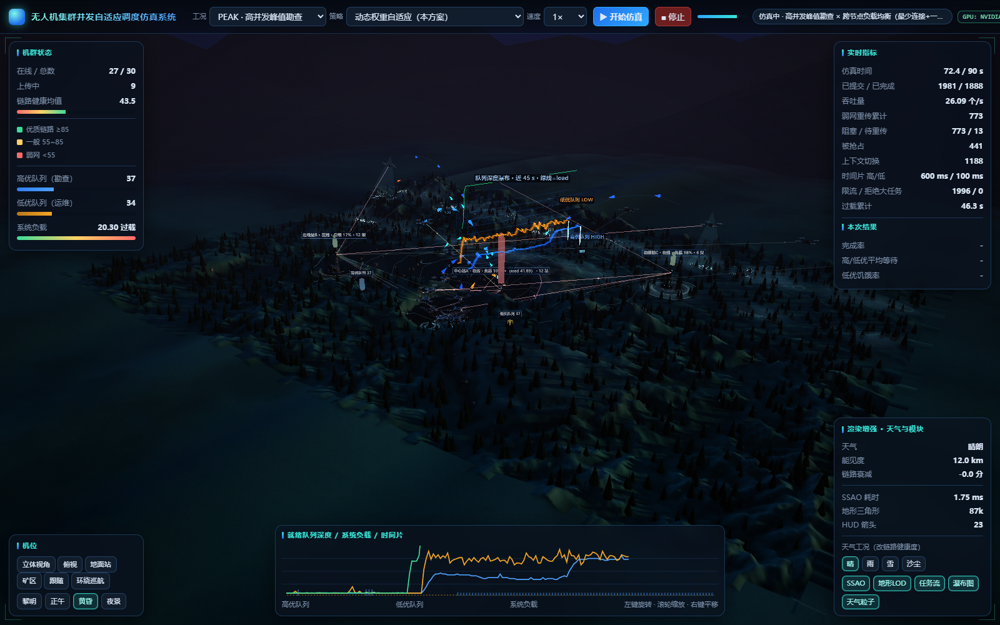
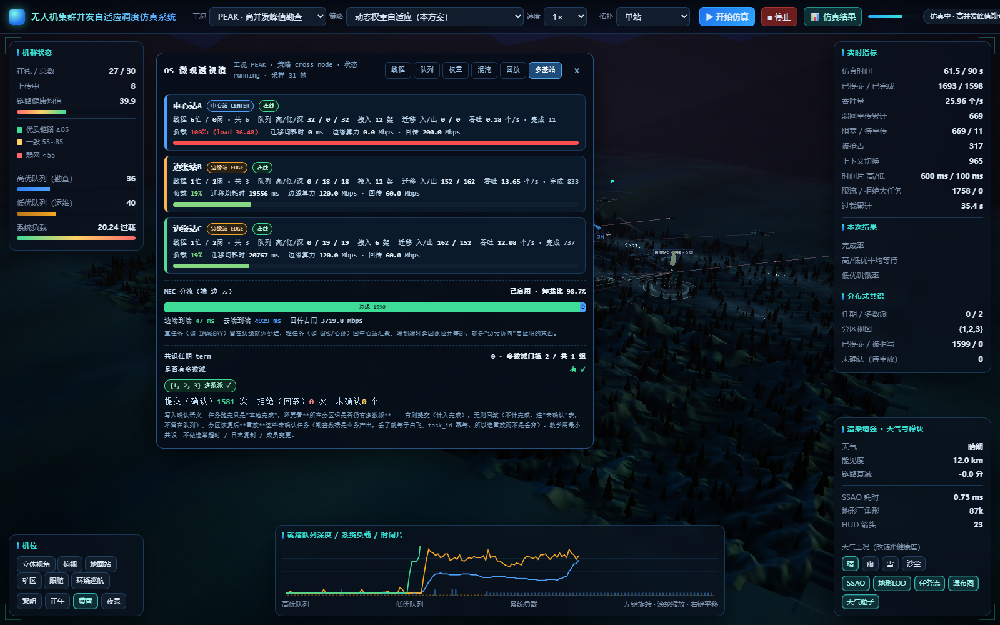
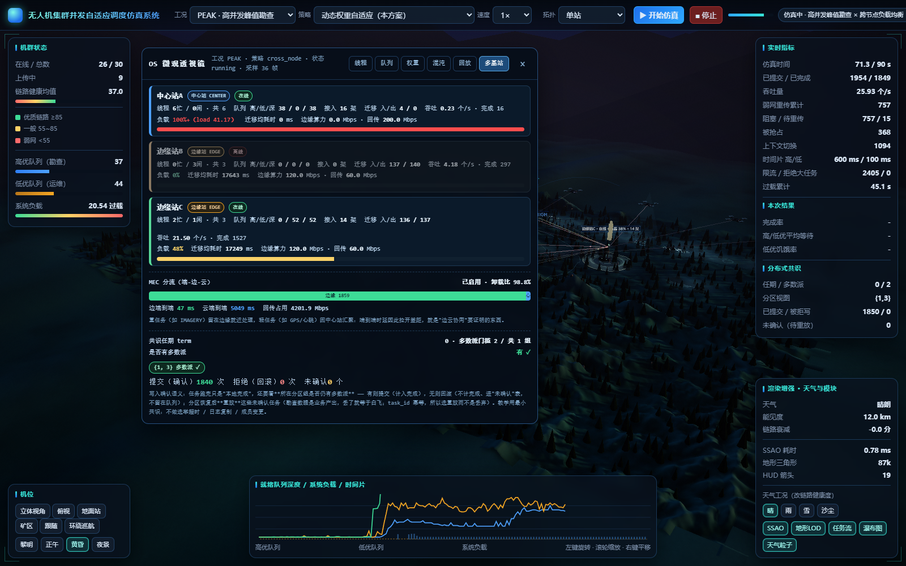
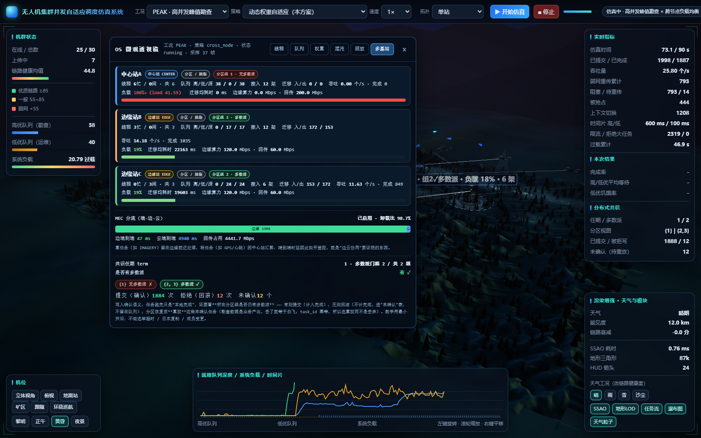
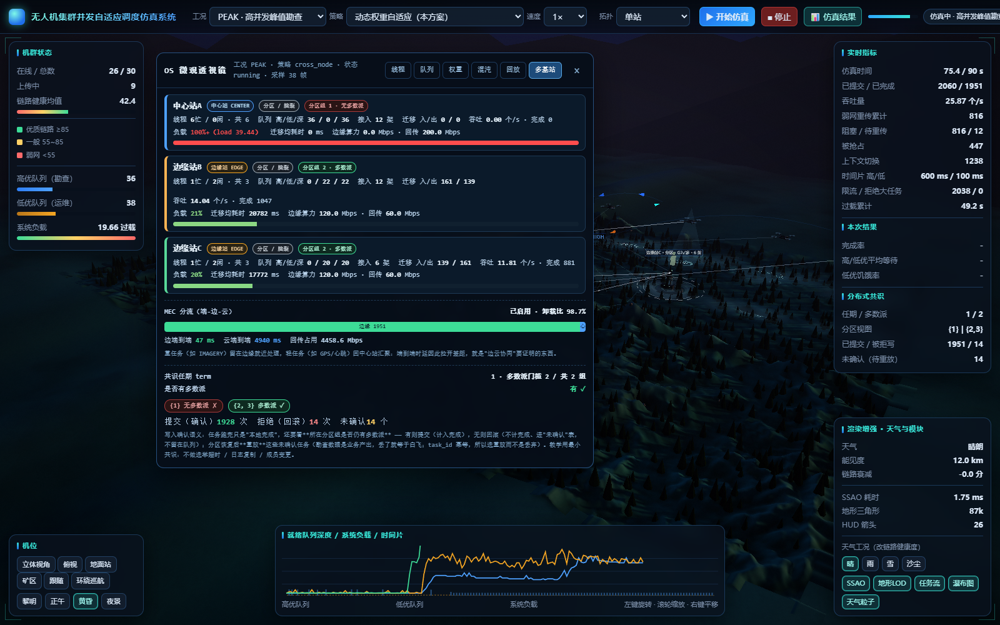

---

## 4.11 多基站能力补完（2026-11 第二轮：把 `docs/11` §8 诚实清单做掉）

> 上一轮（4.10）把系统从"单机内核"演进到"分布式系统"；这一轮把当时如实列出的
> **7 条待办**逐条推进，并明确标注哪些是"部分完成"。完整说明与实测数字见
> [`docs/11-多基站与MEC边缘计算.md`](docs/11-多基站与MEC边缘计算.md) §4.6~§5.4、§8。

### 4.11.1 桌面版 / exe 能直接开多站（体验缺口）

```powershell
& ".\.venv\Scripts\python.exe" app.py --stations triple --mec
& "dist\无人机集群调度仿真系统.exe" --stations triple --mec --browser --port 8795
```

3D 页顶栏还新增了**「拓扑」下拉**（单站 / 3 站·端-边-云）：选完调
`GET /api/topology?stations=...&mec=...`，界面明确提示「**重启仿真后生效**」。
右键"下次生效"而不是立刻热切换：运行中换拓扑会让正在跑的仿真状态错乱，重跑又会丢进度。

### 4.11.2 一致性哈希**再平衡**（增删站只迁约 1/N 的键）

| 场景 | 重映射比例（实测） | 理论 | 单调性 |
|---|---|---|---|
| 加站 3 → 4 | **28.82 %**（1153/4000 key） | 1/(N+1) = 25 % | 变化的 key **全部迁往新站** |
| 删站 3 → 2 | **30.30 %**（1212/4000 key） | 1/N = 33.3 % | 变化的 key **全部来自被删站** |
| 仿真器接入归属（30 架机）加站 | 7/30 | — | 全部落到新站 |

比例写"约 1/N"而不是精确值：64 个虚拟节点在 N=3 时单站占环比例本身有 ±8 pp 固有波动。
**零容差断言只给单调性**（纯逻辑），比例容差取区间（覆盖 >3σ，同时否决"退化成朴素取模的 100 % 重映射"）。

### 4.11.3 分区期间的**最小 quorum 共识**（教学用，不是 Raft）

`term` + 每站投票 + `majority = floor(N/2)+1`（按**总站数**，不随在线数下降）+
写入确认（无多数派侧**回滚**、恢复后**重放**）。N=3 脑裂 `{1} | {2,3}` 实测：

| 步骤 | term | commits | rejects | uncommitted | done |
|---|---|---|---|---|---|
| 1 号站（少数派侧）完成 1 个 | 1 | 0 | **1** | **1** | **0**（回滚） |
| 2/3 号站完成 2 个 | 1 | **2** | 1 | 1 | **2** |
| 恢复后重放并跑完 | 2 | 3 | 1 | 0 | **3**（一个不丢） |

**明确不含** Raft 全量语义：无日志复制、无选举超时/拉票 RPC、无成员变更；`term` 只在
分区注入与恢复时 +1，投票是"新任期全站赞成"的简化。指标新增
`quorum_commits / quorum_rejects / uncommitted_tasks / quorum_term`（`METRIC_SPEC` **24 → 46**）。

> **口径例外**：`quorum_commits` 在**单站/未分区多站**下**等于完成数（不是 0）** ——
> 单站 `majority=1`，每次完成都是一次成功确认。

### 4.11.4 多站 × 多策略完整矩阵 + 站级指标进常规流程

```powershell
& ".\.venv\Scripts\python.exe" run.py stations      # triple × 6 策略 × 3 工况 = 18 组
& ".\.venv\Scripts\python.exe" run.py all --no-db   # 15 组不变 + 3 组伴生探针 + charts/09
```

| 工况 | `dynamic` 不均衡度 | `cross_node` 不均衡度 | 迁移次数 |
|---|---|---|---|
| NORMAL | 0.555 | **0.289** | 240 |
| PEAK | 0.551 | **0.107**（−81 %） | **1261**（平均 551 ms/次） |

**15 组口径没动**：`results/summary.csv` 仍是表头 + 15 行，`charts/01~08` 生成逻辑未改，
站级/MEC 走**独立目录 + 独立图**（`results/stations/`、`results/station_probe/`、`charts/09`、`charts/10`）。

### 4.11.5 重复实验覆盖多站/MEC（给"抖动"一个置信区间）

```powershell
& ".\.venv\Scripts\python.exe" run.py replicate --reps 10 --scenarios PEAK `
    --schedulers dynamic cross_node --variants single,triple,triple_mec --no-db
```

reps=3 实测（18 次仿真）：唯一显著且方向合理的是 **triple 档 cross_node − dynamic 的
站间不均衡度差 −0.407 ± 0.115**；`triple_mec` 档不显著（−0.000 ± 0.002）。
**reps=3 只演示方法可用**（df=2 → t=4.303，个别指标相对半宽 >70 %），下结论请 `--reps ≥ 10`。

### 4.11.6 GPU 分析模型的多站 / MEC 版本

```powershell
.\gpu\build.ps1 -Rebuild
& ".\.venv\Scripts\python.exe" gpu\run_gpu.py --backend cuda --stations 3 --mec --reps 300 --out-dir results\gpu\multi_cuda
& ".\.venv\Scripts\python.exe" gpu\run_gpu.py --backend python --stations 3 --mec --reps 300 --out-dir results\gpu\multi_py
```

Python 参考模型 ↔ CUDA 内核对拍（各 300 reps）：多站/MEC 档偏差 **≤ ±0.5 %**，
`cross_node` 迁移次数 **0.00 %**；默认 `--stations 1` 仍走原内核，与改前 CSV
**100 行 × 13 列 0 处不一致**。分析模型是"同规则不同实现"，**不逐位复刻**参考仿真器。

### 4.11.7 一致性哈希再平衡、分区/脑裂截图与验收

截图 6 张（`docs/images/19~23` + `19-…-分区与多数派`），全部由当前代码产出、
脚本内联断言全 `[OK]`。新增测试 5 个文件共 **32** 条用例；三件套门禁
`ruff` / `pytest`（**83 → 153 passed / 0 failed**）/ `run.py check` 全过。
exe 已重新打包并实跑验证（`--stations triple --mec` → `/api/state` 3 站 + 脑裂拒写可见）。

---

## 4.12 「📊 仿真结果」界面（2026-11 新增：不用再翻文件夹找图）

> 一句话：顶栏「开始仿真 / 停止」右边多了一个按钮，点开就是**实验结果浏览界面** ——
> 图表、15 组矩阵、时序回放、置信区间全在一个页面里，还带**生成时间**防止拿旧图当新结论。

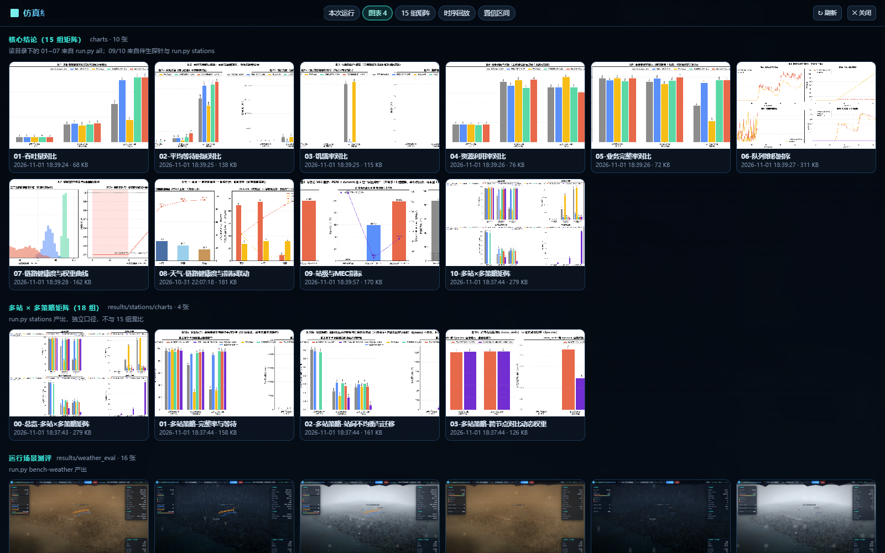
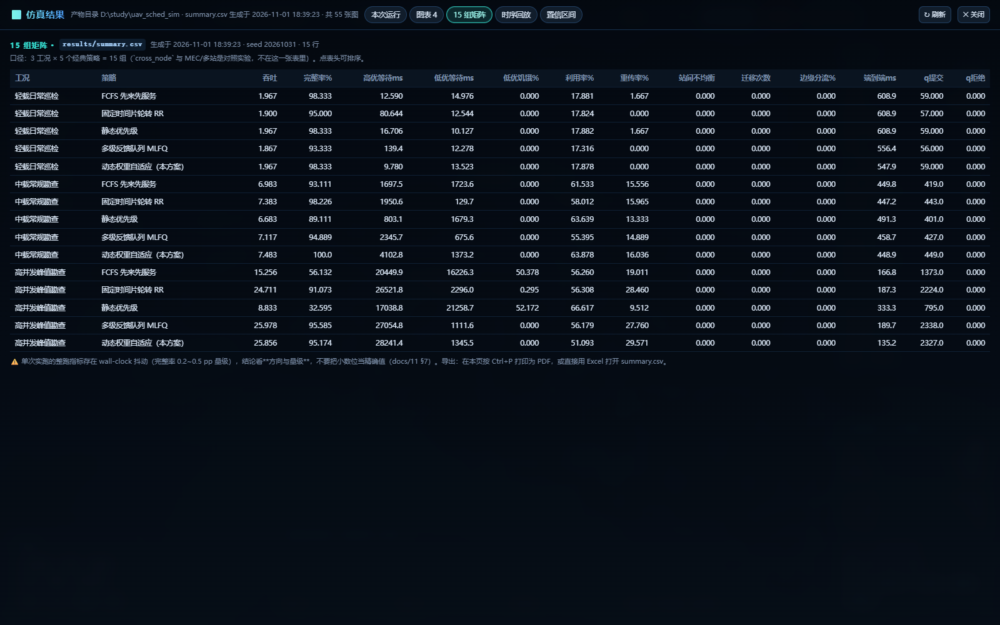
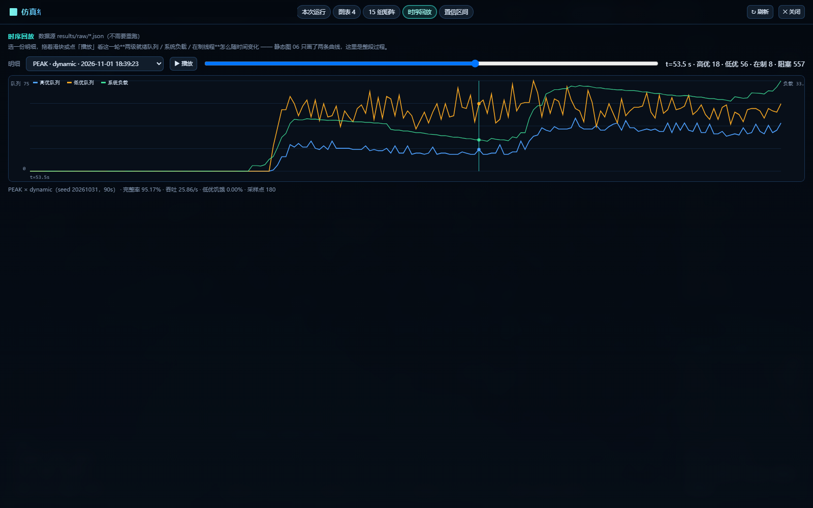

### 4.12.1 五个页签看什么

| 页签 | 看什么 | 数据来自 |
|---|---|---|
| **本次运行** | 14 项 KPI（吞吐/完整率/等待/P95/饥饿/利用率/重传/不均衡/迁移/分流/端到端/quorum）+ 实时进度 + **每站一张表** | 内存态快照（面板这一轮） |
| **图表** | 按目录分组：核心结论 15 组 / 多站矩阵 / 伴生探针 / MEC / 天气 / 场景测评 / GPU / 文档截图；**每张标生成时间 + 大小**，点开灯箱放大（← → / Esc） | `charts/`、`results/*/`、`docs/images/` |
| **15 组矩阵** | 13 个指标列，**点表头排序**，附"单次实跑有抖动"的口径提醒 | `results/summary.csv` |
| **时序回放** | 选一份 `raw/*.json`，拖滑块/播放看**高优队列、低优队列、系统负载**随时间变化 | `results/raw/*.json` |
| **置信区间** | 变体 × 指标 × 策略的 `mean ± ci95_half (n)` | `results/replications/*.csv` |

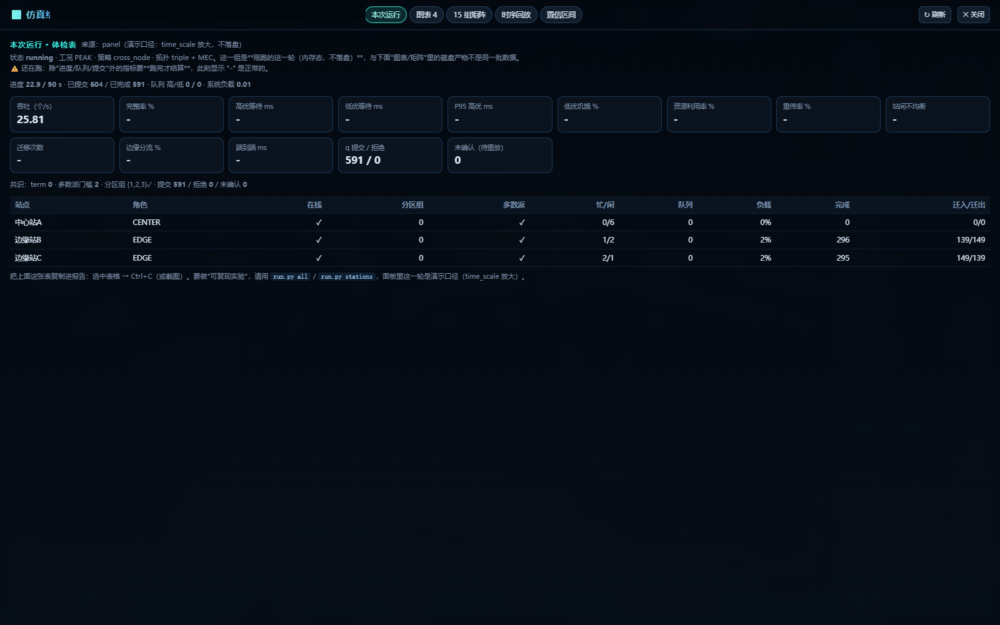
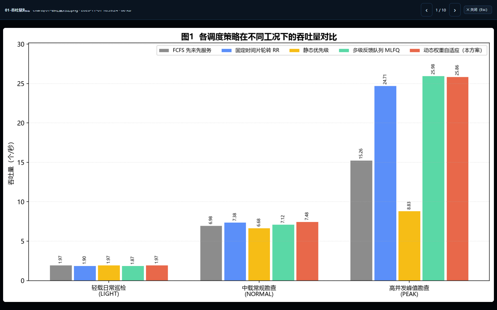
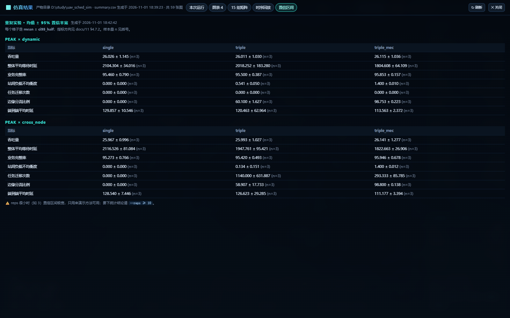

### 4.12.2 怎么用

```powershell
& ".\.venv\Scripts\python.exe" run.py ui        # 或双击 exe
# 跑过实验后（run.py all / stations / mec / replicate 任意一个），
# 点顶栏「📊 仿真结果」；也可以直接按键盘 R 打开，Esc 关闭
```

**产物缺失怎么办**：每个页签都有可执行提示（例如"先在项目根跑 `python run.py all --no-db`"），
不会白屏报错。**exe 里同样可用** —— 它读的是 exe 旁边的 `charts/` 与 `results/`。

### 4.12.3 两个刻意的设计 + 三个顺手修的 bug

1. **遮罩而不是新页面**：演示时要"跑着给它看结果"，新页面会把 3D 仿真停掉；
2. **每张图必须带生成时间**：`charts/` 里的图可能来自上周那次 `all`，不标时间就会"拿旧图当新结论"；
   页面顶部还单独标了 `summary.csv 生成于 …`，并把"本次运行（内存态、不落盘）"与"磁盘产物"显式分开；
3. 🐛 结果界面头部原本用 `class="bar"`，与页面已有的全局 `.bar{height:6px;overflow:hidden}`
   （左侧进度条）**撞名**，标题被压成一条 —— 改名 `.rxbar`，并加 `@media` 让窄窗口（1366/1440）
   依次收起 GPU/quorum 徽章，保证按钮不被挤出屏幕；
4. 🐛 灯箱背景半透明时底层标题会透上来叠字 —— 给灯箱头部加实底色；
5. 🐛 **exe 里结果界面空白**：exe 从 `dist/` 启动，产物却在项目根（`dist/..`），
   而打包内置 `config.yaml` 的 `results_dir: results` 会解析到 `_MEIPASS` 临时目录、
   且 `load_config()` 会顺手把目录建出来 → "目录存在"判据恒真。现在按
   `[UAV_RESULTS_ROOT 环境变量 → exe 目录 → exe 上级 → cwd]` 探测**真有产物**的那一层，
   `_results_dir()` 也改成"有 `summary.csv` 或 `raw/`"才算数。修完 exe 内实测：
   **60 张图 / 15 行矩阵 / 15 份 raw / 42 行 CI** 全部可读（见
   `docs/images/30-仿真结果-exe内实测.png`）。

### 4.12.4 接口与安全

| 接口 | 说明 |
|---|---|
| `GET /api/results` | 一次返回全部**元数据**（图片清单/矩阵/raw 清单/CI/本次运行），图片懒加载 |
| `GET /results_img/<相对路径>` | 读图片；**白名单目录 + 图片扩展名双闸**，`../`、绝对路径、非图片一律 404 |
| `GET /api/raw_series?name=<文件>` | 时序回放数据；文件名禁止 `/`、`\`、`..` |
| `GET /api/run_experiment?kind=…` | 一键重跑（后台子进程）；**kind 白名单**，命令行服务端拼装，`all` 先备份 `summary.csv` |
| `GET /api/run_status` / `/api/stop_experiment` | 进度轮询 / 终止 |
| `GET /api/export_bundle?scope=charts\|all` | 导出报告素材包 zip（含自动生成的 `结论摘要.md`） |

安全考虑：`/results_img` 等于把本地磁盘暴露给浏览器，所以**只认白名单目录**（`charts/`、
`results/*/`、`docs/images/`），失败时**不回显服务器路径**。测试见
[`tests/test_results_api.py`](tests/test_results_api.py)（21 条，含目录穿越的 7 个反例）。

### 4.12.5 三个"能动手"的能力（不用再开终端）

**① 一键重跑**：右上角「↻ 重跑」→ 选四档实验之一 → 跑在**子进程**里（面板与 3D 不受影响），
对话框里实时贴出子进程输出，**跑完自动刷新**结果界面。

| 实验 | 预计 | 会覆盖什么 |
|---|---|---|
| `all` | 100~130 s | `results/summary.csv`（**先备份为 `summary.prev.csv`**）+ `charts/01~07、09` |
| `stations` | 120~150 s | `results/stations/*` + `charts/10`（独立目录，不动 15 组） |
| `mec` | 110~140 s | `results/mec/*` |
| `replicate` | 150~200 s | `results/replications/*`（可设 reps） |

> **exe 里的解释器问题（已修）**：`sys.executable` 在打包后是 **exe 自己**，直接拿它拼命令行
> 会得到 `exe run.py all`，被 exe 的 argparse 拒绝（退出码 2）。现在按
> `UAV_PYTHON` → 项目根 `.venv`/`venv` →（非 frozen 时）`sys.executable` 的顺序找**真正的 Python**；
> 找不到就**不拼命令**，直接给出"请在项目目录执行 `python run.py all --no-db`"的建议。
> 子进程还强制 `PYTHONIOENCODING=utf-8`，避免中文/`✓✗` 乱码。
> 因此：**exe 要和 `.venv` 放在同一层目录**（也就是项目目录）才能一键重跑；单独拷走时它仍是
> 完整的"查看器"，只是重跑按钮会给出明确提示。
>
> 顺带：**"全量 15 组"只刷新 01~07 与 09**；`08` 要 `run.py weather`、`10` 要 `run.py stations`、
> 「运行场景测评」要 `run.py bench-weather` —— 卡片上的时间戳不变是正常的，界面里已写明每张图的产出命令。

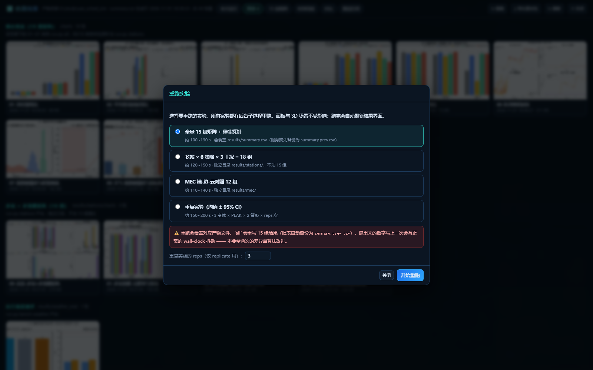
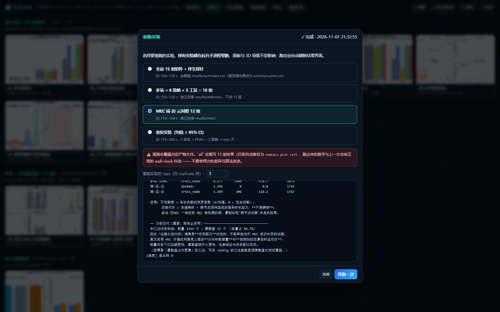
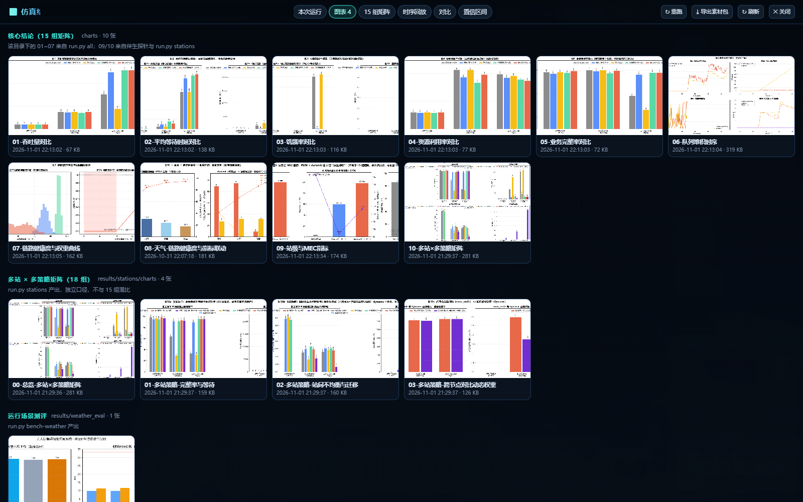

**② 两份明细对比**（页签「对比」）：选两份 `raw/*.json`，得到 12 个指标的并排表
（A / B / 差值 / 相对 % / **变好-变差判定**）+ 两组队列曲线叠加；若两份 seed 不同会**明确警告**
"差值里混着随机性，不能当因果结论"。

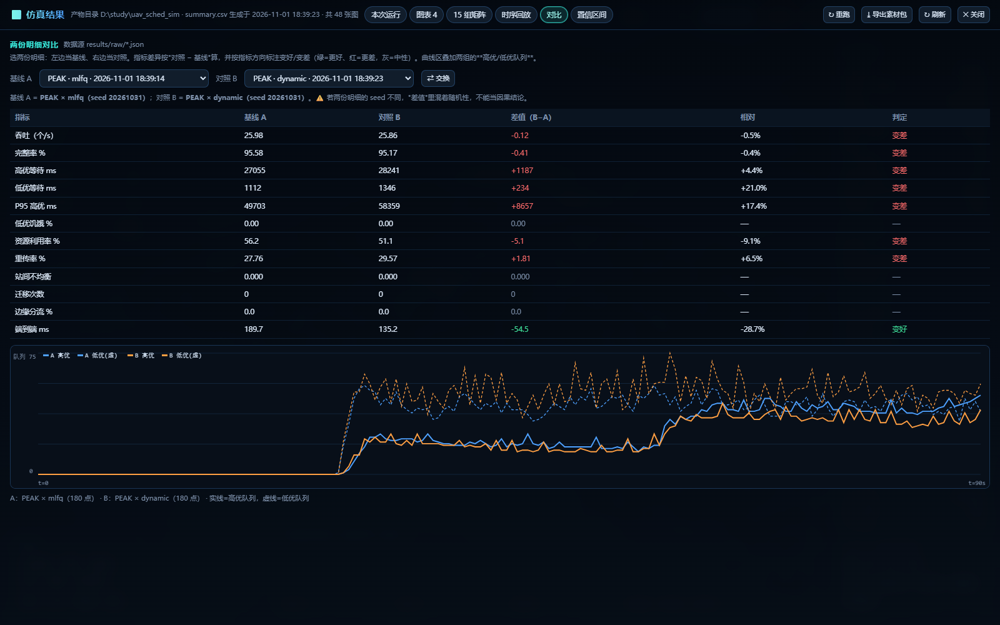

**③ 导出报告素材包**（右上角「⤓ 导出素材包」）：一键 zip = 图表 + 三张结论表 +
**自动生成的 `结论摘要.md`**（Markdown 表，可直接粘进报告）+ `README.txt`（目录说明/口径提醒/文件清单）。
默认 `scope=charts` 实测 **2.0 MB / 18 个条目**，能直接发微信；**刻意不打包 `results/raw`**（15 份 JSON 就 11 MB，
且是中间产物）。

---

## 4.13 真实环境数据（天气线，2026-11 新增）

> 完整口径、快照格式、映射表、证据与诚实边界：**[`docs/12-真实环境数据接入.md`](docs/12-真实环境数据接入.md)**

真实天气走 **采集 → 录制 → 回放**：

```powershell
# 1) 采集一次（Open-Meteo 免费免 key）
& ".\.venv\Scripts\python.exe" tools\fetch_real_env.py `
  --at 2026-11-01T07:00 --force --out data\real\weather_rain.json

# 2) 离线回放（推荐；不改 config.yaml）
& ".\.venv\Scripts\python.exe" run.py ui `
  --real-weather data\real\weather_rain.json
```

默认 `real.enable=false`，因此 15 组矩阵、单站 SHA-256 基线和所有既有实验仍走
内置合成天气。真实模式只作为独立演示面；3D 顶栏与「仿真结果」都会显示
`天气 合成` 或 `天气 真实 · 观测时间`。

本机实测（真实降雨快照）：

| 项 | 数字 |
|---|---|
| 快照 SHA-256 | `642903b7447ea444b76c224ab43b6c431655edff2cf6b11b36a2516b8ba3baa7` |
| 同快照两次回放：天气/链路 SHA | 两次完全相同 |
| 同快照两次 PEAK×dynamic 吞吐 | 25.4889 / 25.5667（相对差 **0.31 %**） |
| 实时采集 vs 快照回放吞吐 | 25.9889 / 25.8000（相对差 **0.73 %**） |
| 既有 PEAK 同代码抖动基线 | ≤1.12 %（docs/11 §7.1） |

边界：本轮只接天气；`ping`/TCP 网络、GPX/tlog 轨迹、CPU/内存动态限流、更大 DEM
均未做。真实快照按**整轮常量**回放，不把小时级气象伪造成秒级动态。

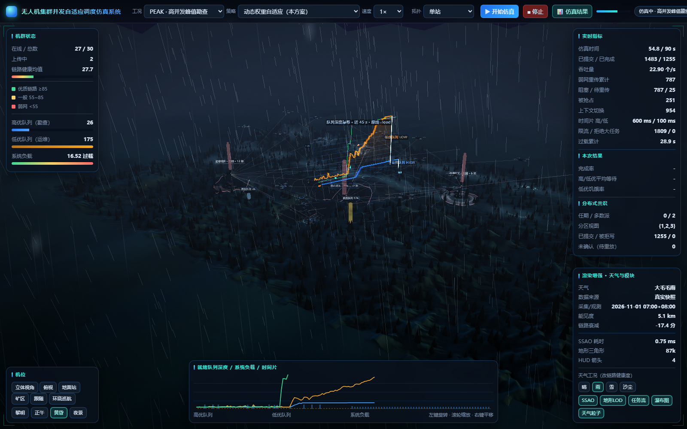
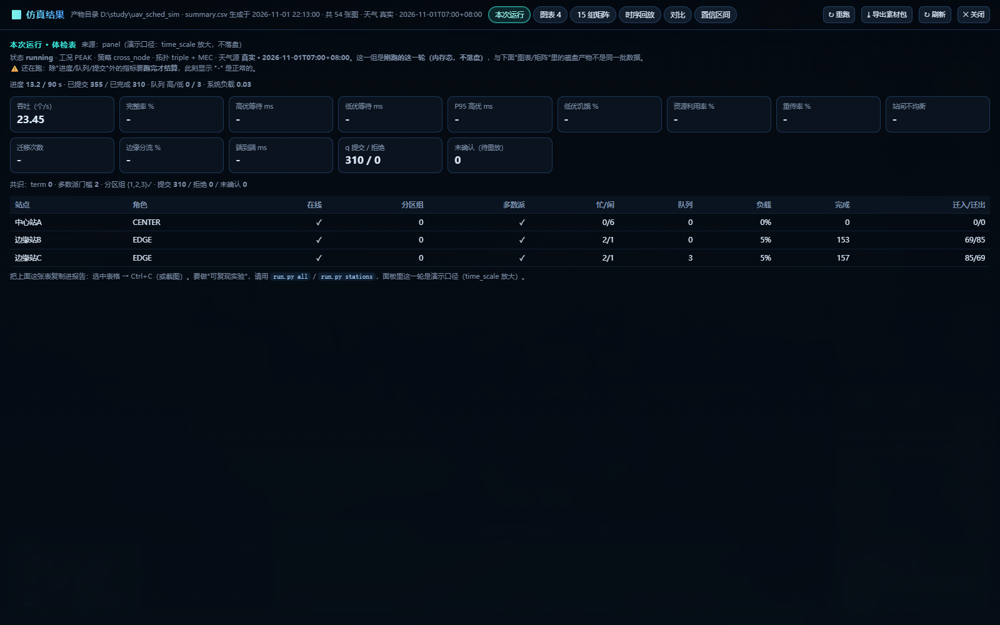

---

## 5. FAQ（12 条）

### 1. 图表里的中文全是方块 / 负号变成小方框

`visualize.setup_chinese_font()` 会按 `Microsoft YaHei → 微软雅黑 → SimHei → 黑体 → 宋体` 顺序探测字体，并设置 `axes.unicode_minus=False`。若仍乱码：

```powershell
& ".\.venv\Scripts\python.exe" run.py check   # 看是否打印 "[WARN] 中文字体配置失败"
```

确认系统装了「微软雅黑」（本机 `C:\Windows\Fonts\msyh.ttc`）。装好后 `run.py charts` 重新出图即可，不必重跑实验。

### 2. MySQL 连不上（实验还能不能跑？）

能。数据库是**增强项**，不是必需品：`db.DBWriter.connect()` 失败只打印中文提示并返回 `False`，`save_run()` 直接跳过，15 组实验照跑、CSV/JSON 照出。急着看结果就加 `--no-db`：

```powershell
& ".\.venv\Scripts\python.exe" run.py all --no-db
```

排查顺序：① `Get-Service *mysql*` 看服务是否在跑；② 口令对不对（`UAV_DB_PASSWORD` 优先于 config.yaml）；③ 端口 3306 是否被占用/拦截；④ `run.py check` 会打印实测的 MySQL 版本与连接耗时。

### 3. `mysql -h127.0.0.1` 报错「无法识别参数」

PowerShell 会把 `-h127.0.0.1` 拆成 `-h` 和 `127.0.0.1` 两个参数。**一律用长选项 + 等号**：

```powershell
mysql --host=127.0.0.1 --port=3306 --user=root -p --database=uav_sched_sim -e "select count(*) from v_exp_summary;"
```

同理 `--user=root`、`--database=uav_sched_sim`。密码用 `-p` 交互输入，别写在命令行里（会进 PowerShell 历史）。

### 4. venv 怎么激活？不激活行不行？

```powershell
& ".\.venv\Scripts\Activate.ps1"     # 激活后可直接写 python run.py ...
```

若报「禁止运行脚本」，先 `Set-ExecutionPolicy -Scope Process -ExecutionPolicy Bypass`。**不激活也完全可行**——本工程所有命令都显式写 `.\.venv\Scripts\python.exe`，这正是文档推荐方式：避免激活错环境后用到别的 Python。

### 5. `pip install` 卡住或超时

用清华源，并显式指定解释器（防止装到系统 Python 上）：

```powershell
& ".\.venv\Scripts\python.exe" -m pip install -r requirements.txt -i https://pypi.tuna.tsinghua.edu.cn/simple
```

包体积最大的是 matplotlib（会带 numpy/pillow/fonttools），约 40 MB，正常 1~2 分钟装完。

### 6. 全量太慢，只想快速验证一遍

改 `config.yaml` 的 `runtime.time_scale`（默认 `0.1`）：改成 `0.02` 后全量约 20 秒。**所有指标都在仿真时间尺度上计算，`time_scale` 只影响跑多快，不影响结论**（可复现性来自固定 seed 的 `WorkloadTrace`）。反之想看得更"真"可以调到 `0.3`，代价是耗时 ×3。

也可以只跑一个工况或一个策略：

```powershell
& ".\.venv\Scripts\python.exe" run.py all --scenarios PEAK --schedulers dynamic priority
```

### 7. 只想跑单个组合，看某一组指标

```powershell
& ".\.venv\Scripts\python.exe" run.py one --scenario PEAK --scheduler dynamic
```

单组不写库时加 `--no-db`；单组也会写 `results/raw/*.json` 与 `results/task_records/*.csv`，但**不会**刷新 `summary.csv`（`summary.csv` 只由 `all` 的 `run_matrix` 导出）。

### 8. 数据库不可用时，程序行为到底是什么？

| 环节 | 行为 |
|---|---|
| `run.py check` | 打印 `[WARN] MySQL 连接失败…`，**不计入** `[PROBLEM]`，退出码仍为 0 |
| `run.py all` / `one` | 首次入库时 `ensure_schema()` 返回 `False`，打印「数据库不可用，后续结果只落本地 CSV/JSON（优雅降级）」，之后不再重试 |
| 结果文件 | `results/summary.csv`、`results/raw/*.json`、`results/task_records/*.csv` 全部照常生成 |
| 出图 | 完全不受影响（图表只读内存里的 `RunResult`） |

### 9. `results/summary.csv` 用 Excel 打开中文乱码

已用 `utf-8-sig` 写入（带 BOM），Excel 双击可正常识别。若你的 Excel 仍乱码，用「数据 → 自文本/CSV → 编码选 UTF-8」导入。

### 10. 为什么正式实验里 `reject_large_count` / `chunk_count` 全是 0？

因为 `server.max_task_memory_mb = 2048`，而三种工况里最大的单个任务只有 2000 MB，**没有任务触发上限**。分片与拒绝能力由 `run.py demo-limiter` 单独验证（那里故意把上限压到 500 MB，1200 MB 的任务被切成 3 片）。这是参数一致性的必然结果，不是功能缺失。

### 11. 为什么 `system_load` 经常 >1，而标定报告说峰值负载率只有 1.2 左右？

两个不同口径，不要混用：

- `load_factor`（标定报告）：**到达率 / 容量**，衡量"长期供需"，PEAK 标定值见 `run.py calibrate`；
- `system_load`（运行期，`Simulator.system_load()`）：**当前积压服务秒 / (工作线程数 × 2 s 视界)**，衡量"瞬时排队压力"，>1 即排不空。

前者是设计参数，后者是调度器每 2 ms 读一次的状态量，动态权重的 `S` 因子与 `overload_seconds` 指标都用后者。

### 12. 测试怎么跑？

三种方式，任选其一（`tests/` 下共 **17** 个测试文件、**153** 个用例，全部通过）：

```powershell
# ① 推荐：pytest（pyproject.toml 里已配好 testpaths/pythonpath，无需设 PYTHONPATH）
& ".\.venv\Scripts\python.exe" -m pytest
& ".\.venv\Scripts\python.exe" -m pytest --cov=src/uav_sim --cov-report=term-missing

# ② 一键脚本（保持原有的中文自检输出风格）
& ".\.venv\Scripts\python.exe" tests\run_all.py

# ③ 逐个脚本直接运行（UTF-8 控制台）
$env:PYTHONIOENCODING = 'utf-8'
& ".\.venv\Scripts\python.exe" tests\test_statistics.py
```

> 测试函数写成 `test_*` + 裸 `assert`，因此 **pytest 可直接收集**，同时保留
> `python tests/xxx.py` 的独立运行能力（教学场景下学生更习惯直接看中文 `[OK]` 输出）。
> 脚本会打印 `✓`、`↔` 等符号，GBK 控制台下若报 `UnicodeEncodeError`，先设
> `$env:PYTHONIOENCODING = 'utf-8'`（脚本内部也已做 `errors="replace"` 兜底）。

`tests/test_statistics.py` 覆盖统计层（t 分位数、95% 置信区间收缩、配对显著性、
CRN 种子清单）；`tests/test_des_model.py` 覆盖 GPU 分析模型的确定性、指标区间
与两条教学结论（含那条对本方案不利的「权重形同虚设」）；`tests/test_end_to_end.py`
校验「同 `(scenario, seed)` 两次 `generate_trace()` 逐元素相同」这条可复现性红线。

多基站相关的测试（本轮为 5 个文件 + 既有 1 个）：

| 文件 | 用例 | 守什么 |
|---|---|---|
| `test_distributed.py` | 21 | 多基站/MEC/跨节点/迁移/混沌/接口契约 + **单站链路 SHA-256 基线** |
| `test_rebalance.py` | 7 | 一致性哈希再平衡的**单调性**（零容差）+ 比例区间 + 热加站不崩 |
| `test_quorum.py` | 6 | 脑裂少数派回滚 / 多数派提交 / 恢复后重放不丢 / 多数派按总站数 / 单站退化 |
| `test_station_matrix.py` | 6 | `run.py stations` 18 组口径 + **summary.csv 仍 15 行** + 默认策略集仍 5 个经典 |
| `test_replication_variants.py` | 4 | 变体重复实验的 cell key / CSV 列 / **配对不跨变体混算** |
| `test_des_multistation.py` | 9 | GPU 模型多站/MEC：单站基线逐位、单站退化、不均衡下降、MEC 分流、口径校准 |

---

## 6. 文档索引
- [`docs/06-PDF要求对照与补充材料.md`](docs/06-PDF要求对照与补充材料.md) —— **PDF 逐条对照 + 8 道开放性问题答案 + 实训日志/小组分工模板 + 数据集合规声明**
- [`docs/diagrams/00-图册索引.html`](docs/diagrams/00-图册索引.html) —— **系统图册入口**：8 张 HTML/SVG 图，含统一导航与打印样式
- [`docs/charts/`](docs/charts/) —— **10 张结果图快照**：吞吐 / 时延 / 饥饿 / 利用率 / 完整率 / 队列 / 链路 / 天气 / 站级 MEC / 多站矩阵
- [`docs/diagrams/01-系统框架图.html`](docs/diagrams/01-系统框架图.html) —— 系统分层架构：现场线程、调度内核、评测存储、3D 监控台
- [`docs/diagrams/02-数据流详细逻辑图.html`](docs/diagrams/02-数据流详细逻辑图.html) —— 任务生成 → 入队 → 调度 → 限流 → 执行 → 重试 → 结算 → 发布
- [`docs/diagrams/03-任务生命周期状态机.html`](docs/diagrams/03-任务生命周期状态机.html) —— READY / RUNNING / BLOCKED / RETRY / CACHED / DONE / FAILED / CANCELLED
- [`docs/diagrams/04-动态权重决策流程图.html`](docs/diagrams/04-动态权重决策流程图.html) —— 饥饿硬补偿、四因子权重、候选比较与回队
- [`docs/diagrams/05-调度执行时序图.html`](docs/diagrams/05-调度执行时序图.html) —— UAV、队列、调度器、限流器、线程池的派发与弱网分支
- [`docs/diagrams/06-多基站部署拓扑图.html`](docs/diagrams/06-多基站部署拓扑图.html) —— 边缘、控制面、数据面与协议端口
- [`docs/diagrams/07-数据库实体关系图.html`](docs/diagrams/07-数据库实体关系图.html) —— `experiment` 聚合根与四类明细表的一对多关系
- [`docs/diagrams/08-实验评测流水线.html`](docs/diagrams/08-实验评测流水线.html) —— 标定、轨迹、运行、采样、指标、持久化、报告

| 文档 | 内容 | 什么时候看 |
|---|---|---|
| [00-接口契约](docs/00-接口契约.md) | 冻结的类/方法签名、时间模型、指标口径、CLI 契约 | 想知道"某个函数签名到底是什么" |
| [01-设计方案说明书](docs/01-设计方案说明书.md) | 四层映射、总体架构、五大模块、动态权重公式与有界性论证、工况标定（含 PDF 参数量级不自洽分析）、三处工程踩坑记录、**15 组真实实验结果**、风险与验收自检 | 写报告、答辩、评审 |
| [02-课程设计报告模板](docs/02-课程设计报告模板.md) | 对齐 PDF §5.3 五维度量规的章节骨架、每章字数建议、第 7 章现成表格、常见扣分点自查 | 开始写课程设计报告 |
| [03-实验指导书（对照增强版）](docs/03-实验指导书（对照增强版）.md) | 实验 0（环境自检）+ 实验 3.1~3.4，每个实验：三层目标、任务、**对接的真实文件与函数**、可复制命令、带分值验收表、思考题 | 上机做实验 |
| [04-四层映射对照表](docs/04-四层映射对照表.md) | ≥15 行「业务现象→OS 原理→算法设计→代码实现→可观测证据」大表 + 答辩口径一句话版 | 答辩前 10 分钟速记 |
| [05-数据库设计说明](docs/05-数据库设计说明.md) | 库/表/字段/类型/索引/约束/命名规范、ER 图、12 条常用查询（含透视表/饥饿明细/队列时序）、数据字典 | 查数据、写 SQL、演示 IDEA 连库 |
| [09-运行场景测评报告](docs/09-运行场景测评报告.md) | **晴/雨/雪/沙尘四场景的稳定性与效率测评**：方法、帧率/P95/P99/最坏帧、9 倍像素压力测试、画面改进说明、复现命令 | 答辩讲"系统稳定高效运行"、交给老师 |
| [10-OS微观透视与混沌工程](docs/10-OS微观透视与混沌工程.md) | **线程五态透视 / 队列传送带 / 权重天平 / 混沌注入 / 死锁看门狗 / Trace 与回放**：数据字段、实现原理、实测数据、复现命令 | 讲"OS 底层原理穿透力"、演示混沌工程 |
| [11-多基站与MEC边缘计算](docs/11-多基站与MEC边缘计算.md) | **改造建议第五章**：多基站数据模型（接入站 vs 算力站）、`cross_node` 策略（最少连接+一致性哈希+带代价迁移）、MEC 端-边-云分级与卸载分水岭、节点宕机/分区/脑裂混沌、**"未污染既有结论"的 SHA-256 + 抖动基线对拍方法** | 讲"从单机内核到分布式系统"、演示多基站与 MEC |
| [12-真实环境数据接入](docs/12-真实环境数据接入.md) | **真实天气线**：Open-Meteo 采集、JSON 快照、WMO 映射、断网/坏快照降级、同快照 SHA-256 回放、实时 vs 快照抖动对比、界面来源徽章 | 讲"真实数据如何不破坏可复现性" |

---

## 7. 许可与合规

- 全部工况参数来自公开遥感数据集量级与行业公开实测参数，不含企业涉密数据；
- 仿真是**教学原型**，不用于生产调度决策；
- 数据库口令不入库、不入文档，请只放在 `config.yaml`（本地）或 `UAV_DB_PASSWORD`（环境变量）。
