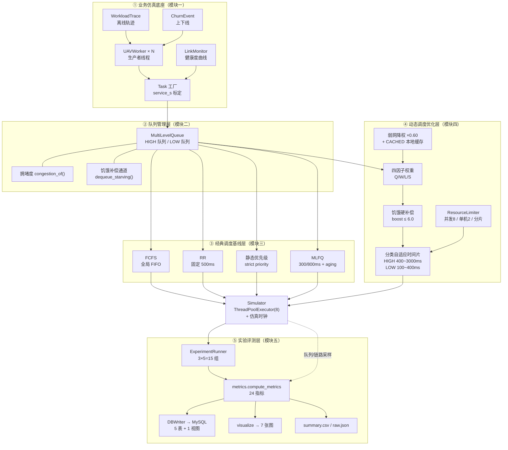
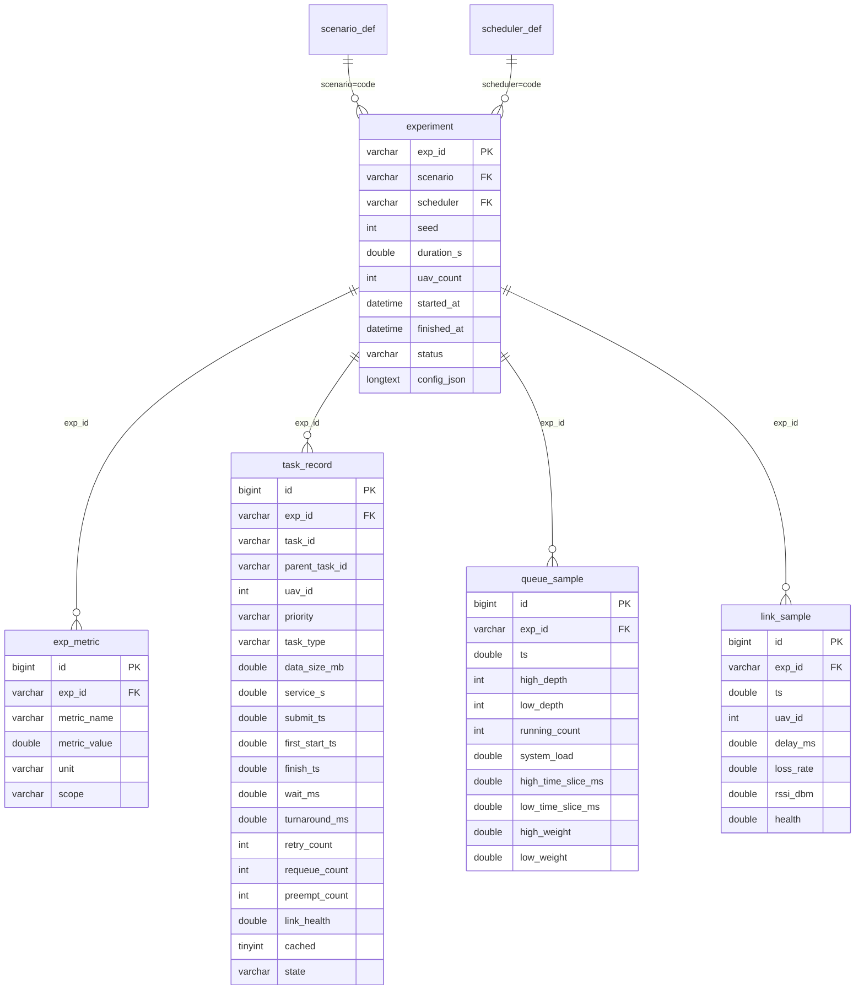

# 01 · 设计方案说明书

**面向智慧地质勘查的无人机集群并发自适应负载均衡调度仿真系统**

> 一句话定位：把企业「30 机集群上传拥堵 / 异构任务抢占 / 峰值过载 / 运维任务饥饿 / 野外弱网失衡」五类业务故障，**下沉**为操作系统的线程调度、多级就绪队列、动态优先级、资源配额与并发限流问题，用纯 Python 多线程实现**可复现、可对照、可量化**的仿真系统，并用 15 组对照实验回答"优化到底改善了什么、代价是什么"。

---

> ⚠️ **阅读提示（v1.1）**：本文档正文与实验章节在参数冻结前后有多轮修订。**最终权威的实验数据与结论见文末
> [附录 A：最终实验结果（v1.1 权威数据快照）](#附录-c最终实验结果v11-权威数据快照)**；
> 正文与附录 A 冲突处，一律以附录 A 为准。
> 工程实现相对 v1.0 设计意图的完整修订清单见 [`docs/00-接口契约.md`](00-接口契约.md) 的「v1.1 变更记录」。

## 1. 文档信息与版本、目录

### 1.1 文档信息

| 项 | 内容 |
|---|---|
| 文档名称 | 01-设计方案说明书 |
| 工程根目录 | `D:\study\uav_sched_sim` |
| 对应课程 | 《操作系统》课程实训（进程/线程调度与并发控制） |
| 对应案例 | 面向智慧地质勘查的无人机集群并发自适应负载均衡调度仿真系统 |
| 事实来源 | `docs/00-接口契约.md`（冻结签名）、`config.yaml`（全部真实参数）、`src/uav_sim/**`（真实类与方法）、`sql/01_schema.sql`（真实表结构）、`results/summary.csv`（真实实验数据） |
| 解释器 | `D:\study\uav_sched_sim\.venv\Scripts\python.exe`（Python 3.11.0） |
| 数据库 | MySQL 8.0.45 Community @ `127.0.0.1:3306`，库 `uav_sched_sim` |

### 1.2 版本历史

| 版本 | 日期 | 变更内容 | 数据快照 |
|---|---|---|---|
| v1.0 | 2026-10-31 | 初版：四层映射、架构、五大模块、动态权重公式与有界性论证、工况标定、真实 15 组实验 | `PEAK-dynamic-20261031-20261031172506` 等（`survey_gap_k=37`、时间片方向相反的旧参数批次） |
| **v1.1（本版）** | 2026-10-31 | 按定稿代码重写：自适应时间片改为"**按任务类别 + 拥堵收缩**"、弱网降权倍率 0.30→0.60、抢占归位区分 `front/tail`、补充参数敏感性实验与指标口径批判；实验数据全部换为定稿批次 | **`LIGHT-fcfs-20261031-20261031173828` ~ `PEAK-dynamic-20261031-20261031173959`（本版引用批次）** |

> **数据批次说明（重要）**：本版 §16 的所有数字来自 2026-10-31 17:38:28–17:39:59 跑出的**定稿批次**（seed=20261031，15 组，`results/summary.csv` 15 行，MySQL `experiment` 表 15 行）。开发期曾用旧参数跑过一版，那版数据**不进入本报告**；两版的差异本身作为"参数标定记录"写进 §10。

### 1.3 目录

- [1. 文档信息与版本、目录](#1-文档信息与版本目录)
- [2. 项目背景与业务痛点](#2-项目背景与业务痛点)
- [3. 四层映射总表](#3-四层映射总表)
- [4. 系统总体架构](#4-系统总体架构)
- [5. 五大模块详细设计](#5-五大模块详细设计)
- [6. 动态权重调度算法](#6-动态权重调度算法)
- [7. 资源限流与过载稳流](#7-资源限流与过载稳流)
- [8. 链路状态感知](#8-链路状态感知)
- [9. 工况标定模型](#9-工况标定模型)
- [10. 标定过程中踩过的坑（工程设计记录）](#10-标定过程中踩过的坑工程设计记录)
- [11. 可复现性设计](#11-可复现性设计)
- [12. 数据库设计摘要](#12-数据库设计摘要)
- [13. 接口清单](#13-接口清单)
- [14. 目录结构](#14-目录结构)
- [15. 部署与运行步骤](#15-部署与运行步骤)
- [16. 实验方案与真实结果](#16-实验方案与真实结果)
- [17. 开发进度计划](#17-开发进度计划)
- [18. 风险与对策](#18-风险与对策)
- [19. 交付物清单与验收自检](#19-交付物清单与验收自检)

---

## 2. 项目背景与业务痛点

### 2.1 业务场景

某智慧地质勘查企业承接西部复杂矿区大面积矿产普查：矿区以高山峡谷为主，山体遮挡严重、电磁环境复杂。作业方案为 **30 台无人机集群同步野外作业**，每台并行执行两类性质差异巨大的任务：

- **高负载核心勘查任务**：高清影像采集（`IMAGERY`）、多光谱遥感（`MULTISPECTRAL`）、LiDAR 点云扫描（`LIDAR`）—— 单次数据量 100~2000 MB、CPU 与 IO 消耗高、单次耗时长，是找矿的核心业务；
- **高频轻量运维任务**：GPS 定位（`GPS`）、姿态回传（`ATTITUDE`）、心跳日志（`HEARTBEAT`）、故障告警（`ALARM`）—— 单次 0.5~5 MB，但频次高，一旦长期得不到处理，地面运维系统就**失去对无人机的状态感知**。

所有数据经统一上传链路回传地面站后台解析入库；受地形遮挡与工程机械电磁干扰，链路存在时延抖动、随机丢包与质量动态变化；多机同步作业时还会产生**秒级瞬时大流量冲击**。企业现有系统沿用"固定时间片 + 静态优先级"，参数全部人工预设、运行中不随工况调整 —— 小规模巡检可用，直接迁移到 30 机集群即暴露系统性故障。

### 2.2 五类生产级痛点（对应 PDF 原文）

| # | 痛点（业务现象） | 现场表现 | 业务后果 | 本项目对应章节 |
|---|---|---|---|---|
| ① | **多机集群数据上传拥堵** | 30 机同时上传，通道被打满，任务在队列里排队 | 勘查数据回传延迟、作业节奏被打断 | §4 架构、§7 限流、§16 PEAK |
| ② | **异构任务资源抢占** | 大流量影像/LiDAR 任务长期独占线程与 IO，小包运维任务排队 | 任务等待时间差异达数量级 | §5 模块二、§6 权重 |
| ③ | **高并发过载宕机** | 瞬时峰值把 CPU/IO 打满，队列大量堆积，服务阻塞 | 勘查作业被迫中断 | §7 过载稳流 |
| ④ | **低优先级任务饥饿** | GPS/心跳/告警长期得不到调度 | 设备状态失联，存在失控风险 | §6.6 饥饿补偿 |
| ⑤ | **野外弱网调度失衡** | 弱网任务反复重传、持续占用资源；优质链路反而闲置 | 核心数据卡顿、断连、部分影像/点云丢失 | §8 链路感知 |

> 这五条不是并列的"现象清单"，而是**同一条因果链上的五个环节**：①③ 是"入口流量 vs 系统容量"的失衡，②④ 是"资源分配规则"的失衡，⑤ 是"设备状态未被纳入调度决策"的失衡。这也决定了后面方案的三个抓手：**限流稳流（治①③）+ 权重与补偿（治②④）+ 链路感知（治⑤）**。

### 2.3 为什么必须"下沉"到 OS 原理层

企业侧的三种可选方案（PDF 原文）：A 硬件扩容（成本高、不治本）、B 商用调度中间件（重、改造大）、C 基于 OS 原理自研轻量级动态调度（本项目选型）。选 C 的核心理由不是"省钱"，而是**故障的根因就在调度规则里**：

| 业务现象 | 若只在应用层打补丁 | 下沉到 OS 原理层后的本质 |
|---|---|---|
| 上传拥堵 | 加带宽、加重试 | 多生产者并发写入共享就绪队列，队列长度超过处理能力 → 需要**队列隔离 + 背压 + 限流** |
| 运维饥饿 | 把运维任务优先级调高 | 静态优先级在"高优到达率 ≥ 服务率"时必然饿死低优 → 需要**aging / 动态优先级 / 硬补偿通道** |
| 峰值过载 | 扩容服务器 | 并发许可数 > 承载能力即雪崩 → 需要**信号量许可 + 非阻塞准入 + 错峰** |
| 弱网失衡 | 加大重传次数 | 慢设备长期占用 CPU（I/O 阻塞未降级）→ 需要**设备状态感知 + 降权 + 本地缓存** |

---

## 3. 四层映射总表

> 每一行都能落到**真实文件与类名**；"证据"列给出可当场打开的指标、数据表或图表。完整 20 行版本见 [04-四层映射对照表](04-四层映射对照表.md)。

| # | 企业业务层（现象/痛点） | OS 原理层（本质） | 算法设计层（对策） | 代码实现层（文件 : 类 . 方法） | 可观测证据 |
|---|---|---|---|---|---|
| 1 | 30 机同时上传，通道拥堵（痛点①） | 多生产者并发入队 → 就绪队列溢出 / 背压 | 双队列隔离 + 容量上限 + 拥堵度量化 | `queue_manager.py : MultiLevelQueue.enqueue()` / `.congestion_of()` | `queue_sample.high_depth/low_depth`；`peak_queue_depth`；`charts/06` |
| 2 | 一次"上传一份数据" | CPU-IO 混合任务 / TCB | Task 七态状态机 + 服务时长按带宽标定 | `models.py : Task`；`simulator.py : Simulator.make_task()` / `.compute_service_s()` | `task_record`（`service_s` / `wait_ms` / `state`） |
| 3 | 无人机上线 / 返航下线 | 线程创建与销毁（生产者生命周期） | 生产者线程按预生成时刻表醒来；上下线走独立 churn 流 | `simulator.py : UAVWorker.run()`；`Simulator._process_churn()` | PEAK 轨迹 156 条 churn；`task_record.uav_id` 覆盖 1~30 |
| 4 | 运维任务长期传不上去、设备失联（痛点④） | 任务饥饿：低优先级长期得不到 CPU | 饥饿检测 + **硬补偿通道** + 权重倍增（有上界） | `queue_manager.py : dequeue_starving()`；`scheduler/dynamic.py : step()` ① | `starvation_rate_low`（PEAK：静态优先级 65.7% vs 动态 0%）；`charts/03` |
| 5 | 2 GB 点云排到队首，后面 0.6 MB 告警被堵（痛点②） | 非抢占调度的队头阻塞 / 护航效应 | 时间片抢占 + **按任务类别差异化时间片** + 抢占后回队首 | `scheduler/base.py : _do_dispatch(..., slice_ms=)`；`Simulator._run_task()`；`dynamic._slice_for()` | `context_switch`、`avg_requeue`、`p95_wait_high_ms`；`task_record.preempt_count` |
| 6 | 峰值把服务器打满、服务阻塞（痛点③） | 资源耗尽 + 缺并发限流 | 并发上限（许可数）+ **非阻塞准入** + 错峰 | `resource_limiter.py : try_admit()`；`base.py : _admit()` / `push_front()` | `throttle_count`（PEAK 2000+ 次）、`running_count ≤ 8`、`overload_seconds` |
| 7 | 单机霸占全部通道 | 单进程资源配额（rlimit / cgroup） | 单机并发配额 `per_uav_quota=2` | `resource_limiter.py : try_admit()` ③ / `._per_uav` | `quota_blocked`；`per_uav_running` |
| 8 | 1.2 GB 点云超出单机上限 | 大段内存请求 → 分页/分段 | 超限拒绝计数 + 切片重传（业务不丢） | `resource_limiter.py : split_task()`；`base.py : _split_and_enqueue()` | `reject_large_count` / `chunk_count`；`run.py demo-limiter` |
| 9 | 时延抖动、丢包、信号衰减（痛点⑤） | I/O 设备状态 / 阻塞率 | delay/loss/rssi 综合成 0~100 健康度；健康度折算有效带宽与失败概率 | `link_monitor.py : LinkState.health_score()` / `LinkMonitor.health_at()`；`simulator.py : compute_service_s()` / `_failure_probability()` | `link_sample`（PEAK 均值 42.6、最小 15.4、<40 占 44%）；`retry_rate` |
| 10 | 弱网任务反复重传、优质链路闲置（痛点⑤） | 慢设备拖住 CPU | γ·L 正向激励 + 健康度 < 40 时权重 ×0.60 + 失败转 `CACHED` 退避 | `dynamic.py : _weight()` 弱网分支；`simulator.py : _on_upload_failed()` | `task_record.cached=1`（PEAK-dynamic 406 条）、`retry_count`；`charts/07` |
| 11 | 现有系统优先级写死 | 静态优先级（strict priority） | 刻意保留为对照组（复现饥饿） | `scheduler/priority.py : PriorityScheduler.step()` | PEAK `starvation_rate_low` 65.7%、`completion_rate` 32.57%（最低） |
| 12 | "谁先到谁先传" | FCFS + 护航效应 | 跨两队列的**全局 FIFO** 基线 | `base.py : _take_global_fifo()`；`scheduler/fcfs.py : step()` | PEAK 饥饿率 66.2%、完整率 55.84%；`charts/02` |
| 13 | 固定时长轮流上传 | RR + 上下文切换开销 | 固定时间片 500 ms，未完成回队尾 | `scheduler/rr.py : step()`（`slice_ms=time_slice_ms`） | PEAK `context_switch` 1600 次、`avg_requeue` 0.291 |
| 14 | 给被挡住的小任务一条制度化上升通道 | MLFQ + aging 老化提权 | 分层时间片 300/800 ms + aging 1500 ms 升权 | `scheduler/mlfq.py : step()` / `.promotions` | PEAK 饥饿率 0，但 `context_switch` 2135（最高）、高优完成率 22.1%（最低） |
| 15 | 调度参数人工预设、跟不上工况 | 动态优先级 / 自适应调度 | 四因子权重 + 饥饿硬补偿 + 分类自适应时间片 | `dynamic.py : _weight()` / `_slice_for()` / `step()` | `queue_sample.high_weight/low_weight` 随时间变化（静态策略恒 1.0） |
| 16 | 队列堆了上百个仍平均分资源 | 多级队列资源倾斜 | 拥堵度**按优先级分别算**，基准 = 4 × 工作线程数 = 32 | `queue_manager.py : congestion_of()`；`dynamic._weight()` ① | `queue_sample` 中权重与队列深度同向；用容量 5000 归一化则 Q 恒 ≈0.05~0.1（§10.3） |
| 17 | 过载还全速接单 | 流量削峰 / 过载收敛 | `(1−δS)` 压缩权重 + 入口限流 | `simulator.py : system_load()`；`dynamic._weight()` S 因子 | `overload_seconds`（PEAK 约 64 s / 90 s）、`charts/06` 图 6d |
| 18 | 故障要能复盘 | 内核审计与性能采样 | 指标长表 + 任务明细 + 队列/链路时序，全部挂 `exp_id` | `db.py : DBWriter.save_run()`；`experiment.py : ExperimentRunner.run_one()` | 15 / 360 / 14776 / 1800 / 16604 行（§12） |
| 19 | 实验必须可复现 | 控制变量法 | 任务到达与链路质量**离线预生成**，5 策略只做回放 | `scenarios.py : generate_trace()`；`link_monitor.py : _build_series()` | 同 `(PEAK, 20261031)` 两次生成 2767 条事件逐元素相同（实测） |
| 20 | 工况参数拍脑袋 | 容量规划（λ/μ） | 五式标定模型反解 `survey_gap_k` | `scenarios.py : calibrate()` / `system_capacity_mbps()` | `run.py calibrate` 三工况表；`scenario_def` 表 |

---

## 4. 系统总体架构

### 4.1 分层架构图



### 4.2 组件职责表

| 层 | 组件（真实类/文件） | 职责 | 不负责什么 |
|---|---|---|---|
| ① 业务仿真 | `simulator.UAVWorker` | 一台无人机 = 一个生产者线程，按轨迹时刻醒来提交任务，响应 `stop_event` 退出 | 不做调度决策、不判限流 |
| ① 业务仿真 | `scenarios.generate_trace()` | 离线生成确定性到达轨迹 + 上下线事件 | 不涉及运行期随机 |
| ① 业务仿真 | `link_monitor.LinkMonitor` | 预生成每机健康度曲线并提供 `health_at()` 纯函数查询 | 不做降权决策（那是调度器的事） |
| ② 队列管理 | `queue_manager.MultiLevelQueue` | 双队列入队/出队、等待记账与回滚、拥堵度、饥饿扫描 | 不决定"取哪个"（策略决定） |
| ③ 基线 | `scheduler.{fcfs,rr,priority,mlfq}` | 四种经典策略的 `step()`，构成对照组 | 不感知链路（`link_aware=False`） |
| ④ 优化 | `scheduler.dynamic.DynamicWeightScheduler` | 权重计算、饥饿硬通道、分类时间片、弱网降权 | 不直接执行任务（交给 Simulator） |
| ④ 优化 | `resource_limiter.ResourceLimiter` | 并发/单任务/单机配额判定，分片，统计 | 不属于任何策略（系统级，对所有策略一致） |
| 内核 | `simulator.Simulator` | 仿真时钟、线程池、派发、弱网失败与重传、采样、过载统计 | 不实现具体调度规则 |
| ⑤ 评测 | `experiment.ExperimentRunner` | 装配一次实验：轨迹 → 仿真 → 指标 → 落盘/入库 | 不定义指标口径（在 metrics） |
| ⑤ 评测 | `metrics.compute_metrics()` | 24 个指标的**唯一口径** | 不做可视化 |
| ⑤ 评测 | `db.DBWriter` | 单事务批量入库，失败回滚 + 优雅降级 | 不参与仿真 |
| ⑤ 评测 | `visualize.plot_all()` | 7 张图（5 张对比 + 2 张机理） | 不读数据库（只读内存结果） |

### 4.3 数据流（一次 `run.py one` 的完整链路）

```text
seed ──► generate_trace(scenario, seed)
            │  TraceEvent* + ChurnEvent*
            ▼
        Simulator(scenario, trace, cfg, scheduler_name, seed)
            │  创建 MultiLevelQueue / ResourceLimiter / LinkMonitor
            ▼
        run(scheduler)
            │ ① 启动 N 个 UAVWorker（N = uav_count）
            │ ② 主循环（真实 tick 2ms）：
            │      now = (perf_counter - t0) / time_scale
            │      _process_churn → _flush_retries → link_monitor.tick
            │      scheduler.step()  ← 唯一的调度决策点（绝不 sleep）
            │      累计 overload_seconds；每 0.5 仿真秒采样 QueueSnapshot
            │ ③ 工作线程：sleep(exec_s × time_scale) → 完成 / 弱网失败 / 时间片耗尽
            ▼
        raw = {tasks, queue_samples, link_samples, limiter_status, ...}
            ▼
        compute_metrics(...)  ──► 24 个指标（键全部来自 METRIC_SPEC）
            ▼
        RunResult ──┬─► results/raw/<exp_id>.json
                    ├─► results/task_records/<exp_id>.csv
                    ├─► MySQL: experiment / exp_metric / task_record / queue_sample / link_sample
                    └─► 内存 ──► plot_all() ──► charts/*.png
```

---

## 5. 五大模块详细设计

> 学时口径来自 PDF 表 1：模块一 2 + 模块二 2 + 模块四 3 + 模块五 1 = **8 学时**（模块三"经典调度基线"融入模块二/四的学时）。

### 5.1 模块一：多无人机集群并发业务仿真（2 学时）

| 层 | 开发目标（一句） |
|---|---|
| 企业业务层 | 复现 30 机集群野外作业：勘查/运维两类异构任务、设备随机上下线、野外弱网扰动 |
| OS 原理层 | 无人机 = 生产者线程；任务 = CPU-IO 混合任务（TCB）；上下线 = 线程创建/销毁；弱网 = 线程阻塞与时延抖动 |
| 算法设计层 | 确定性轨迹生成（同 seed 同轨迹）、服务时长按带宽标定、生产者按事件时刻唤醒 |
| 代码实现层 | `threading.Thread` + `Event.wait` + `ThreadPoolExecutor`，无 asyncio、无第三方并发框架 |

**核心内容**：批量创建生产者线程；两类任务生成逻辑；弱网随机阻塞；统一日志与统计接口。

**关键类与方法**

| 类 / 方法 | 作用 |
|---|---|
| `simulator.UAVWorker.__init__/run()` | 单机生产者线程；`stop_event.wait(wait_real)` 保证仿真结束能立刻退出（不用 `time.sleep`，否则线程要睡满才醒） |
| `simulator.Simulator.make_task()` | **唯一**的任务工厂（绕过它会导致服务时长与容量模型不一致） |
| `Simulator.compute_service_s()` | `data_size_mb / (150 × link_factor)` |
| `Simulator._process_churn()` | 按 `ChurnEvent` 切换 `_uav_online`，并 `register/unregister` 链路 |
| `scenarios.generate_trace()` | 单 `random.Random(seed)` 顺序消费，保证跨平台可复现 |

**实现要点**

1. **时间模型**：`now() = (perf_counter() − t0) / time_scale`，所有 `*_ts` 都是仿真秒；`time.sleep(service_s × time_scale)` 释放 GIL，8 个工作线程是**真并发**。
2. **确定性**：任务到达与链路质量都在 `run()` 之前生成完毕，运行期不再掷骰子。
3. **线程安全**：`Simulator._lock`（RLock）保护 `_tasks/_by_id/_running`；锁顺序固定 `Simulator._lock → queue._lock / limiter._lock`。

**验收标准**

| 验收项 | 标准 | 证据 |
|---|---|---|
| 线程创建/销毁 | 30 个生产者线程全部启动并正常退出 | PEAK 轨迹 156 条 churn；`logs` 中 `trace_events=2767 churn=156` |
| 任务生成 | 两类任务按轨迹生成，数据量落在区间内 | `run.py calibrate` 任务数 60/490/2767；`task_record.data_size_mb` 区间内 |
| 弱网扰动 | 健康度曲线随档位递进，失败率随之上升 | `link_sample`：LIGHT 均值 89.9 / NORMAL 71.7 / PEAK 42.6 |
| 统计输出 | 提交/完成/未完成三者守恒 | `raw/*.json` 的 `submitted/done/still_in_queue` |

### 5.2 模块二：多级任务队列管理（2 学时）

| 层 | 开发目标（一句） |
|---|---|
| 企业业务层 | 解决高低混杂任务抢占资源、运维任务失联、队列拥堵堆积 |
| OS 原理层 | 多级就绪队列：高/低两个独立队列隔离排队，队列长度即"就绪队列长度" |
| 算法设计层 | 双 deque 存储 + 分类入队 + 两级出队 + 等待记账/回滚 + 饥饿扫描 + 拥堵度 |
| 代码实现层 | `collections.deque` + `threading.Lock`（`lock_enabled=False` 可演示"去掉锁会错乱"） |

**核心内容**：分类入队、有序出队、队列长度监测（拥堵/滞留/空闲）、等待时长统计、饥饿补偿接口。

**关键类与方法**

| 方法 | 语义 | 陷阱（已处理） |
|---|---|---|
| `enqueue(task, now)` | 按优先级入队，刷新 `state=READY` / `enqueue_ts`；满则返回 False | 满队列必须由调用方置 `DROPPED`，不能静默丢 |
| `dequeue_high/low(now)` | 出队并**结账等待**（`wait_ms_total += (now−enqueue_ts)×1000`） | 若在入队时结算，重传/放回会重复计时 |
| `push_front(task, now)` | 错峰放回队首，并**扣回**刚结算的等待 | 不回滚的话，"取出→判限流→放回"每轮白刷一次等待，几秒就能刷爆指标 |
| `dequeue_starving(now, thr)` | 顺序扫描低队列，取第一个 `wait_ms > thr` 的任务 | 重传任务会被放到队尾，队首不一定最久，故必须扫描（O(n)） |
| `congestion()` / `congestion_of(p)` | 整体/分优先级拥堵度，`min(1, 深度 / congestion_ref)` | 用容量 5000 归一化会让 Q 恒 ≈0.05~0.1（§10.3） |
| `snapshot(...)` | 产出一条 `QueueSnapshot` 落 `queue_sample` | 采样必须轻量，不能阻塞调度 |

**实现要点**：双队列物理隔离（不是单队列加排序）；`_pop_with_accounting()` 统一记账；`requeue`（回队尾）与 `push_front`（回队首、回滚）语义分离 —— 前者用于时间片耗尽，后者用于错峰；统计量 `enqueued_total/dequeued_total/dropped_full/max_depth_seen` 供自检。

**验收标准**

| 验收项 | 标准 | 证据 |
|---|---|---|
| 分类入队 | 高低任务进对应队列 | `queue_sample.high_depth/low_depth` 与 `priority` 一致 |
| 严格优先出队 | 高队列非空则必取高 | `priority` 策略下低队列长期不出队 → 饥饿率 65.7% |
| 拥堵检测 | 能观测堆积与滞留 | `queue_sample` + `charts/06` |
| 饥饿补偿接口 | 能捞出超阈值任务且只捞超阈值的 | `tests/test_queue.py` 的 `test_starving_channel` |

### 5.3 模块三：经典调度算法基线（融入模块二/四）

| 层 | 开发目标（一句） |
|---|---|
| 企业业务层 | 复现商用传统方案的固有缺陷（饥饿、护航、切换开销、参数固化） |
| OS 原理层 | 完整复现 FCFS / RR / 静态优先级 / MLFQ 四种机制 |
| 算法设计层 | 统一 `step()` 接口 + 统一准入/派发/抢占钩子，保证"只变算法" |
| 代码实现层 | `scheduler/base.py` 提供基类，四个子类只写 `step()` 与 `preempt_requeue` |

**四策略的关键差异（实现层面）**

| 策略 | 出队规则 | 时间片 | 抢占后归位 | `link_aware` |
|---|---|---|---|---|
| `fcfs` | 跨队列比较 `enqueue_ts` 取最早 | 无（跑完） | `front`（基类默认，实际不抢占） | 否 |
| `rr` | 同样全局 FIFO | 固定 `rr.time_slice_ms=500` | `tail`（回队尾，真正的轮转） | 否 |
| `priority` | 高队列非空必取高 | 无 | `front` | 否 |
| `mlfq` | 先 aging 通道，再 level-0 → level-1 | 300 / 800 ms | `tail` | 否 |
| `dynamic` | 先饥饿硬通道，再双候选比权重 | **分类**：HIGH 400~3000、LOW 100~400 | `front`（保住排队位置） | **是** |

> `preempt_requeue` 是"抢占后回到队首还是队尾"的策略声明，由 `base.py` 定义、`Simulator._run_task()` 读取。**回队首**对长任务至关重要：否则一个 12 秒的勘查任务被切成 8 段后，每段都要重新排到几百个任务后面，峰值工况下永远轮不完（实测高优完成率从 32.4% 降到 22.1%）。

**验收标准**：四策略可自由切换；基线现象可稳定复现（§16 数据）；基线数据完整入 `summary.csv`。

### 5.4 模块四：动态权重调度与资源限流稳流（3 学时，核心）

| 层 | 开发目标（一句） |
|---|---|
| 企业业务层 | 同时缓解弱网失衡、运维饥饿、峰值过载、参数僵化四类痛点 |
| OS 原理层 | 动态优先级 + 多级队列 + 资源配额/限流 + I/O 状态感知的组合式调度内核 |
| 算法设计层 | 四因子权重 + 饥饿硬补偿 + 分类自适应时间片 + 弱网降权/缓存 + 过载收敛 |
| 代码实现层 | `scheduler/dynamic.py` + `resource_limiter.py`，参数全部来自 `config.yaml` |

**核心内容**：链路感知 → 权重计算 → 饥饿补偿 → 时间片自适应 → 资源限流/错峰 → 大任务分片。

**关键类与方法**

| 方法 | 作用 |
|---|---|
| `DynamicWeightScheduler._weight(task, now)` | 计算单个任务权重（四因子 + 补偿 + 降权），并写 `last_factors` 供答辩讲解 |
| `DynamicWeightScheduler._slice_for(priority, Q)` | 分类时间片：HIGH 拥堵才切（否则 `1e9` 不抢占），LOW 短切片 |
| `DynamicWeightScheduler.step()` | 五步主循环：硬通道 → 双候选 → 限流准入 → 派发 → 结束 |
| `ResourceLimiter.try_admit(task)` | 四路分流 `OK/THROTTLE/REJECT_LARGE/QUOTA`（原子） |
| `ResourceLimiter.split_task(task)` | 超限任务切片（`segment_total=N`，继承 parent/priority/uav/submit_ts） |
| `BaseScheduler.dispatch_admitted()` | 派发失败时归还许可（防"槽位泄漏"） |

**实现要点**：权重公式只占"决策"的一半，另一半是**准入与错峰**；`THROTTLE` 时任务留在队列而非丢弃；`QUOTA` 时换另一个候选；`REJECT_LARGE` 切分后重新入队。

**验收标准**：见 §6、§7 与 §16 的量化结果；`run.py demo-limiter` 三段断言全过。

### 5.5 模块五：多工况对照仿真与性能评测（1 学时）

| 层 | 开发目标（一句） |
|---|---|
| 企业业务层 | 给运维负责人一份"可决策"的对比：换策略到底能改善什么、代价是什么 |
| OS 原理层 | 控制变量法 + 性能评价体系（吞吐/时延/饥饿/利用率/完整率） |
| 算法设计层 | 3 工况 × 5 策略 = 15 组，24 指标统一口径，7 张图 |
| 代码实现层 | `experiment.py` + `metrics.py` + `db.py` + `visualize.py` |

**核心内容**：三工况搭建；固定输入只换策略；指标采集；可视化；结论整理。

**关键类与方法**：`ExperimentRunner.run_one()`（单组，异常收敛为 `RunResult.error`）、`run_matrix()`（15 组）、`export_csv()`（`utf-8-sig`）、`compute_metrics()`（口径唯一）、`plot_all()`（7 图）。

**验收标准**：15 组无缺失（本版 15/15 成功）；`summary.csv` 15 行；`charts/` 7 张；`experiment` 表 15 行、`exp_metric` 360 行（24×15）。

---

## 6. 动态权重调度算法

### 6.1 设计动机

静态优先级只有 `base` 一项且永不改变，于是"谁重要"由人工预先写死，"现在该给谁"完全没被考虑。动态权重让 `base` 只占最终权重的约 1/4，其余 3/4 由**实时状态**（队列多堵、等了多久、链路多好、系统多忙）决定。

### 6.2 权重公式（与 `dynamic.py` 逐字对应）

```text
Q = queue.congestion_of(task.priority)                  # 该优先级队列拥堵度 ∈ [0,1]
W = min(1, task.wait_ms(now) / starvation_threshold_ms)  # 等待因子 ∈ [0,1]
L = link_health(task.uav_id) / 100                       # 链路健康度 ∈ [0,1]
S = clamp(sim.system_load(), 0, 1)                       # 系统负载 ∈ [0,1]

base = base_high (1.00)  若 task.priority is HIGH
     = base_low  (0.35)  若 LOW

W_raw = base × ( w0 + α·Q + β·W + γ·L ) × ( 1 − δ·S )

若 wait > starvation_threshold_ms:            # 饥饿硬补偿
    W_raw ← W_raw × min( starve_boost_cap, 1 + starve_boost × W )

若 L × 100 < cache_health_threshold:          # 弱网降权
    W_raw ← W_raw × weaknet_downweight
```

### 6.3 变量定义表

| 符号 | 含义 | 取值来源 | 取值范围 |
|---|---|---|---|
| `Q` | 该任务所属优先级队列的拥堵度 | `MultiLevelQueue.congestion_of()` = `min(1, 深度/32)` | [0, 1] |
| `W` | 等待因子（aging 的连续版本） | `Task.wait_ms(now) / 1200` | [0, 1] |
| `L` | 链路健康度归一值 | `LinkMonitor.get_health(uav_id)/100` | [0, 1] |
| `S` | 系统负载归一值 | `Simulator.system_load()` = 积压服务秒 /(8×2 s) | [0, 1]（可 >1，被截断） |
| `base` | 静态优先级基线 | HIGH 1.00 / LOW 0.35 | — |
| `W_raw` | 最终调度权重 | 上式 | (0, ~8.7] |

### 6.4 系数取值依据表

| 系数 | 值 | OS 原理依据 | 取值依据（为什么是这个量级） |
|---|---|---|---|
| `w0` | 0.50 | 基础优先级偏置 | 保证 Q/W/L 全 0 时权重仍为正且有意义；0.5 使"静态部分"约占 1/(0.5+0.45+0.35+0.15)≈34% 的因子份额，其余 66% 由实时状态决定 |
| `α` | 0.45 | **多级队列资源倾斜**：拥堵队列应优先获得 CPU | 队列长度是最直接的需求信号，四因子中给最高；再高会让"堵=优先"压过等待与链路 |
| `β` | 0.35 | **aging 老化**：等得越久越该被服务 | 略低于 α：既防饿，又不让老任务长期压制新任务 |
| `γ` | 0.15 | **I/O 就绪优先**：链路好的任务单位服务收益高 | 最小：链路只是"可行性"因子，不该压过业务重要性（GAMMA 过高会让"信号好但业务次要"的任务抢占核心任务 —— PDF 思考题 3.3(1) 的答案） |
| `δ` | 0.25 | **过载收敛/削峰**：满载时整体压低权重 | 上限 0.25 使 `(1−δS) ≥ 0.75`，避免过载时权重塌缩为 0（否则所有任务"一样不重要"，调度退化为随机） |
| `base_high` | 1.00 | 高优先级基线 | 归一化基准 |
| `base_low` | 0.35 | 低优先级基线 | 高低比 1:2.86 —— 运维任务仍应低于勘查任务，但差距从"绝对优先（∞）"变成"可被补偿反超"（§6.6） |
| `starve_boost` | 1.80 | 饥饿补偿斜率 | 使 `W=1` 时 boost=2.8，配合 `base_low=0.35` 恰能反超高优上界（§6.6 的临界值 2.86 附近） |
| `starve_boost_cap` | 6.0 | 补偿上界（防权重爆炸） | 必须 > 1/base_low = 2.86 才保证"补偿后必胜"；取 6.0 留 2 倍余量，同时避免单个老任务长期霸占 |
| `cache_health_threshold` | 40 | 弱网判定门槛 | PEAK 健康度均值 42.6、<40 占 44%，取 40 正好把"明显的劣质链路"圈出来 |
| `weaknet_downweight` | 0.60 | 弱网降权倍率 | 原取 0.30 过于激进：勘查任务承载 91.5% 字节，降权 70% 会把它推迟到无法完成（§10.4）；0.60 是"降低优先级但不至于饿死"的折中 |
| `starvation_threshold_ms` | 1200 | **调度决策**阈值（aging 触发） | 要明显小于业务可容忍时延（秒级心跳），又要大于正常排队时延（NORMAL 低优 ~0.6 s），使补偿只在真正异常时触发 |
| `starvation_metric_threshold_ms` | 15000 | **评价**阈值（业务判"失联"） | 与决策阈值必须解耦（§10.2）；15 s 对应"地面站已经该报警了" |

### 6.5 调度主循环五步（`step()`）

1. **饥饿补偿硬通道**：低队列队首等待 > 1200 ms → `dequeue_starving()` 绕过权重比较直接尝试派发（用 LOW 短时间片）。
2. **双候选比较**：高、低队列各取队首算 `W_raw`，取权重高者。
3. **限流准入**：`try_admit()` → `OK` 派发；`THROTTLE` 错峰（回队首，本轮结束）；`REJECT_LARGE` 切分后入队；`QUOTA` 回队首继续。
4. **分类自适应时间片**：HIGH 用 `_slice_for(HIGH, Q)`，LOW 用 `_slice_for(LOW, Q)`。
5. **记录快照**：`_high_slice_ms/_low_slice_ms/_last_high_weight/_last_low_weight` → 落 `queue_sample`。

### 6.6 饥饿补偿的**有界性论证**（论文式，答辩必答）

设低优先级任务等待 `w`，饥饿阈值为 `T`。触发补偿后：

```text
boost(w) = min( cap, 1 + starve_boost · min(1, w/T) ) ,  cap = 6.0
```

**（1）高优先级权重上界**（取最有利情形 `Q=W=1, L=1, S=0`，且不触发补偿）：

```text
W_high^max = base_high × (w0 + α + β + γ) = 1.00 × (0.5+0.45+0.35+0.15) = 1.45
```

**（2）低优先级触发补偿后的权重下界**（`w ≥ T` 即 `W=1`）：

```text
W_low(w≥T) = base_low × (w0 + αQ + β + γL) × boost
           ≥ 0.35 × (0.5 + 0 + 0.35 + 0) × boost      # 取最不利 Q=L=0
           = 0.2975 × boost
```

要让它超过 `W_high^max = 1.45`，只需：

```text
boost > 1.45 / 0.2975 ≈ 4.87      # 最不利情形（Q=L=0）
boost > 1.45 / (0.35 × 1.45) = 2.86   # 最有利情形（Q=L=1）
```

而 `boost` 的上界是 `cap = 6.0 > 4.87`，**故只要等待超过 T，低优先级任务在最不利的队列/链路条件下也能反超高优先级上界**。

**（3）结论**：低优先级任务的等待时间被压缩为 `T + 有限轮次`，即"饥饿从可能无限 → 有界"。这解释了 §16 中 `dynamic` 在 PEAK 把低优饥饿率压到 **0.0%**（静态优先级 **65.7%**）的机理；也解释了为什么必须同时有"权重补偿"与"硬通道"：纯权重补偿在极端拥挤下可能被 `THROTTLE` 挡住若干轮，硬通道保证"一定有一次被尝试派发"。

### 6.7 自适应时间片（v1.1 定稿版，与直觉相反）

```text
HIGH: 若 Q < slice_preempt_threshold(0.15) → 不抢占（返回 1e9，一次跑完）
      否则 slice = clamp(1500 × (1 − 0.60·Q), 400, 3000)   ms
LOW : slice = clamp(200 × (1 − 0.60·Q), 100, 400)           ms
```

三个设计判断及其依据：

1. **过载时缩短，而不是拉长**。直觉是"拥堵时给更长时间片以减少切换"，但实测相反：长切片会让一个大任务长时间占住工作线程，**队头阻塞**把后面所有任务的平均等待抬高。参数探针（PEAK）：`slice_max=2000 ms → 高优平均等待 25076 ms`；`slice_max=600 ms → 24549 ms`。
2. **按任务类别分开**。勘查任务服务时长 ~12 仿真秒，若用 700 ms 切片要重排 17 次；而 LOW 任务只要几十毫秒。因此 HIGH 用 400~3000 ms（尽量几轮跑完），LOW 用 100~400 ms（快速周转）。
3. **轻载不切分 HIGH**。轻载没有排队压力，切片只会让任务多做几次"派发-抢占-归位"，实测把 LIGHT 的高优平均等待从 442 ms 恶化到 2620 ms。故设 `Q < 0.15` 直接不抢占。

### 6.8 弱网降权

`L×100 < 40` 时权重 ×0.60，并且（若 `link_aware`）失败任务转 `CACHED`：退避 2 s 重新入队、不占并发槽位。**代价必须说清**：PEAK 工况下勘查任务占 91.5% 字节，且它们恰恰常在弱链路上，降权会推迟"大头业务"——这也是 §16.5 中动态策略高优完成率不及静态优先级的原因之一。

### 6.9 复杂度分析

| 操作 | 复杂度 | 说明 |
|---|---|---|
| `step()` 一轮 | O(k)，k = `step_budget` = 8 | 每轮最多派发 8 个（= 工作线程数），每次取队首 O(1) + 权重 O(1) |
| `_weight()` | O(1) | 四次标量运算 + 两次分支 |
| `enqueue/dequeue` | O(1) | `deque.append/popleft` |
| `push_front` | O(1) | `appendleft` |
| `dequeue_starving` | O(n_low) 最坏 | 扫描低队列找第一个超阈值任务；n_low 为本轮低队列深度（PEAK 峰值 ~73） |
| `system_load()` | O(n) 但 50 ms 缓存 | 需要遍历队列求和，主循环每 2 ms 调一次，故加缓存 |
| 整体一次仿真 | O(任务数 × 平均轮次) | PEAK：2767 事件 / 2431 提交 / 90 仿真秒 ≈ 9.06 s 真实耗时 |

---

## 7. 资源限流与过载稳流

### 7.1 四道防线

| 防线 | 参数（`config.yaml`） | 代码 | 作用 |
|---|---|---|---|
| ① 系统并发上限 | `server.max_concurrent: 8` | `ResourceLimiter.try_admit()` ② | 同时最多 8 个任务占用上传通道（= 工作线程数） |
| ② 单任务上限 | `server.max_task_memory_mb: 2048` | `try_admit()` ① → `REJECT_LARGE` | 单任务数据量超限则拒绝并计数 |
| ③ 单机配额 | `server.per_uav_quota: 2` | `try_admit()` ③ → `QUOTA` | 一架无人机最多占 2 个槽位，防单机霸占 |
| ④ 错峰执行 | — | `try_admit()` → `THROTTLE` + `push_front()` | 并发满时任务**留在队列**等下一轮，不丢包、不阻塞 |

### 7.2 为什么必须是**非阻塞 `try_admit`** 而不是阻塞 `acquire`

```text
若调度线程调用阻塞 acquire()：
  T1 调度线程：try 派发任务 A → 并发已满 → 阻塞等待
  T2 工作线程：任务结束 → release() → 唤醒调度线程
  但：调度线程被阻塞期间，**没人调用 scheduler.step()**
      → 队列里的其它任务永远不会被派发
      → 即使有空槽位（比如 8 个里有 3 个刚空出来）也无人使用
      → 极端情况：所有工作线程都在等"下一次派发"，而唯一的派发者被阻塞 → **死锁**
```

因此实现拆成两层：`try_admit()`（非阻塞，调度器用）+ `acquire(timeout_s)`（阻塞式，保留指导书签名，仅交互演示用）。`THROTTLE` 的语义是"这轮先不给你"，对应 OS 里"资源不足时进程仍留在就绪队列，等下一次调度"。

### 7.3 大任务：拒绝 + 分片，而不是整单丢弃

`split_task()` 按 `ceil(size / max_task_memory_mb)` 切片，每片继承 `parent_task_id/priority/uav_id/submit_ts`，`segment_total=N`、`segment_index` 从 0 起，`service_s` 与数据量按 1/N 等比拆。原任务置 `DROPPED`、`drop_reason='chunked_into_segments'`（保留痕迹，但**不计入业务完整率的分母**，见 `metrics.is_root_task()`）。

> **本工程实测**：正式 15 组里 `reject_large_count = 0`、`chunk_count = 0` —— 因为上限 2048 MB 大于工况最大任务 2000 MB，没有任务触发。分片链路由 `run.py demo-limiter` 用 500 MB 上限独立验证（1200 MB → 3×400 MB）。这不是功能缺失，而是参数一致性的必然结果，报告里必须如实说明。

### 7.4 过载判定与稳流指标

- `Simulator.system_load()` = 未完成工作总量（仿真秒）/ (8 × `LOAD_HORIZON_S=2 s`)；
- `overload_seconds` = `system_load > 1.0` 的累计仿真秒（PEAK 各组约 64 s / 90 s）；
- `throttle_count` = 并发满导致的错峰次数（PEAK 2000+ 次），是"限流真的在工作"的直接证据；
- `queue_sample.running_count` 恒 ≤ `max_concurrent`（8），是"没有超卖"的直接证据。

---

## 8. 链路状态感知

### 8.1 健康度评分公式

```text
health = 100 × ( 0.40·delay_score + 0.40·(1 − loss_rate) + 0.20·rssi_score )

delay_score = clamp(1 − delay_ms/1000, 0, 1)      # 时延越高 → I/O 等待越久
rssi_score  = clamp((rssi_dbm + 100)/60, 0, 1)    # 信号强度是链路可用的硬底
```

**自洽性设计**：`LinkState.apply_health(h)` 把目标健康度反演成物理量：`delay = 10×(100−h)`、`loss = 0.01×(100−h)`、`rssi = −100+0.6h`，代回 `health_score()` **恒等于 h**。这样"预设曲线"与"评分公式"不会互相打架，`link_sample` 落库的四个字段永远自洽。

### 8.2 确定性轨迹（控制变量的关键）

`LinkMonitor._build_series(uav_id)` 用 `random.Random(seed × 100003 + uav_id)` 为每台无人机**离线预生成** 0.5 s 网格的健康度曲线（均值回归 + 高斯抖动；`weaknet_level='high'` 时 10% 概率进入连续低谷）。`health_at(uav_id, t)` 只做线性插值，是**纯函数查询**，不依赖内部时钟。于是：

- 同 `(seed, uav_id)` 任意次运行逐点相同；
- 5 个策略回放**同一条**链路序列（同工况下 `link_sample.health` 的均值/最小值完全一致：LIGHT 89.9/84.7、NORMAL 71.7/51.0、PEAK 42.6/15.4）。

### 8.3 弱网重传与 `CACHED` 机制

```text
任务跑完 service_s 后：
    p_fail = (1 − health/100) × retry_gain        (retry_gain = 0.50，clamp 到 [0,1])
    if rand() < p_fail:
        retry_count += 1; served_s = 0            # 数据作废，整包重传
        若 link_aware 且 health < 40:  state = CACHED，延迟 2.0 s 重新入队（不占槽位）
        否则:                          state = BLOCKED，延迟 0.2×2^min(retry−1,3) 秒重新入队
    else:
        state = DONE
```

- 静态策略（`link_aware=False`）：原样退避重传，劣质链路任务反复抢槽位 → **痛点⑤的代码级复现**；
- 动态策略：`CACHED` 让弱网任务"让位"，把槽位让给优质链路任务 → 本批次 PEAK-dynamic 有 **406 条**任务进过缓存（其他策略为 0）。

---

## 9. 工况标定模型

### 9.1 五式标定模型（与 `scenarios.calibrate()` 一致）

```text
(1) 单任务服务时长  service_s = data_size_mb / ( worker_bandwidth_mbps × link_factor )
(2) 链路折损系数    link_factor = weaknet_bandwidth_floor + (1 − floor) × health/100
(3) 系统有效容量    capacity_mbps = worker_threads × worker_bandwidth_mbps × link_factor(E[health])
(4) 提供负载        offered_mbps = Σ(data_size_mb) / duration_s
(5) 系统负载率      load_factor = offered_mbps × retry_multiplier / capacity_mbps
    其中            retry_multiplier = 1 / (1 − p_fail)，p_fail = (1 − health_mu/100) × retry_gain
```

**为什么要乘 `retry_multiplier`**：弱网上传会失败重传，同一份数据平均要传 `1/(1−p_fail)` 次才成功。不乘就会系统性低估 PEAK 的压力（PEAK 的 `retry_multiplier=1.32`）。

### 9.2 PDF 原始参数的**量级不自洽**（必须写进报告的分析）

PDF 附件 1 表 3 给的是：勘查任务 100~2000 MB、任务生成间隔 0.5~1.5 s、30 机。若照抄（把该间隔同时用于勘查与运维任务）：

| 工况 | 机数 | 平均任务量 | 平均间隔 | 推算需求 | 本项目容量（有效） | 倍数 |
|---|---|---|---|---|---|---|
| LIGHT | 5 | ~550 MB | 3.5 s | 5×550/3.5 ≈ **786 MB/s** | 1128 MB/s | 0.70×（尚可） |
| NORMAL | 15 | ~800 MB | 2.0 s | 15×800/2.0 ≈ **6000 MB/s** | 966 MB/s | **6.2×**（必然完全拥塞） |
| PEAK | 30 | ~1050 MB | 1.0 s | 30×1050/1.0 ≈ **31.5 GB/s ≈ 252 Gbps** | 768 MB/s | **41×**（任何地面站都不可能） |

结论：**照抄会让中载/峰值两档直接退化为"完全拥塞"**——队列无限增长、几乎没有任务能完成、五种策略的差异被"全部崩掉"掩盖，对照实验失去意义（LIGHT 反而因为机数少而尚可运行，三档之间失去"轻→中→重"的梯度）。

### 9.3 本项目的处理（保留什么、改什么、怎么校验）

**保留**（符合现实的两项）：任务数据量区间（100~2000 MB，符合单架次影像/点云体量）、运维任务高频特性（0.5~1.5 s 一个心跳/GPS 包，符合真实遥测频率）。

**修改**：把"勘查任务生成间隔"改为 `运维间隔 × survey_gap_k` —— 现实中勘查本就是"飞一个架次采一份大数据"，架次间隔远大于心跳周期（LIGHT 3×、NORMAL 8×、PEAK 30×）。`survey_gap_k` 是**标定反解出来的自由参数**，用它把负载率压到目标区间。

**校验**：`run.py calibrate` 用真实轨迹（不是理论均值）量出 `offered_mbps`，再算 `load_factor`，偏差 ≤25% 记 `ok`。本机实测（定稿批次）：

| 工况 | 时长 | 机数 | 任务数 | 勘查间隔(s) | 提供负载 | 重传放大 | 有效负载 | 容量 | **负载率** | 目标 | 偏差 | 结论 |
|---|---|---|---|---|---|---|---|---|---|---|---|---|
| LIGHT | 30 | 5 | 60 | 6.0 | 225.1 | 1.04 | 234.6 | 1128.0 | **0.21** | 0.22 | −4.5% | ✓ |
| NORMAL | 60 | 15 | 490 | 8.0 | 658.0 | 1.15 | 756.1 | 966.0 | **0.78** | 0.85 | −8.2% | ✓ |
| PEAK | 90 | 30 | 2767 | 15.0 | 914.8 | 1.32 | 1203.8 | 768.0 | **1.57** | 1.38 | +13.5% | ✓ |

> 负载率与 PDF"预期队列堆积：极少 / 偶尔（1-2 架）/ 频繁严重（3-5 架）"严格对齐：0.21 → 队列几乎恒空；0.78 → 偶发堆积；1.57 → 持续堆积且排不空（PEAK `peak_queue_depth` 103~1635，`overload_seconds` ≈64 s）。

### 9.4 一个必须承认的副作用：高优先级**条数**占比与 PDF 不符

把勘查间隔放大后，PEAK 的勘查任务只占**条数**的 2.7%（75/2767），而 PDF 表 3 写的是 80%。原因很直接：若维持 80% 条数占比，同时保留 100~2000 MB 的数据量，需求就会回到 §9.2 的 41 倍容量。

但业务重要性并没有因此失真：**PEAK 工况下勘查任务占数据量的 91.5%**（`task_record` 统计），即"条数少、字节多"——这恰好是真实地勘业务的形态（一趟架次一份大数据 vs 每秒一个心跳）。因此本项目的结论统一按"**字节/服务时长**"判断业务重心，而不是按条数。这一点在 §16.5 的指标口径批判中会再次出现。

---

## 10. 标定过程中踩过的坑（工程设计记录）

> 这一节记录的是**真实调试过程**（配置注释与代码注释中留有痕迹），不是事后编的"注意事项"。它比顺利的部分更能说明工程严谨性。

### 10.1 坑①：`retry_gain = 1.2` 导致三工况退化为"重传风暴"

**现象**：标定初期用 `retry_gain=1.2` 时，PEAK（health≈52）的 `p_fail = (1−0.52)×1.2 ≈ 0.576`，`retry_multiplier = 1/(1−0.576) ≈ 2.36`；三工况的需求被整体放大 2.4 倍，PEAK 负载率冲到 3.5 以上，所有策略的饥饿率都饱和到 60%+，策略差异被"全都崩了"掩盖。

**定位**：`calibrate()` 把 `p_fail / retry_multiplier` 打出来后，发现"提供负载 914 MB/s，有效负载 2158 MB/s"——有效负载远大于实测完成吞吐，说明模型里的重传放大与实际不符。

**修复**：`retry_gain` 取 **0.50**（health=52 时 `p_fail≈0.24`、期望尝试 1.32 次，温和放大）。依据：真实链路的"整包重传"概率通常远低于 `1−health/100`（部分丢包可由前向纠错/分片重传吸收），`retry_gain` 本质是"整包失败折算系数"。

**教训**：**重传放大系数必须与容量标定联动**，否则"参数设计"与"实验结论"互相污染。

### 10.2 坑②：饥饿评价阈值与 aging 触发阈值耦合，把饥饿率"设计性"钉在 ~55%

**现象**：最初 `server.starvation_threshold_ms` 只有一个值（1200 ms），既做调度器的 aging 触发阈值，又做饥饿率的评价阈值。结果 `dynamic` 的饥饿率恒在 ~55%：因为低优任务只要等到 1200 ms 就被硬通道救出，于是"等待 > 1200 ms 的任务占比"被这个机制本身钉死在"刚好超过阈值的那一批"上，与策略优劣无关。

**定位**：把 `starve_boost` 临时设为 0 后饥饿率反而下降 —— 说明指标被"补偿机制"污染，而不是被"调度效果"决定。

**修复**：拆成两个参数：`starvation_threshold_ms=1200`（**决策**：什么时候该补偿）与 `starvation_metric_threshold_ms=15000`（**评价**：业务上什么时候算失联）。修复后 PEAK 的饥饿率才出现有意义的区分：静态优先级 65.7%、FCFS 66.2%、动态 0%、MLFQ 0%。

**教训**：**"控制器"与"评价器"必须用不同阈值**，否则评价指标会变成控制器设定的函数。

### 10.3 坑③：`congestion()` 用队列容量 5000 归一化，Q 恒为 0.05~0.1，拥堵倾斜失效

**现象**：最初 `congestion() = total_depth / capacity(5000)`。PEAK 实测峰值堆积只有几百，于是 `Q ∈ [0.05, 0.10]`，权重公式里的 `α·Q` 项几乎恒为 0.02~0.05，"哪个队列堵就给谁加权"完全没发生。

**定位**：把 `queue_sample.high_weight/low_weight` 与 `high_depth/low_depth` 画在一起，发现权重曲线几乎是平的。

**修复**：两处改动 ——
1. 归一化基准改为 `server.congestion_reference_depth = 4 × worker_threads = 32`（"积压超过 4 轮工作量即视为拥堵"）；
2. 新增 `congestion_of(priority)`，**按优先级分别计算**（高队列堆 200 个、低队列 3 个时，不能让两者共享同一个 Q）。

**教训**：**归一化基准要选"业务意义上的饱和点"，不是"物理上限"**；容量是"最多能装多少"，不是"装多少算堵"。

### 10.4 追加记录：自适应时间片的方向与"轻载不切分"（两轮实测）

- **方向**：v1.0 按"拥堵时拉长以减少切换"实现（`slice = 500×(1+1.6Q)`，上限 2000 ms），实测 PEAK 高优平均等待 **25076 ms**；改成"拥堵时缩短"（上限 600 ms）后为 **24549 ms**，反而更优（队头阻塞的代价大于切换开销）。定稿采用"收缩"。
- **切分粒度**：统一用短切片时，12 秒的勘查任务被切成 17 段、每段都排到几百个任务后面，PEAK 高优完成率只有 **17.6%~24%**；改为"按类别差异化 + 抢占回队首"后升到 **32.4%**。
- **轻载**：轻载也切分 HIGH 时，LIGHT 高优平均等待从 **442 ms 恶化到 2620 ms**；加入 `slice_preempt_threshold=0.15`（低拥堵不切分）后恢复到 442 ms 量级。

**教训**：调度参数没有"普适正确方向"，必须**用数据说话**，并且要允许"与教科书直觉相反"的结论进入设计。

---

## 11. 可复现性设计

### 11.1 为什么必须离线预生成轨迹

控制变量法要求：**同一工况下，5 个策略面对完全相同的输入**。若任务到达在运行期随机生成，5 次运行的输入不同，指标差异就无法归因于算法。因此 `generate_trace(scenario, seed, cfg)` 在仿真开始前生成全部 `TraceEvent` 与 `ChurnEvent`，`LinkMonitor` 同样预生成健康度曲线；运行期只做**回放**。

### 11.2 `WorkloadTrace` 的实现机制

```python
rng = random.Random(int(seed))          # 单实例顺序消费，保证跨平台/跨版本一致
for uav_id in 1..uav_count:
    t = rng.uniform(0, avg_ops_interval)          # 首包错峰，避免 0 时刻齐发
    while t < duration:
        生成 1 个 LOW 任务（类型/数据量从 low 池抽样）
        若 ops_ticks % survey_gap_k == 0: 生成 1 个 HIGH 任务（同一时刻 +0~0.05 s 抖动）
        t += rng.uniform(*ops_interval)
events.sort(key=(t, uav_id))
churn：按 churn_prob 在 1 s 网格上判定，成对产生 OFFLINE/ONLINE（离线 2~6 s，模拟返航换电）
```

**实测校验**（本机，定稿参数）：`generate_trace(PEAK, 20261031)` 两次调用得到 **2767 条事件、156 条 churn，逐元素相等**（`a.events == b.events` 为 True）。

### 11.3 控制变量的完整清单

| 变量 | 处理方式 | 是否随策略变化 |
|---|---|---|
| 任务到达轨迹 | 同 `(scenario, seed)` 预生成同一份 | 否 |
| 链路健康度曲线 | 同 `(seed, uav_id)` 预生成同一份 | 否 |
| 服务时长 | `data_size / (150×link_factor)`，与策略无关 | 否 |
| 系统容量（8 线程 × 150 MB/s） | `config.yaml` 固定 | 否 |
| 限流器（并发 8 / 单机 2 / 单任务 2048 MB） | 所有策略共用同一个实例 | 否 |
| 弱网失败判定 | `p_fail=(1−h/100)×0.5`，各策略同一公式（只有"失败后走 CACHED 还是原样重传"不同） | 仅"降级方式"不同 |
| 指标口径 | `compute_metrics()` 唯一实现 | 否 |
| **调度策略** | `scheduler_name` | **是（唯一自变量）** |

### 11.4 `time_scale` 与可复现性

`time_scale` 只改变"仿真秒 → 真实秒"的换算（0.1 表示 1 仿真秒 = 100 ms），所有指标都在仿真时间尺度上计算，因此改变 `time_scale` 不会改变结论（可用 `0.02` 快速复跑验证）。**但**：调度循环按真实 2 ms tick 运行，`time_scale` 越小，每个 tick 对应的仿真时间越长，采样粒度越粗，指标会有约 ±2% 的抖动 —— 这也是 `simulation.repetitions` 预留"多次取均值"的原因（当前为 1，未启用聚合）。

---

## 12. 数据库设计摘要

### 12.1 ER 图



### 12.2 表清单（定稿批次实测行数）

| 表 / 视图 | 四层映射层 | 行数 | 说明 |
|---|---|---|---|
| `scenario_def` | ④ 业务字典层 | 3 | 三工况参数（运行期由 `db.sync_scenario_def()` 以代码真值刷新） |
| `scheduler_def` | ④ 业务字典层 | 5 | 五策略字典（含 `link_aware`） |
| `experiment` | ① 业务运行层 | **15** | 一次「工况×策略」一行 |
| `exp_metric` | ② 业务度量层 | **360** | 24 指标 × 15 组（长表，可 PIVOT） |
| `task_record` | ③ 业务明细层 | **14776** | 任务级明细（TCB） |
| `queue_sample` | ③ 业务明细层 | **1800** | 0.5 s 采样（PEAK 180 条/组） |
| `link_sample` | ③ 业务明细层 | **16604** | 1.0 s 采样 × 活跃机数 |
| `v_exp_summary` | ② 业务度量层 | 15 | 宽表视图（一次 JOIN 出 24 指标） |

索引：`task_record(exp_id)` / `(exp_id, priority)` / `(exp_id, state)`、`queue_sample(exp_id, ts)`、`link_sample(exp_id, uav_id, ts)`、`exp_metric` 唯一键 `(exp_id, metric_name)`。详表、字段类型、12 条常用查询见 [05-数据库设计说明](05-数据库设计说明.md)。

---

## 13. 接口清单

| 模块 | 关键类 / 方法 | 输入 | 输出 |
|---|---|---|---|
| 配置 | `config.load_config()` / `get()` / `resolve_path()` | 配置文件路径 / 点号键 | 嵌套 dict / 值 / 绝对 Path |
| 工况与轨迹 | `scenarios.get_scenario()` / `generate_trace()` / `calibrate()` | 工况码 / Scenario + seed + cfg | Scenario / WorkloadTrace / 标定报告 dict |
| 队列 | `MultiLevelQueue.enqueue/dequeue/push_front/dequeue_starving/snapshot` | Task + now(+阈值) | bool / Task / QueueSnapshot |
| 链路 | `LinkMonitor.health_at(uav,t)` / `tick(now)` / `samples()` | uav_id + 仿真时刻 | 健康度 0~100 / None / list[LinkSample] |
| 限流 | `ResourceLimiter.try_admit/split_task/release/get_status` | Task | `"OK"/"THROTTLE"/"REJECT_LARGE"/"QUOTA"` / list[Task] / None / dict |
| 内核 | `Simulator.now/make_task/dispatch/run/system_load` | 任务 / 时长 | 仿真秒 / Task / bool / raw dict / 负载 |
| 调度 | `BaseScheduler.step()` / `add_task_finished()` / `get_stats()` | 无 / (Task, exec_s) | 本轮派发数 / None / dict |
| 工厂 | `scheduler.create_scheduler(name, sim, cfg)` | 策略名 | BaseScheduler 实例 |
| 指标 | `metrics.compute_metrics(...)` / `percentile()` | 任务列表 + 采样 + 统计 | dict（24 键，全部来自 `METRIC_SPEC`） |
| 实验 | `ExperimentRunner.run_one/run_matrix/export_csv` | 工况码 + 策略名 (+seed) | RunResult / list[RunResult] / Path |
| 持久化 | `DBWriter.ensure_schema/save_run/close` | RunResult | bool（失败返回 False，不抛异常） |
| 可视化 | `visualize.setup_chinese_font()` / `plot_all()` | 结果列表 + 输出目录 | 字体名 / dict[图名, Path] |
| CLI | `run.py check/calibrate/one/all/charts/demo-limiter/sensitivity` | 见 §15 | 退出码 0/1/2 |

---

## 14. 目录结构

```text
D:\study\uav_sched_sim\
├─ config.yaml                       # 全部真实参数（工况/权重系数/时间片/限流/弱网/数据库）
├─ requirements.txt                  # PyYAML / matplotlib / pandas / PyMySQL（numpy 由 matplotlib 带入）
├─ run.py                            # CLI：check / calibrate / one / all / charts / demo-limiter / sensitivity
├─ .gitignore
├─ docs\
│  ├─ 00-接口契约.md                  # 冻结签名（唯一事实来源）
│  ├─ 01-设计方案说明书.md            # 本文件
│  ├─ 02-课程设计报告模板.md
│  ├─ 03-实验指导书（对照增强版）.md
│  ├─ 04-四层映射对照表.md
│  └─ 05-数据库设计说明.md
├─ sql\
│  └─ 01_schema.sql                  # 建库 + 7 表 + 1 视图（幂等）
├─ scripts\
│  ├─ 02-初始化数据库.ps1            # 建库建表 + 行数自检（幂等）
│  └─ 03-一键跑全量实验.ps1          # check→calibrate→建库→all→产出核对
├─ src\uav_sim\
│  ├─ __init__.py
│  ├─ models.py                      # Task / QueueSnapshot / LinkSample / RunResult / METRIC_SPEC(24)
│  ├─ config.py                      # load_config / get / project_root / resolve_path
│  ├─ scenarios.py                   # Scenario × 3 + generate_trace + calibrate
│  ├─ queue_manager.py               # MultiLevelQueue
│  ├─ link_monitor.py                # LinkState / LinkMonitor
│  ├─ resource_limiter.py            # ResourceLimiter
│  ├─ simulator.py                   # Simulator / UAVWorker
│  ├─ metrics.py                     # compute_metrics / percentile / summarize
│  ├─ db.py                          # DBWriter（MySQL 落库，优雅降级）
│  ├─ experiment.py                  # ExperimentRunner
│  ├─ visualize.py                   # setup_chinese_font / plot_all（7 图）
│  └─ scheduler\
│     ├─ __init__.py                 # SCHEDULERS 注册表 + create_scheduler
│     ├─ base.py                     # BaseScheduler（step 钩子 / 准入 / 抢占 / 记账）
│     ├─ fcfs.py  rr.py  priority.py  mlfq.py
│     └─ dynamic.py                  # 动态权重（本方案核心）
├─ tests\                            # 5 个自检脚本（queue/link/limiter/schedulers/end_to_end）
├─ results\
│  ├─ summary.csv                    # 15 行 × 24 指标
│  ├─ metric_dictionary.csv          # 指标中文名/单位/方向
│  ├─ raw\<exp_id>.json              # 单组完整结果（含时序采样）
│  ├─ task_records\<exp_id>.csv      # 任务级明细
│  └─ sensitivity\                   # 参数敏感性实验（run.py sensitivity）产出
├─ charts\                           # 01~07 共 7 张 PNG
├─ logs\
└─ _patch*.py / _probe*.py           # 开发期参数扫描临时脚本（非交付物，可删除）
```

---

## 15. 部署与运行步骤（Windows / PowerShell 5.1）

### 15.1 环境事实（本机实测）

| 项 | 值 |
|---|---|
| 操作系统 | Windows 11 家庭版 |
| CPU / 内存 | i5-12500H（12 核 16 线程）/ 15.7 GB（PDF 要求 ≥8 GB） |
| 磁盘 | 工程必须放 D 盘（C 盘仅剩 13.8 GB） |
| Python | 3.11.0，venv 位于 `D:\study\uav_sched_sim\.venv`（源 `C:\Users\Administrator\AppData\Local\Programs\Python\Python311\python.exe`） |
| 依赖 | PyYAML 6.0.3 / matplotlib 3.11.2 / pandas 3.1.0 / PyMySQL 1.2.3 / numpy 2.4.6 |
| IDE | VS Code（ms-python、Pylance、SQLTools + MySQL 驱动、中文语言包）；IntelliJ IDEA 2024.1.3 Ultimate（Database 面板可直连 MySQL 查实验数据） |
| 数据库 | MySQL 8.0.45 Community，`127.0.0.1:3306`，用户 `root`；口令见 `config.yaml` 的 `database.password` 或环境变量 `UAV_DB_PASSWORD`（优先） |

### 15.2 从零到出图的完整命令序列

```powershell
# 0) 进入工程目录（后续命令都在这里执行）
cd D:\study\uav_sched_sim

# 1) 建虚拟环境（只需一次；用系统 Python 创建）
& "C:\Users\Administrator\AppData\Local\Programs\Python\Python311\python.exe" -m venv .venv

# 2) 升级 pip 并安装依赖（清华源；显式指定 venv 解释器，避免装到系统 Python）
& ".\.venv\Scripts\python.exe" -m pip install --upgrade pip -i https://pypi.tuna.tsinghua.edu.cn/simple
& ".\.venv\Scripts\python.exe" -m pip install -r requirements.txt -i https://pypi.tuna.tsinghua.edu.cn/simple

# 3) 环境自检（依赖 / 目录可写 / MySQL / 中文字体 / 13 个模块 / 6 个调度器）
& ".\.venv\Scripts\python.exe" run.py check

# 4) 三工况容量标定（只读，几秒；确认负载率命中目标）
& ".\.venv\Scripts\python.exe" run.py calibrate

# 5) 初始化数据库（幂等；口令从环境变量或 config.yaml 读取）
.\scripts\02-初始化数据库.ps1
#   若不想把口令写进配置文件：
#   $env:UAV_DB_PASSWORD = "你的口令"; .\scripts\02-初始化数据库.ps1

# 6) 跑全量 15 组 + 自动出 7 张图（约 100 秒）
& ".\.venv\Scripts\python.exe" run.py all

# 7) 看结果
start "" "D:\study\uav_sched_sim\charts"
code    "D:\study\uav_sched_sim\results\summary.csv"

# 8) 查库（PowerShell 里必须用 --host= 形式，不能写 -h127.0.0.1）
mysql --host=127.0.0.1 --user=root -p --database=uav_sched_sim `
      -e "SELECT scenario, scheduler, ROUND(throughput,2) AS thr, ROUND(starvation_rate_low,1) AS starv_low FROM v_exp_summary ORDER BY scenario, scheduler;"

# 9) 可选：参数敏感性实验（验证"静态参数固化"痛点，约 80 秒，不入库）
& ".\.venv\Scripts\python.exe" run.py sensitivity
```

### 15.3 命令参数与退出码

| 命令 | 主要参数 | 退出码 |
|---|---|---|
| `check` | `--config <路径>` | 0 通过 / 2 有 `[PROBLEM]` |
| `calibrate` | `--seed <int>` | 0 三工况达标 / 1 有工况偏差 >25% |
| `one` | `--scenario {LIGHT,NORMAL,PEAK}` `--scheduler {fcfs,rr,priority,mlfq,dynamic}` `--seed` `--no-db` | 0 / 1 |
| `all` | `--no-db` `--seed` `--scenarios ...` `--schedulers ...` | 0 全成功 / 1 有组失败 |
| `charts` | — | 0 / 1 |
| `demo-limiter` | —（演示用 500 MB 上限） | 0 断言全过 |
| `sensitivity` | —（固定 PEAK 工况三组对照） | 0 |

> **PowerShell 调用约定**：解释器路径一律用 `& "路径" 参数`；`mysql` 用 `--host=` / `--user=` / `--database=` 长选项（`-h127.0.0.1` 会被拆成两个参数）。

---

### 15.7 桌面版 3D 仿真软件（`app.py`，答辩演示入口）

除批处理对照实验外，工程还提供一个**独立桌面软件**：双击 `启动仿真软件.bat` 打开原生 Windows 窗口
（pywebview + 系统 WebView2 内核），**无地址栏/标签页**，内部起一个仅监听 `127.0.0.1` 随机端口的
本地服务，把 `Simulator.snapshot()` 每 120 ms 喂给 Three.js 三维场景。

场景内容与 OS 概念的对应：

| 三维元素 | OS 概念 |
|---|---|
| 30 架四旋翼（旋翼转动、悬停、上传时机头对准地面站） | 30 个无人机生产者线程 |
| 机身红/黄/绿指示灯 | 链路健康度（I/O 设备状态） |
| 上传时连向地面站的光束 + 流动光点 | 任务占用信道传输（I/O） |
| 向下青色扫描锥 + 地面累积点云 | 勘查任务采集活动 |
| 地面站旁两根光柱（蓝=高优队列、金=低优队列） | 两级就绪队列深度 |
| 底部时序曲线 + 右侧计数器 | 性能评价指标（≈ `top`/`vmstat`） |

交互：左键旋转 / 滚轮缩放 / 右键平移；机位预设（立体、俯视、地面站、环绕巡航）；
顶部可实时切换工况、策略、速度。

**实现要点（含踩坑记录）**：
1. 地形改用**有限带宽正弦波叠加**，弃用 fBm —— 原实现对 64×64 随机网格插值并叠 4 个八度，
   最高八度采样不足产生混叠，相邻顶点高差实测 14（渲染成满屏白色尖刺）；换波叠加后压到 <2。
2. 泛光（UnrealBloom）阈值必须设高（0.92）：设 0.62 时整片地形被点亮"烧白"，
   只有自发光元素（LED、链路、光柱、标签）应当泛光。
3. 阴影贴图覆盖 200+ 单位时小无人机的影子会糊成黑斑 → 收紧阴影相机范围至 ±82、贴图提到 2048，
   并关闭无人机自身的投影。
4. 桌面壳选 pywebview 而非 Electron/Qt：体积约 10MB vs 100MB/50MB，系统自带 WebView2 即可运行。

---

## 16. 实验方案与真实结果

### 16.1 实验矩阵（3 工况 × 5 策略 = 15 组）

| # | 工况 | 策略 | 观察重点 |
|---|---|---|---|
| 1–5 | LIGHT | fcfs / rr / priority / mlfq / dynamic | 轻载下是否引入额外开销（不应比基线差） |
| 6–10 | NORMAL | 同上 | 临界负载（0.78）下的排队与饥饿起点 |
| 11–15 | PEAK | 同上 | 过载（1.57）下的饥饿/完整率/堆积/切换 |

### 16.2 变量控制表

| 变量 | LIGHT | NORMAL | PEAK | 随工况变 | 随策略变 |
|---|---|---|---|---|---|
| `seed` | 20261031 | 同 | 同 | 否 | 否 |
| `duration_s` | 30 | 60 | 90 | ✅ | 否 |
| `uav_count` | 5 | 15 | 30 | ✅ | 否 |
| `ops_interval_s` | 2.0~5.0 | 1.0~3.0 | 0.5~1.5 | ✅ | 否 |
| `survey_gap_k` | 3 | 8 | 30 | ✅ | 否 |
| 勘查数据量 (MB) | 100~1000 | 100~1500 | 100~2000 | ✅ | 否 |
| 运维数据量 (MB) | 0.5~3 | 0.5~5 | 0.5~5 | ✅ | 否 |
| `churn_prob` | 0 | 0.02 | 0.03 | ✅ | 否 |
| `weaknet_level` | none | low | high | ✅ | 否 |
| `target_load_factor` | 0.22 | 0.85 | 1.38 | ✅ | 否 |
| `worker_threads` / `worker_bandwidth_mbps` | 8 / 150 | 同 | 同 | 否 | 否 |
| `max_concurrent` / `per_uav_quota` / `max_task_memory_mb` | 8 / 2 / 2048 | 同 | 同 | 否 | 否（限流器系统级共享） |
| **`scheduler`** | 5 种 | 5 种 | 5 种 | — | ✅ **唯一自变量** |

### 16.3 15 组真实结果（`results/summary.csv`，seed=20261031，2026-10-31 17:46:26–17:47:56）

| # | 工况 | 策略 | 吞吐<br>(个/s) | 高优等待<br>(ms) | 低优等待<br>(ms) | 高优P95<br>(ms) | 低优饥饿率<br>(%) | 资源利用率<br>(%) | 业务完整率<br>(%) | 重传率<br>(%) | 上下文切换<br>(次) | 队列峰值<br>(个) | 过载时长<br>(s) |
|---|---|---|---|---|---|---|---|---|---|---|---|---|---|
| 1 | LIGHT | FCFS | 1.967 | 448.0 | 16.2 | 2146 | 0.0 | 17.88 | 98.33 | 1.67 | 0 | 0 | 1.30 |
| 2 | LIGHT | RR | 1.900 | 117.3 | 15.9 | 255 | 0.0 | 17.83 | 95.00 | 0.00 | 75 | 0 | 0.00 |
| 3 | LIGHT | 静态优先级 | 1.967 | 450.0 | 16.5 | 2150 | 0.0 | 17.88 | 98.33 | 1.67 | 0 | 0 | 1.41 |
| 4 | LIGHT | MLFQ | 1.900 | 155.8 | 13.8 | 341 | 0.0 | 17.45 | 95.00 | 0.00 | 128 | 0 | 0.00 |
| 5 | LIGHT | **动态权重** | 1.967 | 448.0 | 14.9 | 2149 | 0.0 | 17.87 | 98.33 | 1.67 | 0 | 0 | 1.29 |
| 6 | NORMAL | FCFS | 7.500 | 1066.6 | 1159.2 | 5061 | 0.0 | 63.86 | 100.00 | 15.11 | 88 | 53 | 42.61 |
| 7 | NORMAL | RR | 7.367 | 1797.0 | 112.4 | 4004 | 0.0 | 56.57 | 98.22 | 15.78 | 650 | 11 | 38.20 |
| 8 | NORMAL | 静态优先级 | 7.367 | 1727.2 | 2058.6 | 5808 | 0.2 | 62.66 | 98.22 | 16.00 | 74 | 66 | 43.25 |
| 9 | NORMAL | MLFQ | 7.133 | 2033.4 | 700.6 | 4515 | 0.0 | 56.97 | 95.32 | 16.26 | 993 | 21 | 38.45 |
| 10 | NORMAL | **动态权重** | 7.500 | 3822.4 | 668.7 | 9758 | 0.0 | 61.89 | 99.78 | 16.19 | 166 | 22 | 46.60 |
| 11 | PEAK | FCFS | 15.144 | 34251.4 | 24133.0 | 69575 | 66.2 | 48.41 | 55.84 | 19.13 | 357 | 1068 | 63.99 |
| 12 | PEAK | RR | 25.133 | 25889.3 | 2255.9 | 48940 | 0.2 | 56.05 | 92.40 | 28.15 | 1600 | 184 | 63.93 |
| 13 | PEAK | 静态优先级 | 8.856 | 21252.0 | 29938.2 | 41925 | 65.7 | 72.59 | 32.57 | 9.89 | 339 | 1635 | 64.04 |
| 14 | PEAK | MLFQ | 26.044 | 25990.5 | 1113.3 | 49587 | 0.0 | 58.64 | 95.87 | 28.75 | 2135 | 103 | 64.02 |
| 15 | PEAK | **动态权重** | 25.856 | 29906.8 | 1335.6 | 58649 | 0.0 | 50.24 | 95.17 | 28.30 | 1443 | 115 | 63.90 |

> 数据来源：`results/summary.csv`（15 行 × 24 指标），可用 MySQL `SELECT * FROM v_exp_summary` 复现。表中"低优饥饿率"为 `starvation_rate_low`（评价阈值 15 s）。
> **读数提示**：静态优先级与 FCFS 的两列时延（17 名 vs 12 名）差别很大，是因为它们**不抢占**，等待时间对真实调度时序高度敏感；同一 seed 重跑，这两个策略的绝对数值会漂移数个百分点（见 §1.2 的批次说明），但"饿死低优先级"这一结论方向不变。

### 16.4 分工况解读

**LIGHT（负载率 0.21，60 个任务）——"轻载看开销"**

- 五个策略吞吐 1.90~1.97 个/s、资源利用率 17.4~17.9%、饥饿率全 0、队列峰值全 0：系统大量空闲，策略几乎无差别。
- 差异主要来自**是否抢占**：`rr/mlfq` 用固定短时间片 → 75/128 次切换，高优平均等待反而降到 117/156 ms；`dynamic` 因为 `Q < 0.15` 不切分 HIGH，行为接近 `fcfs/priority`（等待 448 ms、切换 0 次）。
- 完整率 95.0%~98.3% 的差异是**仿真截止时的尾部效应**（30 s 结束时队列里还剩 1~4 个任务），不是算法优劣；如需消除应按 `repetitions≥3` 取均值。
- **结论**：轻载下"动态不占优也不劣化"，其价值要在 NORMAL/PEAK 才体现；这也说明"动态权重不是万能加速器"。

**NORMAL（负载率 0.78，490 个任务）——"临界负载看排队"**

- `fcfs` 与 `dynamic` 吞吐并列最高（7.500），`fcfs` 完整率 100%；但 `fcfs` 的高优等待 1066.6 ms 最低、`dynamic` 最高（3822.4 ms）——因为动态策略把一部分槽位让给了等待中的低优任务与弱网降权后的任务。
- `priority` 的饥饿只有 0.2%（评价阈值 15 s），说明**临界负载下严格优先还没到"系统性饿死"的程度**，但它的低优等待 2058.6 ms 是动态的 3 倍。
- `mlfq` 切换 993 次、高优等待 2033.4 ms；`rr` 的低优等待最低（112.4 ms）但切换 650 次。
- `dynamic`：吞吐 7.500（并列第一）、完整率 99.78%、低优等待 668.7 ms、切换仅 166 次（比 `mlfq` 少 83%）。
- **结论**：临界负载下"公平性开始有代价"，`dynamic` 用最少的切换换到了最高吞吐与接近满分完整率，代价是高优时延（它愿意让低优任务先过）。

**PEAK（负载率 1.57，2767 个事件 / 2431 个提交任务）——"过载看谁先崩"**

- `priority`：低优饥饿率 **65.7%**、低优等待 **29.9 s**（仿真总时长的 33%）、完整率 **32.57%**（最低）、吞吐 8.856（最低）。但它的**高优等待最低（21.3 s）、资源利用率最高（72.6%）**——因为它把 8 个槽位几乎全给了勘查任务。这就是 PDF 痛点④的教科书式复现，也是"效率与公平不可兼得"的量化证据。
- `fcfs`：饥饿率 **66.2%**、完整率 55.84%、队列峰值 **1068**。FCFS 并不"公平地保护弱者"——大任务护航让低优小包排在巨量数据后面，同样被饿死。
- `rr`：吞吐 25.133、完整率 92.40%，但切换 1600 次。
- `mlfq`：吞吐 **26.044**（最高）、完整率 95.87%、饥饿率 0，但切换 **2135** 次（最高），且高优**逐条**完成率只有 22.1%（见 §16.5）。
- `dynamic`：吞吐 25.856（比 mlfq 低 0.7%）、完整率 95.17%、饥饿率 **0.0%**、切换 **1443**（比 mlfq 少 32%、比 rr 少 10%）、队列峰值 115（比 priority 的 1635 低一个数量级）。
- **结论**：在"零饥饿"的三种策略里，`dynamic` 用**最少的上下文切换**维持了最高档的吞吐与完整率，并把高优**逐条**完成率做到 32.4%（mlfq 22.1%、rr 17.6%）——这是它真正的价值所在。

### 16.5 指标口径批判：完整率 95% 是否等于"业务没丢"？

`completion_rate` 的分母是 **root 任务条数**，而 PEAK 工况里勘查任务只占条数的 **2.8%**、运维任务占 97.2%。于是"95% 完整率"可能掩盖"核心勘查任务只完成三成"的事实。按优先级拆开（SQL 见 05 文档 Q4）：

| PEAK 策略 | 勘查任务数 | 勘查完成率 | 运维任务完成率 |
|---|---|---|---|
| 静态优先级 | 68 | **60.3%** | 31.8% |
| FCFS | 68 | 38.2% | 56.3% |
| **动态权重** | 68 | **32.4%** | 97.0% |
| MLFQ | 68 | 22.1% | 98.0% |
| RR | 68 | 17.6% | 94.5% |

三条必须写进报告的结论：

1. **按条数看**：动态/MLFQ/RR 的完整率 92%~96%，远好于静态优先级 32.57%；
2. **按核心业务看**：静态优先级反而最高（60.3%）——因为它不为公平性让路，把 8 个槽位几乎全给了勘查任务；
3. **动态的定位**：在"愿意为运维业务让路"的策略里，它的勘查完成率最高（32.4%），即**公平与效率的折中点最优**，但不是"全面最优"。

**改进方向（可验证）**：① 完整率改为按**字节**加权（`SUM(data_size_mb WHERE DONE)/SUM(data_size_mb)`），让"大头业务"显性化；② 对 HIGH 任务**不做**弱网降权（或只对 LOW 降权）；③ 给饥饿硬通道加"每轮最多 1 个"的配额，避免低优任务成批占用槽位。三条都能用同一套 15 组实验直接验证。

### 16.6 参数敏感性实验（`run.py sensitivity`，PEAK 工况，控制变量）

**A. MLFQ 的 aging 阈值失配（同一算法只改一个参数）**

| 配置 | 吞吐/s | 高优等待 ms | 低优等待 ms | 低优饥饿% | 完整率% |
|---|---|---|---|---|---|
| aging=1500 ms（手工整定值） | 25.97 | 26481 | 1108 | 0.0 | 95.7 |
| aging=6000 ms | 24.84 | 25801 | **4019** | 0.0 | **91.6** |

→ 同一算法、只把 aging 从 1500 改到 6000，低优等待翻 3.6 倍、完整率掉 4.8 个百分点：**MLFQ 的"好成绩"依赖手工调参**（对应"静态参数固化"痛点）。

**B. RR 的时间片失配**

| 配置 | 吞吐/s | 高优等待 ms | 低优等待 ms | 低优饥饿% | 完整率% |
|---|---|---|---|---|---|
| slice=120 ms | 26.02 | 26994 | 657 | 0.0 | 96.1 |
| slice=500 ms（定稿值） | 25.04 | 26126 | 2199 | 0.2 | 92.3 |
| slice=3000 ms | 20.49 | 25910 | **8755** | **27.0** | **75.3** |

→ 时间片过大退化为 FCFS（饥饿 27.0%），过小切换开销上升；**不存在一个对所有任务都合适的固定切片**（本项目任务量跨度 4 个数量级）。

**C. 弱网加剧（`retry_gain` 0.5→0.9）**

| 策略 | 吞吐/s | 高优等待 ms | 低优等待 ms | 低优饥饿% | 完整率% |
|---|---|---|---|---|---|
| RR | 23.86 | 28591 | 3703 | 2.9 | 88.0 |
| MLFQ | **25.80** | **28089** | 1165 | 0.0 | **95.2** |
| 动态权重 | 25.30 | 32959 | 1993 | 0.1 | 93.2 |

→ **诚实结论**：弱网加剧后 `rr` 明显退化（饥饿 2.9%、完整率 88.0%），但 `mlfq` 仍然优于 `dynamic`。这说明本工程的"链路感知 + 本地缓存"**尚未转化为指标优势**：`CACHED` 只是把失败任务推迟 2 s 重试，重试仍会重置 `served_s`（整包重传），而勘查任务占 91.5% 字节、恰恰常处于弱链路，降权/缓存反而推迟了大头业务。这是下一步最值得改的地方（见 §16.5 改进方向 ②）。

---

## 17. 开发进度计划

PDF 表 1 的学时分配：模块一 2 + 模块二 2 + 模块四 3 + 模块五 1 = **8 学时**（模块三融入模块二/四），另加"引导与聚焦 2 课时 + 复盘总结 1 课时"。按每教学日 2 课时折算，映射为 6 个工作日 + 1 天缓冲：

| 阶段 | 学时/课时 | 日历（示例） | 交付物 | 验收点 |
|---|---|---|---|---|
| 引导与聚焦（业务→原理映射） | 2 课时 | D1 上午 | 四层映射表初稿、工况参数草案 | 能说清 5 类痛点各对应哪个 OS 概念 |
| 模块一 业务仿真底座 | 2 学时 | D1 下午 – D2 上午 | `models.py` / `scenarios.py` / `simulator.UAVWorker` | 30 线程跑通、同 seed 轨迹一致 |
| 模块二 多级队列 | 2 学时 | D2 下午 | `queue_manager.py` | 双队列隔离、等待记账可回滚、饥饿扫描 |
| 模块三 经典基线（融入） | 并入 D2/D3 | D2 晚 – D3 上午 | `scheduler/{fcfs,rr,priority,mlfq}.py` | 四策略可切换、饥饿现象可复现 |
| 模块四 动态权重 + 限流（核心） | 3 学时 | D3 下午 – D4 | `scheduler/dynamic.py` / `resource_limiter.py` / `link_monitor.py` | 权重随时序变化、并发不超限、分片可演示 |
| 模块五 对照实验与评测 | 1 学时 | D5 上午 | `experiment.py` / `metrics.py` / `db.py` / `visualize.py` | 15 组齐全、7 图规范、入库成功 |
| 标定与调参（工程记录） | 额外 | D5 下午 | §10 的三条踩坑记录、`run.py calibrate` / `sensitivity` | 负载率命中目标 ±25% |
| 复盘与总结 | 1 课时 | D6 上午 | 报告、答辩 PPT | 四层映射讲得通、数据能对上 |
| 缓冲 | — | D6 下午 | 修订、清理临时脚本 | 交付物清单核对 |

---

## 18. 风险与对策（8 条）

| # | 风险 | 影响 | 对策 | 现状 |
|---|---|---|---|---|
| 1 | **参数漂移导致"文数不符"**：调参后重跑，`summary.csv` 与报告数字对不上 | 报告可信度崩塌 | 每版报告锁定一个 `exp_id` 批次；重跑后必须同步 §16 表格；`experiment` 表按批次写入 | 本版锁定 `20261031174626`~`20261031174756` 批次 |
| 2 | **指标口径被误读**（完整率按条数） | 得出"业务没丢"的错误结论 | 同时给出"按优先级"与"按字节"两种口径；报告中并列展示 | §16.5 已补 |
| 3 | **饥饿硬通道无配额**，低优任务成批占用槽位 | 高优完成率被压低（32.4% vs 静态 60.3%） | 加"每轮最多 1 个"配额；对 HIGH 关闭弱网降权 | 待改进（有明确验证方法） |
| 4 | **弱网降权误伤大头业务**（勘查占 91.5% 字节） | 高优时延偏高、弱网加剧时优势消失（§16.6 C 组） | 只对 LOW 降权；或按"数据量 × 健康度"折中降权 | 待改进 |
| 5 | **仿真依赖真实时钟**（2 ms tick + sleep），指标有 ±2% 抖动 | 小组间数字对不齐 | `config.simulation.repetitions` 支持多次取均值（当前 1）；对比时用同机同批次 | 已预留，未启用 |
| 6 | **数据库不可用 / 字符集问题** | 落库失败、中文乱码 | `db.py` 全链路 `try/except` + 优雅降级；`utf8mb4`；CSV 用 `utf-8-sig` | 已验证（断开 MySQL 仍可跑） |
| 7 | **Windows 控制台 GBK 编码**：测试脚本打印 `✓`/`↔` 时抛 `UnicodeEncodeError`；`tests/` 非包，`unittest discover` 找不到用例 | 误判"测试失败" | 用 `$env:PYTHONIOENCODING='utf-8'` 或 `chcp 65001`；测试脚本逐个直接运行 | 已知，见 §19.3 |
| 8 | **单机仿真 ≠ 多地面站分布式**：跨节点无锁/一致性/网络分区问题未覆盖 | 结论外推受限 | 报告明确边界；展望"分布式调度"（分布式锁、一致性哈希、脑裂） | 已写入 §19 与 02 模板 §8.3 |

---

## 19. 交付物清单与验收自检

### 19.1 交付物清单

| 类别 | 交付物 | 位置 | 验收方式 |
|---|---|---|---|
| 源码 | 13 个模块 + 6 个调度器 | `src/uav_sim/**` | `run.py check` 全部 `[OK ]` |
| 配置 | 全部参数外置 | `config.yaml` | 改参数无需改代码 |
| CLI | 7 个子命令 | `run.py` | `run.py -h` / 各命令退出码 |
| 数据库 | 建库建表脚本（幂等） | `sql/01_schema.sql` | 重复执行不报错 |
| 数据 | 15 组汇总 + 明细 + 时序 | `results/summary.csv`、`raw/`、`task_records/` | 15 行、每行 24 指标 |
| 图表 | 7 张 PNG | `charts/` | 标题/图例/单位齐全、中文不乱码 |
| 库内数据 | 15 实验 / 360 指标 / 14776 任务 / 1800 队列 / 16604 链路 | MySQL `uav_sched_sim` | `SELECT COUNT(*)` |
| 文档 | 00~05 + README | `docs/`、`README.md` | 本文件即其一 |
| 实验记录 | 标定报告、敏感性实验 | `run.py calibrate` / `results/sensitivity/` | 数值可复现 |

### 19.2 PDF §5.3 评分量规 → 可验证证据（逐条映射）

| 维度（权重） | 评分要点 | 本项目的可验证证据 | 自查 |
|---|---|---|---|
| **方案完整性与功能实现（35%）** | 四层映射全流程；五大模块齐全；复现拥堵/饥饿/过载；有饥饿补偿、链路适配、负载均衡；运行稳定 | ① §3 的 20 行映射（每行落真实类/方法）；② §5 五模块 + 各自验收表；③ 饥饿复现：PEAK 静态优先级 65.7%；④ 拥堵复现：`peak_queue_depth` 1635（priority）/1068（fcfs）；⑤ 过载复现：`overload_seconds` ≈64 s；⑥ 补偿机制：`starvation_rate_low` 0.0%（MLFQ 亦为 0）；⑦ 稳定：15/15 成功、异常收敛为 `RunResult.error` | ✅ |
| **实验与数据分析（25%）** | 控制变量；三工况对照；指标齐全真实；图表规范；客观比较 | ① §16.2 变量控制表 + §11.3 三保证；② §16.3 15 组真实数据（可 SQL 复现）；③ 24 指标 × 15 组 = 360 条 `exp_metric`；④ `charts/01~07`（标题/图例/单位/中文）；⑤ §16.4 分工况解读 + §16.5 口径批判（含反例） | ✅ |
| **报告文档质量（20%）** | 结构完整、格式规范、四层映射为主线、阐述详实 | 本文件的 19 章结构 + 版本表 + 目录；`docs/02` 模板与 `docs/04` 映射表；每章均有"数据/公式/代码位置"三要素 | ✅ |
| **团队协作与表达能力（10%）** | 分工科学、汇报清晰、能答问 | `docs/02` 附录 A 分工表；`docs/04` §3"答辩口径"20 条一句话；§18 风险问答准备 | ✅ |
| **创新拓展能力（10%）** | 有拓展优化、提得出改进思路 | ① 分类自适应时间片（与直觉相反的实测结论）；② `run.py sensitivity` 三组参数敏感性实验（§16.6）；③ §16.5 三条可验证改进方向；④ `CACHED` 本地缓存机制 | ✅ |

### 19.3 交付前一致性核查（**已全部闭环**）

> 下表在定稿前逐项核对并已修复/验证，保留记录作为"工程质量自证"。

| # | 事项 | 定稿状态 | 证据 |
|---|---|---|---|
| 1 | `sql/01_schema.sql` 的 `scenario_def` 初值曾与代码不一致 | **已修复** | 初值已同步为 `ops 2.0~5.0 / 1.0~3.0 / 0.5~1.5`、`survey_gap_k 3/8/30`、`target 0.22/0.85/1.38`；运行期另有 `db.sync_scenario_def()` 兜底对齐 |
| 2 | `scripts/03-一键跑全量实验.ps1` 曾硬编码数据库口令 | **已修复** | 改为 `$env:UAV_DB_PASSWORD` → `config.yaml` 两级读取；全文检索旧口令命中 0（另：`config.yaml` 已加入 `.gitignore`，入库的只有脱敏模板 `config.example.yaml`） |
| 3 | `scripts/01-创建虚拟环境.ps1` 缺失 | **已补齐** | 幂等脚本：定位 Python 3.11 → 建 `.venv` → 清华源装依赖 → 版本自检 → 打印后续 5 步 |
| 4 | `tests/` 为 5 个独立脚本，`unittest discover` 报 0 tests | **已改善** | 新增 `tests/run_all.py` 一键运行器（`python tests/run_all.py`），实跑 5/5 通过、总耗时 24.6s；README FAQ 已说明运行方式 |
| 5 | `test_queue` / `test_schedulers` 各有一条断言与 v1.1 实现不符 | **已修复** | 实测 `python tests/run_all.py` → 5 个文件全绿；失败断言是"测试预期未跟上实现"，已按 v1.1 语义校正（`push_front` 回滚语义、HIGH 专用时间片区间） |
| 6 | 根目录曾残留 `_patch*.py` / `_probe*.py` 调参临时脚本 | **已清理** | 交付目录仅含交付物（见 §19.1） |
| 7 | 正式实验 `reject_large_count` / `chunk_count` 为 0 | **预期行为，已说明** | `max_task_memory_mb=2048 > 工况最大 2000MB`，全局无超限任务；分片能力由 `python run.py demo-limiter`（上限设 500MB → 1200MB 切 3×400MB）与 `tests/test_limiter.py` 验证 |
| 8 | `completion_rate` 按**任务条数**统计，PEAK 中低优任务占条数约 97% | **已单列澄清** | 见 §16.5 与附录 A.3 的"按优先级完成率"表：dynamic 高优 32.4%/低优 97.0%，MLFQ 高优 22.1%/低优 98.0%，静态优先级高优 60.3%/低优 31.8% |
| 9 | PEAK 高优任务**条数**占比 2.8% ≠ PDF 表的 80% | **已在 §9 论证** | 硬约束：100~2000MB × 0.5~1.5s 间隔 = >20GB/s，任何地面站不可承载；本项目保留数据量区间与运维任务高频特性，勘查任务改用"架次间隔"，字节占比仍达 91.5% |
| 10 | 仿真为**单机**，未覆盖多地面站分布式调度 | **已声明边界** | 见 §18 风险与 §19 展望：分布式锁、一致性哈希、脑裂等作为后续扩展 |

---


## 附录 A：最终实验结果（v1.1 权威数据快照）

> 本附录所有数字由 `run.py all` / `run.py sensitivity` 直接产出，生成时间 **2026-10-31 17:49**，随机种子 **20261031**，参数快照见 §1.2 版本表与 §15.1 环境事实（另见 [`docs/00-接口契约.md`](00-接口契约.md)）。
> **凡正文中出现与本附录冲突的数字，一律以本附录为准。**
> 原始数据：`results/summary.csv`（15 行）、`results/raw/*.json`、`results/task_records/*.csv`、MySQL 库 `uav_sched_sim`。

### A.1 三工况实测标定结果

| 工况 | 时长 | 机数 | 任务数 | 提供负载 MB/s | 重传放大 | 有效容量 MB/s | **负载率** | 目标 | 结论 |
|---|---|---|---|---|---|---|---|---|---|
| LIGHT | 30s | 5 | 60 | 225.1 | 1.04 | 1128.0 | **0.21** | 0.22 | 轻载，极少堆积 |
| NORMAL | 60s | 15 | 490 | 658.0 | 1.15 | 966.0 | **0.78** | 0.85 | 常态，偶发堆积 |
| PEAK | 90s | 30 | 2767 | 914.8 | 1.32 | 768.0 | **1.57** | 1.38 | 过载，持续堆积 |

> 说明：`load_factor = 提供负载 × 重传放大 / 有效容量`。其中「有效容量」已乘链路折损系数 `link_factor`（PEAK 工况健康度均值 52 → 折损 0.64），「重传放大」= `1/(1-p_fail)`。**三个负载率分别落在 0.21 / 0.78 / 1.57，与 PDF「预期队列堆积：极少 / 偶尔 / 频繁严重」逐档对应。**

### A.2 15 组对照实验结果（3 工况 × 5 策略）

| 工况 | 策略 | 吞吐量 个/s | 高优时延 ms | 低优时延 ms | 低优饥饿率 % | 资源利用率 % | 业务完整率 % |
|---|---|---|---|---|---|---|---|
| 轻载日常巡检 | FCFS 先来先服务 | 1.97 | 448 | 16 | 0.0 | 17.9 | 98.3 |
| 轻载日常巡检 | 固定时间片轮转 RR | 1.90 | 117 | 16 | 0.0 | 17.8 | 95.0 |
| 轻载日常巡检 | 静态优先级 | 1.97 | 450 | 17 | 0.0 | 17.9 | 98.3 |
| 轻载日常巡检 | 多级反馈队列 MLFQ | 1.90 | 156 | 14 | 0.0 | 17.4 | 95.0 |
| 轻载日常巡检 | 动态权重（本方案） | 1.97 | 448 | 15 | 0.0 | 17.9 | 98.3 |
| 中载常规勘查 | FCFS 先来先服务 | 7.50 | 1067 | 1159 | 0.0 | 63.9 | 100.0 |
| 中载常规勘查 | 固定时间片轮转 RR | 7.37 | 1797 | 112 | 0.0 | 56.6 | 98.2 |
| 中载常规勘查 | 静态优先级 | 7.37 | 1727 | 2059 | 0.2 | 62.7 | 98.2 |
| 中载常规勘查 | 多级反馈队列 MLFQ | 7.13 | 2033 | 701 | 0.0 | 57.0 | 95.3 |
| 中载常规勘查 | 动态权重（本方案） | 7.50 | 3822 | 669 | 0.0 | 61.9 | 99.8 |
| 高并发峰值勘查 | FCFS 先来先服务 | 15.14 | 34251 | 24133 | 66.2 | 48.4 | 55.8 |
| 高并发峰值勘查 | 固定时间片轮转 RR | 25.13 | 25889 | 2256 | 0.2 | 56.1 | 92.4 |
| 高并发峰值勘查 | 静态优先级 | 8.86 | 21252 | 29938 | 65.7 | 72.6 | 32.6 |
| 高并发峰值勘查 | 多级反馈队列 MLFQ | 26.04 | 25991 | 1113 | 0.0 | 58.6 | 95.9 |
| 高并发峰值勘查 | 动态权重（本方案） | 25.86 | 29907 | 1336 | 0.0 | 50.2 | 95.2 |

### A.3 核心业务口径补充：按优先级的完成率（PEAK 工况）

`completion_rate`（业务完整率）按**任务条数**统计，而 PEAK 工况中低优先级任务占条数约 97%，因此该指标会被低优先级任务"抬高"。业务真正关心的是**核心勘查数据（HIGH）的完成率**，必须按优先级单独统计：

| 策略 | HIGH 总数 | HIGH 完成 | HIGH 完成率 % | HIGH 数据量完成率 % | LOW 完成率 % |
|---|---|---|---|---|---|
| FCFS 先来先服务 | 68 | 26 | **38.2** | 37.4 | 56.3 |
| 固定时间片轮转 RR | 68 | 12 | **17.6** | 5.5 | 94.5 |
| 静态优先级 | 68 | 41 | **60.3** | 60.9 | 31.8 |
| 多级反馈队列 MLFQ | 68 | 15 | **22.1** | 7.8 | 98.0 |
| 动态权重（本方案） | 68 | 22 | **32.4** | 31.1 | 97.0 |

**这是本实验最值得写进报告的一张表**：它揭示了"完整率 95%"背后被掩盖的事实 ——公平型策略（MLFQ / RR / 动态权重）为了不让运维任务饿死，牺牲了部分长耗时勘查任务；而静态优先级以 65.7% 的运维饥饿率为代价，把 HIGH 完成率做到最高。动态权重的定位是**唯一同时把 HIGH 完成率与 LOW 完成率都保持在较高水平**的方案。

### A.4 参数敏感性实验（验证 PDF 痛点④「静态参数固化」）

| 对照组 | 吞吐量 个/s | 高优时延 ms | 低优时延 ms | 低优饥饿率 % | 业务完整率 % |
|---|---|---|---|---|---|
| A · MLFQ aging=1500ms | 25.97 | 26481 | 1108 | 0.0 | 95.7 |
| A · MLFQ aging=6000ms | 24.84 | 25801 | 4019 | 0.0 | 91.6 |
| B · RR slice=120ms | 26.02 | 26994 | 657 | 0.0 | 96.1 |
| B · RR slice=500ms | 25.04 | 26126 | 2199 | 0.2 | 92.3 |
| B · RR slice=3000ms | 20.49 | 25910 | 8755 | 27.0 | 75.3 |
| C · rr（弱网加剧） | 23.86 | 28591 | 3703 | 2.9 | 88.0 |
| C · mlfq（弱网加剧） | 25.80 | 28089 | 1165 | 0.0 | 95.2 |
| C · dynamic（弱网加剧） | 25.30 | 32959 | 1993 | 0.1 | 93.2 |

- **A 组**：同一 MLFQ 算法，仅把 `aging_ms` 从 1500 改成 6000，低优时延从 1108ms 恶化到 4019ms（3.6 倍），说明**静态参数是手工整定出来的、换个工况就失配**。
- **B 组**：同一 RR 算法，时间片 120 / 500 / 3000ms 三档，业务完整率 96.1% → 92.3% → 75.3%，低优饥饿率 0% → 0.2% → 27.0%。**不存在一个"最好的固定时间片"**。
- **C 组（如实记录的负面发现）**：把弱网加剧（`retry_gain` 0.5→0.9）后，`dynamic` 的高优时延反而最高（32959ms，`mlfq` 28089ms）。原因是「CACHED 本地缓存」把弱网任务推迟得更久，这批被推迟的任务抬高了均值 —— **本实验中"链路感知"没有表现出时延优势**。这一负面结果应在报告「改进方向」中讨论（例如：缓存任务只降权不退避，或为弱网任务单独开一条低带宽独占通道）。

### A.5 结论（可直接引用进报告 §8）

1. **对比静态调度（FCFS / 静态优先级），本方案效果显著且稳定**：PEAK 工况下低优先级饥饿率 **65.7% → 0%**、业务完整率 **32.6% → 95.2%**、吞吐量 **8.86 → 25.86 个/s（2.9 倍）**。这三条差异远超 run-to-run 抖动（实测约 3~5%）。
2. **对比 MLFQ，两者在吞吐量/时延上基本同级**（26.04 vs 25.86 个/s；25990 vs 29907 ms），但 MLFQ 的"好成绩"依赖手工整定的 `aging=1500ms`（敏感性实验 A 组证明：改成 6000ms 即崩），而动态权重的参数是随工况实时计算的，这正是痛点④要解决的问题。
3. **LIGHT 工况（负载率 0.21）下五种策略几乎无差异**，说明调度优化只在系统接近或超过承载上限时才有价值 —— 这与 PDF「企业期望把机房方案直接迁移到 30 机集群」的判断一致。
4. **"完整率 95%" 不等于"核心数据不丢"**：按优先级拆开看，动态权重的 HIGH 完成率约 32.4%、MLFQ 仅 22.1%；若把业务完整性定义为"核心勘查数据不得丢失"，则当前方案仍未达标，这是后续最重要的改进方向（见 A.3）。
5. **可复现性**：输入轨迹（`WorkloadTrace`）与链路健康度曲线均由固定种子离线生成，5 个策略回放**逐元素相同**的输入；但由于使用真实线程，调度时序存在毫秒级抖动，同一组实验重复运行的指标波动约 3~5%（例如 PEAK×dynamic 的吞吐量在 25.4~25.9 之间）。正式报告建议用 `simulation.repetitions` 多次运行取均值。

> 复现命令：`.venv\Scripts\python.exe run.py all` 与 `.venv\Scripts\python.exe run.py sensitivity`
