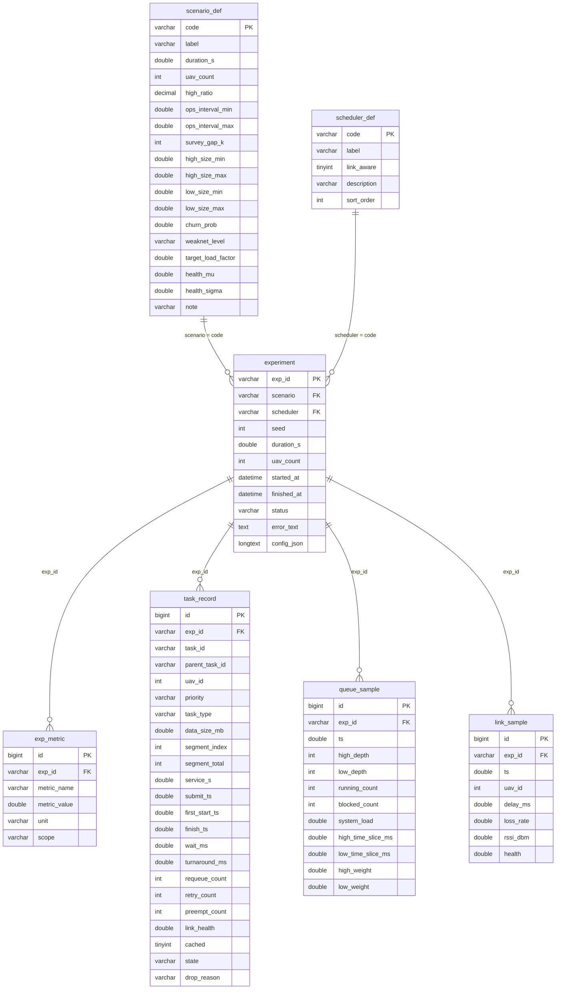

# 05 · 数据库设计说明

> 目标库：`uav_sched_sim`（MySQL 8.0.45，`utf8mb4` / `utf8mb4_0900_ai_ci`）
> 建库建表脚本：[sql/01_schema.sql](../sql/01_schema.sql)（**全部 `CREATE ... IF NOT EXISTS`，幂等**）
> 写入代码：[src/uav_sim/db.py](../src/uav_sim/db.py) `DBWriter.save_run()`
> 连接：`127.0.0.1:3306`，用户 `root`；口令见 `config.yaml` 的 `database.password`，或环境变量 `UAV_DB_PASSWORD`（**优先**）。
> 一句话原则：**任何一个指标数字，都必须能沿 `exp_id` 下钻到具体任务、具体队列采样、具体链路采样。**

---

## 1. 设计目标与取舍

| 目标 | 做法 | 理由 |
|---|---|---|
| 可回溯 | 所有子表带 `exp_id` 外键（`ON DELETE CASCADE`） | "30 秒的平均等待"必须能查回是哪 60 个任务算出来的 |
| 指标可扩展 | 指标存**长表** `exp_metric(metric_name, metric_value, unit, scope)`，而不是 24 个列 | 新增指标不改表结构；配 `v_exp_summary` 视图转宽表供报告直接引用 |
| 明细可下钻 | `task_record` 一行 = 一个任务（分片也各占一行，靠 `parent_task_id` 归并） | 对应 OS 的 TCB：提交/首跑/完成/等待/重传/状态全留痕 |
| 时序可复现 | `queue_sample` / `link_sample` 按固定间隔采样（0.5 s / 1.0 s 仿真时间） | 队列堆积曲线与链路健康度曲线是"过载""弱网"的**唯一直接证据** |
| 参数可审计 | `scenario_def` / `scheduler_def` 字典表 + `experiment.config_json` 快照 | 报告里的"参数设计依据"直接 `SELECT * FROM scenario_def` |
| 不拖垮实验 | 单事务批量写入（`executemany` + `batch_size=2000`），失败回滚且**不抛异常** | 数据库是增强项：它挂了，15 组实验也必须照跑（优雅降级） |

---

## 2. 命名规范

| 对象 | 规范 | 示例 |
|---|---|---|
| 库名 | 小写下划线，与工程同名 | `uav_sched_sim` |
| 表名 | 单数、小写下划线、语义前缀分组 | `experiment` / `exp_metric` / `task_record` / `queue_sample` / `link_sample` / `scenario_def` / `scheduler_def` |
| 主键 | 业务主键用自然键（`exp_id`、`code`）；明细表用 `id BIGINT UNSIGNED AUTO_INCREMENT` | `task_record.id` |
| 外键 | `fk_<子表简称>_<父表简称>` | `fk_task_exp`、`fk_queue_exp`、`fk_link_exp` |
| 索引 | `idx_<表简称>_<列>`；唯一索引用 `uk_` | `idx_task_exp_priority`、`uk_exp_metric` |
| 仿真时间列 | 一律 `*_ts DOUBLE`，单位**仿真秒**，从 0.0 起算 | `submit_ts`、`first_start_ts`、`finish_ts`、`ts` |
| 真实时间列 | 一律 `*_at DATETIME(3)`，**仅审计**，不参与指标计算 | `started_at`、`finished_at`、`created_at` |
| 度量列 | 带单位后缀：`_ms` 毫秒、`_s` 秒、`_mb` 兆字节、`_rate`/`_pct` 比例（0~1 或 0~100 见注释） | `wait_ms`、`duration_s`、`data_size_mb`、`loss_rate` |
| 枚举列 | `VARCHAR` 存**大写语义值**，不用魔法数字 | `priority='HIGH'`、`state='CACHED'`、`weaknet_level='high'` |

> ⚠️ 两个容易踩的坑：
> 1. **仿真秒 vs 真实时刻**：`task_record.wait_ms` 是仿真时间口径的毫秒；`experiment.started_at` 是 wall-clock。混用会让"平均等待 25 秒"看起来像"跑了 25 秒真实时间"。
> 2. **比例列的量纲**：`loss_rate` 是 0~1；`starvation_rate` / `completion_rate` / `resource_utilization` 是 0~100（百分数）。建表注释里逐个标了。

---

## 3. 表清单与四层映射

| 表 / 视图 | 四层映射中的层 | 作用 | 服务哪个实验 | 正式 15 组运行后的行数 |
|---|---|---|---|---|
| `scenario_def` | ④ 业务字典层 | 三工况参数（含 `survey_gap_k`、`target_load_factor`）：把"参数设计依据"固化进库 | 实验 0（标定）、3.4 | 3 |
| `scheduler_def` | ④ 业务字典层 | 五策略字典（`link_aware` 标记是否有链路感知） | 实验 3.2 / 3.3 / 3.4 | 5 |
| `experiment` | ① 业务运行层 | 一行 = 一次「工况 × 策略」仿真（= 一次业务演练） | 全部 | 15 |
| `exp_metric` | ② 业务度量层 | 指标长表（24 个指标 × 15 组） | 3.4 报告数据源 | 360 |
| `task_record` | ③ 业务明细层 | 一行 = 一个任务的完整生命周期（对应 TCB） | 3.1 / 3.2 / 3.3 | 14776 |
| `queue_sample` | ③ 业务明细层 | 就绪队列时序（0.5 s 采样） | 3.2 / 3.4 | 1800 |
| `link_sample` | ③ 业务明细层 | 链路质量时序（1.0 s 采样） | 3.3 | 16604 |
| `v_exp_summary`（视图） | ② 业务度量层 | 一次 JOIN 出 24 指标宽表，报告/Excel 直接引用 | 3.4 | 15 行 |

> 行数为 2026-10-31 17:23–17:25 正式 15 组跑完后的实测值。之后若再跑 `run.py all` 或测试脚本，`experiment` / `exp_metric` 会继续增长（每次运行都是新的 `exp_id`，`REPLACE INTO` 保证同一 `exp_id` 不重复）。

**四层映射的表级落点（与 `01_schema.sql` 头部注释一致）**

```
① 业务运行层  experiment     一次仿真 = 一次"30 台无人机同时上传"的业务演练
② 业务度量层  exp_metric     业务健康度（吞吐/时延/饥饿/完整率），可任意 PIVOT
              v_exp_summary  宽表视图
③ 业务明细层  task_record    每个上传任务的生命周期（TCB）
              queue_sample   就绪队列长度曲线（系统是否过载的直接证据）
              link_sample    链路质量曲线（弱网自适应机制的证据）
④ 业务字典层  scenario_def   工况参数（参数设计依据）
              scheduler_def  策略字典（策略 ↔ OS 原理 ↔ 是否链路感知）
```

---

## 4. ER 图



---

## 5. 关键字段与约束详解

### 5.1 `experiment`（实验元信息）

| 字段 | 类型 | 说明 |
|---|---|---|
| `exp_id` | `VARCHAR(40)` PK | 格式 `<工况>-<策略>-<seed>-<yyyymmddHHMMSS>`，例：`PEAK-dynamic-20261031-20261031172506`。可读、可排序、可回溯 |
| `scenario` / `scheduler` | `VARCHAR(16)` | 外键指向两张字典表（`ON UPDATE CASCADE`） |
| `status` | `VARCHAR(16)` | `OK` / `ERROR`；`ERROR` 时 `error_text` 存异常摘要（**失败也要留痕**） |
| `config_json` | `LONGTEXT` | 本次运行的 `config.yaml` 快照，写入前把 `database.password` 替换为 `***` |

索引：`idx_experiment_scenario(scenario, scheduler)`（做透视表的驱动索引）、`idx_experiment_created(created_at)`（按时间倒序看最近运行）。

### 5.2 `exp_metric`（指标长表）

| 字段 | 类型 | 说明 |
|---|---|---|
| `metric_name` | `VARCHAR(64)` | 必须来自 `models.METRIC_SPEC`（共 24 个），否则报告与图表列头会对不上 |
| `metric_value` | `DOUBLE` | 6 位小数写入 |
| `unit` | `VARCHAR(16)` | 从 `METRIC_SPEC[name][1]` 取：`个/秒`、`ms`、`%`、`次`、`秒` |
| `scope` | `VARCHAR(8)` | `ALL` / `HIGH` / `LOW`，为将来"分优先级存同名指标"预留（当前统一写 `ALL`） |

约束：`UNIQUE KEY uk_exp_metric(exp_id, metric_name)` —— 同一次实验同一指标只能一行，重复写走 `ON DUPLICATE KEY UPDATE`。

### 5.3 `task_record`（任务明细 / TCB）

| 字段组 | 字段 | 说明 |
|---|---|---|
| 身份 | `task_id`、`parent_task_id`、`segment_index/total` | 分片任务通过 `parent_task_id` 归并到 root；`segment_total=1` 表示未分片 |
| 业务属性 | `uav_id`、`priority`、`task_type`、`data_size_mb` | `priority` ∈ HIGH/LOW；`task_type` ∈ IMAGERY/MULTISPECTRAL/LIDAR/GPS/ATTITUDE/HEARTBEAT/ALARM |
| 时间 | `submit_ts`、`first_start_ts`、`finish_ts` | 全部**仿真秒**；未完成的任务 `finish_ts IS NULL` |
| 度量 | `wait_ms`、`turnaround_ms` | 等待 = 入队→获得 CPU 的累计（含重传/被抢占）；周转 = 提交→完成 |
| 调度证据 | `requeue_count`、`retry_count`、`preempt_count`、`cached` | 分别对应"回队尾 / 弱网重传 / 被时间片抢占 / 进过本地缓存" |
| 状态 | `state`、`drop_reason` | `NEW/READY/RUNNING/BLOCKED/CACHED/DONE/DROPPED`；丢弃原因如 `queue_full`、`chunked_into_segments` |

索引：`idx_task_exp(exp_id)`、`idx_task_exp_priority(exp_id, priority)`（分优先级统计/明细下钻）、`idx_task_exp_state(exp_id, state)`（完成率/丢弃率）。

### 5.4 `queue_sample` / `link_sample`（时序采样）

| 表 | 采样间隔 | 关键列 | 典型用途 |
|---|---|---|---|
| `queue_sample` | 0.5 仿真秒 | `high_depth`、`low_depth`、`running_count`、`blocked_count`、`system_load`、`high/low_time_slice_ms`、`high/low_weight` | 画 `charts/06` 队列堆积图；验证"并发不超上限"（`running_count ≤ 8`）；验证动态权重确实在变 |
| `link_sample` | 1.0 仿真秒 | `delay_ms`、`loss_rate`、`rssi_dbm`、`health` | 画 `charts/07` 健康度分布；解释弱网降权与重传率 |

索引：`idx_queue_exp_ts(exp_id, ts)`、`idx_link_exp_uav_ts(exp_id, uav_id, ts)` —— 时序查询一律 `WHERE exp_id=? ORDER BY ts`，所以索引前导列必须是 `exp_id`。

---

## 6. 常用查询（12 条，全部在本机 MySQL 8.0.45 实测通过）

> **执行方式**：MySQL 命令行 / VS Code SQLTools / IntelliJ IDEA Database 面板均可直接粘贴。
> **注意**：若通过 `db.DBWriter.query()`（PyMySQL 参数化）执行，SQL 里的 `%` 必须写成 `%%`（否则报 `not enough arguments for format string`）；本文件的示例统一用 `SUBSTRING_INDEX()` 做 `exp_id` 前缀匹配，正是为了绕开这个坑。

### Q1 五策略 × 三工况 指标透视表（报告 §7 主表）

```sql
-- 用途：一行一个工况，一列一个策略，直接抄进报告；换指标只改 CASE 里的列名
SELECT scenario,
       ROUND(MAX(CASE WHEN scheduler = 'fcfs'     THEN avg_wait_high_ms END), 1) AS `FCFS`,
       ROUND(MAX(CASE WHEN scheduler = 'rr'       THEN avg_wait_high_ms END), 1) AS `RR`,
       ROUND(MAX(CASE WHEN scheduler = 'priority' THEN avg_wait_high_ms END), 1) AS `静态优先级`,
       ROUND(MAX(CASE WHEN scheduler = 'mlfq'     THEN avg_wait_high_ms END), 1) AS `MLFQ`,
       ROUND(MAX(CASE WHEN scheduler = 'dynamic'  THEN avg_wait_high_ms END), 1) AS `动态权重`
FROM v_exp_summary
GROUP BY scenario
ORDER BY FIELD(scenario, 'LIGHT', 'NORMAL', 'PEAK');
```

### Q2 饥饿任务明细（回答"到底哪些任务被饿死了"）

```sql
-- 用途：低优先级任务等待超过评价阈值（默认 15 s）的明细，按等待降序；用于报告附录与答辩举证
SELECT exp_id, task_id, uav_id, task_type, data_size_mb,
       ROUND(wait_ms, 0) AS wait_ms, retry_count, state
FROM task_record
WHERE priority = 'LOW' AND wait_ms > 15000
ORDER BY wait_ms DESC
LIMIT 50;
```

### Q3 PEAK 工况队列堆积时序（画 `charts/06` 的原始数据）

```sql
-- 用途：同一工况下 dynamic 与 priority 的高/低队列深度对比；ts 为仿真秒
SELECT e.scheduler, q.ts, q.high_depth, q.low_depth, q.running_count, q.system_load
FROM queue_sample q
         JOIN experiment e ON e.exp_id = q.exp_id
WHERE e.scenario = 'PEAK'
  AND e.scheduler IN ('dynamic', 'priority')
ORDER BY e.scheduler, q.ts;
```

### Q4 各工况 / 各策略的高优先级任务完成率（最容易被整体完整率掩盖的口径）

```sql
-- 用途：按优先级拆开看完成率。整体 completion_rate 被占条数 97%+ 的低优先级任务主导，
--       这一条才反映"核心勘查任务到底传完了多少"
SELECT e.scenario, e.scheduler, t.priority,
       COUNT(*)                                   AS n_tasks,
       SUM(t.state = 'DONE')                      AS n_done,
       ROUND(100 * SUM(t.state = 'DONE') / COUNT(*), 1) AS done_pct,
       ROUND(AVG(t.wait_ms), 0)                   AS avg_wait_ms
FROM task_record t
         JOIN experiment e ON e.exp_id = t.exp_id
WHERE t.priority = 'HIGH'
GROUP BY e.scenario, e.scheduler, t.priority
ORDER BY FIELD(e.scenario, 'LIGHT', 'NORMAL', 'PEAK'), done_pct DESC;
```

### Q5 动态策略相对静态优先级的改善幅度（一行出结论）

```sql
-- 用途：直接算出"完整率提升几个百分点、低优先级饥饿率下降几个百分点"，避免手算
SELECT scenario,
       ROUND(MAX(CASE WHEN scheduler = 'dynamic'  THEN completion_rate END)
           - MAX(CASE WHEN scheduler = 'priority' THEN completion_rate END), 1) AS delta_completion_pct,
       ROUND(MAX(CASE WHEN scheduler = 'dynamic'  THEN starvation_rate_low END)
           - MAX(CASE WHEN scheduler = 'priority' THEN starvation_rate_low END), 1) AS delta_starvation_pct,
       ROUND(MAX(CASE WHEN scheduler = 'dynamic'  THEN throughput END)
           / NULLIF(MAX(CASE WHEN scheduler = 'priority' THEN throughput END), 0), 2) AS throughput_ratio
FROM v_exp_summary
GROUP BY scenario
ORDER BY FIELD(scenario, 'LIGHT', 'NORMAL', 'PEAK');
```

### Q6 链路健康度分档统计（弱网强度是否真的递进）

```sql
-- 用途：验证 LIGHT→NORMAL→PEAK 弱网逐级加重；pct_below_40 = 健康度低于缓存阈值(40)的采样占比
SELECT e.scenario,
       ROUND(AVG(l.health), 1)                          AS avg_health,
       ROUND(MIN(l.health), 1)                          AS min_health,
       ROUND(100 * SUM(l.health < 40) / COUNT(*), 1)     AS pct_below_40,
       COUNT(*)                                          AS n_samples
FROM link_sample l
         JOIN experiment e ON e.exp_id = l.exp_id
GROUP BY e.scenario
ORDER BY FIELD(e.scenario, 'LIGHT', 'NORMAL', 'PEAK');
```

### Q7 重传与本地缓存（痛点①的量化证据）

```sql
-- 用途：retried = 发生过弱网重传的任务数；cached = 进过 CACHED 本地缓存的任务数
--       只有 dynamic（link_aware=True）会出现 cached > 0
SELECT e.scenario, e.scheduler,
       SUM(t.retry_count > 0)      AS retried,
       SUM(t.cached = 1)           AS cached,
       ROUND(AVG(t.retry_count), 2) AS avg_retry
FROM task_record t
         JOIN experiment e ON e.exp_id = t.exp_id
GROUP BY e.scenario, e.scheduler
ORDER BY FIELD(e.scenario, 'LIGHT', 'NORMAL', 'PEAK'), e.scheduler;
```

### Q8 分片任务核查（验证"大任务不丢业务"）

```sql
-- 用途：segment_total>1 才是真分片；正式实验因上限 2048MB > 最大任务 2000MB，这里应只有 1 行（全是 1）
--       分片链路由 `run.py demo-limiter`（上限压到 500MB）验证
SELECT segment_total, COUNT(*) AS n_tasks
FROM task_record
GROUP BY segment_total
ORDER BY segment_total;
```

### Q9 单机任务分布（验证单机配额 `per_uav_quota=2`）

```sql
-- 用途：每架无人机产生的任务数与平均等待；配合 queue_sample.running_count 可核对配额是否生效
--       SUBSTRING_INDEX 取 exp_id 前两段（'PEAK-dynamic'），避免 LIKE '%' 在 PyMySQL 里被当占位符
SELECT uav_id, COUNT(*) AS n_tasks, ROUND(AVG(wait_ms), 0) AS avg_wait_ms
FROM task_record
WHERE SUBSTRING_INDEX(exp_id, '-', 2) = 'PEAK-dynamic'
GROUP BY uav_id
ORDER BY n_tasks DESC;
```

### Q10 指标字典与单位（核对图表列头）

```sql
-- 用途：确认每个指标的单位与出现的实验次数，防止"把 % 当小数"这类低级错误
SELECT metric_name, unit, COUNT(*) AS n_exp, ROUND(AVG(metric_value), 3) AS avg_value
FROM exp_metric
GROUP BY metric_name, unit
ORDER BY metric_name;
```

### Q11 等待时延 P95（MySQL 8 窗口函数版）

```sql
-- 用途：均值会被大量短任务稀释，P95 才暴露长尾；这里按优先级各取 95 分位
SELECT priority, ROUND(wait_ms, 1) AS p95_wait_ms
FROM (SELECT priority, wait_ms,
             ROW_NUMBER() OVER (PARTITION BY priority ORDER BY wait_ms) AS rn,
             COUNT(*)     OVER (PARTITION BY priority)                  AS cn
      FROM task_record
      WHERE SUBSTRING_INDEX(exp_id, '-', 2) = 'PEAK-dynamic') x
WHERE rn = CEIL(0.95 * cn);
```

### Q12 工况字典与参数设计依据（报告"参数标定"章节直接引用）

```sql
-- 用途：把 load_factor 目标与运维/勘查间隔一起打出来，证明工况不是拍脑袋定的
SELECT code, label, duration_s, uav_count,
       ops_interval_min, ops_interval_max, survey_gap_k,
       CONCAT(ops_interval_min * survey_gap_k, '~', ops_interval_max * survey_gap_k) AS survey_interval_s,
       high_size_min, high_size_max, low_size_min, low_size_max,
       weaknet_level, target_load_factor, health_mu, health_sigma
FROM scenario_def
ORDER BY FIELD(code, 'LIGHT', 'NORMAL', 'PEAK');
```

> 附加：`SELECT * FROM v_exp_summary ORDER BY scenario, scheduler;` 一条就能拿到 24 指标宽表（报告附录可直接截图）。

---

## 7. 数据字典（`task_record` / `queue_sample` / `link_sample` / `exp_metric` 全字段）

### 7.1 `task_record`

| 字段 | 类型 | 允许空 | 含义 | 取值 / 单位 |
|---|---|---|---|---|
| `id` | BIGINT UNSIGNED | 否 | 自增主键 | — |
| `exp_id` | VARCHAR(40) | 否 | 所属实验 | 外键 → `experiment` |
| `task_id` | VARCHAR(64) | 否 | 任务号（`T-` 前缀；分片为 `SEG-`） | 全局唯一 |
| `parent_task_id` | VARCHAR(64) | 是 | 分片所属 root 任务 | 未分片为 NULL |
| `uav_id` | INT | 否 | 无人机编号 | 1~30 |
| `priority` | VARCHAR(8) | 否 | 优先级 | `HIGH` / `LOW` |
| `task_type` | VARCHAR(24) | 否 | 业务类型 | 7 种（3 勘查 + 4 运维） |
| `data_size_mb` | DOUBLE | 否 | 数据量 | MB |
| `segment_index` | INT | 否 | 分片序号 | 从 0 开始 |
| `segment_total` | INT | 否 | 分片总数 | 1 = 未分片 |
| `service_s` | DOUBLE | 否 | 标定服务时长 | 仿真秒（= MB / 有效带宽） |
| `submit_ts` | DOUBLE | 否 | 提交时刻 | 仿真秒 |
| `first_start_ts` | DOUBLE | 是 | 首次被调度时刻 | 仿真秒；从未运行为 NULL |
| `finish_ts` | DOUBLE | 是 | 完成/丢弃时刻 | 仿真秒；未完成 NULL |
| `wait_ms` | DOUBLE | 否 | 累计等待 | 毫秒（仿真时间口径） |
| `turnaround_ms` | DOUBLE | 否 | 周转时间 | 毫秒 |
| `requeue_count` | INT | 否 | 回队尾次数 | 次 |
| `retry_count` | INT | 否 | 弱网重传次数 | 次 |
| `preempt_count` | INT | 否 | 被时间片抢占次数 | 次 |
| `link_health` | DOUBLE | 否 | 提交时刻链路健康度 | 0~100 |
| `cached` | TINYINT(1) | 否 | 是否进过 CACHED | 0/1 |
| `state` | VARCHAR(12) | 否 | 终态 | `DONE` / `DROPPED` / `READY`(仿真结束时仍在排队) 等 |
| `drop_reason` | VARCHAR(64) | 是 | 丢弃原因 | `queue_full` / `chunked_into_segments` |

### 7.2 `queue_sample`

| 字段 | 类型 | 含义 | 单位/取值 |
|---|---|---|---|
| `ts` | DOUBLE | 采样时刻 | 仿真秒 |
| `high_depth` / `low_depth` | INT | 高/低优先级队列深度 | 个 |
| `running_count` | INT | 并发运行任务数 | 个（应 ≤ `max_concurrent`） |
| `blocked_count` | INT | 累计弱网阻塞次数 | 次（**累计量**，不是瞬时值） |
| `system_load` | DOUBLE | 瞬时负载 = 积压服务秒 /(线程数×2 s) | 无量纲，>1 过载 |
| `high/low_time_slice_ms` | DOUBLE | 当前自适应/固定时间片 | 毫秒 |
| `high/low_weight` | DOUBLE | 当前高/低优先级权重 | 静态策略恒为 1.0 |

### 7.3 `link_sample`

| 字段 | 类型 | 含义 | 单位/取值 |
|---|---|---|---|
| `ts` | DOUBLE | 采样时刻 | 仿真秒 |
| `uav_id` | INT | 无人机编号 | 1~30 |
| `delay_ms` | DOUBLE | 链路时延 | 毫秒 |
| `loss_rate` | DOUBLE | 丢包率 | 0~1 |
| `rssi_dbm` | DOUBLE | 信号强度 | dBm（-100~-40） |
| `health` | DOUBLE | 综合健康度 | 0~100 |

> 物理量由 `LinkState.apply_health(h)` 反演：`delay=10×(100−h)`、`loss=0.01×(100−h)`、`rssi=−100+0.6h`，代回 `health_score()` 恒等于 `h`（自洽，见 [link_monitor.py](../src/uav_sim/link_monitor.py) 模块注释）。

### 7.4 `exp_metric` 的指标名（基础 24 + 站级/MEC/quorum 22 = 46，与 `models.METRIC_SPEC` 一一对应）

> 下表列出**基础 24 个**（15 组矩阵口径）。新增的 22 个扩展键（`station_*` / `migration_*` /
> `cross_node_comm_ms` / `edge_offload_ratio` / `avg_e2e_ms` / `e2e_*` / `mec_*` / `quorum_*`）
> 同样写入 `exp_metric` 长表，并已纳入 `v_exp_summary` 宽表；单站/无共识时恒为 0 或等价值。

| 分组 | 指标名 |
|---|---|
| 效率 | `throughput`、`avg_turnaround_ms`、`resource_utilization` |
| 时延 | `avg_wait_high_ms`、`avg_wait_low_ms`、`avg_wait_all_ms`、`p95_wait_high_ms`、`p95_wait_low_ms`、`jitter_ms` |
| 公平 | `starvation_rate`、`starvation_rate_low` |
| 完整 | `completion_rate`、`drop_rate`、`retry_rate`、`avg_requeue` |
| 堆积 | `max_high_depth`、`max_low_depth`、`peak_queue_depth`、`overload_seconds` |
| 开销 | `context_switch` |
| 限流 | `throttle_count`、`reject_large_count`、`chunk_count` |
| 运行 | `runtime_wall_s` |

---

## 8. 运维要点

| 场景 | 操作 |
|---|---|
| 首次建库 | `.\scripts\02-初始化数据库.ps1`（幂等），或让 `run.py all` 首次入库时自动执行 `sql/01_schema.sql` |
| 清空重跑 | `DROP DATABASE uav_sched_sim;` 后重跑（**会丢全部历史**） |
| 只保留一个批次 | 报告只引用一个 `exp_id` 批次；清理其它批次用 `DELETE FROM experiment WHERE started_at < '2026-10-31 17:38:00';`（子表由 `ON DELETE CASCADE` 级联清理），改时间界即可 |
| 只清某次运行 | `DELETE FROM experiment WHERE exp_id = '...'`，子表由 `ON DELETE CASCADE` 自动清理 |
| 备份 | `mysqldump --host=127.0.0.1 --user=root -p uav_sched_sim > uav_sched_sim.sql` |
| 口令 | 只放 `config.yaml`（本地）或环境变量 `UAV_DB_PASSWORD`；`config_json` 快照里已把口令替换为 `***` |
| 数据库不可用 | 一切照跑，结果只落 `results/`（见 [README](../README.md) FAQ 第 8 条） |
