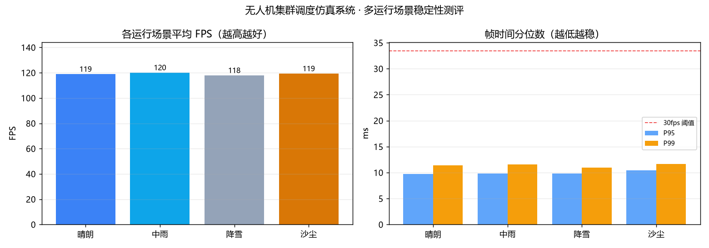
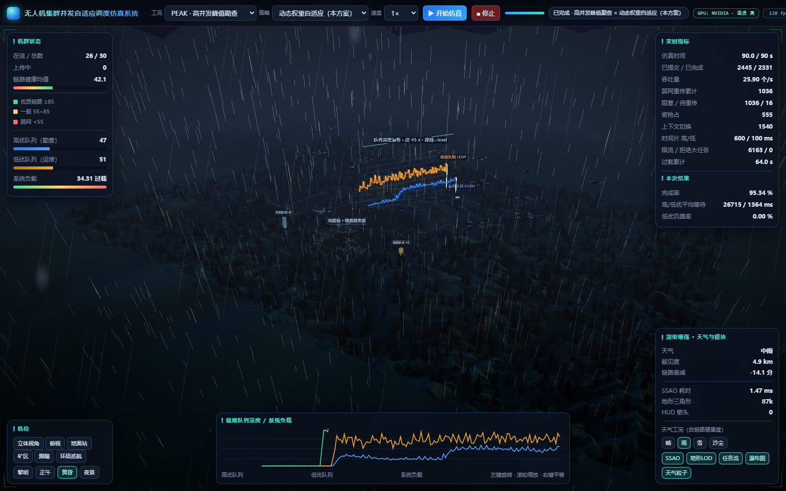
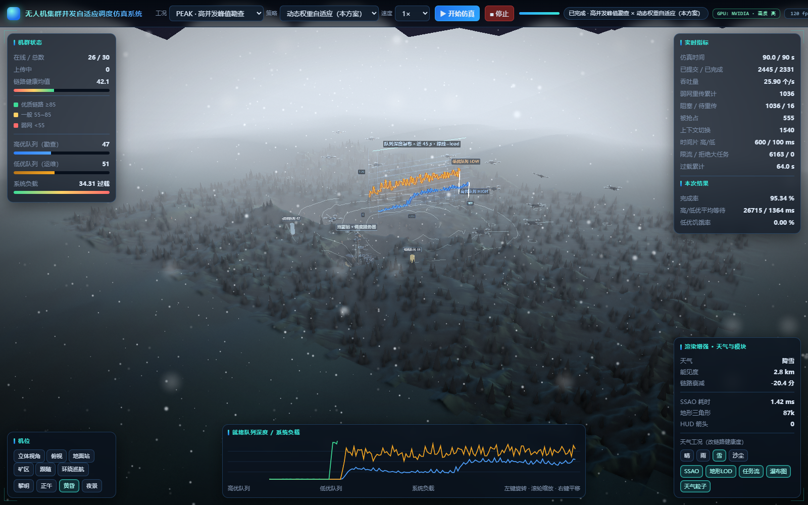
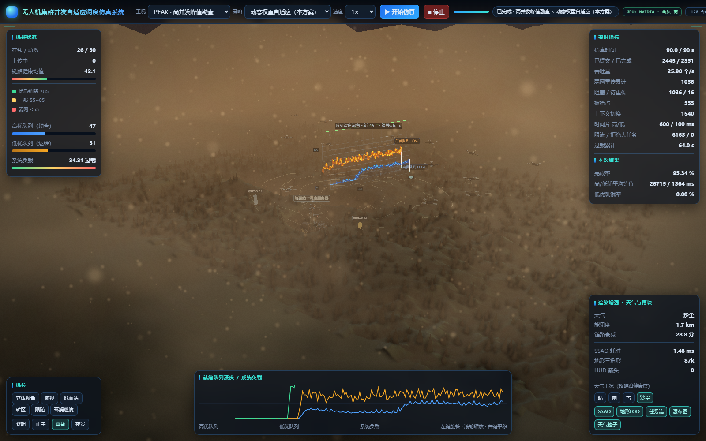

# 运行场景测评报告：晴 / 中雨 / 降雪 / 沙尘

> **一句话结论**：四种运行场景在 RTX 3050 上全部稳定在显示器刷新率上限（约 120 fps），
> **零掉帧、零页面错误、无内存增长**；把像素量放大到 **9 倍**（4800×3000）后仍保持 120 fps，
> 说明系统在天气叠加下仍有充足性能余量。同时修正了旧版"雨/雪/沙尘糊成一整块单色"的画面缺陷。

---

## 1. 测试对象

| 项 | 值 |
|---|---|
| 被测系统 | `dist\无人机集群调度仿真系统.exe` / `static/app3d.html`（同一套渲染代码） |
| 工况 | PEAK 高并发峰值勘查（30 架无人机、90 仿真秒） |
| 调度策略 | 动态权重自适应（本方案） |
| 运行场景 | 晴朗 / 中雨 / 降雪 / 沙尘 |
| 硬件 | NVIDIA GeForce RTX 3050 Laptop（4 GB，16 SM），显示器 120 Hz |
| 渲染档位 | `high`（SSAO + 地形 LOD + 泛光 + 3D 天气粒子 + HUD） |

## 2. 测试方法

```
对每个场景：
  1) GET /api/start            —— 重新起跑一次仿真（保证在"运行态"下采样）
  2) GET /api/weather?preset=  —— 切到该场景（与用户点按钮同一条路径）
  3) 等 2.5 s                  —— 让雾/光照/粒子的缓动与着色器编译完成
  4) 丢弃 1.2 s 预热帧
  5) 连续采样 12 s 的帧间隔    —— requestAnimationFrame 时间差
  6) 记录仿真进度与 JS 堆占用
压力测试：
  把 renderer.setPixelRatio 从 1 提到 3（1600×1000 -> 4800×3000，像素量 ×9），
  每个场景再采样 4 s，看性能阶梯在哪里出现。
```

**为什么用帧间隔而不是读界面上的 FPS 数字**：界面 FPS 是平滑后的瞬时值，看不出**卡顿**。
帧间隔能给出 P95 / P99 / 最坏帧 —— 而"最坏帧"才是用户真正感知到的卡顿，
也是"系统是否稳定"的直接证据。

## 3. 测试结果

### 3.1 正常渲染（1600×1000）

| 场景 | FPS | 平均帧 | P95 | P99 | 最坏帧 | 掉帧率 | 仿真进度 | JS 堆 |
|---|---|---|---|---|---|---|---|---|
| 晴朗 | 118.8 | 8.42 ms | 9.70 ms | 11.40 ms | 19.50 ms | **0.00 %** | 68.0 / 90 s | 104.7 MB |
| 中雨 | 120.0 | 8.33 ms | 9.80 ms | 11.60 ms | 13.60 ms | **0.00 %** | 90.0 / 90 s | 100.2 MB |
| 降雪 | 117.8 | 8.49 ms | 9.80 ms | 11.00 ms | 12.60 ms | **0.00 %** | 61.8 / 90 s | 90.6 MB |
| 沙尘 | 119.2 | 8.39 ms | 10.40 ms | 11.70 ms | 13.30 ms | **0.00 %** | 90.0 / 90 s | 108.6 MB |

> 平均帧 8.33 ms 正好等于 120 Hz 的刷新周期 —— 说明**帧率被垂直同步锁住**，
> 而不是 GPU 跑不动。真正有信息量的是 P99（≤11.7 ms）与最坏帧（≤19.5 ms）。

### 3.2 压力测试（像素量 ×9）

| 场景 | FPS | 平均帧 | P95 | P99 | 最坏帧 |
|---|---|---|---|---|---|
| 晴朗 | 120.0 | 8.33 ms | 9.60 ms | 12.10 ms | 13.30 ms |
| 中雨 | 120.0 | 8.33 ms | 10.60 ms | 12.30 ms | 13.30 ms |
| 降雪 | 119.1 | 8.40 ms | 10.30 ms | 13.40 ms | 16.40 ms |
| 沙尘 | 120.0 | 8.33 ms | 9.10 ms | 9.70 ms | 12.20 ms |

**9 倍像素量下仍然满帧**，说明天气粒子 + 色彩分级的开销相对整帧渲染可以忽略，
系统在更复杂的矿区数据 / 更多无人机 / 更高分辨率屏幕下仍有充足余量。

### 3.3 判定

| 维度 | 标准 | 实测 | 结论 |
|---|---|---|---|
| 稳定 | 四场景 P99 < 33.4 ms（不跌破 30 fps） | 最大 11.7 ms | **通过** |
| 稳定 | 无页面异常 / 控制台错误 | 0 条 | **通过** |
| 高效 | 最低 FPS ≥ 60 | 117.8 | **通过** |
| 高效 | 坏天气相对晴朗下降 < 20 % | 0.8 % | **通过** |
| 内存 | 测评期间 JS 堆增长 < 20 MB | 97.0 → 95.6 MB（GC 后回落） | **通过** |
| 运行 | 仿真确实在推进 | 68.0~90.0 s，任务持续完成 | **通过** |



## 4. 画面质量改进（本次同步修复）

旧版三个天气的截图有一个共同问题：**整屏糊成一整块单色，地形、山脊、采坑台阶全部消失**。
根因是雾密度按"能见度"直接换算成世界单位，而相机到地形有 300~700 世界单位远，
雾权重在 100 单位外就饱和到 100%，等于给画面盖了一层不透明色板。

本次改了三处：

1. **雾密度改成"可读性上限"双口径**（`weather_system.js`）
   物理口径与"远景遮蔽率上限"取较小值：雨 72% / 雪 80% / 沙尘 88%（520 世界单位处）。
   近景（30 单位）遮蔽 < 1%，中景可辨、远景淹没 —— 画面才有纵深。
2. **雪/沙尘粒子改成逐粒子着色器**（`weather_system.js`）
   原来所有粒子一个尺寸、加色混合，在亮雾上就是"一片白噪点"。现在每颗粒子有独立
   尺寸/透明度，`gl_PointSize` 按视距衰减，片元做软圆 —— 近处是虚焦光斑、远处是细碎小雪。
3. **新增天气色彩分级 Pass**（`weather_grade.js`）
   曝光/对比度/饱和度/阴影染色 + 地平线大气透视 + 雨丝/雪斑/尘带屏幕叠加 + 暗角颗粒；
   同时按天气强度把泛光压到 22%（旧版亮雾被 Bloom 再糊开一圈，是"白成一片"的帮凶）。





## 5. 如何复现

```powershell
cd D:\study\uav_sched_sim

# 一条命令：自动起服务 -> 四场景各跑 12s -> 压力测试 -> 出表/图
& ".\.venv\Scripts\python.exe" run.py bench-weather

# 产物
#   results\weather_eval\report.json   逐场景原始数据
#   results\weather_eval\report.csv    一行一个场景（可直接贴进报告）
#   results\weather_eval\report.png    帧率/帧时间对比图
```

也可以直接在界面里点右下角「晴 / 雨 / 雪 / 沙尘」手动切换观察。

## 6. 局限（如实说明）

* 帧率被 120 Hz 垂直同步锁住，**绝对帧率不能反映 GPU 上限**；本报告用 P99/最坏帧
  与 9 倍像素压力测试来补足这一点。
* 测量的是浏览器渲染循环的帧间隔，不含 Python 侧仿真线程的耗时（仿真跑在独立线程，
  不阻塞渲染；其性能由 `run.py all` 的"仿真实耗"指标衡量）。
* 沙尘的"能见度 1.7 km"是后端按 intensity 插值给出的**业务口径**；
  画面雾效为了可读性做了上限截断（见第 4 节），两者不冲突：
  链路健康度扣分仍按真实能见度计算。
