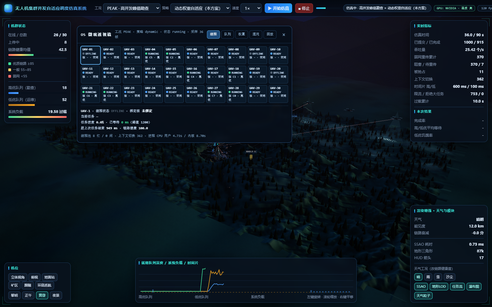
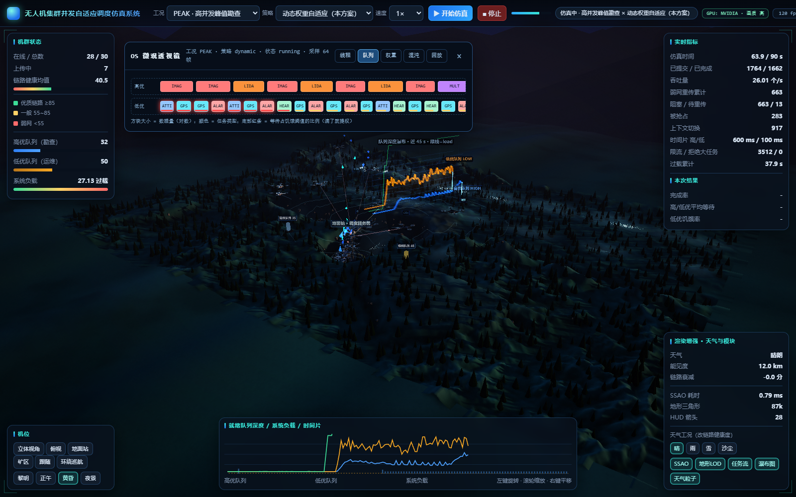
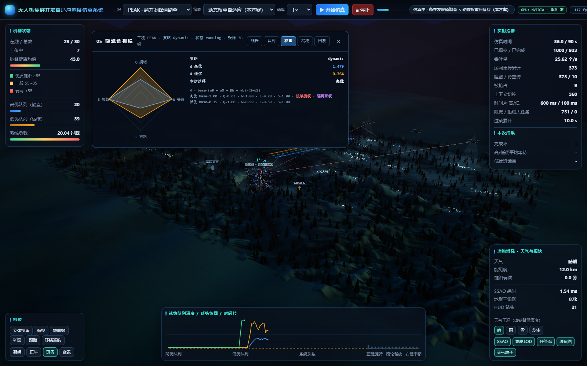
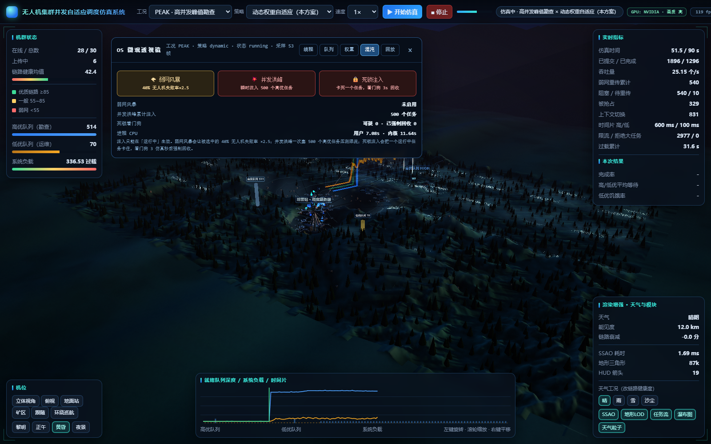

# OS 微观透视 + 算法透明化 + 混沌工程 + Trace 回放

> 对应改造建议的第一~四章。目标是把「好看的 3D Demo」升级成
> 「**能看见线程、能看见决策、能注入故障、能回放取证**」的操作系统仿真平台。

---

## 0. 一句话概览

顶栏新增 **🔬 OS 透视** 按钮，点开后是一个五页签的检查器：

| 页签 | 回答的问题 | 数据来源 |
|---|---|---|
| 线程 | 这一架无人机现在是五态中的哪一态？绑在哪个核？在跑哪个任务？多久没拿到 CPU？ | `/api/state → uav_states` |
| 队列 | 队列里到底排着哪些任务？谁快饿死了？ | `queue_tasks` |
| 权重 | 这一次为什么调度了它？四个因子各是多少？ | `weight` |
| 混沌 | 弱网/洪峰/死锁打进去，系统扛得住吗？ | `/api/chaos` |
| 回放 | 刚才那一秒发生了什么？能导出原始日志吗？ | 前端环形缓冲 + `/api/trace` |

所有数据都是**只读轮询**（250 ms），唯一的写操作是用户主动点混沌按钮。

## 1. 后端补了什么（`simulator.py` / `queue_manager.py` / `dashboard.py`）

### 1.1 线程级遥测

`Simulator.dispatch()` 现在会给每个任务分配一个**并发槽位**（= 绑定的 CPU 核号），
并在任务结束/抢占时归还；同时记录「该机上次任务结束 → 本次被派发」的间隔，
作为**上下文切换间隔**（`switch_ms`）。

快照 `uav_states[uid]` 现在是：

```json
{"state":"RUNNING","core":3,"task_id":"T-9b0b0ccba802","priority":"HIGH",
 "task_type":"LIDAR","progress":0.42,"wait_ms":128.5,"switch_ms":312.0,"health":88.1}
```

`state` 取值 `RUNNING / READY / OFFLINE`（对应线程五态的就绪、运行、终止/未创建）。

### 1.2 队列快照（传送带）

`MultiLevelQueue.snapshot_tasks(limit, now)` 是**严格只读**的：不出队、不记账，
按出队顺序列出前 N 个任务（高优在前），带 `data_size_mb` / `wait_ms` / `retry`。

### 1.3 权重因子

`DynamicWeightScheduler` 现在按优先级分别保存最近一次四因子
（`_factors_by_prio` → `last_candidates`），快照里同时给出高/低两个候选的
`Q / W / L / S / base / weight / boosted / degraded`，前端才能画"天平"。

### 1.4 内核级指标（如实说明取到了什么）

| 指标 | 来源 | 说明 |
|---|---|---|
| 进程 CPU 用户态 / 内核态 | Windows `GetProcessTimes` / POSIX `os.times()` | **真实**的进程级拆分，不是估算 |
| 上下文切换次数 | 调度器计数 | 已运行过的任务再次被派发即 +1 |
| 切换间隔均值/最大 | 每架机"上次结束→本次派发" | 仿真时间口径 |
| 线程池 忙/闲 | `len(_running)` vs `workers` | 实时 |
| 线程存活数 | `threading.active_count()` | 含生产者线程 |
| 死锁可疑/已回收 | 看门狗 | 见 3.3 |

> 为什么没有"线程级 user/kernel 切换时间"：Python 没有跨平台的线程级 CPU 时间接口。
> 这里给的是**进程级真值** + 线程池状态 + 切换间隔，并明确标注口径 —— 不编造数据。

### 1.5 事件日志（Trace）

有界环形缓冲（默认 20000 条，`simulation.trace_max_events` 可配），记录：

```
enqueue / dispatch / done / preempt / retry / cache /
chaos_weaknet / chaos_burst / chaos_deadlock / deadlock_recovered
```

每条带 `t`（仿真时刻）、`k`（类型）、`tid`、`uav`、`prio`、`type`，以及类型相关字段
（`slot`、`slice_ms`、`size_mb`、`wait_ms`、`retry`、`held_s`…）。

导出：`GET /api/trace?format=json|csv`（CSV 带 UTF-8 BOM，Excel 双击不乱码）。

## 2. 算法决策透明化（前端）

### 2.1 权重天平

雷达图四条轴 = `Q 拥堵 / W 等待 / L 链路 / S 负载`；蓝色多边形是高优候选、
琥珀色是低优候选。旁边直接写出：

```
W = base·(w0 + αQ + βW + γL)·(1−δS)
W 高优 1.446 / W 低优 0.357 -> 本次选择：高优
```

当触发饥饿硬补偿或弱网降权时，对应一侧会标红字「饥饿提权 / 弱网降权」。

### 2.2 饥饿倒计时

队列传送带里，每个**低优**任务方块底部有一条进度条：
`wait_ms / starvation_threshold`，绿→黄→红；超过 90% 时方块本身开始**脉冲发光**
（CSS `@keyframes osPulse`）—— 这就是"提权前夜"的视觉提示。

### 2.3 时间片伸缩

底部折线图标题改为「就绪队列深度 / 系统负载 / **时间片**」，
在曲线下方叠加两条细柱：蓝色 = 高优时间片、琥珀 = 低优时间片。
过载时能直接看到高优片从 6000 ms 收缩、低优片维持 100~800 ms 的调控过程。

## 3. 混沌工程（`/api/chaos`）

| 注入 | 接口 | 实现 | 观察点 |
|---|---|---|---|
| 🌪 弱网风暴 | `?kind=weaknet&duration=20&frac=0.4` | 选中前 40% 无人机，失败率 ×2.5 | 链路健康度均值掉、重传率涨、动态权重开始降权 |
| 💥 并发洪峰 | `?kind=burst&n=500` | 立刻向队列注入 500 个高优勘查任务 | 高优队列瞬间冲到 500+、系统负载过载、限流触发 |
| 🔒 死锁注入 | `?kind=deadlock&hold=20` | 让一个运行中任务"卡住" | 看门狗 3 仿真秒后判定并强制回收，`deadlock_recovered +1` |

### 3.3 死锁看门狗

主循环每 tick 扫一遍 `_running`：带 `_hang_since` 且已超过 **3 仿真秒** 的任务，
直接 `remove from running + limiter.release + 标记 DONE(drop_reason=deadlock_recovered)`，
并写一条 `deadlock_recovered` 事件。工作线程醒来后发现任务已 DONE，安静退出，不重复记账。

这就是"检测 → 强制回收 → 记录证据"的完整闭环，不是假动画。

## 4. Trace 与回放

- **导出**：回放页两个按钮，直接下载 `/api/trace?format=json|csv`；
- **回放**：前端维护 600 帧环形缓冲（250 ms/帧 ≈ 150 s），拖动进度条即可看到
  该时刻的队列深度、系统负载、时间片、线程池忙闲、完成/提交数；
- **自动清空**：检测到 `sim_time` 回退（新起一轮仿真）时清空缓冲，不会把两轮数据混在一起。

## 5. 实测效果（截图）






实测数据（RTX 3050 / PEAK / 动态权重）：

- 线程页：30 架机实时显示 `READY/RUNNING/OFFLINE`、绑核 `C0~C7`、当前任务、等待/切换间隔；
- 队列页：高优方块（IMAG/LIDA/MULT 大红橙紫）与低优方块（GPS/HEAR/ALAT 小蓝绿）按数据量缩放；
- 权重页：`W 高优 1.446 vs W 低优 0.357`，弱网时出现「弱网降权」标记；
- 混沌页：注入 500 任务后高优队列 507、系统负载 348、死锁看门狗强制回收 1 次。

## 6. 复现

```powershell
cd D:\study\uav_sched_sim
& ".\.venv\Scripts\python.exe" run.py ui          # 或双击 启动仿真软件.bat
# 点顶栏「🔬 OS 透视」→ 点「开始仿真」→ 依次看 线程/队列/权重/混沌/回放

# 纯接口验证
curl "http://127.0.0.1:8765/api/state"            # 看 uav_states / queue_tasks / weight / kernel
curl "http://127.0.0.1:8765/api/chaos?kind=burst&n=500"
curl -o trace.csv "http://127.0.0.1:8765/api/trace?format=csv"
```

## 7. 第五章：多基站与 MEC 边缘计算（已完成）

老师文档第五章「多基站 / MEC 边缘计算」属于架构演进。**本轮已实现**，
完整说明见 **[`11-多基站与MEC边缘计算.md`](11-多基站与MEC边缘计算.md)**。
落地路径与当初预留的接口完全一致：

1. `Simulator` 增加 `station_id` 维度（`StationNode`/`StationCluster`），
   每站独立 workers / 队列 / 限流器；`LinkMonitor` 按 **(uav, station)** 维护链路；
2. 调度器增加第 6 种策略 **`cross_node`**（最少连接 + 一致性哈希 +
   **带代价的任务迁移**）；
3. 3D 场景增加第二/第三个地面站、接入关系连线与切站过渡动画；
4. 混沌扩展为 **节点宕机 / 网络分区 / 脑裂 / 一键恢复**，可观察任务重调度与恢复。

**控制变量硬约束**：默认配置（`stations.nodes` 只有 1 个 CENTER、
`mec.enable=false`）下，多站代码路径退化为单站。分两层说清：

* **确定性输入层 —— 可证"逐位一致"**：任务到达轨迹 / 链路健康度曲线 / 服务时长标定
  **不受本次改造影响**，由 `tests/test_distributed.py` 的 **SHA-256 基线 + 1e-9 精度**
  持续守护（181 点 × 5 机）。
* **整跑指标层 —— 只能说"无系统性变化"**：本仿真器是**真实多线程 + sleep 模拟 IO**，
  单次实跑本身有 wall-clock 抖动，因此**不能**写"15 组数值逐位不变"（不可证的强断言）。
  实测对拍：相对差 > 20 % 的 (组,指标) 单元数 —— **同代码两次运行 = 46/360**、
  **改造前 vs 改造后 = 39/360**（改造前后差异**比抖动还小**）；结论级指标 PEAK
  吞吐 / 完整率差异 **≤ 0.71 %**，小于同代码抖动基线 **≤ 1.12 %** → **无系统性回归**。
  方法与产物见 [`11-多基站与MEC边缘计算.md`](11-多基站与MEC边缘计算.md) **§7.1**。
