# 11 · 多基站与 MEC 边缘计算（改造建议 · 第五章）

> 承接 [`10-OS微观透视与混沌工程.md`](10-OS微观透视与混沌工程.md) **第 7 节**列出的落地路径。
> 第 1~4 章把**单站系统**的"内部"摊开（线程五态 / 多级队列 / 权重天平 / 混沌注入 / Trace 回放）；
> 第五章把**一个地面站**摊开成**多个基站节点 + 边缘算力**：从"单机内核"演进到"**分布式系统**"。
>
> 口径声明（**必读**）：本文所有数字分三类，逐处标注 ——
> * **实测（既有产物）**：来自 `results/` 下已存在的真实产物（如 `summary.csv`、`mec/mec_matrix.csv`），给出文件名；
> * **待实测 / 待补**：尚未产出真实产物的数字与截图，**一律显式占位并标注，不填任何编造值**；
> * **设计口径**：公式/参数的定义性描述（不是测量结果），实现以 `src/uav_sim/` 代码为准。
>
> 另：本仿真器是真实多线程 + sleep 模拟 IO，**实测指标为"单次实跑口径"**（wall-clock 抖动见 §4.4）。
>
> 版本：v1.0 · 工程 `D:\study\uav_sched_sim`

---

## 0. 一句话概览

**默认仍然是「1 个地面站 × CENTER」的单站系统** —— 多站改造**不改变任何确定性输入**，
15 组结论指标的差异**落在实跑抖动范围内、无系统性变化**（证据与方法见 §7）；
打开开关后，地面站从 1 个变成 N 个（`CENTER` 中心站 + `EDGE` 边缘站），每站有**自己的一套**
工作线程池 / 两级就绪队列 / 并发限流器，每架无人机到**每个站**各有一条独立链路，
调度器新增第 6 种策略 `cross_node` 负责**跨节点选站 + 带代价迁移**，
`mec.enable` 打开后把"轻量运维任务下沉边缘、重勘查任务回中心"的**端-边-云分层**接进来。

### 0.1 四层映射表（企业业务层 ↔ 分布式/OS 原理层）

沿用 [`04-四层映射对照表.md`](04-四层映射对照表.md) 的写法：任选一行，从左讲到右就是一段完整叙述。

### 0.2 本章两轮的演进（读之前先知道"每一节是哪一轮做的"）

| 轮次 | 做了什么 | 对应章节 |
|---|---|---|
| **第一轮**（提交 `a028232`） | 多基站数据模型与门面、每 (uav, station) 链路、第 6 种策略 `cross_node`、MEC 端-边-云、分布式混沌注入、3D/OS 透视呈现 | §0~§3、§4.1~§4.5、§5.1~§5.2、§7 |
| **第二轮**（本轮） | ① 桌面版/exe 可直接开多站 + 顶栏「拓扑」下拉（P0）<br>② 多站 × 多策略 18 组矩阵（P1）<br>③ 一致性哈希**再平衡**（P2，§5.4）<br>④ 分区期间**最小 quorum 共识**（P4，§5.3）<br>⑤ GPU 分析模型的多站/MEC 版本（P5，§4.8）<br>⑥ 站级指标进常规流程 + 重复实验覆盖多站/MEC（P6，§4.7）<br>⑦ 分区/脑裂截图（P3，§2.1） | §4.6、§4.7、§4.8、§5.3、§5.4、§2.1、§8 |

> §8 是**诚实清单**：8 条里 **5 条 ✅ 已完成**、**2 条 🟡 部分完成**（quorum 只做教学用最小共识、
> GPU 只做趋势对拍，边界都写在各自小节与 §8 里）、**1 条 ⛔ 明确不做**（§8 第 8 条「负载感知的接入切换」）。

| # | 企业业务层：业务现象 / 痛点 | OS / 分布式原理层：本质 | 算法设计层：对策 | 代码实现层：文件 : 类 . 方法 | 可观测证据（指标 / 字段） |
|---|---|---|---|---|---|
| 1 | 一个矿区只架一座地面站，30 架机全往它上传，站一忙全网都卡 | **单节点瓶颈**：一台机器的 CPU 核数与网卡带宽是硬上限 | 把"一个站"拆成 N 个**基站节点**，每站独立线程池 + 独立两级队列 + 独立限流器 | `station.py : StationNode` / `StationCluster`；`simulator.py` 按站持有 queue/limiter/workers | `stations[].workers / active / idle / queue_depth / load / throughput` |
| 2 | 主站机房断电，整个矿区作业停摆 | **单点故障（SPOF）**：无冗余则一处失效全系统不可用 | 节点宕机注入 + **任务重调度**到存活站 + 恢复后回迁 | `Simulator.inject_node_down()` / `recover_nodes()` | `chaos.nodes_down`、`stations[].online`、`migrations_in/out` |
| 3 | 两个站之间的骨干链路断了，各自都以为自己是"唯一活着的大脑"，结果两边同时改数据、事后对不上 | **网络分区 / 脑裂（split-brain）**：分区期间无法达成共识 | 分区注入：**分区内禁止跨区迁移**，并用 `split_brain` 标志把"已失去全局一致性"这件事显式暴露出来 | `Simulator.inject_partition()` / `inject_split_brain()` | `chaos.partitions`、`chaos.split_brain` |
| 4 | 一个站的排队任务堆成山，而这些任务完全可以放到别的算力站去跑 | **进程迁移（process migration）**：把任务搬到空闲节点执行；迁移有开销（在途 + 带宽） | **算力站**迁移：改 `Task.station_id` 并**按迁移代价计价**（不是瞬间完成）；**接入点不变** | `models.py : Task.station_id / home_station_id / migrate_count`；`station.py` 迁移计价 | `migrations_in/out`、`migration_cost_ms`、`task_record.migrate_count` |
| 5 | A 站排队上百个任务，B 站却在空转 | **负载不均 / 静态绑定失效**：请求分配不感知实时负载 | **最少连接（least connections）**：新任务优先给"在制任务数最少"的站 | `station.py : StationCluster.least_connections()`；`scheduler/cross_node.py` | 各站 `queue_depth / active / load` 的离散程度 |
| 6 | 每来一个任务就重新算一次去哪，同一架机的任务在站之间乱跳，缓存全失效 | **一致性哈希（consistent hashing）**：键到节点的映射要稳定，节点增减时只动 1/N 的键 | `hash(uav_id) mod N` 稳定映射，作为最少连接的**亲和性基线** | `station.py : StationCluster.consistent_hash()`；`cross_node.py` 选站主流程 | 同一 `uav_id` 在多次快照中 `station_of_uav` 稳定 |
| 7 | 把一个任务从 A 站搬到 B 站，数据要跟着搬 —— 要时间、要带宽，不是点一下就到 | **进程迁移代价**：页表 / 内存镜像 / 网络传输都不是免费的 | 迁移耗时 + 带宽损耗**记账**，迁移期间任务**不重复占用两个站的槽位** | `station.py` 迁移计价；`cross_node.py` 迁移决策 | `migration_cost_ms`、`task_record.migrate_count` |
| 8 | 心跳包、告警、姿态这种几百 KB 的小任务，跑一趟几公里外的中心机房不值当 | **计算卸载 / 两级存储层次**：边缘 = 贴近 CPU 的 Cache/本地内存（快、小、近），中心 = 远端大容量主存（慢、大、远）；"哪些数据放近端"就是数据放置策略 | 任务分级：**轻量运维下沉 EDGE，重勘查回 CENTER** | `mec.py` 任务分级 + 端到端时延模型 | `mec.task_class`、`mec.edge_tasks / center_tasks`、`mec.edge_offload_ratio` |
| 9 | 边缘算力有限、回传带宽也有限，到底该下沉多少？ | **通信开销 vs 计算开销的权衡**（Amdahl 式的分层收益递减） | 边缘算力与回传带宽**可调**，用端到端时延对照找拐点 | `mec.py`；`Simulator` 站级算力/带宽参数；`/api/start?mec=1` | `mec.avg_e2e_ms / edge_e2e_ms / center_e2e_ms`、`mec_crossing_data_mb` |
| 10 | 主站机房断电后，连在它上面的无人机"失联"，数据传不回来 | **无线接入切换 / 重新关联（re-association）**：终端在服务基站失效时必须切到可用基站 | **接入点改派**：一致性哈希顺时针找下一个可用站（`uav_rehome`）；**接入 ≠ 算力** | `simulator.py : _station_of_uav()`；`station.py : home_station_for()` / `pick_by_hash()` | `station_of_uav` 的变化 + `uav_rehome` 事件；3D 的 0.6 s 切站过渡动画 |

---

## 1. 多基站数据模型（`station.py`）

### 1.1 为什么单站模型必须改

单站版本里，`Simulator` 只有一个 `MultiLevelQueue`、一个 `ResourceLimiter`、一个 `ThreadPoolExecutor`
（`runtime.worker_threads = 8`）。这正对应"**一台地面站 = 一个内核**"的假设。
一旦有第二个站，"队列""限流器""工作线程"这三个东西就**不能再是全局唯一的** ——
否则两个站只是同一台机器的两块牌子，负载均衡也就无从谈起。

### 1.2 `StationNode`：一个基站节点 = 一个小内核

| 属性 | 含义 | 对应 OS 概念 |
|---|---|---|
| `id` / `name` / `role` | 站号、显示名、角色（`CENTER` / `EDGE`） | 节点标识 / 节点类型 |
| `x` / `z` | 3D 场景中的地面坐标（世界单位，1 单位 ≈ 41 m） | 节点物理位置（决定传播距离） |
| `workers` | 本站工作线程数 | **本节点的 CPU 核数** |
| `queue` | 本站独立的 `MultiLevelQueue`（两级 + 饥饿硬补偿通道） | 本节点的**本地就绪队列** |
| `limiter` | 本站独立的 `ResourceLimiter`（并发上限 / 单任务上限 / 单机配额 / 分片） | 本节点的**资源配额与限流** |
| `online` / `partitioned` | 是否在线 / 是否处于分区中 | 节点存活状态 / 网络可达状态 |
| `edge_compute_mbps` | 本站计算算力（EDGE 才有意义；CENTER 为 `0` 表示不由边缘承担） | 本节点的**计算能力** |
| `backhaul_mbps` | 本站到中心/云的回传带宽 | 本节点的**上行网络带宽** |

站级运行统计：`active` / `idle` / `queue_depth` / `queue_high` / `queue_low` / `load` /
`uav_count` / `uavs` / `migrations_in` / `migrations_out` / `migration_cost_ms` / `done` / `throughput`。

**可配置字段与默认值**（`config.yaml` 的 `stations.nodes`，默认只 1 个中心站）：

| 字段 | 默认（单站） | `triple` 拓扑 CENTER | `triple` 拓扑 EDGE ×2 |
|---|---|---|---|
| `id` / `name` / `role` | `1` / `中心站A` / `CENTER` | `1` / `中心站A` / `CENTER` | `2` `3` / `边缘站B` `边缘站C` / `EDGE` |
| `x` / `z` | `0` / `0` | `0` / `0` | `−70` / `45`、`70` / `−45` |
| `workers` | `8`（与 `runtime.worker_threads` 一致） | `6` | `3` |
| `bandwidth_mbps` | `150` | `150` | `90` |
| `backhaul_mbps` | `200` | `200` | `60` |
| `edge_compute_mbps` | `0` | `0` | `120` |

多站拓扑在 `stations.topologies` 下**按名字注册**（内置 `triple` = 1×CENTER + 2×EDGE），
由 `station_spec` 配置项或 `?stations=triple` 选中；**不配置就是 `stations.nodes` 的单站默认值**。

> **`load` 的口径（易错，务必写准）**：`stations[].load` **不是 0~1 的百分比**，而是**过载倍数** ——
> `load = 积压服务秒 / (本站核数 × 视界 2.0 s)`，**口径与 `Simulator.system_load()` 完全一致**。
> `< 1` 表示按满负荷能在视界内排空；`> 1` 就是过载倍数（例如 53 ≈ 需要 53 个视界才排空）。
> PEAK 三站下实测该值可到 **16~53**（严重过载），单站也可能到 32 左右。
> 因此**不能**把 `load = 0.42` 读成"42% 负载"，前端也要"截断绘制、保留真值文字"。
> ⚠️ 注意与 README FAQ 第 11 条区分两种**看似同名**的量：那里说的是 `load_factor`（到达率/容量）
> 与 `system_load`（本节口径）—— 本节的 `load` 与 `system_load` **是同口径**，与 `load_factor` 不是。

### 1.3 `StationCluster`：拓扑与选站

`StationCluster` 持有各站的有序列表（按 `id` 升序），并提供选站原语：

```python
least_connections()            # 最少连接：在制任务数最少（并列时站号小者优先）的在线站
consistent_hash(uav_id)        # 一致性哈希：hash(uav_id) 稳定映射到某个站
```

* **最少连接**解决"B 站在空转"（§0.1 第 5 行）；
* **一致性哈希**解决"同一架机的任务在站之间乱跳"（第 6 行）；
* 二者在 `cross_node` 里是**组合使用**的：哈希给亲和性基线，最少连接在基线站拥塞时改判（见 §3）。

一致性哈希用 **`stations.hash_virtual_nodes = 64`** 个虚拟节点，避免"N 很小时键分布倾斜"
（真实分布式哈希环的做法：节点少的时候，直接 `hash mod N` 会让负载严重偏心）。

### 1.4 链路：从"每机一条"到"每 (uav, station) 一条"

| 版本 | 链路数据 | 含义 |
|---|---|---|
| 单站（既有） | `LinkMonitor` 每架无人机一条健康度曲线 | 该机到**唯一**那个站的链路 |
| 多站（本章） | 每 **(uav, station)** 一条 | 同一架机到不同站的链路质量**不同**（距离/遮挡不同） |

关键兼容点：`LinkMonitor.health_at(uav, t, station_id=None)` —— `station_id=None` 时退化为
**默认站**，因此既有调用**一行都不用改**，单站路径的行为保持一致。

快照里的三种呈现：

| 字段 | 结构 | 用途 |
|---|---|---|
| `links` | `{uav_id: health}` | **语义不变**：该机到**当前接入站**的健康度（旧前端/旧脚本零改动）|
| `link_matrix` | `{uav_id: {station_id: health}}` | 全拓扑链路矩阵，用于画接入连线与选站决策 |
| `station_of_uav` | `{uav_id: station_id}` | 每机当前**接入站**（见下方语义区分） |

> **覆盖范围（重要）**：`links` / `link_matrix` / `station_of_uav` 均**覆盖全部无人机（含已返航的，共 30 架）**，
> 三者口径一致；且 `links` 与 `link_matrix[uid][当前接入站]` 用**同一个快照时刻 `now`** 计算
> （早期版本曾用两个时间基准、最大差 1.23 点，现已统一、不再有该偏差）。
> 这样前端按 `uav_id` 索引时不会出现"某架机没有链路记录"而报错。

#### 1.4.1 **接入站（access） vs 算力站（compute）** —— 两者会不同，这是刻意的

| 概念 | 字段 / 决策 | 何时改变 |
|---|---|---|
| **接入站**（access） | `station_of_uav`，由**接入关系**决定（一致性哈希给每机一个原生归属站） | **只在归属站宕机时改派**：一致性哈希顺时针找下一个**可用**站，并写一条 `uav_rehome` 事件。这正是 3D"切换站点过渡动画"的数据来源 |
| **算力站**（compute） | `Task.station_id`，由**调度器的选站/迁移**决定（§3） | 任务迁移时改变 —— **这是服务器侧行为** |

**关键点：任务迁移不改无人机接入点。** 把某个排队任务从 A 站搬到 B 站，
这架无人机的无线电接入点仍然是 A；真实 MEC 里 **access ≠ compute** 本来就是常态
（无人机通过无线电连到**最近的基站**，而算力可以调度到别的节点）。

因此 **3D 场景里的接入连线画的是 `station_of_uav`（接入站）**，不是算力站 ——
物理上无人机是通过无线电连到基站的，不是连到某台算力机；而任务流向由 HUD 的任务箭头表达。

> **已知放宽提醒**：接入站**目前只在宕机时改派**，**分区**不会触发改派
> （`inject_partition` 只置 `partition_group`，不改 `online`）；
> **负载高低也不会触发改派** —— 见 §8"尚未做"第 8 条。

### 1.5 站点迁移（`station_id` 变更）与代价

```python
# models.py
Task.station_id        # 当前所在站（会因迁移而改变）
Task.home_station_id   # 初始归属站（不变，用于计算"迁走了多远"）
Task.migrate_count     # 迁移次数（0 = 从未迁移）
```

迁移**不是瞬间完成**：一次迁移要计入**迁移耗时**与**带宽损耗**，且在迁移窗口内
该任务**不重复占用两个站的并发槽位**（否则并发上限会被双计，`running_count` 恒 ≤ N 的
既有证据链就断了）。

迁移代价的**冻结参数**（`config.yaml` 的 `stations:` 节）：

| 参数 | 值 | 含义 |
|---|---|---|
| `migration_latency_ms` | `120` | 迁移耗时：任务搬到新站后先"**在途**"这么久才可被派发 |
| `migration_bw_penalty` | `0.15` | 迁移带宽损耗：迁移后**剩余服务时长 ×(1 + 0.15)** |
| `migration_load_ratio` | `1.25` | 迁出触发水位：**站负载 > 全局平均负载 × 1.25** 才允许迁出 |
| `migration_batch` | `8` | 单轮最多迁移任务数（防止一次性抖动） |

两个关键设计点：

* **在途期**：`migration_latency_ms = 120` 表示迁移**不是瞬移** —— 这 120 ms（仿真时间）内
  任务既不占原站槽位、也不占新站槽位（所以既不会双计并发，也不会"借迁移白拿算力"）；
* **带宽损耗**：`migration_bw_penalty = 0.15` 把"数据跟着任务搬"的成本记进**剩余服务时长**
  （+15%）——于是"为了几毫秒的负载差迁一次任务"在账面上算不过来，这正是 §3 的取舍来源。

### 1.6 兼容性红线：默认单站不得改变**确定性输入**与**结论口径**

> **表述纪律（重要）**：本仿真器是**真实多线程 + sleep 模拟 IO**，整跑指标存在 wall-clock 抖动
> （项目在 `docs/09` 与 `tests/test_weather.py` 第 6 条已论证）。
> 因此**不能**说"15 组数值逐位不变"——对多线程仿真器这是**不可证的强断言**。
> 可证的准确说法见 §7。

| 约束 | 说明 |
|---|---|
| 默认拓扑 | 不配置 `station_spec` / `?stations=` 时用 `stations.nodes`：**1 个 CENTER 站**（`workers=8`），`snapshot()["stations"]` 长度恒为 `1` |
| 默认 `station_of_uav` | 全部指向站 1 |
| **确定性输入层（可证"逐位一致"）** | 任务到达轨迹、链路健康度曲线、服务时长标定**完全不受本次改造影响** —— 由 `tests/test_distributed.py::test_single_station_link_series_matches_pre_t1_baseline` 以 **SHA-256 + 1e-9 精度**守护（181 点 × 5 机，另含弱网三档均值与 `health_at(1, 0.0)`） |
| 默认指标口径 | 既有 **24** 个指标的**键名 / 单位 / 方向 / 计算方式不变**；本轮又追加 22 个站级/MEC/quorum 指标（键总数 **24 → 46**，见 §7 表）；改造前后**结论级指标**（吞吐 / 完整率）差异落在**实跑抖动范围内**（PEAK ≤ 0.71 %，小于同代码两次运行的抖动基线 ≤ 1.12 %），**无系统性变化** —— 证据与对拍方法见 §7 |
| 新策略的退化 | `cross_node` 在**没有 `stations` 属性的 MockSim** 下必须优雅退化为单站行为，不抛异常、不丢任务（否则 `tests/test_schedulers.py` 的通用循环会挂） |

### 1.7 `/api/state` 新增字段**全量清单**（契约，非示例）

`live.stations[]` —— 每站一个对象，**共 26 个键**（`station.py : StationNode.to_dict()`）：

| 键 | 类型 | 含义 |
|---|---|---|
| `id` / `name` / `role` | int / str / str | 站号 / 显示名 / `CENTER` 或 `EDGE` |
| `x` / `z` | float | 3D 地面坐标（世界单位） |
| `online` | bool | 是否在线（宕机注入后为 `false`） |
| `partitioned` | bool | 是否处于分区中（= `partition_group > 0`） |
| `partition_group` | int | 分区组号，`0` = 未分区；同组内可达 |
| `is_majority` | bool | **本站所在（在线）分区组是否达到多数派**（`size >= floor(N/2)+1`，N = 总站数）。单站恒 `true`；离线站 `false`。最小 quorum 的 per-station 视图，见 §5.3 |
| `workers` | int | 本站工作线程数（= 本站核数） |
| `active` / `idle` | int | 在制任务数 / 空闲线程数 |
| `queue_depth` / `queue_high` / `queue_low` | int | 本站队列总深 / 高优 / 低优 |
| `load` | float | **过载倍数**（积压服务秒 /(核数×视界 2.0 s)），**不是百分比**，见 §1.2 |
| `uav_count` / `uavs` | int / int[] | 接入本站的无人机数 / id 列表 |
| `migrations_in` / `migrations_out` | int | 迁入 / 迁出本站的任务数 |
| `migration_cost_ms` | float | 本站累计迁移代价（ms） |
| `done` / `throughput` | int / float | 本站完成任务数 / 吞吐（个/秒） |
| `edge_compute_mbps` / `backhaul_mbps` | float | 本站算力 / 回传带宽 |
| `color` | str | 3D 与面板配色（`#RRGGBB`） |

`live.mec` —— **共 19 个键**（`mec.py : MecController.snapshot()`）：

| 键 | 类型 | 含义 |
|---|---|---|
| `enabled` | bool | **只表示"MEC 卸载策略"是否开启**（是否按角色主动下沉轻量任务）。**不控制时延/分流统计** —— 那些是"度量"，恒开启（原因见 §4.2） |
| `edge_tasks` / `center_tasks` | int | 落到边缘站 / 中心站的任务数（均按任务计一次） |
| `backhaul_used_mbps` | float | 已发生的回传同步数据量折算值（MB） |
| `edge_offload_ratio` | float | 分流到边缘的**任务条数占比**（0~1）。**注意**：`enabled=false` 时它仍可能 ≈0.55（接入亲和，非 MEC 卸载，见 §4.2） |
| `avg_e2e_ms` | float | 端到端平均时延（**在派发时记账，不含排队**） |
| `avg_e2e_edge_ms` / `avg_e2e_center_ms` | float | 边缘站 / 中心站任务的端到端时延 |
| `e2e_if_edge_ms` / `e2e_if_center_ms` | float | 反事实：同一批任务"全下沉边缘" / "全回中心"的时延 |
| `e2e_light_if_edge_ms` / `e2e_light_if_center_ms` | float | 反事实（**仅轻量任务**） |
| `e2e_heavy_if_edge_ms` / `e2e_heavy_if_center_ms` | float | 反事实（**仅重勘查任务**） |
| `crossing_data_mb` | float | **卸载分水岭**（MB），见 §4.4.3 |
| `counted_tasks` | int | 参与统计的任务数（每任务只计一次） |
| `edge_compute_mbps` / `backhaul_mbps` | float | 当前边缘算力 / 回传带宽 |
| `task_class` | object | 任务分级表，**覆盖全部 7 种任务类型**：`{"IMAGERY":"HEAVY","MULTISPECTRAL":"HEAVY","LIDAR":"HEAVY","GPS":"LIGHT","ATTITUDE":"LIGHT","HEARTBEAT":"LIGHT","ALARM":"LIGHT"}` |

`live.chaos` 新增 3 键：`nodes_down`（int[]，如 `[2]`）、`partitions`（int[][], 如 `[[1],[2,3]]`，`[]`=无分区）、`split_brain`（bool）。

`live.quorum` —— **最小共识状态对象，9 个键**（`station.py : StationCluster.quorum_view()` + `Simulator.snapshot()`，见 §5.3）：

| 键 | 类型 | 含义 |
|---|---|---|
| `term` | int | 当前**任期**。只在分区/脑裂注入与恢复时 +1（教学用最小共识的简化：没有选举超时） |
| `majority` | int | 多数派门槛 `floor(N/2)+1`，**N = 总站数**（不随在线数下降，这是 Raft 口径） |
| `has_majority` | bool | **是否存在任一分区组达到多数派**。分区后两半都"自认在跑"，但只有 `true` 的那侧能确认写入 |
| `groups` | array | `[{ids:[1], size:1, has_quorum:false}, {ids:[2,3], size:2, has_quorum:true}]`；未分区时是全体在线站一组 |
| `commits` | int | 已确认（提交）的完成数 = `quorum_commits` |
| `rejects` | int | 无多数派侧被**回滚拒绝**的完成数 = `quorum_rejects` |
| `uncommitted` | int | 当前挂在"未确认待重放"表里的任务数 = `uncommitted_tasks` |
| `replayed` | int | 恢复后已重放的任务数（只增键，便于证明"回滚不等于丢数据"） |
| `votes` | object | 每站投票状态 `{站号: {voted_term, vote_granted}}`（简化：新任期全站赞成） |

---

## 2. 3D 场景：多地面站、接入连线与切换动画

改造前：场景里只有**一座**地面站，30 架机的上传光束全部指向它。
改造后（`static/app3d.html` + `static/os_inspect.js`）：
| # | 元素 | 表现 | 数据来源 |
|---|---|---|---|
| 1 | **多个地面站** | CENTER 与 EDGE **造型/颜色区分**，颜色取 `stations[].color` | `stations[]` |
| 2 | **站负载柱** | 站上方一根竖直光柱，高度随 `load` 变化；地面**圈层**颜色按 `load` 从绿 → 黄 → 红 | `stations[].load` |
| 3 | **接入连线** | 每架无人机与其**接入站** `station_of_uav` 之间一条连线，颜色按 `link_matrix[uid][station]` 健康度着色。**画的是接入站**（无线电连到的基站），不是算力站 | `station_of_uav` / `link_matrix` |
| 4 | **切换站点过渡动画** | 接入站**因宕机改派**时**不瞬间改线**：约 0.6 s 的位置/透明度/颜色插值（数据源是 `_station_of_uav()` 的改派，事件 `uav_rehome`）。**注意：任务迁移不会触发它**（迁移是服务器侧行为，无人机接入点不变，见 §1.4.1） | `station_of_uav` 的变化 |
| 5 | **故障态** | `online=false` → 熄灭/暗红；`partitioned=true` → 灰色或虚线描边 | `stations[].online / partitioned` |
| 6 | **OS 透视新增「多基站」页签** | 每站一行卡片（名称/角色/在线/分区、队列深度高/低、`load` 进度条、接入机数、迁移次数、吞吐）+ MEC 端-边-云分流比例与端到端时延对比 + **quorum 共识卡片**（term / 多数派门槛 / 各组 ✓✗ / 提交-拒绝-未确认-已重放） | `/api/state` |
| 7 | **顶栏「拓扑」下拉**（本轮新增） | 单站 / 3 站·端-边-云 二选一，改完调 `GET /api/topology?stations=...&mec=...`，界面提示「**重启仿真后生效**」。为什么是"下次生效"：运行中换拓扑会让正在跑的仿真状态错乱，而重跑又会丢掉当前进度 | `/api/topology` |
| 8 | **顶栏 quorum 徽章**（本轮新增） | `term N · 多数派 M · {1}✗ \| {2,3}✓`，绿 / 琥珀 / 红三态；单站时不显示异常态。右侧面板新增「分布式共识」四行：任期/多数派、分区视图、已提交/被拒写、未确认（待重放） | `live.quorum` |
| 9 | **站标签的分区短标记**（本轮新增） | 分区时站名后追加 `G1✗少` / `G2✓多`（短标记而非长中文：3D 标签是屏幕空间精灵，字多了会互相重叠糊成一片 —— 实测踩坑）。配合 `?cam=station` 机位，一屏能看到两侧各自在跑、只有多数派那侧能确认写入 | `stations[].partition_group / is_majority` |
| 10 | **顶栏「📊 仿真结果」按钮 → 结果浏览界面**（本轮新增） | 全屏遮罩（**不停 3D 场景**），五个页签：本次运行体检表 / 图表（按目录分组 + 灯箱放大）/ 15 组矩阵（可排序）/ 时序回放（拖滑块看队列演化）/ 置信区间。数据全部来自**已落盘的实验产物**，只读、不重跑 | `/api/results`、`/results_img/`、`/api/raw_series`，见 §2.2 |

**优雅降级**（硬性要求）：后端未就绪或旧快照没有 `stations` 键时，前端**回退成"单站 = 原点"**表现，
页面不得报错白屏。

### 2.1 实测截图

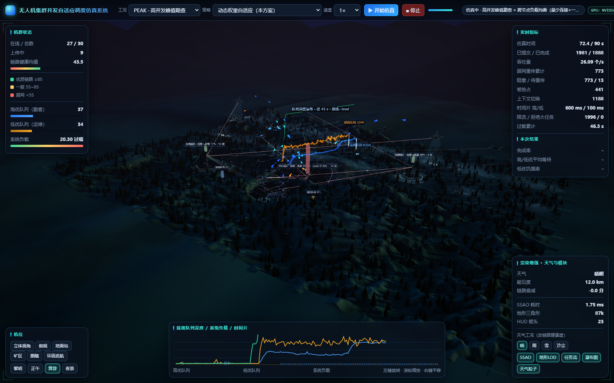
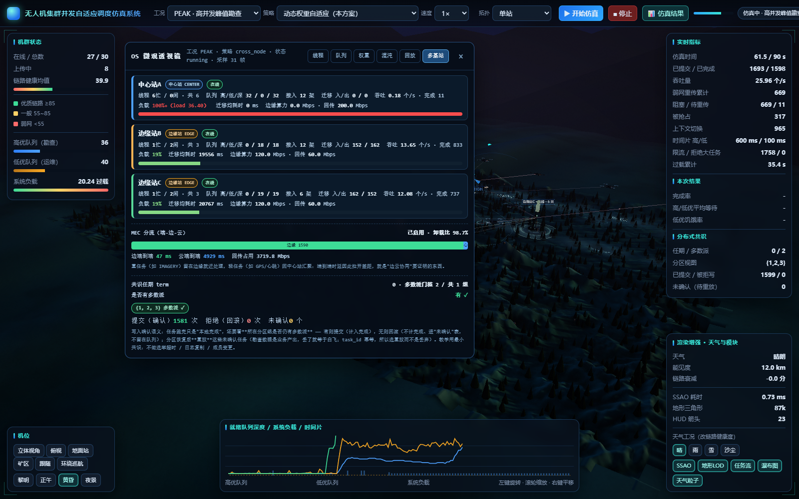
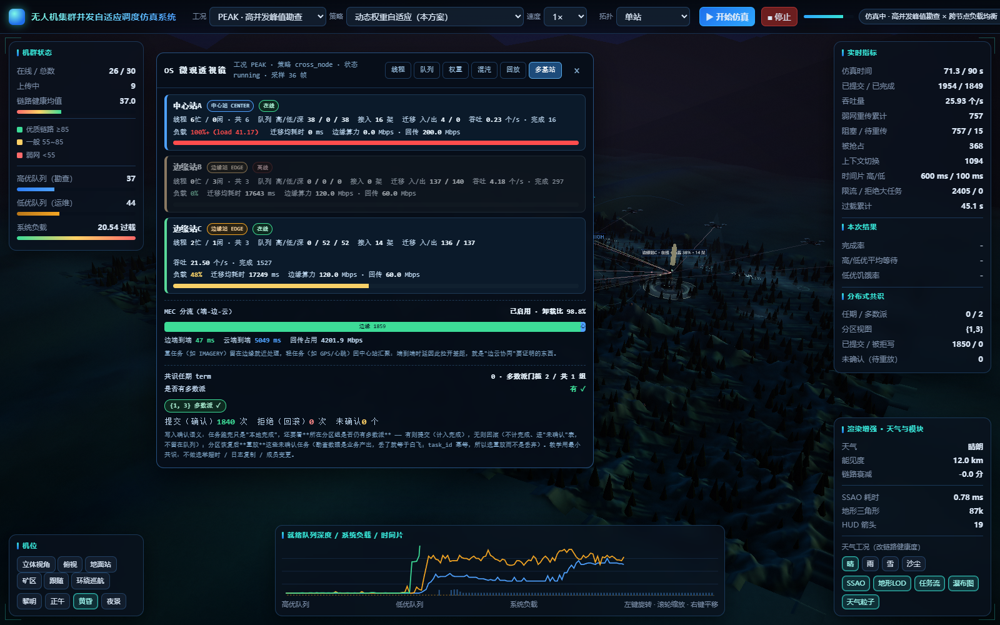
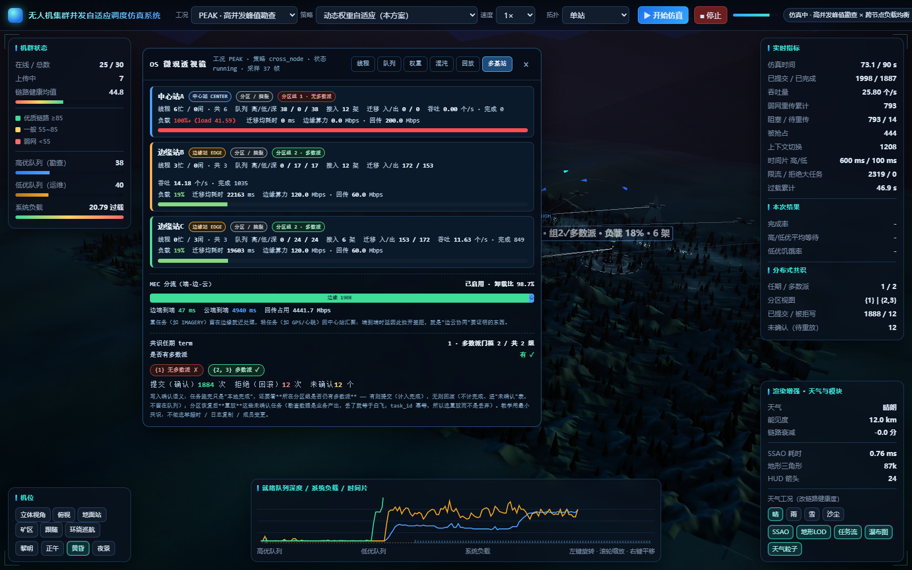
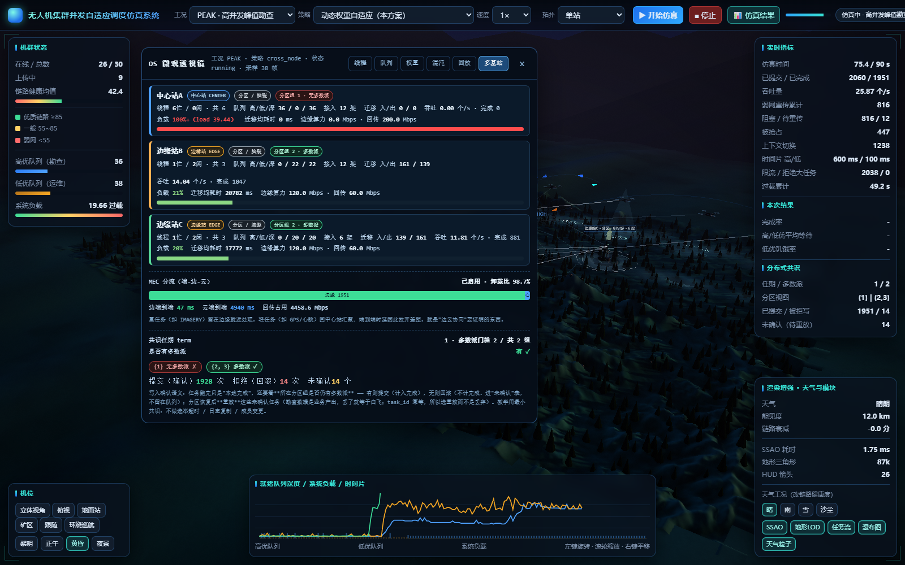
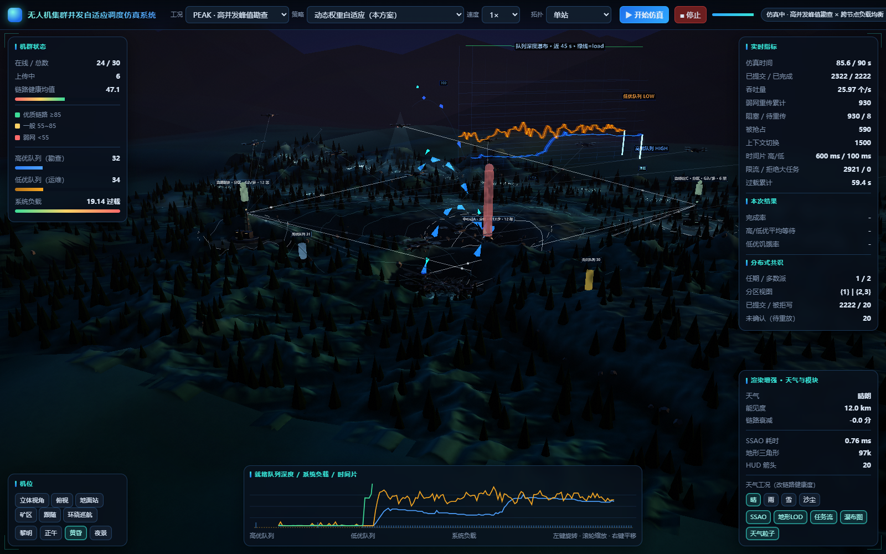

> **截图状态：已用当前代码全部重拍**（`tools/shot.mjs` + `tools/shot_stations.js` 无头 GPU 渲染，
> 与实施代码同一次构建，脚本内联断言全 `[OK]`，逐张人工复核过）。六张图分别对应：
> scene（全景）→ tab（OS 透视页签）→ down（节点宕机）→ **partition（网络分区）** →
> **split_brain（脑裂 + 拒写证据）** → **act=1 + `?cam=station`（3D 近景）**。
>
> 为什么要重拍 19~21 三张旧图：上一轮那三张由旧代码产出，站卡片上还没有 quorum 字段；
> 用新代码重拍后，画面与 `docs/11` 的字段表（`is_majority` / `live.quorum`）才是**同一份证据**。
>
> 另外还修了一个**真实的渲染 bug**（不是截图脚本的问题）：`OrbitControls` 开启阻尼后，
> 每帧 `controls.update()` 会按内部 spherical 把相机拉回拖动前的位姿 —— 于是
> "用 JS 改相机位姿再截图"永远拍在默认的「立体视角」。现在 `app3d.html` 支持
> `?cam=<iso|top|station|pit>` URL 参数（构造期就落到指定机位），并暴露
> `window.__uavCam(name)` 供自动化使用；截图脚本用 `&act=1&cam=station` 组合即可拍到近景。

### 2.2 「📊 仿真结果」界面（本轮新增，把"翻文件夹看图"变成"点一下"）

**要解决的问题**：跑完实验后，10 张图散在 `charts/`、矩阵在 `results/summary.csv`、
多站/ MEC / 天气 / GPU 各自在自己的子目录里 —— 演示时只能一个个文件夹点开；
更要命的是**看不出某张图是哪次实验产出的**（旧图当新结论是这类项目最容易犯的错）。

**做法**：3D 顶栏「开始仿真 / 停止」右侧加一个按钮，点开**全屏遮罩**（3D 场景不停，
关掉即回到场景）。五个页签：

| 页签 | 内容 | 数据源 |
|---|---|---|
| **本次运行** | 体检表 14 项 KPI（吞吐/完整率/等待/P95/饥饿/利用率/重传/不均衡/迁移/分流/端到端/quorum）+ 实时进度行 + **每站一张表**（在线/分区组/多数派/忙闲/队列/负载/完成/迁移） | `Simulator.snapshot()`（内存态） |
| **图表** | 按目录分组（核心结论 15 组 / 多站矩阵 / 伴生探针 / MEC / 天气 / 场景测评 / GPU / 文档截图），**每张卡片标生成时间 + 文件大小**，点开灯箱放大（← → 切换、Esc 关闭） | `charts/`、`results/*/`、`docs/images/`（**白名单**） |
| **15 组矩阵** | 表格视图，13 个指标列，**点表头排序**，附口径说明（单次实跑有抖动） | `results/summary.csv` |
| **时序回放** | 选一份 `raw/*.json`，拖滑块/播放看**高优队列、低优队列、系统负载**随时间变化（游标处实时读数） | `results/raw/*.json` 的 `queue_samples` |
| **置信区间** | 变体 × 指标 × 策略的 `mean ± ci95_half (n)` 表 | `results/replications/replication_summary.csv` |

**接口（只读、白名单，三个都新增）**：

| 接口 | 返回 | 安全约束 |
|---|---|---|
| `GET /api/results` | `{images:[{dir,title,note,images:[{rel,name,title,mtime,size}]}], summary:{exists,generated_at,seed,columns,rows}, raw:{items}, replication_ci:{rows}, live:{...}}` | 只扫 `dashboard.RESULT_SECTIONS` 白名单目录；**一次只返回元数据**，图片本身懒加载 |
| `GET /results_img/<相对路径>` | 图片字节流 | **两道闸**：① 必须落在 `RESULT_IMG_DIRS` 白名单目录（`resolve()` 后比较前缀，`../`/绝对路径/盘符全部拒绝）；② 只允许图片扩展名。失败一律 404 且不回显服务器路径 |
| `GET /api/raw_series?name=<文件名>` | `{ok, series:[{ts,high,low,load,running,blocked}], metrics}` | 文件名禁止 `/`、`\`、`..`，只读 `results/raw/` |

**三个刻意的设计决定**：

1. **遮罩而不是新页面**：演示时要"跑着给它看结果"，新页面会把仿真停掉；
2. **每张图必须带生成时间**：`charts/` 里的图可能来自上周那次 `all`，不标时间就会"拿旧图当新结论"；
   页面顶部还单独标了 `summary.csv 生成于 …`；
3. **"本次运行"与"磁盘产物"显式分开**：面板里这一轮是演示口径（`time_scale` 放大）、**不落盘**，
   与 `run.py all` 的正式产物不是同一批数据 —— 混在一起最容易得出"图对了但数不对"。

**实测截图**（无头 GPU 渲染 + `tools/act_results.js` 内联断言，全部 `[OK]`）：

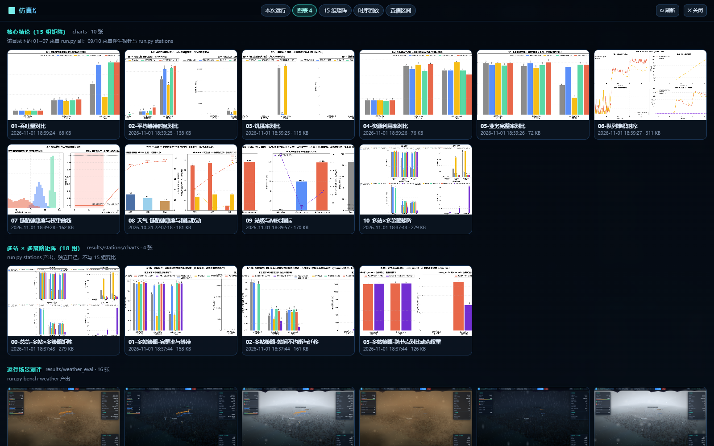
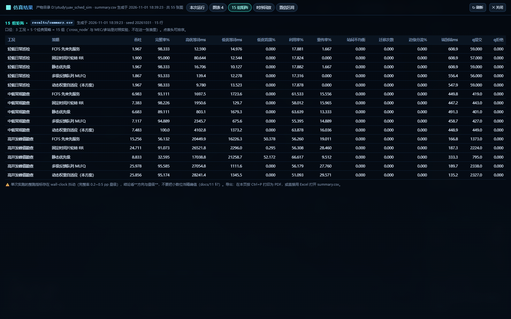
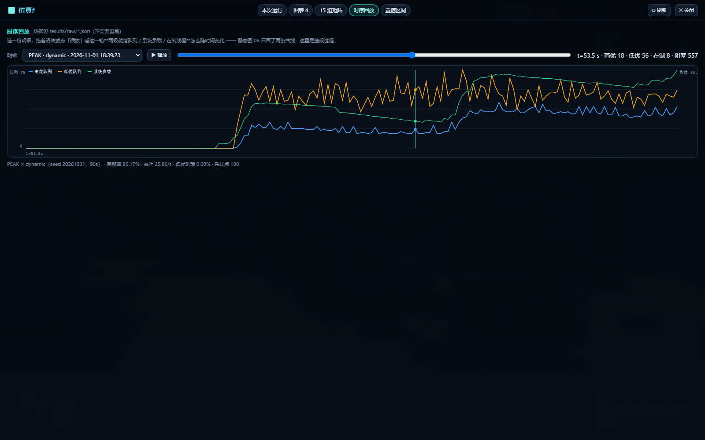
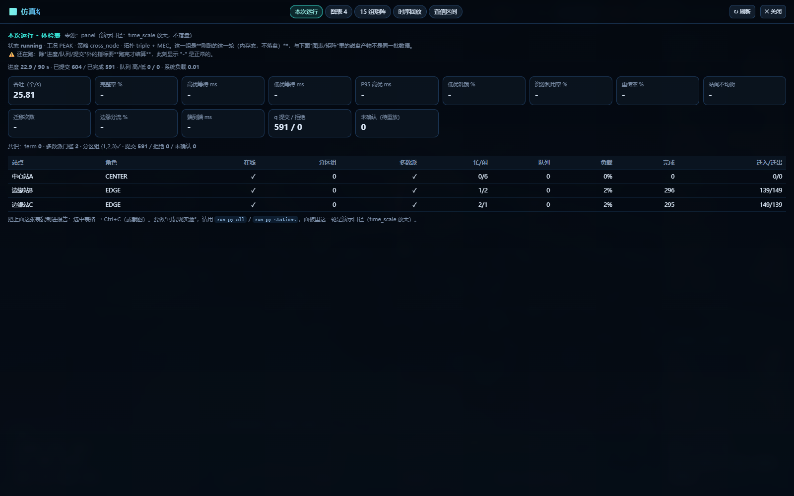
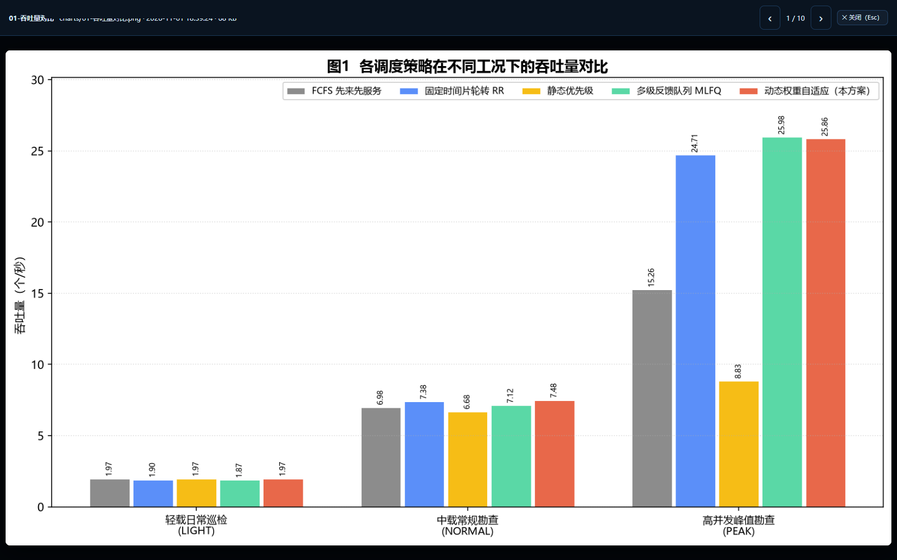
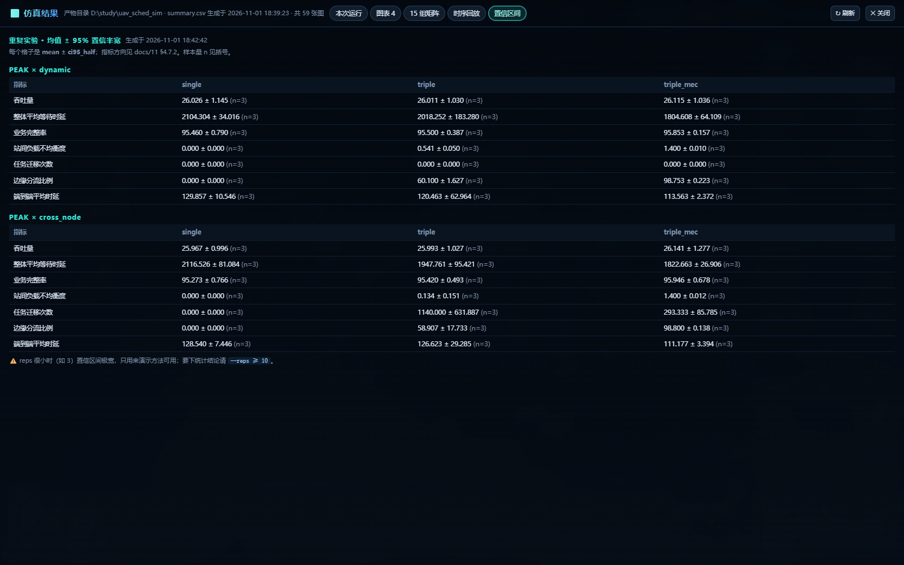

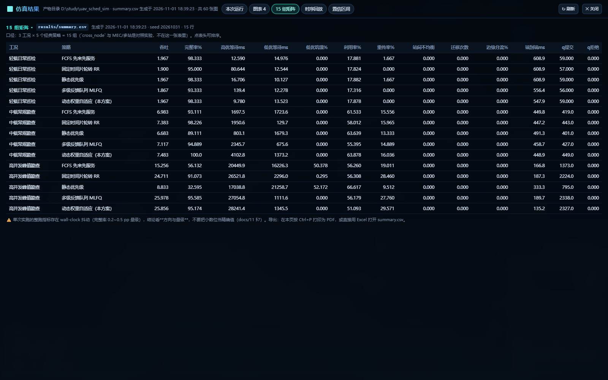

> **顺手修的两个真 bug**（不是截图脚本的问题）：
> ① 结果遮罩头部原本用 `class="bar"`，与页面早就存在的全局 `.bar{height:6px;overflow:hidden}`
> （左侧面板进度条）撞名，导致标题/页签被压成一条 —— 改成 `.rxbar` 并加 `@media` 规则处理
> 窄窗口（1366/1440 分辨率下把 GPU 徽章、quorum 徽章依次收起，保证按钮不被挤出屏幕）；
> ② 灯箱背景是半透明时，底层结果界面的标题会透上来与灯箱标题叠字 —— 给灯箱头部加实底色。
>
> **exe 里的产物定位**（也是实测踩出来的）：exe 从 `dist/` 启动时，`charts/` 与 `results/`
> 其实在**项目根**（`dist/..`）；而打包内置的 `config.yaml` 里 `results_dir: results` 会按
> `_MEIPASS` 解析到临时目录，且 `load_config()` 会顺手把那个目录建出来 ——
> 于是"目录存在"这个判据在 exe 里恒为真，结果界面永远空白。
> 现在 `dashboard._detect_output_root()` 按 `[UAV_RESULTS_ROOT 环境变量 → exe 目录 → exe 上级目录 → cwd]`
> 探测"真的有 `charts/` 或 `results/`"的那一层；`_results_dir()` 的判据也从"目录存在"改成
> "目录里真的有 `summary.csv` 或 `raw/`"。修完后 exe 内实测：**60 张图 / 15 行矩阵 / 15 份 raw / 42 行 CI** 全部可读。

### 2.3 结果界面的三个"能动手"的能力（本轮新增）

看数据只是第一步；真正省时间的是**在同一个界面里把实验重跑、把两次结果对比、把素材打包带走**。

#### 2.3.1 一键重跑（`GET /api/run_experiment` + `/api/run_status` + `/api/stop_experiment`）

点结果界面右上角「↻ 重跑」→ 对话框里选跑哪个 → 点「开始重跑」：

| 实验 | 预计 | 会覆盖什么 |
|---|---|---|
| `all` | 100~130 s | `results/summary.csv`（**服务端先备份为 `summary.prev.csv`**） |
| `stations` | 120~150 s | `results/stations/*`（独立目录，不动 15 组） |
| `mec` | 110~140 s | `results/mec/*`（独立目录） |
| `replicate` | 150~200 s | `results/replications/*`（独立目录，可设 reps） |

**三条纪律**（写进代码注释，也是这个功能敢放进界面的前提）：

1. **白名单**：`kind` 只能是 `EXPERIMENT_KINDS` 的键，命令行由**服务端**拼装
   （`<python> run.py <白名单参数>`），**绝不接受前端传来的任意命令**；
2. **先备份再覆盖**：`all` 跑之前把旧 `summary.csv` 复制成 `summary.prev.csv`
   —— 覆盖式实验最容易丢的就是"上一次的对照"；
3. **不并发**：同一时刻只允许一个实验任务（否则两个 `run.py all` 会抢同一批输出文件）。

实现上跑在**子进程**里（`subprocess.Popen` + 输出泵线程 + 400 行环形缓冲），
所以面板与 3D 场景不受影响，失败也带不崩面板；界面每秒轮询 `/api/run_status`，
把子进程输出实时贴进对话框，**跑完自动刷新结果界面**。

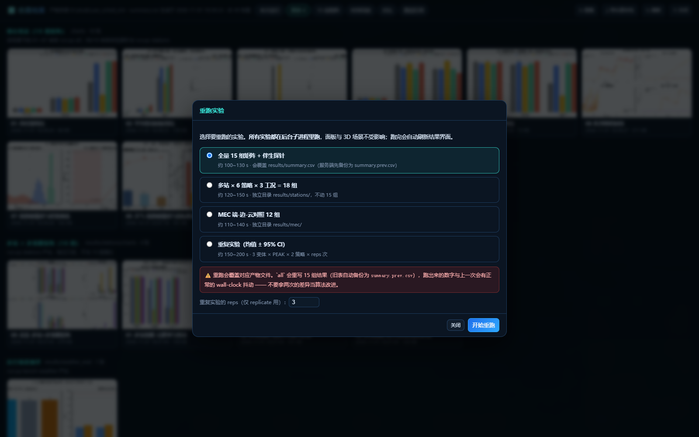


> 实测（本轮）：`stations` 66 行输出 / `mec` 62 行输出，均 `rc=0`；
> 跑完后 `results/stations/charts/*` 的时间戳从 18:37 变成 21:29，页面缩略图同步更新。

#### 2.3.2 两份明细对比（页签「对比」）

选两份 `results/raw/*.json`（左边基线 A、右边对照 B），得到：

* **12 个指标的并排表**：A 值 / B 值 / 差值（B−A）/ 相对差 % / **判定**（按指标方向标"变好/变差"，
  绿红两色；中性指标标"—"）；
* **叠加曲线**：A、B 两组的高优队列（实线）与低优队列（虚线）画在同一张画布上，直接看"谁堆得更狠"；
* 顶部**明确警告**：若两份明细的 seed 不同，差值里混着随机性，**不能当因果结论**
  （呼应 §7.1 的"抖动基线"方法论）。

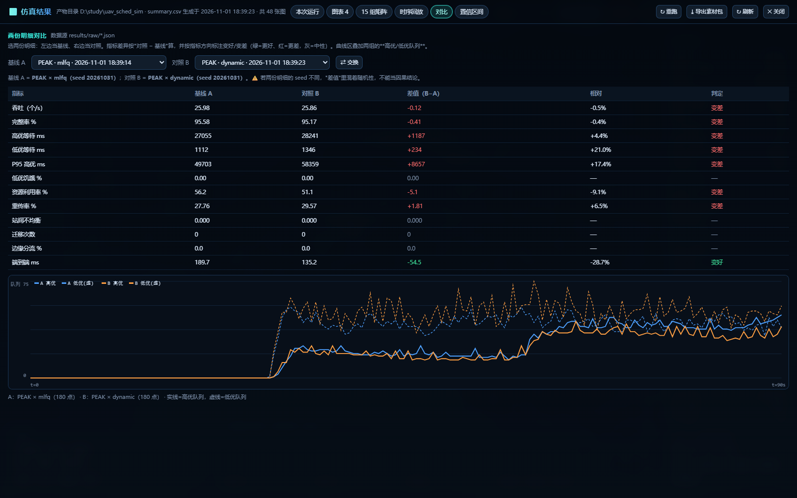

#### 2.3.3 导出「报告素材包」（`GET /api/export_bundle?scope=charts|all`）

一键打 zip（纯标准库 `zipfile`，流式返回）：

| 内容 | charts（默认） | all |
|---|---|---|
| `charts/*.png`（01~10） | ✅ | ✅ |
| `results/stations/`（CSV + 4 张图） | ✅ | ✅ |
| `results/station_probe/` | ✅ | ✅ |
| `results/mec/`、`results/replications/` | — | ✅ |
| `screenshots/`（`docs/images` 归档图） | — | ✅ |
| **`结论摘要.md`**（由 `summary.csv` **自动生成**的 Markdown 表 + 复现命令） | ✅ | ✅ |
| `README.txt`（目录说明 + 口径提醒 + 完整文件清单 + 被跳过的文件） | ✅ | ✅ |

**刻意不打包 `results/raw/`**：15 份 JSON 就 11 MB，且是中间产物，报告用不上；
单文件超过 12 MB 会跳过并在 README 里列出来（避免"悄悄少东西"）。
实测 `scope=charts` 产出 **2.0 MB / 18 个条目**，能直接发微信/邮件。

> 中文文件名走 RFC 5987 的 `filename*=UTF-8''…`，否则浏览器按 latin-1 解会乱码（实测踩过）。

---

## 3. 跨节点负载均衡策略 `cross_node`

注册名 `cross_node`，中文名「**跨节点负载均衡（最少连接 + 一致性哈希）**」——
这是系统第 **6** 种调度策略（前 5 种见 [`00-接口契约.md`](00-接口契约.md) §4.7）。

### 3.1 三步决策

```
① 亲和性基线：s_pref = consistent_hash(uav_id)            # 同一架机稳定落同一站（64 个虚拟节点）
② 负载改判  ：若 online(s_pref)=false / partitioned(s_pref)=true
              / load(s_pref) > 全局平均 load × 1.25
              → s* = least_connections()                  # 换到在制任务最少的在线未分区站
   否则 s* = s_pref
③ 迁移计价  ：若 s* ≠ task.station_id
              → 记一次迁移：+120 ms 在途、剩余服务时长 ×1.15、
                在途窗口内不占任何站的槽位
              → task.station_id = s*; task.migrate_count += 1
              → 单轮迁移总量不超过 migration_batch = 8
```

### 3.2 公式与参数

**选站判据**（冻结实现：`station.py` / `scheduler/cross_node.py`）：

```
least_connections(s) = argmin_s active(s)      , s ∈ {online(s) 且 非 partitioned}
consistent_hash(k)   = ring[ hash(k) ]  # 每站在环上占 hash_virtual_nodes=64 个虚拟节点
改判条件              : online(s_pref) == false
                     或 partitioned(s_pref) == true
                     或 load(s_pref) > mean(load) × migration_load_ratio
```

**迁移代价**（冻结参数，值见 §1.5）：

```
在途耗时   : migration_latency_ms = 120 ms（仿真时间；在途期间不占任何站的并发槽位）
带宽损耗   : 迁移后剩余服务时长 ×(1 + migration_bw_penalty) = ×1.15
迁出水位   : load(站) > 全局平均 load × migration_load_ratio = ×1.25
单轮上限   : migration_batch = 8 个任务
```

| 参数（`config.yaml` 键） | 含义 | 取值 |
|---|---|---|
| `stations.nodes` | 默认拓扑 | **1 个 CENTER 站**（单站） |
| `stations.topologies.triple` | 多站拓扑 | **3 站**（1×CENTER + 2×EDGE） |
| `stations.nodes[].workers` | 每站工作线程数 | 单站 `8`；triple：CENTER `6`、EDGE 各 `3` |
| `stations.nodes[].bandwidth_mbps` | 每站上行带宽 | 单站 `150`；CENTER `150`、EDGE `90` |
| `stations.migration_latency_ms` | 迁移在途耗时 | `120` ms |
| `stations.migration_bw_penalty` | 迁移带宽损耗 | `0.15` |
| `stations.migration_load_ratio` | 迁出触发水位 | `1.25` |
| `stations.migration_batch` | 单轮最大迁移数 | `8` |
| `stations.hash_virtual_nodes` | 一致性哈希虚拟节点数 | `64` |

**站级 / MEC / quorum 指标键**（`models.METRIC_SPEC` 累计新增 **22** 个，指标总数 **24 → 46**；
本轮在上一轮 18 个的基础上追加了最后 4 个 quorum 键）：

| 指标键 | 中文名 | 单位 |
|---|---|---|
| `station_max_queue_depth` | 单站最大队列深度 | 个 |
| `station_load_imbalance` | 站间负载不均衡度 | σ/均值 |
| `migration_count` | 任务迁移次数 | 次 |
| `migration_cost_ms` | 迁移平均代价 | ms |
| `cross_node_comm_ms` | 跨节点通信开销 | ms |
| `edge_offload_ratio` | 边缘分流比例 | % |
| `avg_e2e_ms` | 端到端平均时延 | ms |
| `edge_e2e_ms` | 边缘任务端到端时延 | ms |
| `center_e2e_ms` | 中心任务端到端时延 | ms |
| `e2e_if_edge_ms` | 全下沉边缘端到端时延 | ms |
| `e2e_if_center_ms` | 全回中心端到端时延 | ms |
| `e2e_light_if_edge_ms` | 轻量任务全下沉边缘时延 | ms |
| `e2e_light_if_center_ms` | 轻量任务全回中心时延 | ms |
| `e2e_heavy_if_edge_ms` | 重勘查全下沉边缘时延 | ms |
| `e2e_heavy_if_center_ms` | 重勘查全回中心时延 | ms |
| `mec_crossing_data_mb` | 边缘卸载分水岭数据量 | MB |
| `mec_light_tasks` | 轻量任务数 | 个 |
| `mec_heavy_tasks` | 重勘查任务数 | 个 |
| `quorum_commits` | 共识确认（提交）次数 | 次 |
| `quorum_rejects` | 无多数派侧被拒写次数 | 次 |
| `uncommitted_tasks` | 未确认（待重放）任务数 | 个 |
| `quorum_term` | 共识任期 term | — |

> **口径例外（本轮新增，必须写进报告）**：`quorum_commits` 在**单站 / 未分区多站**下
> **等于完成数（不是 0）** —— 单站时 `majority=1`，每次正常完成都是一次成功确认；
> `quorum_rejects` / `uncommitted_tasks` / `quorum_term` 在单站下**恒为 0**。
> 这是刻意口径，见 §5.3。

> 后 9 个（`e2e_if_*` / `e2e_light_if_*` / `e2e_heavy_if_*` / `mec_crossing_data_mb`）是**反事实对照**：
> 同一批任务分别按"全下沉边缘""全回中心"重算时延，用来回答"这一份数据到底该不该卸载"（§4.3.1）。
> `mec_light_tasks` / `mec_heavy_tasks` 给出**任务配比的直接证据** —— 有了这两个数，
> "分流比例为什么接近 100 %"就不必靠读者推断（§4.3.1 第①条的 2692 / 75 即由此而来）。
> 单站模式下这 18 个键**恒为 0 或等价值**（`models.py` 注明），所以既有的 24 个指标口径不受影响。

> **为什么必须"有代价"**：如果迁移瞬间完成、且不占带宽，那么"把所有任务都搬到最闲的站"
> 永远是最优解，负载均衡会退化成"每毫秒重新洗牌"，实验上表现为 `migrations_in/out` 爆炸而
> 时延不降。把代价显式记账，才能观察到**"迁移收益 > 迁移代价"才迁移**这个真实的取舍。
>
> **代价是真实开销，不是账面数字**：实测（多站-无MEC 档）站间不均衡度从 0.534 降到 0.099，
> 但**平均等待从 1971 ms 升到 2190 ms（约 +11 %）**，同时发生 1053 次迁移、平均代价 519.8 ms。
> 也就是说**均衡度的大幅改善是用等待时间换来的**（本次 +11%，在单次实跑波动范围内）。
> 报告里必须两条一起写 —— 只报"不均衡度降了一个数量级"而隐去等待变长，是不可信的。

### 3.3 与既有 5 种策略的关系（**两层混合，不是另起一套**）

`CrossNodeScheduler` **继承 `DynamicWeightScheduler`**，所以它是"**站内 + 站间**"两层的组合：

| 层 | 决策 | 机制 |
|---|---|---|
| **站内**（复用 `dynamic`） | 这一轮派谁 | 多级就绪队列 + 四因子动态权重 + 饥饿硬补偿 + 自适应时间片 + 弱网降权/缓存 + 过载收敛 |
| **站间**（`cross_node` 新增） | 这个任务归哪个站 | 最少连接 + 一致性哈希 + 带代价迁移 |

也就是说 `cross_node` **不是**"另立一套站内调度"，而是在动态权重之上加了"选站"这一层。
这个取舍有实测代价支撑：

> **工程取舍（T1 记录）**：最初把 `cross_node` 写成一套**独立的严格优先级调度**，
> 实测单站完整率只有 **31.7%**（远差于 `dynamic` 的约 95%）——因为站内那一半的
> "饥饿硬补偿 + 自适应时间片"被丢掉了。**重构为继承 `DynamicWeightScheduler` 后完整率回到 95.6%**。
> 结论：**跨节点均衡解决的是"站与站之间"的不均，不能替掉"站内"的公平性与过载收敛**。
> （该 31.7% 是重构前的一次实测记录，代码已重构，当前仓库不可复现。）

**迁移的四条硬约束**（`station.py` / `cross_node.py` 实现）：

| 约束 | 规则 | 为什么 |
|---|---|---|
| **禁止迁回 home 站** | 只做 `home → 其它站` 的单向分流，候选目标必须 `sid != task.home_station_id` | 把任务搬回老家没有任何均衡收益（该站的负载正是它原本承担的），白付迁移代价，还会乒乓 |
| **迁移次数上限** | `migrate_count >= 2` 的任务不再被选中迁出 | 防止同一任务反复被搬（迁移抖动） |
| **MEC 角色匹配** | MEC 开启时，迁移目标站的角色必须等于 `desired_role_for(task_type)`（重勘查不许迁到边缘） | 否则"刚下沉到边缘的重任务又被搬回中心"，破坏端-边-云分层 |
| **单轮批量上限** | 每站单轮最多迁 `migration_batch = 8` 个 | 防止一次搬空队列造成站间震荡 |

**由此可推出一个可验证的不变式**：`migrate_count > 0` 的任务必然满足
`station_id != home_station_id`（因为"迁回 home"被显式禁止）。

### 3.4 边界与已知放宽（失败模式下的取舍）

以上约束在**正常运行**下严格成立；**节点宕机疏散**时有一处**刻意放宽**，必须如实说明：

| 场景 | 行为 | 取舍理由 |
|---|---|---|
| 正常迁移 | 角色约束**严格**（`desired_role_for`）+ 禁止迁回 home + 次数上限 | 均衡收益优先，且不能破坏分层 |
| **节点宕机疏散** | 角色约束放宽为 **best-effort**：**不检查角色**，只按最少连接选活站 | **"任务必须落到某个活站"优先于"必须落到正确角色的站"** —— 站点已经死了，此刻保命 > 保分层 |
| **分区期间** | 疏散**遵守网络分区**：只迁往**同 `partition_group`** 的站 | 跨分区本来就不可达，把任务"迁"过去等于丢任务 |

> 这三条合起来就是一次完整的失败模式设计：**正常路径严格、故障路径保命、分区路径不放行**。
> 实验中可通过"宕机后 `migrations_in/out` 是否增长、任务是否落到异构角色站"来观察这条边界。

---

## 4. MEC 边缘计算：任务分级与端-边-云权衡

### 4.1 任务分级规则

| 类别 | 任务类型 | 去向 | 业务理由 |
|---|---|---|---|
| **LIGHT**（轻量运维） | `GPS` / `HEARTBEAT` / `ATTITUDE` / `ALARM` | **下沉 EDGE 边缘站** | 几百 KB、时延敏感、算力需求低，跑一趟中心机房不值当 |
| **HEAVY**（重勘查） | `IMAGERY` / `MULTISPECTRAL` / `LIDAR` | **回 CENTER 中心站** | 数据量大、需要集中算力与全局视角 |

快照中通过 `mec.task_class` 暴露映射关系，例如 `{"IMAGERY":"HEAVY","GPS":"LIGHT"}`。

### 4.2 可调参数（`config.yaml` 的 `mec:` 节）

| 参数 | 含义 | 默认值 |
|---|---|---|
| `mec.enable` | **只表示"MEC 卸载策略"是否开启**（是否按角色把轻量任务**主动下沉**边缘） | **`false`**（不改变任何调度行为） |
| `edge_task_types` | 下沉边缘的任务类型 | `[GPS, ATTITUDE, HEARTBEAT, ALARM]` |
| `center_task_types` | 回中心的任务类型 | `[IMAGERY, MULTISPECTRAL, LIDAR]` |
| `edge_compute_mbps` | **边缘算力**（可调） | `120` |
| `center_compute_mbps` | 中心算力 | `400` |
| `backhaul_mbps` | **边缘 → 中心回传带宽**（可调） | `60` |
| `sync_ratio` | 边缘需回传中心同步的数据比例（**通信开销来源**） | `0.15` |
| `edge_access_ms` | 边缘接入时延基础值 | `18` |
| `center_access_ms` | 中心接入时延基础值 | `46` |

#### 4.2.1 `enable` 只切"卸载策略"，不切"度量"

| `enable` | 卸载决策（轻量任务是否**主动**下沉） | 时延/分流**统计** |
|---|---|---|
| `false`（默认） | 由**普通负载均衡**决定落点（无角色偏好） | **照常统计** |
| `true` | 按 `desired_role_for(task_type)` 决定落点（轻量→EDGE，重勘查→CENTER） | **照常统计** |

**为什么统计必须恒开启**：如果让时延/分流统计也跟着 `enable` 走，那么"纯中心"模式下
`avg_e2e_ms` 恒为 0，"纯中心 vs 端-边-云"就**没有可比口径**了。
所以 `e2e` 是**度量**、`enable` 是**策略**，两者解耦（`simulator.py` 在 `dispatch()` 里对所有策略统一记账）。

#### 4.2.2 **接入亲和 ≠ MEC 卸载**（两个概念别混）

`mec.enable=false` 时 `edge_offload_ratio` 仍可能 ≈ **0.55**（实测：多站-无MEC 档
`dynamic` 59.43 %、`cross_node` 55.16 %）。这**不是** MEC 卸载，而是**接入亲和**：

1. 多站拓扑下每架无人机按**一致性哈希**有一个**原生接入站**；
2. 有些无人机的接入站**本来就是边缘站**（2 号/3 号站）；
3. 这些机产生的任务自然落在其接入站上 —— 边缘站**因此承担这部分流量**。

而 `enable=true` 时的 ≈ **98.8 %** 才是真正的 MEC 卸载结果：**不论接入站是谁**，
只要任务类型是轻量运维就**主动下沉**到边缘站（已派发任务中轻量占 **98.8 %**，详见 §4.3.1）。

| 概念 | 触发条件 | 靠什么决定落点 | 实测占比 |
|---|---|---|---|
| **接入亲和** | 始终存在（多站拓扑） | 无人机 ↔ 站的一致性哈希归属 | ≈ 55~59 % |
| **MEC 卸载** | 仅 `enable=true` | `desired_role_for(task_type)` 角色分级 | 轻量任务几乎全部 → 合计 ≈ 98.8 % |

### 4.3 通信开销 vs 计算开销（模型口径）

```
T_e2e(去 CENTER) = center_access_ms + T_comp
T_e2e(去 EDGE)   = edge_access_ms   + T_comp + T_back

T_comp = data_mb / compute_mbps × 1000              # 站内计算（CENTER 400 / EDGE 120），单位 ms
T_back = sync_ratio × data_mb / backhaul_mbps × 1000  # 只有"要回中心入库"的部分才付（通信开销）
```

> 与 `mec.py` 的模型一致：`T_e2e = 接入时延 + 计算时延 + 回传时延`，回传项只对"要回中心入库"的
> 数据计费（`sync_ratio`）。**不含该站的排队时延**（排队由站内调度决定，单列在 `avg_wait_*` 指标里）。

* **下沉 EDGE 的收益**：接入时延从 `46 ms → 18 ms`，且把轻量任务**从中心站的队列里挪走**
  （中心队列更短 → 重勘查任务的 `T_wait` 下降）；
* **下沉 EDGE 的代价**：算力只有中心的 `120/400 = 30%` → `T_comp` 变大，
  并且多出一项 `T_back`（`sync_ratio = 15%` 的数据要回传同步）；
* **拐点**：轻量任务（小 `size`）的 `T_comp` 很小，`T_back` 也小，下沉几乎无条件划算；
  一旦把**大数据量任务**往边缘塞，`T_comp` 会以 `size/120` 的速度膨胀并吃光接入时延的收益 ——
  所以分级规则把 `HEAVY` 钉死在 CENTER（§4.1），而不是"一律下沉"。

> 上面是**模型口径**（与 `mec.py` 的 `T_e2e` 组成一致）；这四类时延分别聚合到指标
> `center_e2e_ms` / `edge_e2e_ms` / `avg_e2e_ms`，以及通信开销 `cross_node_comm_ms`
> 与分流比 `edge_offload_ratio`。

### 4.3.1 口径交代：任务配比与"边缘分流比例"的关系（**读数据前必看**）

这一节必须写在数据表**正前方**，否则下表的 `edge_offload_ratio ≈ 98.8 %` 会被误读成"MEC 的成功证据"，
甚至被反过来质疑"端-边-云只是把 98 % 的活挪到了边缘"。

**① PEAK 工况的任务配比本身极度偏向轻量任务。**

这里有两组数，**分母不同，不要混用**：

| 口径 | 含义 | LIGHT 轻量运维 | HEAVY 重勘查 | 轻量占比 |
|---|---|---|---|---|
| **已派发任务**（`run.py mec` 输出，**MEC 指标真正的分母**） | 实际被派发执行的任务 | **2344** | **29** | **98.8 %** |
| 事件轨迹（`generate_trace` 生成） | 全部到达事件 | 2692 | 75 | 97.3 % |

两者的差异来自"事件数"与"实际派发数"分母不同（部分任务未完成 / 被丢弃 / 尚未派发）。
**下文一律用「已派发」口径 2344 / 29（98.8 %）**，因为 `mec_light_tasks` / `mec_heavy_tasks`
这两个新指标就是这么统计的。

按类型拆开（事件轨迹口径，供理解配比来源）：心跳 689 / GPS 716 / 姿态 629 / 告警 658 = 2692 条；
影像 28 / 多光谱 22 / LiDAR 25 = 75 条。

**② 所以 `edge_offload_ratio` 天然接近 100 %，它不能单独作为结论。**
该指标的分母是**任务条数**；轻量任务占 98.8 %、MEC 又把轻量任务全部下沉，
于是分流比 ≈ 98~99 % 是**配比的算术后果**，而不是"算法有多高明"。
**看这一列判断 MEC 成败是错的。**

**③ 真正说明 MEC 价值的判据只有两条，且都与任务配比无关**：

| 判据 | 指标 | 实测值 | 结论 |
|---|---|---|---|
| **(a) 卸载分水岭** | `mec_crossing_data_mb` | 基线 **3.36 MB** → 边缘算力减半 **1.68 MB** → 回传降至 1/3 **2.10 MB** → 两者同时恶化 **1.29 MB** | 分水岭由**算力/带宽**决定，与任务配比无关；参数越好、边缘能接的业务范围越大 |
| **(b) 按类别的反事实时延** | `e2e_light_if_*` / `e2e_heavy_if_*` | 轻量：边缘 **47.3 ms** < 中心 59.5 ms（**下沉更优**）<br>重勘查：边缘 10483 ms > 中心 **4876 ms**（**必须回中心**） | 同一批任务分别按两种落点算时延，**干净地回答"该不该沉"**，不受"实际落了多少"影响 |

判据 (b) 之所以干净，是因为它用**同一批任务**算两个反事实值，把"任务大小差异"与"落点差异"解耦了
（`mec.py : note_dispatch()` 的实现注释写明了这个动机）。

**④ 为什么没有为了让数字好看而调高 PEAK 的勘查占比？**

因为那会改动既有 15 组实验的**输入轨迹**（`WorkloadTrace`），直接破坏**控制变量法**：
15 组结果的对照前提是"同一份任务轨迹只换调度策略"。改了配比 → 既有 15 组结论全部作废 →
反而要重跑并重写报告里所有数字。**宁可如实标注口径，也不改数据。**
（本项目的既有惯例：负面/不利结论照写，见 `gpu/README.md` 第 5 节与 `docs/04` §4。）

**⑤ 复现入口**：`run.py mec` 在输出末尾会**自动打印**这段口径交代，
所以它不只是文档里的一句话，而是**随实验产物一起输出**的可复查声明。

### 4.4 对照实验数据（`run.py mec` 实测）

**口径说明（必读）**：

| 项 | 说明 |
|---|---|
| 来源 | `results/mec/mec_matrix.csv`（12 组 = PEAK × {纯中心 / 多站-无MEC / 端-边-云} × {dynamic, cross_node}），运行日志 `results/mec_run.log`，总实耗约 **112 s** |
| 参数 | `seed=20261031`，PEAK 工况，`time_scale=0.1`；数据库关闭；**不覆盖既有 15 组产物** |
| **单次实跑口径** | 本仿真器是**真实多线程 + sleep 模拟 IO**，指标有 **wall-clock 抖动**：同一配置连跑两次，`completion_rate` 差 **0.2~0.5 pp**、端到端时延差 **3~8 ms**、**站间不均衡度差 0.02~0.10**。**下表小数位不代表精确值**，只用于同表内**横向比较**与**效应方向**判断 |
| `avg_e2e_ms` 口径 | 在**派发时**记账、每个任务只计一次（`_mec_counted` 打标，抢占/重传不重复计）；**对所有策略统一统计**（含纯中心，否则纯中心恒为 0 就无可比口径）。它**不含排队等待**，排队单列在 `avg_wait_*` |
| **分流比口径** | `edge_offload_ratio` 的分母是**任务条数**，而已派发任务中轻量占 **98.8 %** → 该值天然接近 100 %，**不能单独当结论用**；判据请用 §4.3.1 的 (a)(b) 两条 |
| 模式的差别 | "多站-无MEC" 只是**关掉 MEC 分级决策**，任务仍会按负载均衡落到边缘站（所以 `edge_offload_ratio` 非 0）——它衡量的是"多站但无端-边-云策略" |

#### 4.4.1 纯中心 vs 端-边-云（同策略、同 seed）

| 策略 | 模式 | 端到端时延<br>`avg_e2e_ms` | 平均等待<br>`avg_wait_all_ms` | 业务完整率<br>`completion_rate` | 吞吐<br>`throughput` | 边缘分流比<br>`edge_offload_ratio` |
|---|---|---|---|---|---|---|
| `dynamic` | 纯中心（单站） | 122.71 | 2138.52 | 95.02 % | 25.86 | 0 % |
| `dynamic` | 多站-无MEC | 96.93 | 1971.48 | 95.21 % | 25.86 | 59.36 % |
| `dynamic` | **端-边-云** | **106.38（−13.3 %）** | **1841.55** | **96.15 %** | 26.07 | 98.78 % |
| `cross_node` | 纯中心（单站） | 140.54 | 2071.47 | 94.93 % | 25.80 | 0 % |
| `cross_node` | 多站-无MEC | 124.53 | 2190.49 | 95.16 % | 25.78 | 56.81 % |
| `cross_node` | **端-边-云** | **106.33（−24.3 %）** | **1864.23** | **95.70 %** | 25.98 | 98.78 % |

* **端到端时延**：两种策略下"纯中心 → 端-边-云"分别降 **13.3 %** 与 **24.3 %**，**方向一致**；
  `cross_node` 的降幅更大，是因为它的纯中心基线本身偏高（140.54 ms，单次口径波动所致）；
* **不要用"边缘分流比 98.78 %"当成绩**：它与已派发任务里轻量占 **98.8 %**（2344/29）是同一件事，
  见 §4.3.1 —— 这也解释了下面 §4.4.2 里端-边-云模式的站间负载为何**结构性不均**。

#### 4.4.2 跨节点均衡效果（`cross_node` 的核心成绩）

`station_load_imbalance` = 各站负载的**变异系数（σ/均值）**，0 = 完全均衡。

| 模式 | 策略 | 站间负载不均衡度 | 迁移次数 | 迁移平均代价 | 平均等待 |
|---|---|---|---|---|---|
| 多站-无MEC | `dynamic` | 0.534 | 0 | 0 | 1971 ms |
| **多站-无MEC** | **`cross_node`** | **0.099** | 1053 | 519.8 ms | 2190 ms |
| 端-边-云 | `dynamic` | 1.401 | 0 | 0 | 1842 ms |
| 端-边-云 | `cross_node` | **1.399（未降）** | 303 | 128.2 ms | 1864 ms |

* **多站-无MEC 一档：0.534 → 0.099** —— 这是"跨节点负载均衡确实有效"最硬的证据。
  **但请按区间表述，不要写死某个精确值**：同一代码两次运行该指标在 **0.02~0.10** 之间波动
  （迁移次数 1053~1130），因此**降幅约 80 %~96 %（跨运行波动）**，
  稳定的结论是「**不均衡度下降一个数量级**」，而不是某个精确百分比；
* **均衡不是免费的，平均等待可能略升**：本档 `cross_node` 的平均等待 **2190 ms** 高于
  `dynamic` 的 **1971 ms**（约 **+11 %**）—— 这正是**迁移开销的真实代价**
  （1053 次迁移、平均代价 519.8 ms）。若只报"不均衡度降了一个数量级"而隐去这一项，
  就是把好消息挑出来讲，不可信；
* **端-边-云一档降不下来（1.401 → 1.399），必须如实写明**：这不是 `cross_node` 失效，而是
  **MEC 的角色硬约束本身就把负载结构性分开了** —— 重勘查任务**只能进中心站**，
  于是"站间负载不均"是**设计要求的**，不是缺陷。这正说明：
  **MEC 分层与站间均衡是两个目标，会互相牵制**。

#### 4.4.3 通信开销 vs 计算开销（按类别拆分的反事实 + 分水岭）

同一批任务分别按"**全下沉边缘**"与"**全回中心**"重算端到端时延（不看它实际落在哪），
再按轻重类别拆开 —— 这样"任务大小差异"和"落点差异"就不会混在一起。

| 变体（边缘算力/回传） | 轻量@边缘 | 轻量@中心 | 重勘查@边缘 | 重勘查@中心 | **分水岭 d\*** |
|---|---|---|---|---|---|
| **边缘-基线**（120 / 60） | **47.3** | 59.5 | 10483.1 | **4876.0** | **3.36 MB** |
| 边缘-算力减半（60 / 60） | 69.9 | **59.5** | 18769.1 | **4937.6** | 1.68 MB |
| 边缘-回传 1/3（120 / 20） | **60.9** | 73.1 | 15313.1 | **9706.1** | 2.10 MB |
| 边缘-最差（60 / 20） | 83.4 | **73.0** | 23363.2 | **9706.1** | 1.29 MB |

**判读（可直接引用）**：

1. **轻量运维任务下沉边缘是划算的**：基线 47.3 ms（边缘）< 59.5 ms（中心）；
2. **重勘查任务必须回中心**：边缘 10483 ms vs 中心 **4876 ms** —— 边缘算力只有中心的 30 %，
   大数据的计算开销完全压倒接入时延的优势；
3. **分水岭会随参数移动**：把边缘算力减半，轻量任务在边缘**反而变慢**（69.9 > 59.5），
   **卸载分水岭从 3.36 MB 降到 1.68 MB**（回传降到 1/3 时为 2.10 MB）——
   这就是"**通信开销 vs 计算开销**"的量化结论：**调大边缘算力或回传带宽，边缘能接住的业务范围变大**。

分水岭已实现为 `MecController.crossing_data_mb()`，闭式解：

```
d* = (center_access_ms − edge_access_ms)
     / ( 1/edge_compute_mbps + sync_ratio/backhaul_mbps − 1/center_compute_mbps )
     ÷ 1000                                        # 单位换算 MB

代入基线：(46−18) / (1/120 + 0.15/60 − 1/400) / 1000 = 3.36 MB   ✓ 与实测一致
```

> 数据取自 `results/mec/mec_matrix.csv` 的 `cross_node` 行（`e2e_light_if_*` / `e2e_heavy_if_*` /
> `mec_crossing_data_mb`）；`dynamic` 行的同类数值略有差异（如重勘查@边缘 10483 ms），
> 属单次实跑口径内的波动。分水岭 `d*` 只由参数决定，两种策略下**都等于 3.36 MB**。

### 4.5 结论

1. **端-边-云能降端到端时延**：`dynamic` −13.3 %、`cross_node` −24.3 %（纯中心 → 端-边-云），方向一致；
2. **卸载有分水岭，不是"一律下沉"**：基线 3.36 MB；轻量任务下沉划算（47.3 < 59.5 ms）、
   重勘查必须回中心（10483 vs **4876** ms）；边缘算力减半后分水岭掉到 1.68 MB，
   轻量任务在边缘反而变慢（69.9 > 59.5 ms）；
3. **MEC 的价值不看"分流比例"**：`edge_offload_ratio ≈ 98.8 %` 是已派发任务配比
   （轻量 **98.8 %**、2344/29）的算术后果，不构成证据；证据是第 2 条的**分水岭**与**按类别反事实时延**
   （详见 §4.3.1）；
4. **`cross_node` 的收益在"多站无 MEC"档最清楚**：站间不均衡度 0.534 → 0.099，
   **降幅约 80 %~96 %（跨运行波动，稳定结论是"下降一个数量级"）**；
   **代价是迁移开销**：1053 次迁移、平均代价 519.8 ms，且**平均等待从 1971 ms 升到 2190 ms（约 +11 %）**
   —— 均衡度大幅改善的代价是等待变长，这一点必须如实写；
5. **MEC 分层会压制站间均衡**：端-边-云档不均衡度 1.401 且不下降 ——
   因为角色硬约束把重勘查任务钉在中心，这是**设计要求**而非缺陷；
6. **`cross_node` 不能替掉站内动态权重**：它继承 `DynamicWeightScheduler`
   （见 §3.3），否则站内公平性与过载收敛会崩（重构前完整率仅 31.7 %）。

> 全部数字为**单次实跑口径**（wall-clock 抖动：完整率 0.2~0.5 pp、端到端 3~8 ms、
> 站间不均衡度 0.02~0.10），结论看**效应方向与量级**，不要把小数位当精确值。
> 原始产物：`results/mec/mec_matrix.csv`。

---

### 4.6 多站 × 多策略完整矩阵（`run.py stations`）

§4.4 的 `run.py mec` 只跑「PEAK × 3 拓扑档 × 2 策略」= 12 组；要回答
**"换拓扑之后 6 个策略谁好谁坏、结论会不会翻"**，需要铺满矩阵。新增子命令：

```
triple 拓扑（1×CENTER + 2×EDGE，MEC **关闭**）× 6 策略 × 3 工况 = 18 组
```

**为什么 MEC 关闭**：这一档要看的是「拓扑 × 策略」两维，把 MEC 角色硬约束混进来会
把"站间均衡"和"角色分流"纠缠在一起（§4.4.2 已证明 MEC 分层会压制站间均衡）。

产出：`results/stations/stations_matrix.csv`（20 行 = 2 行表头 + 18 组）、
`results/stations/raw/*.json`、`results/stations/charts/*.png`（4 张），
并把总览另存为 `charts/10-多站×多策略矩阵.png`。**不写数据库、不覆盖 `results/summary.csv`。**

实测（`seed=20261031`，单次实跑，实耗 120.0 s）：

| 工况 | 策略 | 完整率 % | 平均等待 ms | 站间不均衡度 | 迁移次数 | 迁移平均代价 ms |
|---|---|---|---|---|---|---|
| LIGHT | fcfs | 96.7 | 14 | 1.414 | 0 | 0 |
| LIGHT | rr | 95.0 | 31 | 1.376 | 0 | 0 |
| LIGHT | priority | 98.3 | 11 | 0.000 | 0 | 0 |
| LIGHT | mlfq | 95.0 | 64 | 1.348 | 0 | 0 |
| LIGHT | dynamic | 98.3 | 16 | 0.000 | 0 | 0 |
| LIGHT | cross_node | 96.7 | 9 | 0.000 | 44 | 477.9 |
| NORMAL | fcfs | 72.8 | 7336 | 0.434 | 0 | 0 |
| NORMAL | rr | 91.1 | 1624 | 0.639 | 0 | 0 |
| NORMAL | priority | 29.3 | 16391 | 0.326 | 0 | 0 |
| NORMAL | mlfq | 92.9 | 1945 | 0.620 | 0 | 0 |
| NORMAL | dynamic | 93.8 | 2184 | 0.555 | 0 | 0 |
| NORMAL | **cross_node** | **95.1** | **1124** | **0.289** | 240 | 593.1 |
| PEAK | fcfs | 33.6 | 20715 | 0.526 | 0 | 0 |
| PEAK | rr | 89.3 | 4391 | 0.596 | 0 | 0 |
| PEAK | priority | 31.3 | 21681 | 0.551 | 0 | 0 |
| PEAK | mlfq | **95.9** | 1996 | 0.608 | 0 | 0 |
| PEAK | dynamic | 95.2 | 2102 | 0.551 | 0 | 0 |
| PEAK | **cross_node** | **95.3** | **1991** | **0.107** | **1261** | 551.4 |

三条可直接引用的判读：

1. **跨节点均衡在多站下确实有效，且不是免费的**：NORMAL 档不均衡度 0.555 → **0.289**
   （240 次迁移）、PEAK 档 0.551 → **0.107（约 −81 %，1261 次迁移）**；
   代价是平均代价 **551~593 ms** 的迁移开销，PEAK 档完整率只从 95.2 % 到 95.3 %（持平）。
2. **多站矩阵没有推翻既有 15 组结论**：静态优先级 `priority` 在 NORMAL/PEAK 仍垫底
   （29.3 % / 31.3 %），`{mlfq, dynamic}` 仍居第一档 —— 与单站 15 组方向一致；
   多站只是把「站间不均衡」这一维暴露出来。
3. **LIGHT 档的 `0.000` 不能读成"完美均衡"**：轻载时队列常空，变异系数分母趋 0 后退化，
   该工况的站间均衡**不具备可判读性**（诚实边界见 §8 第 3 条）。

---

### 4.7 站级 / MEC 指标进入常规流程（不再只是独立子命令）

### 4.7.1 `run.py all` 的**伴生探针**与独立图 `charts/09`

`run.py all` 跑完 15 组、出完 01~08 张图之后，会**追加**一组独立的伴生探针：

```
PEAK × dynamic × {纯中心(单站) / 多站-无MEC(triple) / 端-边-云(triple+MEC)} = 3 组
```

结果写 **独立目录** `results/station_probe/`（独立 `results_dir` + 独立 CSV），
产出新增独立图 `charts/09-站级与MEC指标.png`；`--no-station-probe` 可跳过；
探针异常只打 `[警告]`，**不影响 15 组的成败判定与返回码**。

> **口径红线**：15 组矩阵仍是「3 工况 × 5 个经典策略 = 15 行」，`results/summary.csv`
> 的**行数不变**；站级/MEC 指标**刻意不进**这张表（理由见 §8 第 2 条与 §7.2 第 2 条）。
> 这是"新增独立图表而非改既有 7 张图"的实现方式。

伴生探针实测（单次实跑）：

| 模式 | 站数 | MEC | 完整率 % | 平均等待 ms | 端到端 ms | 边缘分流 % | 不均衡度 |
|---|---|---|---|---|---|---|---|
| 纯中心(单站) | 1 | 关 | 95.8 | 2137 | 129.1 | 0.0 | 0.000 |
| 多站-无MEC | 3 | 关 | 95.2 | 2093 | **96.9** | 59.4 | 0.572 |
| 端-边-云 | 3 | 开 | 95.8 | **1892** | 106.4 | 98.8 | 1.401 |

* 端到端：129.1 → 106.4 ms（**−17.6 %**）；**同一条命令另一次运行得到 −22.1 %**
  —— 这正是"单次点估计不可当强结论"的现成证据；
* 端-边-云不均衡度 1.401 高于多站-无MEC 的 0.572，是 MEC 角色硬约束的**设计使然**（§4.4.2）。

### 4.7.2 `run.py replicate --variants`：多站/MEC 面的**均值 ± 95 % 置信区间**

`run.py replicate` 原先只覆盖单站 5 策略；现在支持拓扑变体：

```powershell
& ".\.venv\Scripts\python.exe" run.py replicate --reps 3 --scenarios PEAK `
    --schedulers dynamic cross_node --variants single,triple,triple_mec --no-db
```

变体语义：`single` = 单站；`triple` = 多站 + MEC 关；`triple_mec` = 多站 + MEC 开。
cell key 升级为 `(variant, scenario, scheduler)`，`replication_summary.csv` 增 `variant` 列，
**配对比较只在同一变体内进行**（不跨变体混算）。

实测（reps=3，CRN 种子 20261031..33，6 单元 × 3 次 = 18 次仿真，实耗 164.9 s）：

| 指标 | 变体 | dynamic | cross_node | 配对差 ± 95 % | 显著 |
|---|---|---|---|---|---|
| `station_load_imbalance` | single | 0.000 ± 0.000 | 0.000 ± 0.000 | 0.000 ± 0.000 | 否 |
| | triple | 0.541 ± 0.050 | **0.134 ± 0.151** | **−0.407 ± 0.115** | **是** |
| | triple_mec | 1.400 ± 0.010 | 1.400 ± 0.012 | −0.000 ± 0.002 | 否 |
| `avg_e2e_ms` | single | 129.9 ± 10.5 | 128.5 ± 7.4 | — | — |
| | triple | 120.5 ± 63.0 | 126.6 ± 29.3 | — | — |
| | triple_mec | **113.6 ± 2.4** | **111.2 ± 3.4** | — | — |
| `migration_count` | triple | 0 | **1140 ± 632** | 1140 ± 632 | **是** |
| | triple_mec | 0 | **293 ± 86** | 293 ± 86 | **是** |

**唯一在 reps=3 就显著、且方向合理的是「triple 变体内 cross_node 把站间不均衡度降 0.407
（95 % CI 不含 0）」**；`triple_mec` 档的差异不显著（−0.000 ± 0.002），与 §4.4.2
"MEC 分层压制站间均衡"的机制一致。

> **诚实边界**：reps=3 时 df=2 → t=4.303，区间极宽（个别指标相对半宽 > 70 %），
> 这只用来**演示统计方法可用**，下结论请 `--reps ≥ 10`。

---

### 4.8 GPU 分析模型的多站 / MEC 版本（`gpu/`，对应 §8 第 6 条）

`gpu/` 目录原先是「单站 × 5 策略」的**独立分析模型**（一个 CUDA 线程跑一次完整仿真，
RTX 3050 上约 12000 次/秒，用来补统计严谨性）。本轮把它扩到多站 + 第 6 策略 + MEC：

```powershell
.\gpu\build.ps1 -Rebuild                     # nvcc 13.3 + MSVC；脚本已处理 -Xcompiler=/utf-8 等三个坑
& ".\.venv\Scripts\python.exe" gpu\run_gpu.py --backend cuda   --stations 3 --mec --reps 300 --out-dir results\gpu\multi_cuda
& ".\.venv\Scripts\python.exe" gpu\run_gpu.py --backend python --stations 3 --mec --reps 300 --out-dir results\gpu\multi_py
```

**实现要点**：

| 面 | 做法 |
|---|---|
| 参数与指标向后兼容 | `PARAM_ORDER` / `DEFAULT_PARAMS` / `METRIC_KEYS` **只在尾部追加**（Python 与 `.cu` 严格同序）；默认 `--stations 1` 走**原内核与原随机流**，`--reps/--out/--coeffs/--sweep/--starve-ms` 行为不变 |
| 站维度 | 每站独立 workers/队列；任务按 `uav_id` 一致性哈希**接入**，`cross_node` 模式再按**最少连接**改判 + 迁移记账（在途 120 ms 不占槽位、剩余服务 ×1.15） |
| MEC | 轻量任务 → EDGE、重勘查 → CENTER；端到端 = 接入 + 计算(按站算力) + 回传(仅回中心) |
| 单站回归 | 新内核输出与改前 `gpu_per_replication.csv` 逐行比对：**100 行 × 13 列，0 处不一致** |

**Python ↔ CUDA 对拍（各 300 reps，同 rep 相同随机流）**：

| 档位 / 指标 | 纯 Python 参考 | CUDA 内核 | 偏差 |
|---|---|---|---|
| 3 站 + MEC / `dynamic` 吞吐 | 30.157 | 30.170 | **+0.04 %** |
| 3 站 + MEC / `dynamic` 完整率 | 96.340 | 96.328 | −0.01 % |
| 3 站 + MEC / `dynamic` 端到端 ms | 52.495 | 52.473 | −0.04 % |
| 3 站 + MEC / 边缘分流 % | 99.068 | 99.069 | +0.00 % |
| 3 站 + MEC / 不均衡度 | 1.324 | 1.325 | +0.08 % |
| 3 站 + MEC / `cross_node` 迁移次数 | 71.440 | 71.440 | **0.00 %** |
| 3 站 + MEC / `cross_node` 迁移均代价 ms | 121.527 | 121.527 | **0.00 %** |
| 3 站无 MEC / `cross_node` 不均衡度 | 0.174 | 0.172 | −1.0 % |
| 3 站无 MEC / `cross_node` 迁移次数 | 649.747 | 646.490 | −0.50 % |
| 单站 5 策略 / 吞吐 | — | — | −0.45 % ~ +0.05 % |

**三档趋势**（CUDA 内核，300 次重复 —— 可直接引用）：

| 档位 | 策略 | 端到端 ms | 边缘分流 % | 站间不均衡 | 完整率 % | 吞吐 /s | 迁移次数 |
|---|---|---|---|---|---|---|---|
| 纯中心（1 站 + 记账） | `dynamic` | **120.3** | 0.00 | 0.000 | 89.96 | 28.13 | 0 |
| 多站无 MEC（3 站） | `dynamic` | 223.9 | 63.50 | 0.217 | 83.51 | 26.12 | 0 |
| **端-边-云（3 站 + MEC）** | `dynamic` | **52.5（−56.3 %）** | 99.07 | 1.325 | 96.33 | 30.17 | 0 |
| 多站无 MEC（3 站） | `cross_node` | 225.5 | 65.97 | **0.172** | 82.29 | 25.75 | 646.5 |
| 端-边-云（3 站 + MEC） | `cross_node` | 52.1 | 99.05 | 1.324 | 96.34 | 30.19 | 71.4 |

四条结论（**每条都带代价，别只报好消息**）：

1. **端到端时延**：纯中心 120.3 ms → 端-边-云 52.5 ms（−56.3 %），方向与 §4.4.1（参考实现
   −13.3 %）一致；**本模型算出的"纯中心" 120.3 ms 与参考实现的 122.71 ms 几乎重合**，
   说明「接入 + 计算 + 回传」这套记账口径同源；
2. **加站 + 跨节点均衡确实压低站间不均衡**：3 站关 MEC 时 0.217 → **0.172（约 −21 %）**，
   代价是 646.5 次迁移/次仿真（平均 145 ms）、完整率 83.51 % → 82.29 %（−1.2 pp）、
   低优等待 +2.3 %；**"均衡度改善"与"等待变长"必须同时写**；
3. **MEC 分层会压制站间均衡**：端-边-云档 1.325 —— 角色硬约束把重勘查全钉在 CENTER，
   结构性不均来自设计（与 §4.4.2「1.401 → 1.399 未降」同一条结论）；
4. **`edge_offload_pct ≈ 99 %` 不是成绩**：PEAK 工况轻量任务本来占 ~98.8 %，MEC 又把轻量
   全部下沉，接近 100 % 是**任务配比的算术后果**（同 §4.3.1 口径）；关 MEC 时的 63.5 % 是
   **接入亲和**（哈希落点本来 2/3 在边缘站），不是 MEC 卸载。

> **诚实边界**：分析模型是"同规则、不同实现"，**不逐位复刻**参考仿真器；未移植
> `WorkloadTrace`、任务分片、单机配额、天气与混沌注入；MEC 用**任务类别**近似数据量
> （标定常量使边缘算力 120 Mbps 时分水岭正好落在 3.36 MB，与参考实现同量级）；
> 端到端**不含排队**（与 `mec.py` 同口径）；均衡收益（−21 %）比参考实现的
> "一个数量级"小，原因是本模型用总容量守恒的均匀槽位、迁出水位也更保守；
> **单站路径（`--stations 1` 且不带 `--mec`）的 `e2e_ms` 恒为 0**（走原模型，无站维度），
> 要测时延必须带 `--mec`；偏差集中在二次噪声型指标（`station_imb`、低优等待）——
> 两条实现的浮点累加顺序不同（float vs double、站点遍历顺序）。
> 因此**只用来看趋势与做统计推断，不要拿绝对值和参考实现逐项对号**。
> 复现与更多细节见 `gpu/README.md` §9、测试 `tests/test_des_multistation.py`。

---

## 5. 混沌扩展：节点宕机 / 网络分区 / 脑裂

第 1~4 章已有 3 种注入（弱网风暴 / 并发洪峰 / 死锁，见 [`10-OS微观透视与混沌工程.md`](10-OS微观透视与混沌工程.md) §3）。
本章再加 **3 种分布式故障 + 1 个一键恢复**，注入点共 6 种；快照 `chaos` 结构新增：

```json
{"nodes_down": [2], "partitions": [[1], [2, 3]], "split_brain": false}
```

`live.stations[]` / `live.mec` / `live.chaos` 的**完整字段表**见 §1.7（非示例，逐键列出）。

| 注入 | 语义 | 观察点 | 代码落点 |
|---|---|---|---|
| 🔌 **节点宕机** | 某站 `online=false`，其队列中的任务需要**重调度**到存活站 | `chaos.nodes_down`、`stations[].online`、`migrations_in/out`、重调度后的等待时延 | `Simulator.inject_node_down()` |
| ✂️ **网络分区** | 集群被切成若干互不可达的子集，**分区内禁止跨区迁移** | `chaos.partitions`、`stations[].partitioned` | `Simulator.inject_partition()` |
| 🧠 **脑裂** | 分区后已失去全局一致性，用标志位**显式暴露**（而不是假装没发生） | `chaos.split_brain` | `Simulator.inject_split_brain()` |
| ♻️ **恢复** | 站点重新上线、分区合并，系统继续推进（不重启仿真） | `nodes_down` 清空、`partitions` 合并、`split_brain=false` | `Simulator.recover_nodes()` |

### 5.1 调用示例（**冻结接口**，全部走 GET）

| 注入 | 调用 | 参数语义 |
|---|---|---|
| 🔌 节点宕机 | `/api/chaos?kind=node_down&station=2&duration=20` | `station` 站号；`duration` 到期**自动恢复**；`duration<=0` 表示不自动恢复，需手动 `recover` |
| ✂️ 网络分区 | `/api/chaos?kind=partition&a=1&b=2,3&duration=20` | `a` / `b` 为**逗号分隔的站点 id 列表**，两组互不可达；缺省 `a=1`、`b=其余站` |
| 🧠 脑裂 | `/api/chaos?kind=split_brain&duration=20` | 分区两侧**各自认为自己是主**，各自独立调度且**拒绝跨区迁移** |
| ♻️ 恢复 | `/api/chaos?kind=recover` | 一键恢复：全部站点上线 + 解除分区 + 清除脑裂（无其他参数） |

统一返回：成功 `{"ok": true, "kind": "<kind>", ...}`；失败 `{"ok": false, "msg": "..."}`。

```powershell
# ① 节点宕机：2 号站下线 20 仿真秒后自动恢复
curl "http://127.0.0.1:8765/api/chaos?kind=node_down&station=2&duration=20"

# ② 网络分区：{1} 与 {2,3} 互不可达
curl "http://127.0.0.1:8765/api/chaos?kind=partition&a=1&b=2,3&duration=20"

# ③ 脑裂：分区两侧各自为主
curl "http://127.0.0.1:8765/api/chaos?kind=split_brain&duration=20"

# ④ 一键恢复
curl "http://127.0.0.1:8765/api/chaos?kind=recover"

# ⑤ 观察注入效果（只读）
curl "http://127.0.0.1:8765/api/state"    # 看 stations / station_of_uav / link_matrix / mec / chaos
```

### 5.2 恢复行为的验证要点

| 检查项 | 期望 |
|---|---|
| 宕机期间 | 该站 `online=false`；**站上"排队中"的任务被疏散**到存活站（**带迁移代价**），**运行中的任务在仿真里继续跑完** —— 所以"任务重调度"这条链在 `migrations_in/out` 与站级 `done` 上都看得见 |
| 宕机期间的接入 | 该站**接入**的无人机被**改派**到下一个可用站（`uav_rehome`），`station_of_uav` 随之变化 → 3D 触发切站过渡动画（§1.4.1） |
| 分区期间 | `partitioned=true`、`partition_group>0`，**跨分区不迁移**（`migrations_out` 不再增长）；**注意接入站不会因分区改派**（分区不置 `online=false`） |
| 脑裂标志 | `split_brain=true`，并且不会偷偷继续做全局决策 |
| 恢复之后 | 站点重新接单，`migrations_in/out` 恢复增长，仿真时间继续推进（无死锁、无丢任务） |
| 不重复占槽 | 迁移窗口内 `running_count` 仍 ≤ 该站并发上限（见 §1.5） |
| 单站保护 | 单站模式下四个 kind 都**拒绝执行**并返回 `{"ok": false, "msg": "…请用 stations=triple"}`（不会静默无效） |
| **分区期间的写入** | 无多数派的一侧**不能确认写入**：`live.quorum.rejects` ↑、`uncommitted` ↑、**`done` 不增**；多数派一侧照常确认（§5.3） |

### 5.3 分区期间的一致性与**最小 quorum 共识**

原状态（上一轮）：分区只做「检测 + 标记 + 停止跨区迁移」，**不做任何共识** ——
于是"两侧各自自认主、各自继续把任务标成完成"这件事在指标上**看不出来**。
本轮补上**教学用的最小共识**，目标只有一个：**让"分区期间写入"这个语义可演示、可测量**。

> **减法声明（先看这条）**：这**不是**一个可用的一致性协议，**不含** Raft 全量语义 ——
> 没有日志复制（no log replication）、没有选举超时/拉票/任期比较、没有 `RequestVote`/
> `AppendEntries` RPC、没有成员变更（joint consensus）。`term` 只在**分区/脑裂注入与恢复**时 +1，
> 每站投票状态是"新任期全站赞成"的简化模型。详见本节末尾的边界表。

**三步语义**：

| 步骤 | 规则 | 代码落点 |
|---|---|---|
| ① 任期与多数派 | `majority = floor(N/2) + 1`（**N = 总站数**，不随在线数下降）；分区注入 / 解除各推进一个 `term` | `StationCluster.majority / bump_term() / _refresh_votes()` |
| ② 写入确认 | 任务完成时看**它所在站的分区组**是否 ≥ `majority`：够 → **提交**（`quorum_commits` ↑，正常计 `done`）；不够 → **回滚**（`quorum_rejects` ↑，`served_s=0`、`finish_ts=None`、**不计 `done`**、**不入队**，进未确认表） | `Simulator._run_task()` 完成路径 → `_rollback_uncommitted()` |
| ③ 恢复重放 | 分区解除 / 一键恢复 / 宕机到点自动上线 → 只重放"所在站已重新具备多数派"的未确认任务（`quorum_replay`，`replayed` ↑） | `Simulator._reconcile_uncommitted()` |

**为什么回滚后选「重放」而不是「丢弃」**：① 勘查数据是**业务产出**，丢了等于这趟飞行白飞；
② 任务 `task_id` 幂等，重放不会重复产出；③ 重放代价只是重跑一段服务时长；
④ 它让"分区 → 写被拒 → 恢复 → 数据仍在"在指标上**可见**
（`quorum_rejects` ↗ / `uncommitted_tasks` ↗ 再 ↘ / `done` 最终不少）。

**实测（N=3，`majority=2`，分区 `{1} | {2,3}`，确定性构造）**：

| 步骤 | term | commits | rejects | uncommitted | done（用户可见） |
|---|---|---|---|---|---|
| 分区生效 | 1 | 0 | 0 | 0 | 0 |
| **1 号站（少数派侧）完成 1 个** | 1 | 0 | **1** | **1** | **0**（被回滚） |
| 2 号站完成 1 个 | 1 | 1 | 1 | 1 | 1 |
| 3 号站完成 1 个 | 1 | **2** | 1 | 1 | **2** |
| `recover_nodes()` | **2** | 2 | 1 | **0** | 2 |
| 重放任务再跑完 | 2 | **3** | 1 | 0 | **3**（一个没丢） |

* 真实多线程整跑（triple、**未分区**）：`triple/LIGHT` → submitted 10 / done 9 / commits **9** / rejects 0；
  `triple/PEAK 30s` → submitted 850 / done 804 / commits **804** / rejects **0**
  （要证的是 `commits == done` 且 `rejects ≡ 0`，数值本身的波动是既有 wall-clock 抖动）；
* 把 3 站里的 2 站宕掉（剩 1 站在线）：`majority` **仍为 2**、`has_majority=false` → 完成被拒，
  站恢复后自动重放并补交 —— **多数派按成员数算，不随存活数下降**，否则共识语义当场失效。

**新增指标（`models.METRIC_SPEC` 42 → 46）**：`quorum_commits`（次，越高越好）、
`quorum_rejects`（次，越低越好）、`uncommitted_tasks`（个，越低越好）、`quorum_term`。
**口径例外要记住**：`quorum_commits` 在**单站 / 未分区多站**下等于完成数（**不是 0**）——
单站时 `majority=1`，每次完成都是一次成功确认，这是刻意的口径。

**UI**：3D 顶栏新增 quorum 徽章（`term N · 多数派 M · {1}✗ | {2,3}✓`，绿/琥珀/红三态）；
右侧「分布式共识」面板给出 `任期 / 多数派 / 分区视图 / 已提交-被拒写 / 未确认`；
OS 透视「多基站」页签新增 quorum 卡片与每站卡片的 **`分区组 G · 多数派/无多数派`** 标注
—— 脑裂截图里 **1 号站显示「分区组 1 · 无多数派」、2/3 号站显示「分区组 2 · 多数派」**，
一屏同时看到"两侧各自自认主"。

**验收测试**：`tests/test_rebalance.py`（7 条 + P2 再平衡）与 `tests/test_quorum.py`（6 条），
其中 `test_split_brain_minority_rolls_back_majority_commits`、`test_recover_replays_uncommitted_and_no_data_loss`、
`test_majority_uses_total_node_count_not_alive_count`、`test_single_station_quorum_always_commits`
是本节四步语义的逐条守护。

**诚实边界（必须写进报告，不要含糊）**：

| # | 边界 |
|---|---|
| 1 | **不做完整 Raft**：无日志复制、无选举超时/拉票/RPC、无成员变更；`term` 只在分区注入/恢复时 +1；投票是"新任期全站赞成"的简化 |
| 2 | **写入确认只覆盖正常完成路径**：`dispatch()` 中 `exec_s<=EPS` 直接标 DONE 的分支与死锁看门狗 `_reap_deadlocks()` 的强制回收**不走确认**（叠加"脑裂 + 死锁"演示时要交代） |
| 3 | **运行期热插拔只到 API 层**：`Simulator.add_station()/remove_station()/rebalance_access()` 有实现与测试（含运行中热加站按需补线程池），但**未接 `/api/chaos` 与 UI 入口**；删站仍要求该站无排队/无在跑任务 |
| 4 | **新站的链路模型是退化的**：`LinkMonitor` 按构造时的站列表预生成曲线，运行期新加的站复用默认站曲线（该文件本轮未改） |
| 5 | **`Simulator._free_slots`（OS 透视的全局核号表）未扩**：新站任务用**站内槽位**（正确），但 `uav_states[].core` 的全局编号不含新站核号 |
| 6 | **接入再平衡需显式调用**（`add_station()` 顺带调一次），**不是**负载感知的周期性切换 —— §8 第 8 条依然成立 |
| 7 | **重映射比例不是精确 1/N**：64 个虚拟节点在 N=3 时有 ±8 pp 固有波动（见 §5.4），只能写"约 1/(N+1) / 约 1/N" |
| 8 | **quorum 状态不落库**：新指标走既有 `exp_metric` 通路自动入库，无需改表；少数派侧拒绝**不**对外抛 HTTP 错误码（写入是仿真内部事件） |
| 9 | 回滚时**已消耗的服务量也不进 `resource_utilization`**（`served_s` 归零）—— "这次写入当作没发生"的一致口径 |

### 5.4 一致性哈希的**再平衡**（节点增减只迁约 1/N 的 key）

上一轮：一致性哈希（64 虚拟节点/站）只用于**选站与接入归属**，哈希环在
`StationCluster.__init__` 里**只建一次** —— 增/删站时环不会更新，新站永远收不到 key
（此时测出的"0 % 重映射"是**假的**）。本轮补上运行期再平衡：

| API | 语义 |
|---|---|
| `StationCluster.rebuild_ring()` | 按**当前**节点集合重建环（幂等），返回虚拟节点数 |
| `StationCluster.add_node(spec)` | 运行期加站：既有节点的队列/限流器/在线状态**原地保留**；重复 id 抛 `ValueError` |
| `StationCluster.remove_node(sid, now, evacuate=False)` | 返回 `(bool, 原因)`。未知站 / 只剩 1 站 / 仍有排队任务（除非 `evacuate=True`）/ 仍有在跑任务 → **拒绝，且零状态改动** |
| `Simulator.rebalance_access()` | 按新环重算全部无人机**接入归属**（只对在线站），逐机记 `uav_rehome(why=rebalance)`，返回 `{total, changed, ratio, to_new}` |
| `Simulator.add_station()/remove_station()` | 组合上面三步 + **按需补/关线程池** + 重算 `self.workers`；事件 `station_added` / `station_removed` |

实测（`hash_virtual_nodes=64`；key = 2000 个 `uav:{id}` + 2000 个定种随机串 = 4000）：

| 场景 | 环规模 | 重映射比例（实测） | 理论 | 单调性（零容差断言） |
|---|---|---|---|---|
| 3 站基线 | 192 虚拟节点 | — | — | 各站占环 37.7 % / 32.0 % / 30.3 % |
| **加站 3 → 4** | 192 → 256 | **1153/4000 = 28.82 %** | 1/(N+1) = 25 % | 变化的 key **全部迁往新站**；1/2/3 之间零搬迁 |
| **删站 3 → 2**（删 3 号站） | 192 → 128 | **1212/4000 = 30.30 %** | 1/N = 33.33 % | 变化的 key **全部来自被删站**；无关 key 原地不动 |
| 仿真器接入归属（PEAK 30 架机）加站 | — | **7/30 = 23.33 %** | — | 全部落到 4 号站；删站后 7 架全回 1/2/3 |

**为什么实测不是正好 25 % / 33.3 %**：某站占环的比例 = 它 64 个虚拟节点覆盖的弧长之和，
是 64 个随机间隔的和；N 小时这个比例本身有 ±8 pp 量级的固有波动
（实测新站占环 28.0~28.8 %，理论 25 %）。所以：

* **硬断言只给单调性**（纯逻辑、零容差）：变化的 key 必须全部来自/去往被增删的那个站；
* 比例只守"量级对了、没有退化成朴素取模的 100 % 全量重映射"，容差取 15~38 %（加站）/
  18~50 %（删站），覆盖 >3σ；
* 把容差写死成 ±1 % 会得到一个"改 `hash_virtual_nodes` 或换一批 key 就红"的假测试。

测试：`tests/test_rebalance.py` 7 条（含"运行中热加第 4 站、仿真不崩不死锁"）。

---

## 6. 复现命令

```powershell
cd D:\study\uav_sched_sim

# ① 可视化演示：打开 3D 场景 + OS 透视「多基站」页签
& ".\.venv\Scripts\python.exe" run.py ui
# 浏览器打开后：顶栏切策略为 cross_node → 点「开始仿真」→ 顶栏「🔬 OS 透视」→ 切到「多基站」页签

# ①' **顶栏「拓扑」下拉**：单站 / 3 站·端-边-云（下一轮点「开始仿真」生效）
#     这是本轮补的体验缺口 —— 页面里就能切拓扑，不必改命令行
#     GET /api/topology?stations=triple&mec=1   （只设"会话默认值"，运行中改也不影响当前这轮）
#     GET /api/topology                        （不带参数 = 读当前会话默认值）

# ①'' 桌面版 / exe 也能直接开多站（app.py 新增 --stations / --mec，与 run.py ui 同一条通道）
& ".\.venv\Scripts\python.exe" app.py --stations triple --mec
& "dist\无人机集群调度仿真系统.exe" --stations triple --mec --browser --port 8795

# ② 纯接口：多站 + MEC + 第 6 种策略（拓扑名 triple = 1×CENTER + 2×EDGE）
curl "http://127.0.0.1:8765/api/start?scheduler=cross_node&scenario=PEAK&stations=triple&mec=1"
curl "http://127.0.0.1:8765/api/state"

# ③ 纯中心 vs 端-边-云 对照实验（12 组：PEAK × {纯中心/多站-无MEC/端-边-云} × {dynamic, cross_node}）
#    产出 results/mec/mec_matrix.csv（+ results/mec/raw/），日志 results/mec_run.log，实耗约 112 s
#    该子命令不写数据库、不覆盖既有 15 组产物
& ".\.venv\Scripts\python.exe" run.py mec

# ④ 分布式混沌
curl "http://127.0.0.1:8765/api/chaos?kind=node_down&station=2&duration=20"
curl "http://127.0.0.1:8765/api/chaos?kind=partition&a=1&b=2,3&duration=20"
curl "http://127.0.0.1:8765/api/chaos?kind=recover"

# ④' 最小 quorum 的观察点（分区期间写入被拒的现场证据）
curl "http://127.0.0.1:8765/api/chaos?kind=split_brain&duration=200"
curl "http://127.0.0.1:8765/api/state"     # live.quorum.rejects > 0 / uncommitted > 0 / groups 两组
#    注意 duration 是**仿真秒**；speed=2 时 200 仿真秒 ≈ 100 秒真实时间，够截图窗口

# ④'' 一致性哈希再平衡（Python API，运行期增删站）
#    python -c "from uav_sim.simulator import Simulator; ... sim.add_station(StationSpec(...)); sim.rebalance_access()"

# ⑤' 多站 × 多策略 18 组矩阵 + 出图（独立目录，不碰 summary.csv）
& ".\.venv\Scripts\python.exe" run.py stations

# ⑥' 重复实验覆盖多站/MEC 面（均值 ± 95 % 置信区间，配对不跨变体混算）
& ".\.venv\Scripts\python.exe" run.py replicate --reps 10 --scenarios PEAK `
    --schedulers dynamic cross_node --variants single,triple,triple_mec --no-db

# ⑦' GPU 分析模型多站/MEC（先编内核，再跑两后端对拍）
.\gpu\build.ps1 -Rebuild
& ".\.venv\Scripts\python.exe" gpu\run_gpu.py --backend cuda --stations 3 --mec --reps 300 --out-dir results\gpu\multi_cuda

# ⑤ 单站回归（默认配置）：确定性输入由 SHA-256 基线守护；结论指标须落在实跑抖动范围内（§7）
& ".\.venv\Scripts\python.exe" run.py all --scenarios PEAK --schedulers dynamic --no-db
& ".\.venv\Scripts\python.exe" -m pytest -q          # 旧用例 + tests/test_distributed.py
& ".\.venv\Scripts\python.exe" -m ruff check src tests run.py gpu tools/bench_weather.py
& ".\.venv\Scripts\python.exe" run.py check
```

> 端口以 `logs/ui.port` 里写的实际端口为准（`run.py ui` 默认 8765；桌面版 `app.py` 用随机空闲端口）。

---

## 7. 与既有 15 组实验结果的关系（控制变量）

这是本章最重要的一条纪律：**默认配置下，多站改造不得改变确定性输入，也不得让既有结论出现系统性变化。**

> **表述纪律（先看这条）**：不要说"15 组数值**逐位不变**"。本仿真器用**真实多线程 + sleep 模拟 IO**，
> 单次实跑本身就有 wall-clock 抖动（`docs/09`、`tests/test_weather.py` 第 6 条已论证），
> 因此"逐位不变"是**不可证的强断言**，老师一问就站不住。
> 能证的是下面两层 —— **确定性输入层可证"逐位一致"，整跑指标层只能证"差异落在抖动范围内"**。

| 项 | 说明 |
|---|---|
| 默认拓扑 | 1×CENTER（`stations.nodes` 只有 1 个中心站）= 多站代码路径**退化为单站** |
| 默认 `workers` | `8`，与 `runtime.worker_threads` 一致 |
| 默认 `mec.enable` | `false` → 纯中心，所有任务仍在中心站处理，无分流，**不改变任何调度行为** |
| 默认 `cross_node` | **不参与** 15 组矩阵：`models.CLASSIC_SCHEDULER_NAMES` 仍是 5 个策略（`fcfs/rr/priority/mlfq/dynamic`），矩阵仍是 3 工况 × 5 策略 = 15 组；`SCHEDULER_NAMES` 扩到 **6** 个只是**能力清单**变长 |
| 指标口径 | 既有 **24** 个指标的键名、单位、方向、计算方式不变；累计新增 **22** 个站级/MEC/quorum 指标（总数 **24 → 46**）。其中 18 个站级/MEC 键在单站下**恒为 0 或等价值**；4 个 quorum 键的口径例外见 §1.7/§5.3：`quorum_commits` 单站下**等于完成数**，其余 3 个恒 0 |
| 默认 quorum | 单站时 `majority = floor(1/2)+1 = 1`，任何分区组都达标 → **永远确认写入**，`quorum_rejects ≡ 0`，单站行为零变化（由 `tests/test_quorum.py::test_single_station_quorum_always_commits` 守护） |
| 既有产物 | `results/summary.csv`（15 行）、`results/raw/*.json`、`results/task_records/*.csv`、MySQL 中的 15 组记录：**结构与行数口径不变**（新增指标键按 `METRIC_SPEC` 自动多出列，列数 48 → 54，前 48 列顺序逐一相同）；数值的差异落在实跑抖动范围内（见下） |
| 新链路字段 | `links` 语义不变（仍 = 该机到当前接入站的健康度），旧前端/旧脚本零改动 |

### 7.1 如何证明"多站改造没有污染既有结论"（方法论，可复现）

分两层证明，**逐层收紧**：

**① 确定性输入层 —— SHA-256 对拍（可证"逐位一致"）**

任务到达轨迹、链路健康度曲线、服务时长标定都是**离线预生成、与调度器无关**的确定性数据，
所以这一层可以下强断言：

```
tests/test_distributed.py::test_single_station_link_series_matches_pre_t1_baseline
  · 单站 LIGHT（seed=20261031，天气 clear）逐 (uav, t) 健康度序列
    → SHA-256 == ca71fdd0…c16f（T1 落地前基线）
  · 弱网三档健康度均值 + health_at(1, 0.0) → 1e-9 精度一致（181 点 × 5 机）
```

**② 整跑指标层 —— 先建"抖动基线"，再对比改造前后（只能证"无系统性变化"）**

单次实跑有抖动，所以**必须先量化抖动本身**，否则"差异"无法解释。做法是
**同一份改造后代码连跑两次**得到抖动基线，再与"改造前 vs 改造后"的差异对比：

| 对比 | 相对差 > 20 % 的 (组,指标) 单元数 |
|---|---|
| 同代码两次运行（**纯抖动基线**） | **46 / 360** |
| 改造前 vs 改造后 | **39 / 360** |

**改造前后的差异（39）比同代码抖动（46）还小** → 不存在系统性回归。

结论级指标（吞吐 / 完整率）改造前后最大相对差，与抖动基线逐档对比：

| 工况 | 改造前后最大相对差 | 同代码抖动基线 | 判定 |
|---|---|---|---|
| LIGHT | 1.75 % | 1.79 % | 抖动内 |
| NORMAL | 5.56 % | 13.09 % | 抖动内 |
| **PEAK** | **0.71 %**（完整率 0.67 %） | **1.12 %** | 抖动内 |

PEAK 逐策略绝对值（改造前 → 改造后，仅列结论级）：

| 策略 | 吞吐 | 完整率 |
|---|---|---|
| `fcfs` | 15.14 → 15.11 | 55.84 % → 55.69 % |
| `rr` | 25.13 → 24.96 | 92.40 % → 91.79 % |
| `priority` | 8.86 → 8.83 | 32.57 % → 32.54 % |
| `mlfq` | 26.04 → 25.99 | 95.87 % → 95.66 % |
| `dynamic` | 25.86 → 25.86 | 95.17 % → 95.41 % |

> **对拍产物在仓库外**：`D:\study\uav_sched_sim-archive\regress\`
> （`summary_before.csv` / `summary_run1.csv` / `summary_run2.csv` + `compare_jitter.py`）。
> 复算：`& ".\.venv\Scripts\python.exe" D:\study\uav_sched_sim-archive\regress\compare_jitter.py`。
> **不引入抖动基线就宣称"没改坏"，是口号；有了它才是可复现的对照证据。**

### 7.2 因此

1. **报告引用的 15 组数字继续有效**（`docs/01` §16、`docs/04` §3、README §4.7 等处）；
   若要严格复述，措辞用"**结论指标无系统性变化（差异落在实跑抖动范围内）**"，
   而**不要**写"逐位不变"；
2. 多基站/MEC 是**新增的独立实验面**，要单独跑、单独出表，**不与 15 组混在一张表里比绝对值**；
   本轮新增的 `run.py stations`（18 组）、`run.py all` 伴生探针（3 组 + `charts/09`）、
   `run.py replicate --variants` 都遵守这条：**独立 `results_dir` + 独立 CSV + 独立图**；
3. "第 6 种策略"的说法只在**能力清单**里出现（README §1/§4），15 组矩阵的"3×5"描述的
   是**既有实验规模**，二者不矛盾 —— 表述时要说清"矩阵 15 组不变，能力新增 1 种策略"。

---

## 8. 尚未做（诚实清单）

> **本轮改动**：8 条里 7 条待办全部推进。状态分三档，**"部分完成"不写成"已完成"**：
> ✅ 已完成 / 🟡 部分完成（边界见本行说明）/ ⛔ 未做。

| # | 项 | 状态 |
|---|---|---|
| 1 | 3D 多基站截图 `images/19-*.png`、`20-*.png`、`21-*.png` | ✅ **已完成（并扩充到 6 张）**：19 全景 / 20 OS 透视页签 / 21 节点宕机 → 新增 **22 网络分区** / **23 脑裂与 quorum** / **19b 3D 近景（地面站机位）**。全部用**当前代码**重拍（`tools/shot_stations.js` 新增 `partition`、`split_brain` 两阶段 + `&act=1`），脚本内联断言全 `[OK]`。证据：§2.1 |
| 2 | 站级/MEC 指标进入 `run.py all` 的常规矩阵与出图 | ✅ **已完成（用"独立伴生图表"实现，15 组口径未动）**：`run.py all` 默认追加 PEAK×dynamic×{纯中心/多站-无MEC/端-边-云} 3 组**伴生探针** → `results/station_probe/` + 独立图 `charts/09-站级与MEC指标.png`；`--no-station-probe` 可跳过；探针失败只告警、不影响 15 组判定。**刻意不把站级指标并进 `summary.csv`**（理由见 §7.2 第 2 条）。证据：§4.7.1、`tests/test_station_matrix.py`（含"summary.csv 仍 15 行""默认策略集仍是 5 个经典"两条口径守护） |
| 3 | 多站 × 多策略的完整矩阵（如 triple × 6 策略） | ✅ **已完成**：新增 `run.py stations` = triple × **6 策略** × 3 工况 = **18 组**（MEC 关闭以隔离拓扑×策略），产物独立（`results/stations/`，不写库、不覆盖 `summary.csv`）+ 总览图 `charts/10-多站×多策略矩阵.png`。结论：`cross_node` 把 PEAK 档站间不均衡度 0.551 → **0.107**（−81 %，代价 1261 次迁移、平均 551 ms）；`priority` 仍垫底，既有结论方向不变。证据：§4.6 |
| 4 | 跨节点一致性哈希的**再平衡**（节点增减时只迁约 1/N 的键） | ✅ **已完成（比例是"约 1/N"，不是精确 1/N）**：`rebuild_ring()/add_node()/remove_node()` + `Simulator.rebalance_access()/add_station()/remove_station()`；实测加站 3→4 重映射 **28.82 %**（理论 25 %）、删站 3→2 **30.30 %**（理论 33.3 %），且**单调性零容差成立**（变化的 key 全部迁往新站 / 全部来自被删站）。边界：运行期热插拔只到 **API 层**，未接 `/api/chaos` 与 UI；新站链路曲线退化为默认站。证据：§5.4、`tests/test_rebalance.py`（7 条） |
| 5 | 分区期间的**共识/多数派**机制（真正的 quorum 写入） | 🟡 **部分完成 —— 教学用"最小共识"**：`term` + 每站投票 + `majority = floor(N/2)+1`（按总站数）+ 写入确认（提交 / 无多数派侧**回滚** / 恢复后**重放**）+ 指标 `quorum_commits/quorum_rejects/uncommitted_tasks/quorum_term`（METRIC_SPEC **42 → 46**）+ 3D 顶栏 quorum 徽章 + OS 透视 quorum 卡片。N=3 脑裂 `{1}\|{2,3}` 实测：少数派侧 1 次拒写（`done` 不增）、多数派侧 2 次提交、恢复后重放 1 个且**最终 done 一个不丢**。**明确不含** Raft 全量语义（日志复制 / 选举超时 / 拉票 RPC / 成员变更），`term` 只在分区注入与恢复时 +1，投票是"新任期全站赞成"的简化；写入确认只覆盖正常完成路径（`exec_s<=EPS` 直标 DONE 与死锁看门狗回收不走确认）。证据：§5.3、`tests/test_quorum.py`（6 条） |
| 6 | GPU 分析模型（`gpu/`）的多站/MEC 版本 | 🟡 **部分完成 —— 双后端 + 趋势对拍，不是逐位复刻**：`gpu/des_model.py` 新增 `simulate_one_multi`（站维度 + 第 6 模式 `cross_node` + MEC 分流），`gpu/replication_kernel.cu` 新增 `multi_kernel` 并保持 `--reps/--out/--coeffs/--sweep/--starve-ms` 向后兼容（默认 `--stations 1` 仍走原内核，与改前 CSV **100 行 × 13 列 0 处不一致**）。对拍（各 300 reps）：多站/MEC 档偏差 ≤±0.5 %，`cross_node` 迁移次数 71.440 / 71.440（**0.00 %**）。边界：分析模型是"同规则不同实现"，未移植 `WorkloadTrace`/分片/配额/天气/混沌，MEC 时延用任务类别近似；单站路径的 `e2e_ms` 恒为 0（要测时延须带 `--mec`）。证据：§4.8、`tests/test_des_multistation.py` |
| 7 | 结果的可复现性 vs wall-clock 抖动 | ✅ **已完成（方法覆盖多站/MEC 面；样本量如实标注）**：`run.py replicate` 支持 `--variants single,triple,triple_mec`，cell key 升级为 `(variant, scenario, scheduler)`，**配对比较不跨变体混算**。实测 reps=3（18 次仿真）：唯一显著且方向合理的是 **triple 档 cross_node − dynamic 的站间不均衡度差 −0.407 ± 0.115**；`triple_mec` 档差异不显著（−0.000 ± 0.002）。**边界**：reps=3 的 CI 只演示方法可用（df=2 → t=4.303，个别指标相对半宽 >70 %），下结论请 `--reps ≥ 10`。证据：§4.7.2、`tests/test_replication_variants.py` |
| 8 | **负载感知的接入切换**（拥塞时让无人机主动改接到更空闲的站） | ⛔ **未做（本轮明确不做）**：接入站仍**只在归属站宕机时改派**（加上本轮新增的"手动 `rebalance_access()`"）；**分区和负载高低都不会触发改派**。任务级的跨节点均衡由**迁移**实现（服务器侧搬任务，接入点不变）。因此 §2 的 0.6 s 切站过渡动画**只在宕机改派时出现**，不要期待它随负载一直触发 |

### 8.1 本轮验收证据汇总（可复现）

```powershell
cd D:\study\uav_sched_sim

# ① 三件套门禁（基线 83 → 现在 115 passed）
& ".\.venv\Scripts\python.exe" -m ruff check src tests run.py gpu tools/bench_weather.py   # All checks passed!
& ".\.venv\Scripts\python.exe" -m pytest -q                                               # 115 passed / 0 failed
& ".\.venv\Scripts\python.exe" run.py check                                               # 环境就绪

# ② 实验面（P1 / P6）
& ".\.venv\Scripts\python.exe" run.py stations        # 18 组 -> results/stations/ + charts/10
& ".\.venv\Scripts\python.exe" run.py all --no-db     # 15 组 + 伴生探针 3 组 -> charts/09
& ".\.venv\Scripts\python.exe" run.py replicate --reps 3 --scenarios PEAK `
    --schedulers dynamic cross_node --variants single,triple,triple_mec --no-db

# ③ GPU（P5）
.\gpu\build.ps1 -Rebuild
& ".\.venv\Scripts\python.exe" gpu\run_gpu.py --backend cuda --stations 3 --mec --reps 300 --out-dir results\gpu\multi_cuda
& ".\.venv\Scripts\python.exe" gpu\run_gpu.py --backend python --stations 3 --mec --reps 300 --out-dir results\gpu\multi_py

# ④ 截图（P3）：先起服务，再逐阶段拍
& ".\.venv\Scripts\python.exe" tools\serve.py --port 8791
node tools\shot.mjs --gpu --url "http://127.0.0.1:8791/static/app3d.html?quality=high&shot=partition" `
  --out docs\images\22-多基站-网络分区.png --wait 9000 --eval-file tools\shot_stations.js --eval-delay 5000
node tools\shot.mjs --gpu --url "http://127.0.0.1:8791/static/app3d.html?quality=high&shot=split_brain" `
  --out docs\images\23-多基站-脑裂与quorum.png --wait 9000 --eval-file tools\shot_stations.js --eval-delay 5000
node tools\shot.mjs --gpu --url "http://127.0.0.1:8791/static/app3d.html?quality=high&shot=scene&act=1&cam=station" `
  --out docs\images\19-多基站-3D场景-分区与多数派.png --wait 9000 --eval-file tools\shot_stations.js --eval-delay 5000
```

| 验收项 | 结果 |
|---|---|
| ruff / pytest / `run.py check` | 全过；**pytest 从 83 → 115 passed / 0 failed**（新增 **32** 条：`test_rebalance` 7 + `test_quorum` 6 + `test_station_matrix` 6 + `test_replication_variants` 4 + `test_des_multistation` 9；`test_distributed` 的 21 条一条未改） |
| 15 组口径 | `results/summary.csv` 仍是**表头 + 15 行**；`charts/01~08` 原样；默认策略集仍是 5 个经典（由 `tests/test_station_matrix.py` 守护） |
| 确定性输入层 | `tests/test_distributed.py::test_single_station_link_series_matches_pre_t1_baseline` **SHA-256 基线一条未改、全绿** |
| 截图 | 6 张，全部由当前代码产出，脚本内联断言全 `[OK]`，逐张人工复核（§2.1） |
| exe | 重新打包（14.5 MB）并**实跑验证**：`dist\无人机集群调度仿真系统.exe --browser --port 8795 --stations triple --mec` → `logs/ui.port` 读端口 → `/api/topology` 返回 `stations=triple, mec=true`、`/api/start` 起来后 `live.stations` 长度 **3**；再注入 `split_brain` → `live.quorum` 出现两组 `{1}✗ / {2,3}✓`、`rejects=11`、1 号站 `done=0`；页面 HTML 里 `id="topo"` / `quorumBadge` / `__uavCam` 均在（前端改动确实打进 exe） |

---

## 9. 相关文件

| 文件 | 关系 |
|---|---|
| [`10-OS微观透视与混沌工程.md`](10-OS微观透视与混沌工程.md) | 第 7 节给出本章的落地路径（上游） |
| [`00-接口契约.md`](00-接口契约.md) | 冻结的类/方法签名、5 种策略的行为约定（本章新增第 6 种） |
| [`04-四层映射对照表.md`](04-四层映射对照表.md) | 四层映射表的既有写法（本章 §0.1 沿用） |
| [`07-3D渲染升级接口契约.md`](07-3D渲染升级接口契约.md) | 3D 模块契约与编码约定的既有写法 |
| `src/uav_sim/station.py` / `mec.py` / `scheduler/cross_node.py` | 本章的实现落点（`StationNode`/`StationCluster`、MEC 模型与分水岭、`CrossNodeScheduler`） |
| `results/mec/mec_matrix.csv` | §4.4 全部实测数字的来源（12 组） |
| `results/stations/stations_matrix.csv` | §4.6 多站 × 多策略 18 组的来源（+ `results/stations/charts/`、`charts/10-多站×多策略矩阵.png`） |
| `results/station_probe/station_probe.csv` | §4.7.1 `run.py all` 伴生探针 3 组的来源（+ `charts/09-站级与MEC指标.png`） |
| `results/replications/replication_summary.csv` | §4.7.2 变体重复实验的均值 ± 95 % CI（配对表 `paired_cross_node_vs_dynamic.csv`） |
| `gpu/README.md` §9 | §4.8 GPU 多站/MEC 的构建、对拍表与诚实边界 |
| `tests/test_rebalance.py` / `test_quorum.py` / `test_station_matrix.py` / `test_replication_variants.py` / `test_des_multistation.py` | 本轮新增的 5 个测试文件（共 32 条用例），逐条对应 §8 的验收点 |
| `results/summary.csv` | 既有 15 组的实测数字（本章默认单站配置下与之**无系统性差异**，见 §7.1） |
| `D:\study\uav_sched_sim-archive\regress\` | §7.1 的"抖动基线 vs 改造前后"对拍产物与 `compare_jitter.py`（**仓库外**） |
