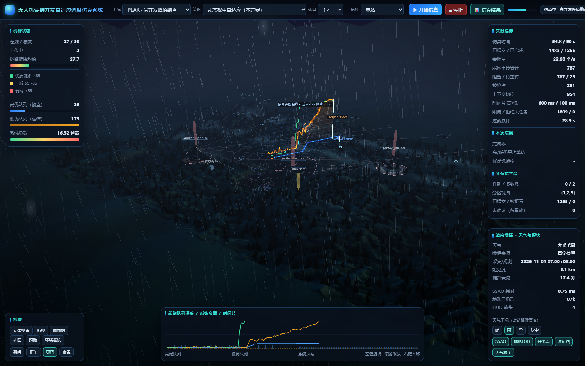
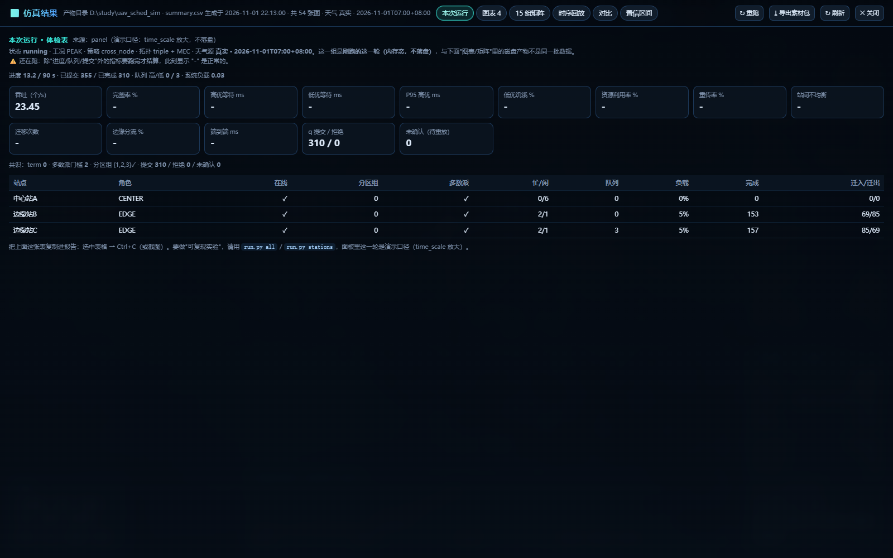

# 12 · 真实环境数据接入（天气线）

> 一句话：真实数据走 **采集 → 录制 → 回放**，仿真只读快照；默认配置仍然
> 完全离线合成，15 组矩阵与单站 SHA-256 基线不受影响。

---

## 1. 本轮范围

本轮只做透**真实气象 → 链路衰减 → 3D / 结果界面**这一条线：

| 做 | 不做 |
|---|---|
| Open-Meteo 当前/小时实况采集 | `ping` / TCP RTT 网络链路 |
| JSON 快照录制与离线回放 | GPX / CSV 遥测 / ArduPilot `.tlog` |
| 天气 → `intensity / visibility_km / link_penalty` 映射 | CPU/内存动态限流 |
| 缺文件/断网/坏 JSON 的优雅降级 | 更大 DEM / 自动换矿区 |
| 3D 与「仿真结果」的数据来源徽章 | GPU 分析模型的天气移植 |

### 1.1 为什么先做天气

天气是唯一同时满足“无硬件依赖、可立即验证、直接进入既有链路模型”的数据线：

```text
真实气象快照
  -> WeatherModel（整轮常量）
  -> LinkMonitor.health_at()
  -> 动态权重 / 重传概率 / 服务时长
  -> 3D 粒子与雾 + /api/state.weather
```

它不需要目标 IP，不需要 API key，也不依赖真实无人机。

### 1.2 时间尺度边界

仿真只有 30 / 60 / 90 仿真秒；Open-Meteo `current` 是 15 分钟级、`hourly` 是
1 小时级。本轮把**一次快照当作整轮常量外部条件**，不把小时数据伪造成秒级
动态。若未来需要时间变化，另做 `hourly` 回放模式，不在本轮偷偷时间压缩。

---

## 2. 数据源与采集

### 2.1 Open-Meteo

- 端点：`https://api.open-meteo.com/v1/forecast`
- 免费、无需 key；
- 使用字段：
  - `temperature_2m`
  - `wind_speed_10m`（km/h）
  - `wind_direction_10m`（度）
  - `precipitation`（当前区间 mm）
  - `visibility`（m）
  - `weather_code`（WMO）

默认坐标取 `src/uav_sim/static/dem.json` 的中心：
`41.8455, 123.9092`，`Asia/Shanghai`。

### 2.2 采集命令

```powershell
cd <项目根>

# 当前实况
& ".\.venv\Scripts\python.exe" tools\fetch_real_env.py

# 指定历史/预报小时（截图用真实降雨场景）
& ".\.venv\Scripts\python.exe" tools\fetch_real_env.py `
  --at 2026-11-01T07:00 --force --out data\real\weather_rain.json
```

采集失败不写半截文件，返回码 2。`data/real/` 已加入 `.gitignore`，快照不随仓库提交。

### 2.3 快照格式

```json
{
  "schema_version": 1,
  "kind": "weather",
  "mapping_version": "wmo-openmeteo-v1",
  "source": "open-meteo",
  "fetched_at": "2026-11-01T22:56:59+08:00",
  "observed_at": "2026-11-01T07:00+08:00",
  "location": {
    "latitude": 41.8455,
    "longitude": 123.9092,
    "timezone": "Asia/Shanghai",
    "name": "作业区"
  },
  "raw": {
    "temperature_2m_c": 5.4,
    "wind_speed_10m_kmh": 4.8,
    "wind_direction_10m_deg": 155.0,
    "precipitation_mm": 1.0,
    "visibility_m": 5060.0,
    "weather_code": 55
  },
  "derived": {
    "preset": "rain",
    "label": "大毛毛雨",
    "intensity": 0.580753,
    "visibility_km": 5.06,
    "link_penalty": 17.35,
    "wind_speed_mps": 1.333333,
    "wind_dir_deg": 155.0,
    "weather_code": 55
  }
}
```

回放时从 `raw + mapping_version` **重新计算** `derived`，不盲信快照里的派生值。
`mapping_version` 不符、字段缺失、非有限数值或 JSON 损坏都会触发降级。

---

## 3. 映射规则

固定其它输入时，降水↑、能见度↓、风速↑ 都必须让 `link_penalty` 不降，
最终健康度 `clamp(base - penalty, 1, 100)` 不升。该单调性由
`tests/test_real_weather.py` 守护。

| 输入 | 规则 |
|---|---|
| `precipitation_mm` | `p_pen = min(30, 6*sqrt(p))`；`p_int = min(1, p/10)` |
| `visibility_m` | `vis_km = clamp(v/1000, 0.05, 12)`；`v_pen = 30*(12-vis_km)/12` |
| `wind_speed_10m_kmh` | `mps = kmh/3.6`；`w_pen = clamp((kmh-20)/8, 0, 10)` |
| `weather_code` | WMO 分类：0~3 晴/多云、45/48 雾、51~67 雨、71~86 雪、95~99 雷暴、30~35 沙尘 |
| 合成 | `intensity = max(p_int, v_int, w_int, code_int)`；`link_penalty = clamp(max(p_pen, v_pen, w_pen, code_pen), 0, 32)` |

`preset` 仍只使用现有四种，保证 3D 粒子/雾/颜色代码零改动：

| 真实天气 | 3D preset | 显示标签 |
|---|---|---|
| 晴/多云 | `clear` | WMO 中文标签 |
| 雨/雾/雷暴 | `rain` | 如“雾”“大毛毛雨” |
| 雪 | `snow` | 如“中雪” |
| 沙尘 | `dust` | 如“强沙尘” |

---

## 4. 配置与降级

`config.yaml` / `config.example.yaml` 新增：

```yaml
real:
  enable: false
  source: snapshot
  snapshot: data/real/weather_snapshot.json
  cache_ttl_s: 900
  fallback: synthetic
  weather:
    latitude: 41.8455
    longitude: 123.9092
    timezone: Asia/Shanghai
    timeout_s: 10
    name: 作业区
```

行为：

| 配置/状态 | 行为 |
|---|---|
| `enable=false` | 永远合成，不联网 |
| `source=snapshot` | 只读快照；缺失/损坏 → 合成 |
| `source=open_meteo` | 启动时抓一次；`cache_ttl_s` 内复用快照；失败 → 合成 |
| UI 点合成天气按钮 | 明确切回合成，来源徽章变回“合成” |
| `--real-weather PATH` | UI/app 临时覆盖配置，适合 exe 验收与截图 |

真实数据不可用时不会抛异常，`/api/state.weather.source` 仍为 `synthetic`，
3D 面板与结果界面显示“合成”。

---

## 5. 界面

### 5.1 3D

- 顶栏徽章：`天气 合成` / `天气 真实 · 2026-11-01T07:00+08:00`
- 「渲染增强」面板：
  - `数据来源`：合成 / 真实快照
  - `采集/观测`：`observed_at` 优先，缺失回退 `fetched_at`
- `weather` 字段追加：
  - `source`: `"synthetic"` / `"real"`
  - `fetched_at`: 采集时间或 `null`
  - `observed_at`: 天气观测时间或 `null`

### 5.2 仿真结果

- `/api/results` 顶层追加 `weather`；
- 「本次运行」页签显示“天气源 真实/合成”；
- 顶部来源行同时显示产物时间与天气来源。

实测截图：




---

## 6. 可复现性证据

### 6.1 同一快照两次回放

使用 `data/real/weather_rain.json`（真实降雨时段）：

| 项 | 实测 |
|---|---|
| 快照 SHA-256 | `642903b7447ea444b76c224ab43b6c431655edff2cf6b11b36a2516b8ba3baa7` |
| 天气曲线 SHA-256（两次相同） | `698da88d97f8a44aacd8fcaa2d8f981277e4094de74a2fe70fe87a44c07f8b0e` |
| 链路序列 SHA-256（两次相同） | `b41b8e06ecd7ee41c3246ee6c73a1afb99d8871d084e22f2d9784d718399c0ca` |
| 第 1 次整跑 submitted / done / throughput | 2440 / 2294 / 25.4889 |
| 第 2 次整跑 submitted / done / throughput | 2444 / 2301 / 25.5667 |
| throughput 相对差 | **0.31 %** |

输入层逐位一致；整跑差异来自既有真实多线程 wall-clock 抖动，按 `docs/11 §7.1`
只声明“落在抖动范围内”。参考同代码 PEAK 抖动基线为 **≤1.12 %**。

### 6.2 实时采集 vs 快照回放

用 `data/real/weather_now.json` 与同一时刻 Open-Meteo 当前实况对比：

| 项 | 实测 |
|---|---|
| 快照 SHA-256（两侧相同） | `1d1c1070375396d1448cb8d37678b85b13385475b36818a4591480c4666fb9d6` |
| 天气曲线 / 链路序列 SHA | 两侧完全相同 |
| submitted | 2445 / 2441 |
| done | 2339 / 2322 |
| throughput | 25.9889 / 25.8000 |
| throughput 相对差 | **0.73 %**（≤ PEAK 抖动 1.12 %） |

复算：

```powershell
& ".\.venv\Scripts\python.exe" tools\verify_real_env.py `
  --snapshot data\real\weather_rain.json --reps 2
& ".\.venv\Scripts\python.exe" tools\verify_real_env.py `
  --snapshot data\real\weather_now.json --reps 1 --fetch-live
```

---

## 7. 测试

新增 `tests/test_real_weather.py`，覆盖：

| 用例 | 断言 |
|---|---|
| `test_precipitation_monotonic` | 降水↑ → penalty/intensity 不降，health 不升 |
| `test_visibility_and_wind_monotonic` | 能见度↓、风速↑ → penalty 不降 |
| `test_open_meteo_payload_maps_to_snapshot` | API payload → 正确 preset/标签/派生值 |
| `test_snapshot_roundtrip_sha256` | 写盘→读回，raw/derived/SHA 一致 |
| `test_same_snapshot_link_series_sha256` | 同快照两次链路序列逐位一致 |
| `test_live_and_snapshot_derived_match` | 采集与回放派生层一致 |
| `test_missing_snapshot_falls_back` | 缺文件降级 |
| `test_malformed_snapshot_falls_back` | 坏 JSON 降级 |
| `test_network_error_falls_back` | 断网降级 |
| `test_invalid_mapping_version_falls_back` | 版本不符降级 |
| `test_real_weather_snapshot_contract` | `source/fetched_at/observed_at` 字段契约 |
| `test_real_disabled_keeps_synthetic_clear` | 默认仍是合成 clear |
| `test_http_state_exposes_real_weather` | `/api/state.weather` 真实来源字段 |

另有既有 `test_weather.py` 的天气字段断言扩展为 11 键，旧 8 键仍逐一断言；
`test_results_api.py` 增加 `/api/results.weather` 来源断言。

---

## 8. 对既有 15 组的影响

| 项 | 结论 |
|---|---|
| 默认配置 | `real.enable=false`，无网络、无新依赖 |
| `run.py all` / `weather` / `stations` / `mec` / `replicate` | 不传真实快照，继续合成路径 |
| `results/summary.csv` | 仍是表头 + 15 行 |
| `charts/01~07` | 生成逻辑不变 |
| 单站链路 SHA-256 | `ca71fdd0…c16f` 基线不变 |
| `/api/state.weather` | 旧字段保留，新增来源字段 |
| 真实模式 | 独立演示面，不与 15 组绝对值混比 |

不写“15 组数值逐位不变”；只写“确定性输入层逐位一致，整跑指标落在抖动范围内”。

---

## 9. exe 验证

```powershell
& ".\.venv\Scripts\pyinstaller.exe" 无人机集群调度仿真系统.spec --noconfirm
& "dist\无人机集群调度仿真系统.exe" --browser --port 8795 `
  --real-weather "<项目根>\data\real\weather_rain.json"
```

实测：

| 项 | 结果 |
|---|---|
| `dist\logs\ui.port` | `8795` |
| `/api/state.weather.source` | `real` |
| `/api/state.weather.fetched_at` | `2026-11-01T22:56:59+08:00` |
| `/api/state.weather.observed_at` | `2026-11-01T07:00+08:00` |
| `preset / label` | `rain / 大毛毛雨` |
| `/api/results.weather.source` | `real` |

---

## 10. 尚未做（诚实清单）

| # | 项 | 状态 |
|---|---|---|
| 1 | `ping` / TCP RTT 真实网络链路 | ⛔ 本轮未做 |
| 2 | GPX / CSV / `.tlog` 真实任务轨迹 | ⛔ 本轮未做（本机也没有样例） |
| 3 | CPU/内存动态限流 | ⛔ 本轮未做；`psutil` 仍未安装 |
| 4 | 更大区域/更高分辨率 DEM | ⛔ 本轮未做；已有真实 DEM 继续使用 |
| 5 | Open-Meteo hourly 时间序列回放 | ⛔ 本轮未做；只做单快照整轮常量 |
| 6 | 和风天气 / QWeather key 源 | ⛔ 本轮未做；Open-Meteo 免 key 已够用 |
| 7 | GPU 分析模型天气移植 | ⛔ 本轮未做；GPU 模型本来就不含天气 |
